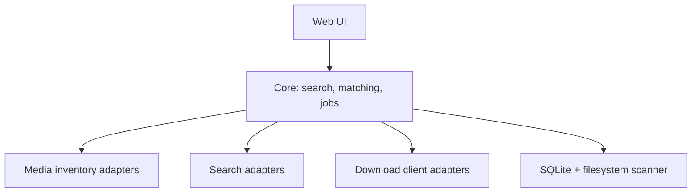

# Media Acquisition Manager — development starting document

**Version:** 0.1, 27 September 2026  
**Status:** draft technical specification; implementation has not started.  
**UI language:** to be decided during development; this document is in English.

## 1. Purpose and context

A standalone self-hosted service for a user who **chooses releases manually**. It shows existing library items alongside releases available from connected sources, lets the user send a selected release to a download client with the right destination, detects duplicates, and, when explicitly requested, carefully replaces an old file after verifying the new one.

Vasyl's initial setup involves Jellyfin, Toloka search, qBittorrent categories, custom collection/trilogy folders, and torrents that must continue seeding. **Architectural requirement:** these three products are merely the first adapters. The core must have no hard dependency on their APIs and must not assume that one torrent contains one movie. The service must work without reorganizing folders such as `Collection/Trilogy`.

### User value

1. Search for a movie and see existing copies and releases from all enabled sources on the same page, even when the movie is already in the library.
2. Compare verified properties of an existing copy with the release's **claimed** properties; the service does not decide what is “better” for the user.
3. Select a release, client, and destination in one workflow; schedule replacement of a **specific** old file or keep both.
4. Find byte-identical files, other versions of the same movie, and possible matches. Never silently delete anything.

## 2. First-version scope and default decisions

| Question | Working decision | Status |
| --- | --- | --- |
| Primary media type | Movies; the model should allow TV shows later | MVP proposal |
| Initial integrations | Jellyfin, Torznab through Jackett or a compatible gateway, qBittorrent | Proposal; verify Toloka with a live connection |
| Toloka | Connect it as a Torznab indexer through Jackett if that works; build a direct adapter only if there is a demonstrated need | Login and search functionality are unverified |
| Other servers/clients | Contracts for Plex/Emby, Transmission/SABnzbd, and others; implement after the first vertical slice | Extension |
| Search | Manual search that queries the existing library and enabled sources concurrently | Requirement |
| Destination | `DownloadDestination` in the core; map it to an existing qBittorrent category/path | Requirement |
| Removal | Only for an explicitly selected old file after verification of the new file; quarantine/reversal where possible | Requirement |
| File layout | Existing names and nested folders remain usable; no mandatory renaming | Requirement |
| Deployment | Docker Compose, SQLite for service state, local UI | Initial proposal |

**Approach:** implement one complete end-to-end workflow with one adapter of each type and stable contracts, then add more adapters. This gives the interfaces broad applicability without implementing every supported product at once.

**Search-source alternatives:** direct Torznab/Newznab; Prowlarr API; Jackett; a site-specific adapter. Using Jackett in the first slice is a practical hypothesis because its documentation lists Toloka and Torznab support. The core must not depend on Jackett.

## 3. Functional requirements

### 3.1 Search and matching

- Search by title, year, IMDb/TMDb ID, or identifier URL if a parser for that URL has been implemented.
- Local results: title, year, identifiers and their sources, location, size, video and audio tracks, subtitles, duration, resolution, codecs, bitrate, and HDR **only when those fields are actually available**. Show “unknown” rather than guessing.
- Source results: release title, indexer, size, format/quality/languages, seeder count when available, source-page link, and a way to retrieve a `.torrent`, magnet, or NZB. Quality inferred from a title is marked as claimed, not verified by inspecting the file.
- Show every matching release even when the movie is already present; allow filtering by source, language, size, and quality. A failure in one source does not hide results from other sources.
- Matching priority: reliable identifier first; then original/localized title plus year; then a candidate requiring manual review. A title or year match alone never authorizes replacement.
- Preserve the provenance of every identifier and title. Conflicting IDs or different editions/versions prevent automatic matching for removal.

### 3.2 “Download” action

1. The user chooses a **specific** release.
2. The UI shows clients compatible with its payload type and available destinations; the initial destination is configurable and can be changed before submission.
3. If the movie already exists, the UI offers `Keep existing` (default) or `Schedule replacement` with a choice of one or more **listed** files. Save that choice as explicit consent for this job.
4. Before submission, show a summary: source, release title, client, destination, selected old paths, and replacement conditions.
5. Create a job, send the release to the client once, and save a stable client-side job identifier after confirmation. Repeated clicks and retries must not create duplicate downloads.
6. If the client or source does not immediately return a reliable ID, correlate cautiously using the info hash/NZB ID and the client's job list; require manual linking if ambiguous.

**Destinations:** logical choices such as `Movies` and `Movies 4K` map to a specific client's configuration. For qBittorrent, check that the selected category exists and has the expected path. The UI must not override the category with a conflicting `savePath`. If the destination path cannot be determined, disable automatic replacement.

### 3.3 Duplicate detection

| Class | Evidence | UI behavior |
| --- | --- | --- |
| Same file / hardlink | Same device and inode in one filesystem namespace | Show links to the same data; **do not** count the occupied space twice |
| Byte-identical duplicate | Full cryptographic hash of both files | Show an exact match; estimate recoverable space with hardlinks/snapshots in mind |
| Another copy of the same work | Reliably matching TMDb/IMDb ID, different files | Show multiple versions; do not automatically call one redundant |
| Possible match | Title + year + duration/other clues when IDs are unavailable | Require manual confirmation; never use it for automatic removal |

Compute hashes lazily: shortlist candidates by size and metadata, then run a full hash only where useful. Key the hash cache by file identity, size, and modification time; invalidate it if any changes. Show `theatrical`, `director's cut`, `extended`, SDR/HDR, and similar labels as potential distinctions; do not treat different cuts as junk. The MVP report must not offer bulk automatic deletion.

### 3.4 Safe replacement

`Scheduled → Submitted → Downloading → Downloaded → Inspecting → Verified → Quarantined/Removed → Completed`

Additional states: `NeedsReview`, `Paused`, `Failed`, `Cancelled`. Persist transitions in SQLite so jobs survive restarts. Each step must be idempotent. Polling the client is sufficient for the MVP; webhooks, where available, can be added later.

Before removing any old file, verify **all** of the following:

1. The client job has completed without errors and the required file(s) are marked complete. For a multifile torrent, “torrent 100%” does not establish which file replaces the old one.
2. The specific new file is inside an allowed directory, is a regular completed media file of nonzero size, and `ffprobe` can open it and reports expected video/duration. This checks readability and stream composition, not every frame.
3. The new file is matched to **the same work and intended edition** using reliable metadata or manual confirmation. A Jellyfin ID can itself be wrong; conflicts or ambiguity lead to `NeedsReview`.
4. The media server can access the new file, and a scan reveals the **new path/version**, rather than merely the old movie card. If Jellyfin groups versions into one item, compare its media sources/paths instead of requiring a new item ID.
5. Immediately before touching the old file, recheck its canonical path, filesystem identity, size/modification time, and current match. Do not remove it if it changed, has the same path as the new file, lies outside an allowed root, or is not the file the user selected.
6. If the old file belongs to an active torrent, is still seeding, or shares its data through a hardlink, **do not modify the torrent or its seeding data**. Keep “remove a media-library copy” separate from “delete a client's files.” When uncertain, use `NeedsReview`.

For the MVP, **move the selected media-library copy into quarantine** instead of irreversibly deleting it, but only if the quarantine directory is on the same filesystem and the move is atomic. Otherwise, offer manual confirmation of deletion after the checks. Implement automatic quarantine cleanup separately, after defining retention and disk-space policies. Moving a hardlinked media copy leaves seeding data in place, but **does not** reclaim its file size until the last hardlink is gone; verify the actual mount paths.

Do not indiscriminately call Jellyfin's `DELETE /Items/{id}`: one item may represent multiple versions, and API permissions and semantics depend on the version. Removal must target a specific file inside authorized storage and be recorded in an audit trail. Never remove the old file because a timer expired or the download reached 100%.

## 4. Architecture and data model

Application-level contracts (interfaces/ports) with explicit capabilities:

| Contract | Responsibility | First implementation |
| --- | --- | --- |
| `IMediaLibraryProvider` | List works, IDs, versions, and physical paths; request a scan; optional version capabilities | Jellyfin |
| `IReleaseSearchProvider` | Search and normalize results; retrieve a payload separately for client submission | Torznab (Jackett) |
| `IDownloadClient` | Supported payload types, destination validation, submission, status, file list/status, job correlation | qBittorrent |
| `IFileInventory` | Scan only allowed roots; file identity, size/hash, ffprobe, quarantine | Local/container mount |
| `IMetadataResolver` | Authoritative IDs/titles and matching without silent guesses | Media-server data; external service if needed |

**Entity boundaries:** `MediaWork` (a movie or episode as a work), `MediaVersion` (edition/quality), `PhysicalFile` (file or filesystem link), `Release` (source listing), `DownloadJob` (client operation), `ReplacementJob` (intent concerning specific old files), `DestinationMapping`, `AuditEvent`. Do not assume `MediaWork == Jellyfin ItemId`, `Release == one file`, or `PhysicalFile == one physical copy of the bytes`.

Minimum `ReplacementJob` fields: internal ID, source/release reference or snapshot, payload type, client/destination IDs, client job ID/info hash, expected media work/edition, selected old files and their identities at selection time, explicit replacement-consent flag, new-file verification evidence, current state, error, timestamps, and audit trail. Never put tracker cookies or keys in plaintext logs or a URL exposed to the browser.

**Path mapping:** Jellyfin, qBittorrent, and the service container may see the same data at different paths. Explicit mount mappings are needed for correlation; ambiguous mappings block replacement. Prefer identical in-container mount paths across services. Scan only explicitly authorized roots; do not follow arbitrary symlinks outside them or trust paths returned by an indexer.

**Security:** authenticate the UI, keep client API access on a private network, supply secrets through environment variables/secret mounts, protect state-changing actions against CSRF, and grant minimal filesystem permissions. Read-only search needs read access, whereas managed replacement requires separately configured write access limited to authorized roots. Submitting a magnet or URL must not let an indexer trigger arbitrary backend HTTP requests to internal addresses; allowlist providers and validate destinations after redirects.

## 5. User interface

**Search:** query field plus `In your library` and `Available releases` sections. Library results show separate physical versions, not just a work title. Each release offers `Details`, `Open source`, and `Download`. Mark unknown quality properties as unknown. Comparison shows verified facts about the existing file beside the release's claimed properties.

**Download dialog:** release → client → logical destination → `Keep both` or a list of specific old copies to replace → final submission confirmation. If the match is not reliable, scheduling removal is disabled; downloading without replacement remains possible.

**Library:** search existing works, versions, and paths; indicate missing IDs. Allow manual linking once that workflow is implemented.

**Duplicates:** filters for `byte-identical`, `same work / other versions`, and `possible`; show the evidence behind each grouping. Display a numeric “potentially recoverable space” estimate only when the storage relationship is known well enough to calculate it.

**Jobs:** queue with current state, verification progress, and reason for any block; cancellation of pending removal, retrying verification, and manual resolution of ambiguity. Cancelling a job does not automatically delete its torrent from the client.

## 6. Implementation phases and acceptance criteria

### Phase A — vertical slice without deletion

- Docker Compose, configuration, and health checks; local UI and SQLite migrations.
- Jellyfin inventory with pagination, IDs, files/versions, and state snapshots; ffprobe for local files.
- One Torznab provider with per-indexer configuration; test Toloka through Jackett using a real query.
- One qBittorrent adapter: connection test, category listing, magnet/.torrent submission, job/file monitoring; separate destination mapping.
- Search displays an existing copy beside releases; one click submits one job; existing files remain untouched in this phase.

**Acceptance:** a movie in a `Collection` folder can be found without moving it; Toloka/another indexer appears when its integration actually works; if Toloka fails, the UI displays an explicit source-specific error; retrying the same command does not create duplicate jobs; the category determines the expected destination without an overriding path.

### Phase B — scanner and duplicates

- Scan only configured roots; account for hardlinks, verify metadata, and hash lazily.
- Separate exact byte duplicates, other versions of the same work, and possible matches.

**Acceptance:** two hardlink names do not inflate occupied space; movies with similar names or years are not merged incorrectly; different cuts are not deleted; conflicting IDs require manual review.

### Phase C — safe replacement

- Persisted state machine, audit trail, restart recovery, checks in §3.4, quarantine where feasible.
- The user selects a specific old file and clearly sees `Keep both` or `Replace after verification`.

**Acceptance:** process restart, failed download, unknown new path, multifile torrent, failed ffprobe, wrong ID, unavailable Jellyfin, changed old file, active seeding, and invalid mount mapping **never cause silent deletion**. A successful unambiguous replacement leaves an audit trail and a way to restore the quarantined copy.

### Phase D — practical extensibility

- Add **one** second search or client adapter with different capabilities (for example, Newznab/SABnzbd or Transmission) without changing the core state machine; add Plex/Emby later if needed.
- Verify that logical destinations, error handling, and UI do not depend on qBittorrent-specific fields.

## 7. Open questions before coding

These are not assumptions about the current setup. Resolve the answers at the start of the next session:

1. What are the OS/filesystem and exact read/write mount paths for the service, Jellyfin, and client? Which directories are managed by active torrents? Can quarantine moves be atomic within one filesystem?
2. What qBittorrent categories and save paths already exist? Is automatic torrent management enabled? Are incomplete downloads stored separately?
3. Does the MVP need TV shows, seasons, anime, or documentaries, or are movies sufficient?
4. What quarantine mode and retention period should be used? Is additional manual approval required before final deletion?
5. Which indexing route actually works with the Toloka account? Is an additional Jackett or Prowlarr container acceptable?
6. Are the old files to be replaced original seeding files, hardlinks, or independent copies?
7. How will the service be exposed: only through LAN/VPN or through a reverse proxy? How will users authenticate?

## 8. Starting prompt for the next Codex session

> I am building a self-hosted Media Acquisition Manager. Read the attached `Media_Acquisition_Manager_Spec.md` in full and treat it as the initial technical specification. First inspect my existing repository if I provide one, and resolve the §7 questions necessary for Phase A. Make concise architectural decisions and implement Phase A as a vertical slice in my repository, or create a project if there is no repository. Do not enable any file deletion until Phase C has been implemented and verified. Distinguish integrations actually tested against live systems from unverified hypotheses. Preserve manual release selection and keep the core independent of Jellyfin, Toloka, and qBittorrent.

## 9. Implementation documentation

- [Jellyfin: Movies, including multiple versions](https://jellyfin.org/docs/general/server/media/movies/)
- [Jellyfin: Metadata provider identifiers](https://jellyfin.org/docs/general/server/metadata/identifiers/)
- [Jellyfin: OpenAPI](https://api.jellyfin.org/)
- [Jackett: API / Torznab](https://github.com/Jackett/Jackett/wiki/Jackett-API) and [supported trackers](https://github.com/Jackett/Jackett)
- [qBittorrent: WebUI API](https://github.com/qbittorrent/qBittorrent/wiki/WebUI-API-%28qBittorrent-4.1%29) — check the installed client's version before using specific endpoints.
- [FFmpeg: ffprobe](https://ffmpeg.org/ffprobe.html)

**Accuracy note:** this document records requirements agreed in the conversation and a proposed design. Toloka appearing in Jackett's supported-tracker list does not establish that login and search work in this specific installation. Phase A must verify that in practice.
