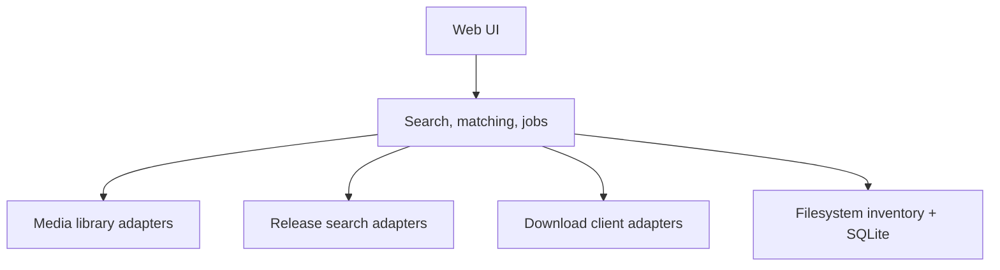

# Media Acquisition Manager

**Status: Phase A in progress — not usable yet.** Version 0.1.0 is being built. Today the app is a
scaffold: an API and a web shell that report their own health. Search, downloads and every
integration are still to come; see [ROADMAP.md](ROADMAP.md).

Media Acquisition Manager is a self-hosted application for people who prefer to choose media
releases themselves. It brings your existing library and available releases into one search view,
sends a selected release to a configured download client, and helps identify duplicates. When you
explicitly request a replacement, it waits until the new file has been downloaded and verified
before touching the selected old copy.

The initial workflow targets Jellyfin, Toloka through a Torznab-compatible indexer gateway, and
qBittorrent. These are intended to be the first integrations, not permanent limits on the
application.

> **Security:** there is no sign-in yet — accounts arrive with MAM-4. Until then, anyone who can
> reach the port can use the app: run it on your own machine only and don't expose it to a network.
> The Docker Compose file publishes the port on `127.0.0.1` for that reason. See
> [Security](#security).

## Stack

| Layer | Choice |
| --- | --- |
| API | ASP.NET Core on .NET 10, controllers |
| Data | EF Core + SQLite in WAL mode; migrations applied on startup |
| Tests | xunit.v3, Moq, `WebApplicationFactory` over real HTTP with a throwaway SQLite database |
| Web app | React 19, React Router 7, TanStack Query 5, axios, Radix Dialog, lucide-react, react-i18next |
| Build | Vite + React Compiler, strict TypeScript, ESLint, Vitest + Testing Library |
| Styling | CSS tokens and semantic classes, no CSS framework |
| Ship | One Docker image (API + web app) for amd64 and arm64, built and pushed to Docker Hub by Jenkins |

## Features

### Available now

- **Service status.** The web app shows its version and whether the service is ready; when it is
  not, it names the check that failed.
- **Health endpoints** for uptime monitors: liveness and readiness. See
  [Health endpoints](#health-endpoints).
- **Zero-config start.** On first run the API creates its SQLite database, applies the migrations
  and generates its own secrets. See [Configuration](#configuration).
- **One Docker container.** `docker compose up -d` runs the published image with nothing to
  configure; the container reports healthy only when the database is ready. See
  [Quick start](#quick-start-docker-compose) and [Deployment](#deployment).

### What it will do

- **Search your library and release sources together.** Keep showing available releases even when
  the title is already in your library.
- **Show meaningful comparisons.** Display verified properties of files you own alongside the
  *claimed* properties of releases, including resolution, video and audio formats, languages, size,
  and HDR when known. The user decides whether a release is an upgrade.
- **Send downloads to the right destination.** Select a compatible client and a logical destination
  such as `Movies` or `Movies 4K`; an adapter maps that destination to a qBittorrent category or
  another client's equivalent.
- **Detect duplicates without conflating different editions.** Distinguish hardlinks,
  byte-identical files, different versions of the same title, and uncertain matches.
- **Replace a selected copy safely.** Offer `Keep both` by default. If replacement is chosen, verify
  the specific new file, its identity, and its visibility to the media server before moving the
  specific old copy into quarantine where possible.
- **Respect existing libraries and seeding.** Work with nested collection/trilogy folders and
  multifile torrents without requiring a library-wide rename or interrupting active torrents.

The application should remain usable when a search provider fails, an item has incomplete metadata,
or a replacement needs manual review. It must never silently delete a file because a download
reached 100%.

### Replacement rules

These rules apply to any future implementation:

- An existing file is never selected for removal solely by a fuzzy title match.
- The user must choose the specific old copy to replace. Keeping both is the default.
- Client completion, file existence, media inspection, identity matching, and media-server
  visibility are separate checks.
- A multifile release requires mapping the new *file*, not just its download job, to the old file.
- Recheck the old file's path and filesystem identity immediately before touching it.
- Never modify files needed by an active torrent or assume that deleting a hardlink recovers its
  apparent size.
- Ambiguity, failed checks, or uncertain container path mappings stop the replacement and request
  review.
- Record every state transition and make recovery after a process restart safe.

## Quick start (Docker Compose)

You need Docker with Compose 2.24 or newer. Put [docker-compose.yml](docker-compose.yml), and
[deploy.sh](deploy.sh) for later updates, in an empty directory and start the app there:

```bash
docker compose up -d
```

Open <http://localhost:8118>. With no configuration at all, the app creates its database and
generates its secrets on the first start, on the `mam-data` volume. To change the image tag, the
port or who can reach the app, copy [.env.example](.env.example) to `.env` next to the compose file
and set only what you need; see [Deployment](#deployment).

To build the image from a checkout of this repository instead of pulling it:

```bash
docker compose -f docker-compose.build.yml up -d --build
```

## Planned architecture



The core works with media works, versions, physical files, releases, and persisted jobs. Adapter
contracts keep it independent of any one media server, indexer, or download client. None of the
adapters exists yet; the solution already has the layers they will live in (see
[Project structure](#project-structure)).

| Integration type | First candidate | Planned extension examples |
| --- | --- | --- |
| Media library | Jellyfin | Plex, Emby |
| Release search | Torznab via Jackett or a compatible gateway | Other Torznab/Newznab providers, direct adapters |
| Download client | qBittorrent | Transmission, SABnzbd, others |
| File inspection | Configured media roots and `ffprobe` | Additional inventory backends if needed |

Toloka appears in Jackett's supported-tracker list, but login and search must be verified against a
real installation during the first implementation phase. A direct Toloka adapter is an option if a
gateway proves unsuitable.

## Security

- **No sign-in yet.** Accounts (an installation owner, other users, owner-only settings) arrive with
  MAM-4 and personal access tokens with MAM-5. Until then keep the API bound to `localhost`; the
  Docker Compose file publishes the port on `127.0.0.1` unless `APP_BIND_ADDRESS` says otherwise.
- **The container runs unprivileged.** The app runs as user `mam` (uid 10001), its own files belong
  to root and are read-only to it, and the only persistent place it can write is `/data` (besides
  the usual scratch space in `/tmp`). The media mounts in the compose file's examples are read-only.
- **Security headers on every response:** `X-Content-Type-Options: nosniff`,
  `X-Frame-Options: DENY`, `Referrer-Policy: no-referrer`, and a Content Security Policy that
  forbids inline scripts. The only inline script, which applies dark mode before the first paint
  (`frontend/index.html`), is allowed by its SHA-256 hash, pinned in
  `SecurityHeadersMiddleware.ThemeScriptHash`. Change one byte of that script and
  `SecurityHeadersHttpTests` fails until the hash is updated.
- **Secrets never live in the repository.** Committed `appsettings*.json` files hold `null` for
  every secret; real values come from environment variables, .NET User Secrets or first-run
  generation. See [Configuration](#configuration).
- **Errors never leak internals.** An unhandled exception answers 500 with a trace id to quote,
  never the exception text.

## Deployment

The image is `vahac/media-acquisition-manager` on Docker Hub, for `linux/amd64` and `linux/arm64`:

| Tag | What it is |
| --- | --- |
| `latest` | The newest build of `main`, released or not. |
| `X.Y.Z`, e.g. `0.1.0` | A release. It never changes once published. |
| `X.Y`, e.g. `0.1` | The newest release of that minor version. |
| `sha-<commit>` | One exact build of `main`, by its short commit hash. |

How the image is built and released is in [PUBLISHING.md](PUBLISHING.md).

**Compose settings.** Set them in `.env` next to `docker-compose.yml`; [.env.example](.env.example)
explains each one. Every other variable in `.env` is passed to the app (see
[Configuration](#configuration)).

| Variable | Default | What it does |
| --- | --- | --- |
| `APP_TAG` | `latest` | The image tag to run. Pin a release to update only when you choose to. |
| `APP_BIND_ADDRESS` | `127.0.0.1` | The host address the port is published on. `0.0.0.0` opens the app to your network — without sign-in until MAM-4. |
| `APP_PORT` | `8118` | The host port. The app listens on 8118 inside the container too. |

**Updating.** Keep [deploy.sh](deploy.sh) next to `docker-compose.yml` and run it from that
directory:

```bash
bash deploy.sh
```

It pulls the image `APP_TAG` names, recreates the container and waits until it reports healthy; if
it doesn't, it prints the recent health probes and the container log. The app migrates its database
on startup, so there is no separate migration step.

**Health.** The image's health check probes `GET /api/health/ready` every 30 seconds (every 2
seconds during the first 150 seconds after a start), so `docker ps` shows `healthy` only when the app
answers and its database is open and fully migrated. When it isn't,
`docker inspect media-acquisition-manager` shows the failing check's reason under `State.Health`.

**Data and backups.** Everything the installation keeps is in `/data` inside the container, on the
`mam-data` volume: `mam.db` and the generated secrets in `.secrets/`. Back them up together, with the
container stopped:

```bash
docker compose stop app
docker run --rm --volumes-from media-acquisition-manager -v "$PWD:/backup" alpine tar czf /backup/mam-data.tgz -C /data .
docker compose start app
```

To keep the data in a host directory instead of the volume, replace `mam-data:/data` with that
directory, and create it for the container's user and for that user alone first, as the image does
with `/data` (the database files inside are otherwise readable by every user on the host):

```bash
sudo install -d -o 10001 -g 10001 -m 700 <directory>
```

**Media folders.** Mount them read-only (`:ro`) — nothing in Phase A writes to the library — at the
same paths Jellyfin and qBittorrent see them at, so a path means the same file in all three. The
compose file has commented examples. The container's user (uid 10001) needs read access: files
readable by everyone (the usual 644 and 755) need nothing more; otherwise add the group that owns
them to the service with `group_add`.

## Local development

To work on the app, run it from source; to just run it, see
[Quick start](#quick-start-docker-compose).

**Prerequisites:** the [.NET 10 SDK](https://dotnet.microsoft.com/download/dotnet/10.0) and
[Node.js 24](https://nodejs.org/) with npm. The `dotnet-ef` tool is needed only to add migrations
(see [Database migrations](#database-migrations)).

Run the API and the Vite dev server in two terminals, from the repository root:

```bash
dotnet run --project src/MediaAcquisitionManager.Api
```

```bash
cd frontend
npm ci
npm run dev
```

Open <http://localhost:5173>. Vite serves the web app with hot reload and proxies `/api` to the API
on <http://localhost:5080>. On first start the API creates `src/MediaAcquisitionManager.Api/Data/`
with the SQLite database `mam.db` and the generated secrets in `.secrets/`; both are git-ignored.

### Serving the built web app from the API

This is how the Docker image serves it: one process, one port. Build the frontend, then point
the API's web root at `frontend/dist`. Pass an absolute path, because a relative one resolves
against the API project directory rather than your shell's. From the repository root (bash or
PowerShell):

```bash
cd frontend
npm ci
npm run build
cd ..
dotnet run --project src/MediaAcquisitionManager.Api -- --webroot "$PWD/frontend/dist"
```

Open <http://localhost:5080>.

## Configuration

The API reads `appsettings.json`, .NET User Secrets (in the Development environment), environment
variables with the `MAM_` prefix, and command-line arguments. In a variable name a double
underscore separates sections: `MAM_Storage__DataDirectory` sets `Storage:DataDirectory`.
[.env.example](.env.example) lists every variable with its trade-offs.

| Variable | Default | What it does |
| --- | --- | --- |
| `MAM_Storage__DataDirectory` | `Data` (`/data` in the Docker image) | Directory for the SQLite database `mam.db` and the `.secrets/` directory. A relative path resolves against the API's content root. The Docker Compose file pins it to `/data`, the volume. |
| `MAM_Encryption__Key` | generated on first run | Base64 of 32 random bytes. Will encrypt stored integration credentials (AES-256-GCM) from MAM-7 on; nothing uses it yet. |
| `MAM_Jwt__Secret` | generated on first run | Base64 of 64 random bytes. Will sign sign-in tokens from MAM-4 on; nothing uses it yet. |

The standard ASP.NET Core variables apply as usual (`ASPNETCORE_URLS`, `ASPNETCORE_ENVIRONMENT`).

**First-run secrets.** When `Encryption:Key` or `Jwt:Secret` is blank, the API reads it from
`<data>/.secrets/encryption-key` or `<data>/.secrets/jwt-secret`, or generates it there on the first
start (directory 0700 and files 0600 on Linux and macOS). A value you set explicitly always wins,
and then no file is written. An existing file is never overwritten, and an empty one stops the
startup with a message that says what to do: silently generating a new key would orphan everything
encrypted with the old one. Back up `.secrets/` together with `mam.db`.

**User Secrets (development).** A fresh checkout needs none: first-run generation covers it. To pin
a value in development without committing it, the Api project has a `UserSecretsId`:

```bash
dotnet user-secrets set "Jwt:Secret" "<base64 value>" --project src/MediaAcquisitionManager.Api
```

## API surface

| Request | Answer |
| --- | --- |
| `GET /api/health` | Liveness: 200 while the process is up. Runs no checks. |
| `GET /api/health/ready` | Readiness: 200 when the service is ready, 503 when a check fails. |
| Any other `/api/...` path, any method | 404 with `{ "error": "No API endpoint matches <METHOD> <path>." }` |
| Everything else | The web app's `index.html`, so client-side routes survive a reload |

Apart from the health endpoints, which answer with their own report (see
[Health endpoints](#health-endpoints)), every failure that carries a message answers
`{ "error": "<readable sentence>" }`. An unknown API path answers 404 JSON instead of the web app's
page, so a mistyped API call can't look like a success.

### Health endpoints

Both endpoints are anonymous and answer `application/json`. Liveness always has an empty check
list:

```json
{ "status": "Healthy", "checks": [] }
```

Readiness checks the database: it must open and have every migration applied. `status` is
`Healthy`, `Degraded` or `Unhealthy`, and a failing check says why in a readable sentence:

```json
{
  "status": "Unhealthy",
  "checks": [
    { "name": "database", "status": "Unhealthy", "description": "The database has 1 pending migration." }
  ]
}
```

## Translations

The web app is in English, and every text it shows comes from
`frontend/src/locales/en/<feature>.json` through react-i18next — never from a component
([ADR 0001](docs/adr/0001-every-ui-string-comes-from-a-locale-resource.md)). New text gets a key in
the feature's file and is rendered with `t()`; `npm run lint` refuses literal text in markup, and
`npm run build` fails on a key that doesn't exist. Show dates, numbers and file sizes with the
helpers in `frontend/src/lib/format.ts`, which follow the UI locale.

To add a language, copy `frontend/src/locales/en/` to a folder named after its language code,
translate the values (keep the keys and the `{{placeholders}}`), and add it to `resources` in
`frontend/src/lib/i18n.ts`. Browsers that prefer that language then get it; anything not yet
translated falls back to English. Messages from the API stay in English.

## Tests

The whole .NET suite:

```bash
bash run-tests.sh
```

It builds the solution in Release and runs the test projects as parallel `dotnet test` shards; each
shard writes TRX and JUnit reports to its project's `TestResults/` directory. `CONFIG=Debug`,
`SHARDS=<n>` and `NO_BUILD=1` override the defaults. A plain run works too:

```bash
dotnet test MediaAcquisitionManager.slnx
```

API tests go over real HTTP through `WebApplicationFactory`, each test class against its own
throwaway SQLite database, so they never touch your `Data/` directory. Tests tagged
`Category=RequiresDocker` are excluded by default; there are none yet.

The frontend checks, in `frontend/` (`npm run build` also type-checks with `tsc -b`):

```bash
npm run lint
npm run build
npm run test
```

## Project structure

```text
MediaAcquisitionManager.slnx
run-tests.sh                                   sharded .NET test runner
Dockerfile                                     the image: API + built web app + ffprobe
docker-compose.yml                             runs the published image
docker-compose.build.yml                       builds the image from the checkout (:local)
deploy.sh                                      pulls, recreates and waits for healthy
Jenkinsfile                                    tests every build of main, pushes to Docker Hub
src/
  MediaAcquisitionManager.Api/                 ASP.NET Core host: Program.cs, health checks,
                                               security headers, EF Core migrations
  MediaAcquisitionManager.Core/                options and pure logic; no package references
  MediaAcquisitionManager.Infrastructure/      DbContext, SQLite pragmas, first-run secrets
tests/
  MediaAcquisitionManager.TestInfrastructure/  test harness: API factory, test databases, clock
  MediaAcquisitionManager.Api.Tests/           endpoint tests over real HTTP
  MediaAcquisitionManager.Core.Tests/
  MediaAcquisitionManager.Infrastructure.Tests/
frontend/                                      React web app (Vite, TypeScript, React Compiler)
  src/locales/                                 UI text, one folder per language, one file per feature
  src/release-notes/                           user-facing What's new, one file per version
docs/
  Media_Acquisition_Manager_Spec.md            development specification
  adr/                                         architecture decision records
```

Dependencies point one way: Api → Infrastructure → Core.

## Database migrations

Migrations live in the Api project and are applied automatically when the API starts. To add one
(install the tool once with `dotnet tool install --global dotnet-ef`):

```bash
dotnet ef migrations add <Name> --project src/MediaAcquisitionManager.Api --startup-project src/MediaAcquisitionManager.Api
```

`dotnet ef` creates the database context through a design-time factory and never creates the data
directory or writes `.secrets/`: when the tools do run the app's startup (a `--context` that names
no known context), the startup skips both.

## Planned features

Work is planned in four phases. [ROADMAP.md](ROADMAP.md) has the scope, tests and acceptance bar
of each, and the tickets of Phase A (MAM-1 to MAM-15).

1. **Phase A: a vertical slice with no removal (release 0.1.0).** Build configuration, a local UI,
   Jellyfin inventory, one Torznab search adapter, qBittorrent submission and status tracking, and
   persisted jobs. Search and download must work while leaving existing files untouched.
2. **Phase B: inventory and duplicate detection.** Scan only authorized paths, account for
   hardlinks, inspect media, and hash candidate files when useful. Label exact, same-work, and
   possible matches separately.
3. **Phase C: safe replacement.** Implement the persisted replacement state machine, explicit file
   selection, checks, audit log, and quarantine where a safe atomic move is possible.
4. **Phase D: prove extensibility.** Add one more search or download adapter with different
   capabilities without rewriting the core replacement workflow. Add other media servers when
   needed.

## Project documentation

- [Development specification](docs/Media_Acquisition_Manager_Spec.md) — requirements, the data
  model, acceptance criteria for each phase, and the open questions (§7) that Phase A answers
  against the real installation before configuring live integrations.
- [Roadmap](ROADMAP.md) and [Changelog](CHANGELOG.md).
- [Publishing](PUBLISHING.md) — the Jenkins pipeline, the image tags and how to cut a release.
- [Release notes](frontend/src/release-notes/0.1.0.md) — the user-facing What's new, one file per
  version.
- Architecture decision records live in `docs/adr/`; new ones start from the
  [template](docs/adr/0000-template.md).
- [Environment variables](.env.example) with their trade-offs.

Integration references:

- [Jellyfin movie organization and multiple versions](https://jellyfin.org/docs/general/server/media/movies/)
- [Jellyfin API](https://api.jellyfin.org/)
- [Jackett API and Torznab](https://github.com/Jackett/Jackett/wiki/Jackett-API)
- [qBittorrent WebUI API](https://github.com/qbittorrent/qBittorrent/wiki/WebUI-API-%28qBittorrent-4.1%29)
- [ffprobe reference](https://ffmpeg.org/ffprobe.html)

Check each integration against the installed version when implementing it.
