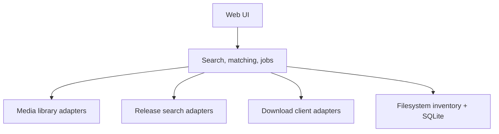

# Media Acquisition Manager

**Status: Phase A in progress — not usable yet.** Version 0.1.0 is being built. Today the app is an
API and a web shell that report their own health, with accounts, integration settings and the
library: the installation owner created on first run, the users the owner manages, and sign-in;
the owner connects Jellyfin, a Torznab source such as Prowlarr and qBittorrent, tests each
connection, and imports the Jellyfin library, which every signed-in user can browse, with what each
file really holds once the app has inspected it inside the media folders the owner allows; the owner
also maps download destinations to qBittorrent's categories. Every signed-in user searches the
library and the release sources together on the Search page and sends a release found there to
qBittorrent; following a download's progress is still to come; see [ROADMAP.md](ROADMAP.md).

Media Acquisition Manager is a self-hosted application for people who prefer to choose media
releases themselves. It brings your existing library and available releases into one search view,
sends a selected release to a configured download client, and helps identify duplicates. When you
explicitly request a replacement, it waits until the new file has been downloaded and verified
before touching the selected old copy.

The initial workflow targets Jellyfin, Toloka through a Torznab-compatible indexer gateway, and
qBittorrent. These are intended to be the first integrations, not permanent limits on the
application.

> **Security:** until the owner account exists, whoever opens the app first becomes the owner, and
> the app speaks plain HTTP. Create the owner first, then open the port only on a network you trust
> or behind a reverse proxy that adds HTTPS. The Docker Compose file publishes the port on
> `127.0.0.1` for that reason. See [Security](#security).

## Stack

| Layer | Choice |
| --- | --- |
| API | ASP.NET Core on .NET 10, controllers, JWT bearer access tokens |
| Data | EF Core + SQLite in WAL mode; migrations applied on startup |
| Tests | xunit.v3, Moq, `WebApplicationFactory` over real HTTP with a throwaway SQLite database |
| Web app | React 19, React Router 7, TanStack Query 5, zustand, axios, Radix Dialog, lucide-react, react-i18next |
| Build | Vite + React Compiler, strict TypeScript, ESLint, Vitest + Testing Library |
| Styling | CSS tokens and semantic classes, no CSS framework |
| Ship | One Docker image (API + web app) for amd64 and arm64; Jenkins tests every commit and publishes releases to Docker Hub |

## Features

### Available now

- **Accounts and sign-in.** The first visit creates the installation owner; everyone else signs in
  with the user name and password the owner gave them. A session lasts 30 days from its last use,
  and signing out, disabling a user or resetting a password takes effect at once. See
  [Security](#security).
- **User management for the owner.** The Users page (**Users** in the owner's user menu) searches
  and pages through the users on the server, adds a user, disables or enables one, resets a
  password, and deletes one after a confirmation. The owner's own account can't be disabled or
  deleted.
- **Integration settings for the owner.** The Integrations page (**Integrations** in the owner's
  user menu) searches by name, filters by kind (media library, release source, download client)
  and pages on the server; adds Jellyfin, a Torznab feed or qBittorrent, edits one, switches it off
  and removes it after a confirmation. **Test connection** checks an unsaved integration from its
  dialog, and a row's **Test** checks a saved one, each answering with a sentence that says what the
  service did. Services that report file paths take path mappings onto the app's own mounts
  ([ADR 0003](docs/adr/0003-service-paths-reach-the-app-through-an-explicit-prefix-mapping.md)).
  Credentials are stored encrypted and never shown again. Jellyfin feeds the library, and a
  switched-off one can't be synced; a Torznab feed is searched for releases, and a switched-off one
  is left alone; qBittorrent's categories are what download destinations name, and a switched-off
  one isn't asked for them or sent a release. The Jellyfin connection test refuses a Jellyfin older
  than 10.9, the oldest the app reads libraries from, and the qBittorrent one a qBittorrent older
  than 4.4.1.
- **The library.** The Library page (**Library** in the header, for every signed-in user) lists the
  movies of the owner's Jellyfin libraries as works: items that share an IMDb or TMDb id are one
  work with several versions, never merged by title and year. Each shows its titles, year and
  identifiers, a warning for a missing IMDb or TMDb id, and its versions with their files, where
  Jellyfin sees them and where the app finds them through the path mappings; what Jellyfin didn't
  report shows as unknown. The server searches by title, original title, IMDb or TMDb id, year or
  path, filters by Jellyfin library or by missing identifiers, and pages, with titles in Ukrainian
  alphabetical order. The owner imports a library with **Sync now**: a background sync reads all
  of it, in Jellyfin 10.9 or later, before it replaces anything, so a failed one changes nothing,
  and nothing in the library or in Jellyfin is moved, renamed or changed
  ([ADR 0008](docs/adr/0008-a-library-sync-replaces-its-sources-snapshot-only-after-reading-all-of-it.md)).
  Removing a Jellyfin integration removes the library it imported from the app, never the files.
- **Verified file facts.** Each file shows what it really holds, read by `ffprobe` from the file
  itself: duration, resolution, video codec and profile, dynamic range (SDR, HDR10, HLG, Dolby
  Vision), overall bit rate, and every audio track (language, codec, channels) and subtitle
  (language, codec, forced, SDH); what the file doesn't say shows as unknown, never guessed. The app
  reads only inside the media folders the owner allows on the **Media folders** page — none by
  default — resolving every link and refusing one that leads out of them. An inspection runs in the
  background after every successful sync, at each start and on **Inspect files**, two files at a
  time; a file is read again only when its identity, size or modification time changes, and two
  names of one file are read once
  ([ADR 0009](docs/adr/0009-the-app-reads-a-file-only-inside-the-allowed-roots-and-keeps-each-reading-by-the-files-identity.md)).
  The Library page shows how many files of each source were inspected, couldn't be read or wait,
  and why a file couldn't be read (the reason to the owner only).
- **Search: your library and the release sources side by side.** The Search page (**Search** in the
  header, first, for every signed-in user) looks for a movie by its title, with a year, an IMDb id
  and a TMDb id in fields of their own when you have them (owner's choice), in the library and in
  every enabled release source at once. **In your library** shows each matching movie as the
  Library page does, versions and verified file facts included, with how it matched — by IMDb or
  TMDb id, by title and year, or by title alone as a possible match to check — and a warning when
  ids conflict; every match is listed, strongest first, and nothing is picked or merged. Below the
  matches come up to 20 movies that don't match but one of whose titles or file paths holds every
  word searched for, each whole, marked as no match, with how many more there are and a link to the
  Library page searched for the same text
  ([ADR 0012](docs/adr/0012-a-search-or-a-release-matches-a-library-work-by-identifier-then-title-and-year-then-title-alone-and-every-match-is-listed.md)).
  **Available releases** lists every release found, even for a movie already in the library, with
  its source, size, seeders and peers, publish date and what its title claims — resolution, medium,
  codec, dynamic range, audio and subtitle languages — marked as claims, and the library copies it
  matches among those listed, the movies by words included, by the title and year read from its
  title and by the ids its listing gives, never by words. Each source answers for itself, so one
  that fails says why beside the others' releases. The server filters by source, audio language,
  quality and size, sorts by seeders, size, date or quality, and pages; the search is stored for a
  day, so a filter, a page or a reload never asks the sources again
  ([ADR 0011](docs/adr/0011-a-search-is-stored-once-and-every-filter-sort-and-page-reads-what-it-stored.md)).
  Each release has **Details**, its listing beside the matching copies' verified facts, **Open
  source** and **Download**, which sends it to a download client (below). The API also keeps
  MAM-10's single-answer search (`POST /api/releases/search`). Movies only; Toloka through Prowlarr
  is searched by title and year and lists no ids, so its releases match by title and year. Download
  links stay on the server
  ([ADR 0004](docs/adr/0004-toloka-is-searched-through-prowlarr-and-download-links-stay-on-the-server.md)).
- **Download destinations for the owner.** The Destinations page (**Destinations** in the owner's
  user menu) names where downloads go — `Movies`, `Movies 4K` — each one a category qBittorrent
  already has, which qBittorrent confirms before the destination is saved; the app never sends a
  folder of its own, so the category decides where a download lands. Each destination shows where
  its category saves, as qBittorrent sees it and as the app does through the path mappings, and
  whether that is inside a Jellyfin library folder; when it isn't, or when the app can't tell, it
  says why. One destination is the default, the first one added unless the owner picks another, and
  removing it leaves none until the owner picks one. Searched and paged on the server; qBittorrent
  4.4.1 or later
  ([ADR 0010](docs/adr/0010-a-destination-is-a-download-clients-own-category-never-a-folder.md)).
  Removing a qBittorrent under Integrations removes its destinations too, and its confirmation says
  so; the downloads sent to them keep their names. The Download dialog offers the default first.
- **Send downloads to the right destination.** **Download** on a release opens a dialog for every
  signed-in user (MAM-13's decision 1): a download client that can take the release, one of its
  destinations with the default picked first, and a summary of what goes where, existing copies
  kept. The server fetches the release itself and hands qBittorrent the destination's category with
  automatic torrent management — never a folder of the app's, so the category's folder is where it
  lands — once it has confirmed that qBittorrent still has the category and doesn't have the torrent
  already. One click sends at most one download: the job is written with the request id the browser
  made before anything is sent, a retry or a second click answers that job, a submission is never
  sent twice, and qBittorrent's id or the torrent's info hash confirms it, with several candidates
  left for linking by hand rather than guessed. A release already sent to that client is refused.
  Following the download's progress comes with MAM-14
  ([ADR 0013](docs/adr/0013-a-download-is-written-down-before-anything-is-sent-and-one-request-sends-it-at-most-once.md)).
- **Service status.** The web app shows its version and whether the service is ready; when it is
  not, it names the check that failed.
- **Health endpoints** for uptime monitors: liveness and readiness. See
  [Health endpoints](#health-endpoints).
- **Zero-config start.** On first run the API creates its SQLite database, applies the migrations
  and generates its own secrets. See [Configuration](#configuration).
- **One Docker container.** `docker compose up -d` runs the published image with nothing to
  configure; the container reports healthy only when the database is ready. See
  [Quick start](#quick-start-docker-compose) and [Deployment](#deployment).

### What it will do

- **Follow each download.** See a sent release's progress in the client until it is downloaded, and
  link by hand a download the app couldn't tell apart.
- **Detect duplicates without conflating different editions.** Distinguish hardlinks,
  byte-identical files, different versions of the same title, and uncertain matches.
- **Replace a selected copy safely.** Offer `Keep both` by default. If replacement is chosen, verify
  the specific new file, its identity, and its visibility to the media server before moving the
  specific old copy into quarantine where possible.
- **Respect existing libraries and seeding.** Work with nested collection/trilogy folders and
  multifile torrents without requiring a library-wide rename or interrupting active torrents.

The application should remain usable when a search provider fails, an item has incomplete metadata,
or a replacement needs manual review. It must never silently delete a file because a download
reached 100%.

### Replacement rules

These rules apply to any future implementation:

- An existing file is never selected for removal solely by a fuzzy title match.
- The user must choose the specific old copy to replace. Keeping both is the default.
- Client completion, file existence, media inspection, identity matching, and media-server
  visibility are separate checks.
- A multifile release requires mapping the new *file*, not just its download job, to the old file.
- Recheck the old file's path and filesystem identity immediately before touching it.
- Never modify files needed by an active torrent or assume that deleting a hardlink recovers its
  apparent size.
- Ambiguity, failed checks, or uncertain container path mappings stop the replacement and request
  review.
- Record every state transition and make recovery after a process restart safe.

## Quick start (Docker Compose)

You need Docker with Compose 2.24 or newer. Put [docker-compose.yml](docker-compose.yml), and
[deploy.sh](deploy.sh) for later updates, in an empty directory and start the app there:

```bash
docker compose up -d
```

Open <http://localhost:8118>. With no configuration at all, the app creates its database and
generates its secrets on the first start, on the `mam-data` volume, and the first page asks you to
create the owner account, who then adds the other users. To change the image tag, the port or who
can reach the app, copy [.env.example](.env.example) to `.env` next to the compose file and set only
what you need; see [Deployment](#deployment).

To build the image from a checkout of this repository instead of pulling it:

```bash
docker compose -f docker-compose.build.yml up -d --build
```

## Planned architecture



The core works with media works, versions, physical files, releases, and persisted jobs, and every
title, identifier, version, file and release it stores names the source that reported it
([ADR 0006](docs/adr/0006-every-title-identifier-and-file-the-core-stores-names-its-source.md)).
Adapter contracts keep it independent of any one media server, indexer, or download client. The
first three adapters exist: Jellyfin's reads the library, the Torznab adapter searches releases and
fetches a release's download, and qBittorrent's lists its categories with the folders they save to,
adds a release and finds its torrents by info hash; reading a download's progress comes with MAM-14.
The core's contracts for libraries, release search, download clients, file inventory and metadata
live in Core and name no product
([ADR 0005](docs/adr/0005-the-core-knows-a-service-only-through-a-registered-adapter-type.md)).

| Integration type | First candidate | Planned extension examples |
| --- | --- | --- |
| Media library | Jellyfin | Plex, Emby |
| Release search | Torznab via Prowlarr (Jackett should work the same way) | Other Torznab/Newznab providers, direct adapters |
| Download client | qBittorrent | Transmission, SABnzbd, others |
| File inspection | The local mounts inside the allowed roots, and `ffprobe` | Additional inventory backends if needed |

Toloka is searched through Prowlarr: it signs in to the tracker with your account, reads its search
pages, and serves the results as a standard Torznab feed, so the app needs no code specific to
Toloka. A search through Prowlarr worked against the real installation (MAM-6); Prowlarr's download
links carry its API key, so the app fetches them itself, from the feed's own address only, and never
shows them
([ADR 0004](docs/adr/0004-toloka-is-searched-through-prowlarr-and-download-links-stay-on-the-server.md)).
A direct Toloka adapter is an option if the gateway proves unsuitable.

## Security

- **Create the owner before anyone else can reach the app.** Until the owner exists, every page
  leads to the setup page, and whoever submits it first becomes the owner; after that setup answers
  409 for good. Every API endpoint but health, setup, sign-in, refresh and sign-out needs a
  signed-in user, and every page of the web app but setup and sign-in leads to sign-in without one.
  The Docker Compose file publishes the port on `127.0.0.1` unless `APP_BIND_ADDRESS` says
  otherwise. Personal access tokens for scripts arrive with MAM-5.
- **Plain HTTP only.** The app serves no TLS, so passwords and tokens cross the network as they are.
  Open it only on a network you trust, or put a reverse proxy that terminates HTTPS in front of it.
- **Passwords.** User names are 3–32 ASCII letters, digits, `.`, `-` and `_`, in any letter case;
  passwords are 8–128 characters with no composition rules, and there is no email reset and no
  second factor. Passwords are stored as PBKDF2-HMAC-SHA256 with 600 000 iterations and a 16-byte
  random salt, never in a form that can be read back.
- **Short-lived access tokens and a refresh cookie.** Sign-in returns a 15-minute access token
  (HS256, signed with `Jwt:Secret`) that the web app keeps in memory only, and a refresh token in
  the `mam_refresh` cookie: `HttpOnly`, `SameSite=Strict`, `Path=/api/auth`, and `Secure` when the
  request came over HTTPS (a browser won't store a `Secure` cookie from a plain-HTTP address). A
  session ends 30 days after its last use. Every refresh rotates the cookie, and the database keeps
  only its SHA-256 hash; a replaced cookie presented again more than 30 seconds later revokes the
  session, since that is what a copied cookie looks like.
- **Every request checks its session.** A valid token is not enough: its session must still be live
  and its user enabled, so signing out, disabling or deleting a user and resetting a password take
  effect on the next request, not when the token expires. Disable and delete end every session of
  the user; a reset ends all but the one it was made from. Rotating `Jwt:Secret` signs nobody out —
  to lock someone out, disable them or reset their password
  ([ADR 0002](docs/adr/0002-every-authenticated-request-checks-its-session.md)).
- **One answer to every failed sign-in.** An unknown user, a wrong password, a disabled account and
  a blank field all get the same 401 `{ "error": "The user name or password is incorrect." }` after
  the same single password hash, so neither the answer nor its timing tells which user names exist.
- **Rate limit.** Sign-in and setup allow 10 attempts a minute per client address; more get 429
  `{ "error": "Too many attempts. Wait a minute and try again." }` with `Retry-After: 60`. Refresh
  isn't limited: its cookie holds 256 random bits.
- **Owner-only settings.** Every action of a controller under `Controllers/Settings` that changes
  something is owner-only because of where the controller lives, not because someone remembered an
  attribute; `SettingsWritesAreOwnerOnlyConventionHttpTests` pins it. The Users, Integrations and
  Destinations endpoints are owner-only for reading as well. Anyone else gets 403
  `{ "error": "Only the installation owner can do this." }`, logged as a warning.
- **The library is everyone's to read; syncing it is the owner's.** Every signed-in user reads the
  Library's works, libraries, sources and sync runs, which carry no address or key. Starting a sync
  is owner-only, as it sends the stored Jellyfin key to the server and replaces what everyone reads.
  It lives outside `Controllers/Settings`, so it declares the gate itself, and
  `LibraryWritesAreOwnerOnlyHttpTests` sends every library endpoint that isn't a GET as a non-owner
  and expects 403. A failed sync's reason can name the service's address, a path problem quotes the
  owner's path mappings, and who started a sync is the owner's sign-in name, so only the owner gets
  them; everyone else gets `null`.
- **Release search is everyone's, and each search its creator's; why a source failed is the
  owner's.** Every signed-in user may search (owner's choice), which sends the stored Torznab key to
  the owner's gateway and, through it, searches the tracker with the owner's account. A search the
  Search page stores is its creator's alone: asked for by anyone else, the owner included, it answers
  the same bare 404 as one that doesn't exist or is more than a day old, so nobody reads through the
  app what someone else searched for, and deleting a user removes their searches
  ([ADR 0011](docs/adr/0011-a-search-is-stored-once-and-every-filter-sort-and-page-reads-what-it-stored.md)).
  The search endpoints are every signed-in user's, so their controller lives outside
  `Controllers/Settings` and `Controllers/Library`. A source's failure can name its address, so only
  the owner reads the sentence, also when a stored search is read again; everyone gets its status. A
  search's library side keeps the Library's rules: why a file couldn't be read and why a file has no
  app path go to the owner only. A release reaches the browser without its download link: the link
  is sealed to the release's row, without the gateway's key, which the fetch puts back. Page links
  lose the forum session (`sid`), and a link or id that could carry a credential isn't shown or
  stored as it is
  ([ADR 0004](docs/adr/0004-toloka-is-searched-through-prowlarr-and-download-links-stay-on-the-server.md)).
- **Sending a release is everyone's, and each download job its sender's.** Every signed-in user may
  send a release of their own searches to a download client (MAM-13's decision 1), which makes the
  server fetch it from the owner's gateway and add it to the owner's qBittorrent. So the endpoints
  live in `Controllers/Downloads`, outside `Controllers/Settings` and `Controllers/Library`, whose
  writes are owner-only by convention. The Download dialog's choices carry names only — no address,
  folder or path mapping — and a release of anyone else's search, or of one more than a day old,
  answers as unavailable. A job is its sender's: another user's answers the same bare 404 as one
  that doesn't exist. Why a send failed, in the source's or the client's own words, is the owner's —
  those words can name the service's address — so anyone else reads the app's sentence naming the
  service, as on the Search page; the app's own sentences, such as a torrent the client already has,
  are everyone's. A release already sent to a client is refused whoever sent it, as the client is
  the household's, and a torrent the client already has is never taken over
  ([ADR 0013](docs/adr/0013-a-download-is-written-down-before-anything-is-sent-and-one-request-sends-it-at-most-once.md)).
- **The app reads files only inside the allowed roots.** It opens a library file only when the
  path, and every link on the way to it, lies inside a folder the owner allowed on the **Media
  folders** page (owner-only, reading included); none is allowed by default, and the whole file
  system, a relative path or a `..` can't be. A link that leads out of the folders, into the app's
  own `/data` say, is refused like any other path outside them, and so is a link swapped in after
  the check: the file is opened without following one, and `ffprobe` reads that open file only, as
  `file:<path>` with `-protocol_whitelist file` and a `-format_whitelist` of video containers, so a
  crafted file can't make it open a URL or the files a list inside it names, through an argument
  list (no shell), for at most 2 minutes and 8 MiB of answer. Asking for
  an inspection is owner-only; why a file couldn't be read, which quotes paths and what ffprobe said,
  goes to the owner only
  ([ADR 0009](docs/adr/0009-the-app-reads-a-file-only-inside-the-allowed-roots-and-keeps-each-reading-by-the-files-identity.md)).
- **Audit trail.** Setup, every change to a user (create, disable, enable, password reset, delete),
  every change to an integration (add, edit, remove), every save of the media folders, every change
  to a destination (add, edit, remove) and every download sent (`DownloadRequested`, written with its
  job before anything is fetched or sent) write an audit row in the same transaction as the change:
  what happened, when, who did it and to whom or what, with both names copied so the row outlives
  them. A save that changes nothing and a connection test write none, and neither does a retry of a
  download already sent, a library sync or a file inspection, whose run rows record who started
  them. There is no screen for it yet.
- **Integration credentials.** The Jellyfin and Torznab API keys and the qBittorrent password are
  stored encrypted with AES-256-GCM under `Encryption:Key`, each sealed to its integration and
  field, so a value copied to another row or column doesn't open. The API never returns one, nor
  what it is sealed as: an integration says only `hasPassword` and `hasApiKey`, and a field left
  empty on an edit keeps what is stored. A stored secret that can't be read (the key changed, or the
  value was copied) fails only that integration's test, with 409 and a sentence asking to enter it
  again; it is never cleared on its own. A secret a service repeats in its answer is masked before
  the sentence reaches the page or a failed sync's stored reason, and none is logged: the
  integration HTTP clients log no request URLs, because a Torznab key rides in the query. Requests
  that carry credentials never follow a redirect (the test reports where it pointed, without its
  query), share no cookies and are never retried. The qBittorrent adapter keeps the session it signed
  in for in memory, one per integration and only while its address and credentials stay the same,
  masked like the password and never logged; when qBittorrent has forgotten it, the adapter signs in
  once more and sends that one read again, and never a write. The one write, a submission's
  `torrents/add`, follows a read that renews such a session and is never sent again, a 403 to it
  included. No call repeats a failed sign-in, and a sign-in qBittorrent refused — the credentials,
  or the app's address banned — is remembered in memory the same way, so no later call sends it while
  the address and credentials stay the same, since each refused one counts towards qBittorrent's ban
  of the address: the page says so until the owner corrects them or a connection test with them
  works. It never reads qBittorrent's preferences, which carry the Web UI's API key and the proxy and
  mail passwords. An address can't hold a user name, a password or a query. There is no guard against
  private addresses: the services live on the owner's network, and only the owner can enter one. The
  one address a service supplies, a release's download link, is fetched when the release is sent,
  only from the Torznab feed's own scheme, host and port, and only once: a redirect to a magnet is
  the release, any other redirect is refused. The fetched link and a magnet's trackers stay on the
  server: the app neither fetches nor checks the trackers — qBittorrent does — and the magnet and
  every address in it are masked in whatever qBittorrent answers, so nothing of them reaches the
  browser or a job's error. A feed's error text has every address cut to its host and every
  `passkey=`-like value masked before it is shown, since it can quote a tracker's URL with a passkey
  the app doesn't hold
  ([ADR 0007](docs/adr/0007-an-integration-credential-is-sealed-to-its-row-and-never-leaves-through-the-api.md)).
- **Behind a reverse proxy.** The app takes the client's address from the connection and ignores
  `X-Forwarded-For`, which any client can write. Behind a reverse proxy that address is the proxy's,
  and a connection Docker's own proxy relays (one from the host itself to a port published on
  `127.0.0.1`, or any connection on Docker Desktop) comes from Docker's gateway. All those clients
  then share one sign-in limit: ten failed attempts a minute from anyone keep everyone from signing
  in for as long as they keep at it. The app also sees plain HTTP behind a TLS-terminating proxy, so
  the refresh cookie is not marked `Secure` there; `HttpOnly` and `SameSite=Strict` still apply.
- **The container runs unprivileged.** The app runs as user `mam` (uid 10001), its own files belong
  to root and are read-only to it, and the only persistent place it can write is `/data` (besides
  the usual scratch space in `/tmp`). The media mounts in the compose file's examples are read-only.
- **Security headers on every response:** `X-Content-Type-Options: nosniff`,
  `X-Frame-Options: DENY`, `Referrer-Policy: no-referrer`, and a Content Security Policy that
  forbids inline scripts. The only inline script, which applies dark mode before the first paint
  (`frontend/index.html`), is allowed by its SHA-256 hash, pinned in
  `SecurityHeadersMiddleware.ThemeScriptHash`. Change one byte of that script and
  `SecurityHeadersHttpTests` fails until the hash is updated.
- **Secrets never live in the repository.** Committed `appsettings*.json` files hold `null` for
  every secret; real values come from environment variables, .NET User Secrets or first-run
  generation. See [Configuration](#configuration).
- **Errors never leak internals.** An unhandled exception answers 500 with a trace id to quote,
  never the exception text.

## Deployment

The image is `vahac/media-acquisition-manager` on Docker Hub, for `linux/amd64` and `linux/arm64`:

| Tag | What it is |
| --- | --- |
| `latest` | The newest release. |
| `X.Y.Z`, e.g. `0.1.0` | A release. Rebuilding it (a fix, newer base images) publishes it again under the same tag. |
| `X.Y`, e.g. `0.1` | The newest release of that minor version. |

Only releases are published; a commit to `main` is tested but never pushed.

How the image is built and released is in [PUBLISHING.md](PUBLISHING.md).

**Compose settings.** Set them in `.env` next to `docker-compose.yml`; [.env.example](.env.example)
explains each one. Every other variable in `.env` is passed to the app (see
[Configuration](#configuration)).

| Variable | Default | What it does |
| --- | --- | --- |
| `APP_TAG` | `latest` | The image tag to run. Pin a release to update only when you choose to. |
| `APP_BIND_ADDRESS` | `127.0.0.1` | The host address the port is published on. `0.0.0.0` opens the app to your network, over plain HTTP: create the owner account first, and keep to a network you trust or a reverse proxy that adds HTTPS. |
| `APP_PORT` | `8118` | The host port. The app listens on 8118 inside the container too. |

**Updating.** Keep [deploy.sh](deploy.sh) next to `docker-compose.yml` and run it from that
directory:

```bash
bash deploy.sh
```

It pulls the image `APP_TAG` names, recreates the container and waits until it reports healthy; if
it doesn't, it prints the recent health probes and the container log. The app migrates its database
on startup, so there is no separate migration step.

**Health.** The image's health check probes `GET /api/health/ready` every 30 seconds (every 2
seconds during the first 150 seconds after a start), so `docker ps` shows `healthy` only when the app
answers and its database is open and fully migrated. When it isn't,
`docker inspect media-acquisition-manager` shows the failing check's reason under `State.Health`.

**Data and backups.** Everything the installation keeps is in `/data` inside the container, on the
`mam-data` volume: `mam.db` and the generated secrets in `.secrets/`. Back them up together, with the
container stopped:

```bash
docker compose stop app
docker run --rm --volumes-from media-acquisition-manager -v "$PWD:/backup" alpine tar czf /backup/mam-data.tgz -C /data .
docker compose start app
```

To keep the data in a host directory instead of the volume, replace `mam-data:/data` with that
directory, and create it for the container's user and for that user alone first, as the image does
with `/data` (the database files inside are otherwise readable by every user on the host):

```bash
sudo install -d -o 10001 -g 10001 -m 700 <directory>
```

**Media folders.** Mount them read-only (`:ro`) — the app writes nothing to the library; a release
you send is written by qBittorrent, through its own mount, into its category's folder — at the path
Jellyfin sees them at, so a library path means the same file to the app. A download client
often sees the same folders under another path (qBittorrent under `/downloads`, say); don't mount
them a second time for it: map its paths onto yours under **Integrations** → the client →
**Path mappings** (`/downloads` → `/media`), as
[ADR 0003](docs/adr/0003-service-paths-reach-the-app-through-an-explicit-prefix-mapping.md)
explains. The compose file has a commented example. If you can't mount them where Jellyfin sees
them, give the Jellyfin integration path mappings the same way; the Library page shows any file
they leave without a path in the app. The Destinations page reads both integrations' mappings to
tell whether each qBittorrent category saves inside a Jellyfin library, and says so when they leave
a category's folder without a path in the app. The container's user (uid 10001) needs read access:
files readable by everyone (the usual 644 and 755) need nothing more; otherwise add the group that owns
them to the service with `group_add`. Mounting is not enough for the app to read a file: the owner
also adds the folder, as the app sees it (`/media` in the compose file's example), under the user
menu → **Media folders**. Until then the app reads no file, and **Inspect files** on the Library
page says so. A mount the app doesn't see shows on the Library page as files it found nothing at.

## Local development

To work on the app, run it from source; to just run it, see
[Quick start](#quick-start-docker-compose).

**Prerequisites:** the [.NET 10 SDK](https://dotnet.microsoft.com/download/dotnet/10.0) and
[Node.js 24](https://nodejs.org/) with npm. The `dotnet-ef` tool is needed only to add migrations
(see [Database migrations](#database-migrations)).

Run the API and the Vite dev server in two terminals, from the repository root:

```bash
dotnet run --project src/MediaAcquisitionManager.Api
```

```bash
cd frontend
npm ci
npm run dev
```

Open <http://localhost:5173>. Vite serves the web app with hot reload and proxies `/api` to the API
on <http://localhost:5080>. On first start the API creates `src/MediaAcquisitionManager.Api/Data/`
with the SQLite database `mam.db` and the generated secrets in `.secrets/`; both are git-ignored.

### Serving the built web app from the API

This is how the Docker image serves it: one process, one port. Build the frontend, then point
the API's web root at `frontend/dist`. Pass an absolute path, because a relative one resolves
against the API project directory rather than your shell's. From the repository root (bash or
PowerShell):

```bash
cd frontend
npm ci
npm run build
cd ..
dotnet run --project src/MediaAcquisitionManager.Api -- --webroot "$PWD/frontend/dist"
```

Open <http://localhost:5080>.

## Configuration

The API reads `appsettings.json`, .NET User Secrets (in the Development environment), environment
variables with the `MAM_` prefix, and command-line arguments. In a variable name a double
underscore separates sections: `MAM_Storage__DataDirectory` sets `Storage:DataDirectory`.
[.env.example](.env.example) lists every variable with its trade-offs.

| Variable | Default | What it does |
| --- | --- | --- |
| `MAM_Storage__DataDirectory` | `Data` (`/data` in the Docker image) | Directory for the SQLite database `mam.db` and the `.secrets/` directory. A relative path resolves against the API's content root. The Docker Compose file pins it to `/data`, the volume. |
| `MAM_Encryption__Key` | generated on first run | Base64 of 32 random bytes. Encrypts the stored integration credentials (AES-256-GCM). A value that isn't base64 of exactly 32 bytes makes saving a credential, or testing with a stored one, fail with a trace id, and the log names this variable; changing it makes every stored credential unreadable until it is entered again. |
| `MAM_Jwt__Secret` | generated on first run | Base64 of 64 random bytes (at least 32). Signs the 15-minute access tokens. Rotating it signs nobody out: the tokens already issued stop working, and open tabs quietly get new ones through their refresh cookie, which this key doesn't sign. |

The standard ASP.NET Core variables apply as usual (`ASPNETCORE_URLS`, `ASPNETCORE_ENVIRONMENT`).
The folders the app may read files in are not configuration: the owner sets them on the **Media
folders** page, and they live in the database
([ADR 0009](docs/adr/0009-the-app-reads-a-file-only-inside-the-allowed-roots-and-keeps-each-reading-by-the-files-identity.md)).
The image brings `ffprobe`; run from source, the app finds it on the `PATH` (install FFmpeg).

**First-run secrets.** When `Encryption:Key` or `Jwt:Secret` is blank, the API reads it from
`<data>/.secrets/encryption-key` or `<data>/.secrets/jwt-secret`, or generates it there on the first
start (directory 0700 and files 0600 on Linux and macOS). A value you set explicitly always wins,
and then no file is written. An existing file is never overwritten: a start that has to generate
one does it under a lock (the empty file `.secrets/.creating.lock`, which stays), so two instances
started at once against one data directory agree on one value. An empty secret file stops the
startup with a message that says what to do and what a new value would cost: a new encryption key
would orphan everything encrypted with the old one, while a new JWT secret only makes the access
tokens already issued stop working (nobody is signed out). Back up `.secrets/` together with
`mam.db`, which holds the accounts, sessions and integrations: the integrations' stored credentials
open only with the encryption key they were sealed with.

**User Secrets (development).** A fresh checkout needs none: first-run generation covers it. To pin
a value in development without committing it, the Api project has a `UserSecretsId`:

```bash
dotnet user-secrets set "Jwt:Secret" "<base64 value>" --project src/MediaAcquisitionManager.Api
```

## API surface

| Request | Answer |
| --- | --- |
| `GET /api/health` | Liveness: 200 while the process is up. Runs no checks. |
| `GET /api/health/ready` | Readiness: 200 when the service is ready, 503 when a check fails. |
| `GET /api/setup` | 200 `{ "isRequired": true }` until the owner exists, `false` after. Anonymous. |
| `POST /api/setup` with `{ userName, password }` | Creates the owner and signs them in: 200 as for sign-in. 400 with the broken rule's sentence; 409 once an owner exists; 429 over the rate limit. Anonymous. |
| `POST /api/auth/sign-in` with `{ userName, password }` | 200 `{ accessToken, accessTokenExpiresUtc, user: { id, userName, isOwner } }` and the `mam_refresh` cookie. Any failure: 401 `{ "error": "The user name or password is incorrect." }`; 429 over the rate limit. Anonymous. |
| `POST /api/auth/refresh` with the cookie | 200 as for sign-in, with the cookie rotated. 401 `{ "error": "Your session has ended. Sign in again." }` and the cookie deleted; 409 when a refresh with the same cookie won a moment ago (retry). Anonymous. |
| `POST /api/auth/sign-out` with the cookie | 204; ends the cookie's session and deletes the cookie. Needs no access token. |
| `GET /api/auth/me` | 200 `{ id, userName, isOwner }` |
| `GET /api/settings/users?search=&page=1&pageSize=25` | Owner only. 200 `{ items, totalCount, page, pageSize }`, each item `{ id, userName, isOwner, isDisabled, createdUtc, lastSignInUtc }`, ordered by user name; `search` matches part of the name in any letter case. 400 for a page below 1 or a page size outside 1–100. |
| `GET /api/settings/users/{id}` | Owner only. 200 with the user; 404. |
| `POST /api/settings/users` with `{ userName, password }` | Owner only. 201 with the user and its `Location`; 400 with the broken rule's sentence; 409 when the name exists in any letter case. |
| `POST /api/settings/users/{id}/disable` | Owner only. 200 with the user, whose sessions all end. 409 for the owner; 404. |
| `POST /api/settings/users/{id}/enable` | Owner only. 200 with the user; the sessions the disable ended stay ended. 404. |
| `POST /api/settings/users/{id}/password` with `{ password }` | Owner only. 204; every session of the user ends except the caller's own. 400 with the rule's sentence; 404. |
| `DELETE /api/settings/users/{id}` | Owner only. 204; the user's sessions go with it. 409 for the owner; 404. |
| `GET /api/settings/integrations?search=&kind=&page=1&pageSize=25` | Owner only. 200 `{ items, totalCount, page, pageSize }`, each item `{ id, name, adapterType, adapterDisplayName, kind, isEnabled, baseUrl, userName, hasPassword, hasApiKey, pathMappings: [{ servicePrefix, appPrefix }], createdUtc }`, ordered by name; `adapterDisplayName` is `null` when this version no longer connects to the type. `search` matches part of the name in any letter case; `kind` is `MediaLibrary`, `ReleaseSearch` or `DownloadClient`. 400 for a page below 1, a page size outside 1–100 or an unknown kind. |
| `GET /api/settings/integrations/adapter-types` | Owner only. 200 `{ items }`, each `{ typeId, displayName, kind, userName, password, apiKey, reportsFilePaths }`, a credential being `NotUsed`, `Optional` or `Required`; the types are `jellyfin`, `torznab` and `qbittorrent`. |
| `GET /api/settings/integrations/{id}` | Owner only. 200 with the integration; 404. |
| `POST /api/settings/integrations` with `{ adapterType, name, baseUrl, userName, password, apiKey, isEnabled, pathMappings }`, a secret as `{ mode: "Set", value }` | Owner only. 201 with the integration and its `Location`; `isEnabled` left out means on. 400 with the broken rule's sentence; 409 when the name exists in any letter case. Never answers a secret, only `hasPassword` and `hasApiKey`. |
| `PUT /api/settings/integrations/{id}` with the same fields but `adapterType`; a secret `{ mode: "Set", value }`, `{ mode: "Clear" }` or left out to keep; `isEnabled` and `pathMappings` left out to keep | Owner only. 204; `pathMappings: []` removes them all. 400 with the rule's sentence; 404; 409 when the name is taken or this version can't connect to the integration's type. |
| `GET /api/settings/allowed-roots` | Owner only. 200 `{ paths }`: the media folders the app may read files in, as the owner entered them, in canonical form; `[]` until the owner adds one. |
| `PUT /api/settings/allowed-roots` with `{ paths }` | Owner only. 204; replaces the whole list, `[]` or `null` allowing nothing, and writes an audit row. 400 with the broken rule's sentence (more than 20, not a full path, a `.` or `..` folder, the whole file system, a path of the other operating system's style, a folder twice or one inside another). Starts no inspection. |
| `DELETE /api/settings/integrations/{id}` | Owner only. 204, with its path and destination mappings; a media library's imported library goes with it (its titles, identifiers, versions, files and libraries, and the works left empty), while its sync runs, the download jobs sent to it and what any other kind of integration reported keep its name. 404. |
| `POST /api/settings/integrations/{id}/test` | Owner only. Tests the saved integration, switched off or not, and saves nothing: 200 `{ status, message }` for every outcome of the test (`Succeeded`, `Unreachable`, `TimedOut`, `AuthenticationFailed`, `Refused`, `ServiceError`, `UnexpectedResponse`, and `UnsupportedVersion` for a Jellyfin older than 10.9 or a qBittorrent older than 4.4.1); 404; 409 when this version can't connect to its type or a stored secret can't be read. |
| `POST /api/settings/integrations/test` with `{ integrationId, adapterType, baseUrl, userName, password, apiKey }` | Owner only. Tests an unsaved integration and saves nothing: 200 as above; 400 with the broken rule's sentence; 404 with a sentence when `integrationId` names an integration that is gone; 409 as above. With `integrationId`, the stored type is used and a secret left out is the stored one. |
| `GET /api/settings/destinations?search=&page=1&pageSize=25` | Owner only. 200 `{ items, totalCount, page, pageSize }`, each item `{ id, name, isDefault, downloadClientId, downloadClientName, clientDestinationKey, check, createdUtc }`, ordered by name, then by the client's name; `search` matches part of the name in any letter case. `check` is `{ status, servicePath, appPath, libraryNames, problem }`, worked out when the list is read by asking each download client on the page once: `status` is `InLibrary`, `OutsideLibraries`, `PathUnknown`, `LibrariesUnknown`, `CategoryMissing`, `ClientDisabled` or `ClientUnavailable`; `servicePath` is the folder the client says the category saves to and `appPath` the same folder through its path mappings, each `null` when unknown; `libraryNames` the media libraries one of whose folders holds it; `problem` the sentence why, for every status but `InLibrary`. 200 whatever the clients answered. 400 for a page below 1 or a page size outside 1–100. |
| `GET /api/settings/destinations/{id}` | Owner only. 200 with the destination, checked; 404. |
| `POST /api/settings/destinations` with `{ name, downloadClientId, clientDestinationKey, isDefault }` | Owner only. Asks the client whether it has the category spelled exactly so, then 201 with the destination, its check and its `Location`. The first destination, or one sent with `isDefault: true`, becomes the default and takes it from the one that had it. 400 with the broken rule's sentence (a name of 1–64 characters, a client, a category name of up to 256 characters, no control characters); 404 with a sentence when `downloadClientId` is not a download client; 409 when the client already has a destination of that name in any letter case, is switched off, is of a type this version can't send downloads to, has a stored secret the app can't read, or has no such category; 502 with the client's sentence when it couldn't answer. Writes an audit row. |
| `PUT /api/settings/destinations/{id}` with the same fields; `isDefault` left out to keep | Owner only. 204. Asks the client only when the client or the category changes; `isDefault: false` on the default leaves none; a save that changes nothing writes no audit row. 404; otherwise as `POST`. |
| `DELETE /api/settings/destinations/{id}` | Owner only. 204 and an audit row; nothing changes in the client, a removed default leaves none, and the download jobs sent to it keep its name and category. 404. |
| `GET /api/settings/destinations/client-destinations/{downloadClientId}` | Owner only. What the download client offers right now: 200 `{ items, error }`, each item `{ key, displayName, check }` in the client's order, `check` as above. When the client couldn't be asked — switched off, a type this version can't send downloads to, a stored secret it can't read, or its call failed — `items` is empty and `error` says why. 404 when the id is not a download client. |
| `GET /api/library/works?search=&locationId=&identifiers=&page=1&pageSize=25` | 200 `{ items, totalCount, page, pageSize }`, each work `{ id, kind, title, originalTitle, year, identifiers: [{ scheme, value, sourceName }], missingIdentifiers, versions: [{ id, sourceName, sourceItemId, editionLabel, observedUtc, files: [{ id, servicePath, appPath, pathStatus, pathProblem, sizeBytes, locationName, inspection }] }] }`, ordered by title in Ukrainian alphabetical order (Latin titles after Cyrillic ones); a value no library reported is `null`. `inspection` is `null` until the app has looked at the file, then `{ status, problem, inspectedUtc, media }`: `status` is `Inspected`, `MediaUnreadable`, `NoAppPath`, `OutsideAllowedRoots`, `NotFound`, `NotARegularFile`, `Unreadable`, `IdentityUnknown` or `InspectorUnavailable`, `problem` the sentence why the file wasn't read (owner only), and `media` only when it was `{ durationMilliseconds, bitRate, tracks: [{ kind, codec, profile, width, height, dynamicRange, channels, channelLayout, language, isDefault, isForced, isHearingImpaired }] }`, `kind` being `Video`, `Audio` or `Subtitle` and `dynamicRange` `Sdr`, `Hdr10`, `Hlg` or `DolbyVision`; whatever the file didn't give is `null`. `search` matches part of a title or original title in any letter case, part of an IMDb or TMDb id, a year, or part of a file path; `locationId` is a library from `locations`; `identifiers=Missing` keeps the works lacking an IMDb or a TMDb id. `appPath` is worked out through the integration's current path mappings; `pathProblem` only for the owner, `null` for everyone else. 400 for a page below 1, a page size outside 1–100, a `locationId` that isn't an id or another `identifiers` value. |
| `GET /api/library/locations` | 200 `{ items }`, each `{ id, name, sourceName }`: the Jellyfin libraries that hold a file, by name. |
| `GET /api/library/sources` | 200 `{ items, inspection }`, each media library integration `{ integrationId, name, adapterDisplayName, isEnabled, canReadLibrary, latestRun, lastSucceededRun, filesWithoutAppPathCount, pathProblem, inspection: { inspectedCount, problemCount, notInspectedCount, problem } }`, by name, and `inspection` `{ hasAllowedRoots, activeRun, lastFinishedRun }` for the whole library, the active run being the running one, else the queued one; `pathProblem`, `problem` and each run's `requestedByUserName` and `error` only for the owner, `null` for everyone else. |
| `POST /api/library/sources/{integrationId}/syncs` | Owner only. 202 with the queued run and its `Location`; the sync runs in the background. 404 for an unknown integration or one that isn't a media library; 409 when it is switched off, its type can't read a library, or a sync of it is under way; 503 when too many syncs are waiting. |
| `POST /api/library/inspections` | Owner only. 202 with the queued file inspection and its `Location`, or with the one already waiting, which the request joins; the inspection runs in the background. 409 `{ "error": "No media folders are allowed yet. Add the folders the app may read under Media folders in the user menu, then inspect again." }`; 503 when too many inspections are waiting. |
| `GET /api/library/inspections/{runId}` | 200 `{ id, trigger, status, requestedByUserName, createdUtc, startedUtc, finishedUtc, filesTotal, filesChecked, filesProbed, error }`, `trigger` being `Requested`, `LibrarySynced` or `AppStarted`; `requestedByUserName` and `error` only for the owner. 404. |
| `GET /api/library/syncs/{runId}` | 200 `{ id, integrationId, integrationName, status, requestedByUserName, createdUtc, startedUtc, finishedUtc, itemsRead, itemsTotal, worksCount, versionsCount, filesCount, error }`, `status` being `Queued`, `Running`, `Succeeded` or `Failed`; `requestedByUserName` and `error` only for the owner, `null` for everyone else. 404. |
| `POST /api/releases/search` with `{ text, year, imdbId, tmdbId }` | Every signed-in user. Searches every enabled release source at once and stores each release found. 200 `{ sources }` whatever the sources answered, by name, each `{ integrationId, name, status, notSearchedReason, error, releases }`: `status` is the call's outcome (`Succeeded`, `Unreachable`, `TimedOut`, `AuthenticationFailed`, `Refused`, `ServiceError`, `UnexpectedResponse`, …) or `null` when the app didn't ask the source, `notSearchedReason` (`SecretUnreadable`, `TypeUnavailable`, `NoUsableSearch`) says why, `error` the sentence for the owner only; each release `{ id, title, sizeBytes, seeders, peers, publishedUtc, sourcePageUrl, categories: [{ id, name }], payloadKind, claimed: { resolution, medium, videoCodec, dynamicRanges, audioLanguages, subtitleLanguages } }` in the source's order, at most 100 per source, `payloadKind` `Magnet` or `null`, the release's download link never included. 400 with the broken rule's sentence: no title, one longer than 200 characters, a year that isn't one, an id that isn't an IMDb (`tt0816692`) or a TMDb (`157336`) id; every field is a string. |
| `POST /api/searches` with `{ text, year, imdbId, tmdbId }` | Every signed-in user. Asks the library — the snapshot the last sync imported — and every enabled release source at once, the sources the way `POST /api/releases/search` does, and stores the search, how each source answered and every release found, for a day. 201 with the search and its `Location` whatever the sources answered: `{ id, text, year, imdbId, tmdbId, createdUtc, library, libraryUnlistedCount, sources, facets }`, the search as asked and trimmed. `library` is every matching work, strongest first, then at most 20 works that match in no way but one of whose titles or file paths holds every word of the title, each whole (ADR 0012), each `{ work, evidence, matchedIdentifiers: [{ scheme, value, sourceName }], matchedTitle: { text, kind, year, sourceName }, conflictingSchemes }`: `work` exactly as `GET /api/library/works` gives it, its owner-only fields `null` for everyone else; `evidence` `Identifier`, `TitleAndYear`, `TitleOnly` or `Words`, which is no match; `matchedIdentifiers` every source's row of a matched id; `matchedTitle` the title that matched, or for `Words` the title holding the words, `null` when none did or only a file path holds them; `conflictingSchemes` (`Imdb`, `Tmdb`) the schemes the search and the work, or the work's own sources, disagree on. `libraryUnlistedCount` is how many more works hold every word of the title than `library` lists, `0` when none were left out. `sources` by name, each `{ id, integrationId, name, status, notSearchedReason, error, releaseCount }` as for the release search, `id` being what the releases' `source` filter takes and `integrationId` `null` once the integration is removed. `facets` `{ audioLanguages, hasUnknownAudioLanguage, resolutions, hasUnknownResolution }`: what the search's releases claim, for the filters. 400 with the broken rule's sentence, nothing stored and no source asked: "Enter the title to search for.", "The search text can be at most 200 characters long.", "The search text can't contain line breaks or other control characters.", "“twenty” is not a year.", "“816692” is not an IMDb id, which looks like tt0816692.", "“tt157336” is not a TMDb id, which is a number such as 157336." (a value is repeated trimmed, cut at 32 characters with "…"). |
| `GET /api/searches/{id}` | Every signed-in user, for their own searches. 200 as for `POST`: the sources as stored, never asked again, and the library matched again as it is now. A bare 404 for a search that doesn't exist, is someone else's (asked for by the owner too) or is more than a day old, whether or not it has been removed yet. |
| `GET /api/searches/{id}/releases?source=&language=&quality=&minSizeBytes=&maxSizeBytes=&sort=seeders&page=1&pageSize=25` | Every signed-in user, for their own searches. The releases the search stored, filtered, sorted and paged on the server without asking a source: 200 `{ items, totalCount, page, pageSize }`, each release `{ id, sourceId, sourceName, title, sizeBytes, seeders, peers, publishedUtc, sourcePageUrl, payloadKind, claimed, claimedWork: { titles, year }, identifiers: [{ scheme, value }], libraryMatches: [{ workId, evidence, conflictingSchemes }] }`: `claimed` as for the release search, `claimedWork` the titles and the year its title is read as (none of either when it names no year), `identifiers` the ids its listing gives, `libraryMatches` every work of the search's `library` it matches, those listed by words included, strongest first, by `Identifier`, `TitleAndYear` or `TitleOnly` and never by `Words`; never its download link. `source` is one of the search's `sources[].id` (another search's lists nothing); `language` a three-letter code in any letter case, or `unknown` for no audio language claimed; `quality` a resolution such as `1080`, or `unknown`; `minSizeBytes` and `maxSizeBytes` bounds in bytes, both inclusive, which leave out a release of unknown size; `sort` `seeders` (the default), `largest`, `smallest`, `newest` or `quality` (resolution, then seeders), in any letter case, a value the listing doesn't give always last and ties in the search's own order. A bare 404 as for `GET`, checked before any rule; 400 with the broken rule's sentence: "Page must be 1 or more.", "Page size must be between 1 and 100.", "“abc” is not a release source.", "“uk” is not a language code. Use a three-letter code such as ukr, or unknown.", "“HD” is not a resolution. Use one such as 1080, or unknown.", "“4GB” is not a size in bytes.", "The smallest size can't be larger than the largest.", "“best” is not a sort order. Use seeders, largest, smallest, newest or quality." |
| `GET /api/downloads/options?releaseId=` | Every signed-in user, for a release of their own searches. The Download dialog's choices, read from the database without asking any client: 200 `{ clients }`, by name, each `{ id, name, typeName, destinations: [{ id, name, clientDestinationKey, isDefault }] }` with its destinations by name — every switched-on download client of a type this version can send to that can take the release's payload (one whose kind the listing didn't state needs a client that takes a .torrent file or a magnet link) and has a destination; `typeName` is what it is ("qBittorrent"). No address, folder or path mapping. 400 `{ "error": "Pick the release to send." }` without a well-formed `releaseId`; 404 `{ "error": "This release isn't available any more: a search keeps what it found for a day. Search again." }` for a release that isn't one of the caller's searches' from the last day. |
| `POST /api/downloads` with `{ requestId, releaseId, downloadClientId, destinationId }` | Every signed-in user, for a release of their own searches. Sends it at most once per request id (ADR 0013): the request id is looked up first, and the caller's same id for the same release, client and destination answers 200 with the job it made, nothing fetched, sent or audited again; otherwise the job is written with an audit row before anything is fetched or sent, and the answer is 201 with the job and its `Location` whatever came of the sending — `Submitted`, `NeedsLinking`, or `Failed` with its sentence. 400 with the broken rule's sentence: "The download has no request id, which keeps a retry from sending it twice. Reload the page and try again.", "Pick the release to send.", "Pick the download client to send it to.", "Pick the destination to send it to.", "“Movies” is a destination of another download client. Pick one of “qBittorrent”’s.", "“qBittorrent” can't take NZB files, which this release is."; 404 with "This release isn't available any more: a search keeps what it found for a day. Search again.", "The download client you picked no longer exists. Reload the page and pick one again." (also for an integration that isn't a download client) or "The destination you picked no longer exists. Reload the page and pick one again."; 409 with "This request id was already used to send a different download. Reload the page and try again.", "“qBittorrent” is switched off. The owner can switch it on under Integrations.", "This version of the app can't send downloads to “…”.", "The source that listed this release has been removed, so the release can't be fetched. Search again.", "“Toloka” is switched off, so its releases can't be fetched. The owner can switch it on under Integrations.", "This version of the app can't fetch releases from “…”." or, when a job that didn't fail already sent the release to that client, "This release was already sent to “qBittorrent”, so it isn't sent twice.". A refused request writes and sends nothing. |
| `GET /api/downloads/{id}` | Every signed-in user, for their own jobs. 200 `{ id, releaseId, releaseTitle, sourceName, downloadClientName, destinationName, clientDestinationKey, status, clientJobId, error, createdUtc, statusChangedUtc }`, as `POST` answers it: `status` is `Created` (being sent, or how that went isn't known), `Submitted`, `NeedsLinking` or `Failed` (`Downloading` and `Downloaded` come with MAM-14); `clientJobId` the client's id of the download, `null` until the client lists it; `error` why it failed, every secret masked; the client's and the destination's names and the category as they were when it was sent. A bare 404 for another user's job or one that doesn't exist. |
| Any other `/api/...` path, any method | 404 with `{ "error": "No API endpoint matches <METHOD> <path>." }`, signed in or not |
| Everything else | The web app's `index.html`, so client-side routes survive a reload |

Apart from the health endpoints, which answer with their own report (see
[Health endpoints](#health-endpoints)), every failure that carries a message answers
`{ "error": "<readable sentence>" }`. An unknown API path answers 404 JSON instead of the web app's
page, so a mistyped API call can't look like a success. A 404 for an id in the path that doesn't
exist has no body at all.

Health, setup, sign-in, refresh and sign-out need no access token; every other endpoint needs
`Authorization: Bearer <access token>`, and answers 401 `{ "error": "Sign in to continue." }`
without one or when the token's session has ended. An owner-only request from anyone else answers
403 `{ "error": "Only the installation owner can do this." }`. The refresh cookie is sent only to
`/api/auth`. Instants are UTC with a trailing `Z`.

### Health endpoints

Both endpoints are anonymous and answer `application/json`. Liveness always has an empty check
list:

```json
{ "status": "Healthy", "checks": [] }
```

Readiness checks the database: it must open and have every migration applied. `status` is
`Healthy`, `Degraded` or `Unhealthy`, and a failing check says why in a readable sentence:

```json
{
  "status": "Unhealthy",
  "checks": [
    { "name": "database", "status": "Unhealthy", "description": "The database has 1 pending migration." }
  ]
}
```

## Translations

The web app is in English, and every text it shows comes from
`frontend/src/locales/en/<feature>.json` through react-i18next — never from a component
([ADR 0001](docs/adr/0001-every-ui-string-comes-from-a-locale-resource.md)). New text gets a key in
the feature's file and is rendered with `t()`; `npm run lint` refuses literal text in markup, and
`npm run build` fails on a key that doesn't exist. Show dates, numbers and file sizes with the
helpers in `frontend/src/lib/format.ts`, which follow the UI locale.

To add a language, copy `frontend/src/locales/en/` to a folder named after its language code,
translate the values (keep the keys and the `{{placeholders}}`), and add it to `resources` in
`frontend/src/lib/i18n.ts`. Browsers that prefer that language then get it; anything not yet
translated falls back to English. Messages from the API stay in English.

## Tests

The whole .NET suite:

```bash
bash run-tests.sh
```

It builds the solution in Release and runs the test projects as parallel `dotnet test` shards; each
shard writes TRX and JUnit reports to its project's `TestResults/` directory. `CONFIG=Debug`,
`SHARDS=<n>` and `NO_BUILD=1` override the defaults. A plain run works too:

```bash
dotnet test MediaAcquisitionManager.slnx
```

API tests go over real HTTP through `WebApplicationFactory`, each test class against its own
throwaway SQLite database, so they never touch your `Data/` directory. Tests tagged
`Category=RequiresDocker` are excluded by default; there are none yet.

Real, sanitized answers of Jellyfin, qBittorrent, Prowlarr's Torznab feed and ffprobe are kept in
`tests/MediaAcquisitionManager.TestInfrastructure/VendorSamples/`, with a README saying where each
came from and how it was sanitized. The adapters' tests run against them: the connection tests,
and Jellyfin's library reads with variants made from the real movies (`JellyfinSamples`: merged
versions, stacked parts, a library of any size for paging). The API tests sync libraries from
`FakeJellyfinServer`, which answers from the same samples. The tests swap each integration's HTTP
handler for one that answers with a sample, so no test reaches a real service.
`VendorSamplesTests` fails the build if a sample carries a credential.

The release search is tested against the real Toloka answers through Prowlarr: the adapter reads the
caps and both search samples (`TorznabSamples` moves their download links to the test's own feed)
and Prowlarr's recorded answer to a wrong API key, and hand-written answers for what they don't show
— magnets, other gateways' shapes, credentials in every place a feed puts them, the other error codes
and statuses. The API tests search through `FakeTorznabServer`, one or several feeds at once, and
`ReleaseSearchSecretsHttpTests` plants the gateway's key, its link token, the forum session and
tracker passkeys and checks that none reaches an answer, the log or a release row. The live search
against the reference installation is checked through the app itself: the Toloka integration added
under Integrations, then a search through the API (16 movie releases for "Interstellar" 2014 on
2026-10-01).

The stored search is tested over HTTP against a real sync of `FakeJellyfinServer`'s library (works
are seeded directly only where no sync can give the case, such as two sources' conflicting ids) and
one or several `FakeTorznabServer` feeds, one class per area in
`tests/MediaAcquisitionManager.Api.Tests/Search/`: `SearchesCreateHttpTests` (the answer, every 400
sentence and the rows stored), `SearchesConcurrencyHttpTests` (the library and every source asked
at once: `DbCommandHook`, a command interceptor of the test harness, holds the library's first read
until a feed is asked, so a search that asked one after the other would wait in vain),
`SearchesFailingSourcesHttpTests` (each way a source fails, beside the others' releases),
`SearchesLibraryMatchingHttpTests` and `SearchReleasesMatchingHttpTests` (evidence, order,
conflicts, and the works listed by words with their cap and count, ADR 0012),
`SearchReleasesListHttpTests` (every filter, every sort with its ties and missing values, paging and
every 400 sentence), `SearchesAccessHttpTests` (another user's search, the day's lifetime and the
prune) and `SearchesSecretsHttpTests` (no planted key, link token, session or passkey in the three
answers, the stored rows or the log). The rules are tested on their own in the core —
`TitleMatchKeyTests`, `ReleaseWorkClaimsTests`, `WorkMatchingTests` and
`SearchReleaseListRulesTests` — and in Infrastructure the ids a listing gives
(`TorznabAdapterSearchIdentifiersTests`) and the new tables' keys (`SearchPersistenceTests`). The
Search page was checked in a browser at desktop and phone width against fake services; it has not
been tried against the reference installation yet.

The download destinations are tested against the real qBittorrent 5.2.3 answers: the adapter lists
the categories of `categories.json` with their folders, and qBittorrent's recorded answer to a
session it has forgotten (`expired-session-response.txt`, a 403) drives the sign-in that renews it;
hand-written answers cover what the samples don't show — other versions' folder rules, empty and
relative save paths, a Windows host and its network shares, names the app can't keep, old versions,
broken answers and refused sign-ins. The folder rules themselves (`QBittorrentCategoryPaths`) and the
kept sessions and refusals (`QBittorrentSessions`) are tested on their own.
The API tests ask `FakeQBittorrentServer`, which answers the sign-in with a session cookie, the
version, the categories and the default save path from the same samples, and the recorded 403 to a
session it doesn't know, with knobs for an old version, a missing category, refused credentials,
an unreachable client and sessions that expire. The library folders the checks need come from a
real sync of `virtual-folders.json` through `FakeJellyfinServer`, so the samples' four categories
land in their four libraries end to end. `DestinationsClientDestinationsHttpTests` checks that every
request the destinations send is the sign-in or a GET and none names a save path. The connection
and the category listing were also checked live through the app on 2026-10-01, against the
reference installation's qBittorrent v5.2.4.

Sending a release is tested over HTTP against `FakeTorznabServer`'s download links and
`FakeQBittorrentServer`, which also answers `torrents/add` — `Ok.` before 5.2 and its JSON from 5.2,
by the `Version` it plays — and `torrents/info` by hash, records every add with its multipart
fields, holds torrents added beforehand (a torrent qBittorrent already has) and can leave an added
torrent unlisted for a number of lookups. One class per area in
`tests/MediaAcquisitionManager.Api.Tests/Downloads/`: `DownloadsSendHttpTests` (the job, its row and
its audit row, and the wire: the feed's download fetched once, then exactly one add with the
release, the category byte for byte and `autoTMM=true`, and no save path in any request),
`DownloadsIdempotencyHttpTests` (one request id sent twice, or twice at once, makes one job, one
audit row and one add; the id used for another download; a release already sent),
`DownloadsValidationHttpTests` (every refusal with its sentence, with nothing written, fetched or
sent), `DownloadOptionsHttpTests`, `DownloadsGetHttpTests`, `DownloadsSendFailuresHttpTests` (each
way a send fails, with exactly what reached qBittorrent: an add answered 500 but listed afterwards
was taken, two jobs listed for one hash need linking) and `DownloadsSecretsHttpTests` (no planted
key, link token, password, session or tracker passkey in any answer, log line, job error or audit
row) and `DownloadsErrorVisibilityHttpTests` (a member reads the app's sentence naming the source or
the client, the owner the service's own words, and everyone the app's own sentences). The adapter's submission is tested on its own against every answer
(`QBittorrentAdapterSubmitTests`), the core's hashes, matching and rules in
`TorrentInfoHashReaderTests`, `ClientJobCorrelationTests` and `DownloadRulesTests`, the unique
request id per user in `DownloadJobPersistenceTests`, and the Download dialog — a double click sends
once, a retry keeps its request id, a failed job's next try gets a new one — in
`DownloadDialog.test.tsx`.

The file inspection is tested in two halves. The local file inventory runs against real folders in
a temporary directory — allowed roots, links that stay inside or lead out, hardlinks, unreadable
files — and a stub `ffprobe` script; its parser reads the two real ffprobe samples and variants made
from them (HDR10, HLG, Dolby Vision). Links, hardlinks and file modes are Linux's and Windows'
business, so a few of those tests run on one platform only and say why on the other. The API tests
replace the inventory with `FakeFileInventory`, the way they replace the vendors' networks, and
drive real inspection runs over HTTP: the cache and its invalidation, every outcome of a file, two
reads at a time and the triggers.

The frontend checks, in `frontend/` (`npm run build` also type-checks with `tsc -b`):

```bash
npm run lint
npm run build
npm run test
```

## Project structure

```text
MediaAcquisitionManager.slnx
run-tests.sh                                   sharded .NET test runner
Dockerfile                                     the image: API + built web app + ffprobe
docker-compose.yml                             runs the published image
docker-compose.build.yml                       builds the image from the checkout (:local)
deploy.sh                                      pulls, recreates and waits for healthy
Jenkinsfile                                    CI: tests every commit to main, pushes nothing
Jenkinsfile.publish                            a release, started by hand: tests, pushes to Docker Hub
src/
  MediaAcquisitionManager.Api/                 ASP.NET Core host: Program.cs, controllers, sign-in
                                               and sessions, user management, integration
                                               settings, the library and its background sync,
                                               the media folders and the file inspection, the
                                               release search, the stored searches and their
                                               library matches, the download destinations, the
                                               downloads sent to a client, audit trail, health
                                               checks, security headers, EF Core migrations
  MediaAcquisitionManager.Core/                entities of the accounts, the media model and
                                               integrations, adapter contracts, options, rules,
                                               path mapping, the allowed roots' rules, the
                                               library's grouping and title order, the release
                                               search's planning and title claims, the matching
                                               of a search and its releases to the library's
                                               works, the release list's filters and sorts, the
                                               destinations' rules and path check, and the
                                               downloads' rules, a torrent's info hashes and the
                                               matching of a client's jobs; no package
                                               references
  MediaAcquisitionManager.Infrastructure/      DbContext, SQLite pragmas, first-run secrets,
                                               password hashing, credential encryption, the
                                               Jellyfin, Torznab and qBittorrent adapters, the
                                               local file inventory and ffprobe
tests/
  MediaAcquisitionManager.TestInfrastructure/  test harness: API factory, test databases, clock,
                                               seeders, vendor samples, a fake Jellyfin, a fake
                                               Torznab feed, a fake qBittorrent, a fake file
                                               inventory
  MediaAcquisitionManager.Api.Tests/           endpoint tests over real HTTP
  MediaAcquisitionManager.Core.Tests/
  MediaAcquisitionManager.Infrastructure.Tests/
frontend/                                      React web app (Vite, TypeScript, React Compiler)
  src/locales/                                 UI text, one folder per language, one file per feature
  src/release-notes/                           user-facing What's new, one file per version
docs/
  Media_Acquisition_Manager_Spec.md            development specification
  adr/                                         architecture decision records
```

Dependencies point one way: Api → Infrastructure → Core.

## Database migrations

Migrations live in the Api project and are applied automatically when the API starts. To add one
(install the tool once with `dotnet tool install --global dotnet-ef`):

```bash
dotnet ef migrations add <Name> --project src/MediaAcquisitionManager.Api --startup-project src/MediaAcquisitionManager.Api
```

`dotnet ef` creates the database context through a design-time factory and never creates the data
directory or writes `.secrets/`: when the tools do run the app's startup (a `--context` that names
no known context), the startup skips both.

## Planned features

Work is planned in four phases. [ROADMAP.md](ROADMAP.md) has the scope, tests and acceptance bar
of each, and the tickets of Phase A (MAM-1 to MAM-15).

1. **Phase A: a vertical slice with no removal (release 0.1.0).** Build configuration, a local UI,
   Jellyfin inventory with ffprobe facts of its files, one Torznab search adapter, qBittorrent
   destinations, submission and status tracking, and persisted jobs. Search and download must work
   while leaving existing files untouched.
2. **Phase B: inventory and duplicate detection.** Scan the allowed folders for files no library
   reported, count hardlinks once, and hash candidate files when useful. Label exact, same-work, and
   possible matches separately.
3. **Phase C: safe replacement.** Implement the persisted replacement state machine, explicit file
   selection, checks, audit log, and quarantine where a safe atomic move is possible.
4. **Phase D: prove extensibility.** Add one more search or download adapter with different
   capabilities without rewriting the core replacement workflow. Add other media servers when
   needed.

## Project documentation

- [Development specification](docs/Media_Acquisition_Manager_Spec.md) — requirements, the data
  model, acceptance criteria for each phase, and the open questions (§7) that Phase A answers
  against the real installation before configuring live integrations.
- [Roadmap](ROADMAP.md) and [Changelog](CHANGELOG.md).
- [Publishing](PUBLISHING.md) — the Jenkins pipeline, the image tags and how to cut a release.
- [Release notes](frontend/src/release-notes/0.1.0.md) — the user-facing What's new, one file per
  version.
- Architecture decision records live in `docs/adr/`; new ones start from the
  [template](docs/adr/0000-template.md).
- [Environment variables](.env.example) with their trade-offs.

Integration references:

- [Jellyfin movie organization and multiple versions](https://jellyfin.org/docs/general/server/media/movies/)
- [Jellyfin API](https://api.jellyfin.org/)
- [Prowlarr](https://wiki.servarr.com/prowlarr) — the indexer manager that serves Toloka as Torznab
- [Jackett API and Torznab](https://github.com/Jackett/Jackett/wiki/Jackett-API)
- [qBittorrent WebUI API](https://github.com/qbittorrent/qBittorrent/wiki/WebUI-API-%28qBittorrent-4.1%29)
- [ffprobe reference](https://ffmpeg.org/ffprobe.html)

Check each integration against the installed version when implementing it.
