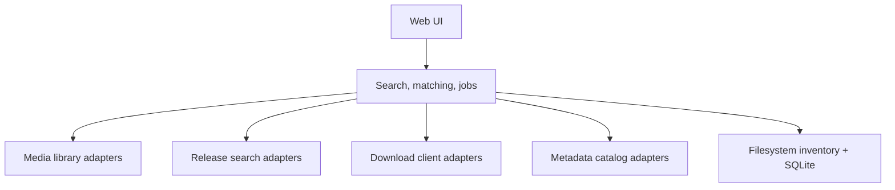

# Media Acquisition Manager

**Status: 0.3.0 published; Phase C checked on the reference installation.** Releases 0.1.0
(2026-10-04), 0.2.0 (2026-10-05), 0.2.1 (2026-10-07) and 0.3.0 (2026-10-11), the version the app now
reports, are published as Docker images; MAM-22 checked Phase B's acceptance bar on the reference
installation on 2026-10-08, and MAM-28 checked Phase C's there on 2026-10-12, on production running
the published 0.3.0 image. 0.3.0 is the first published image with MAM-37 (the Duplicates page lists
only real copies of one film or episode — never two episodes of one show, an episode's "a" and "b"
files, films whose file names claim years far apart or different cuts — and flags for review the
copies whose running times differ widely), built after MAM-22's check while the version was still
0.2.1 and checked the same day on a copy of production's database, 4 groups where there were 46, and
MAM-38 (a download whose files would land on a different file already in the destination's folder is
refused before anything reaches qBittorrent), built after it the same day; and it holds Phase C,
built under 0.3.0: MAM-24 (built on 2026-10-09: the owner schedules, in the Download dialog, the
replacement of specific old copies, which follows its download to `Downloaded`), MAM-25 (built on
2026-10-10: once the download is done, each new file is checked — complete, readable, and identified
by Jellyfin's own ids as the old copy's work — and the replacement ends verified or stops for
review), MAM-26 (built on 2026-10-10: once the new file is verified, the old copy, checked again
with the torrents that might hold it, moves with its own subtitles into a quarantine at the top of
its media folder, where it stays until the owner restores it or deletes it for good) and MAM-27
(built on 2026-10-11: on the Jobs page and each job's page the owner sees where a replacement
stands, the old copies he ticked with the new file each pairs with, what the check found and why it
stopped, and keeps both copies, retries a stopped check or drops one old copy). On 2026-10-12
replacement was turned on on production as the 0.3.0 release note says — which took the compose
file's `user:` line, missing from production's — and a film was replaced: its old copy moved into
the quarantine and came back with Restore, while a season's replacement stopped for the torrent that
seeds its old copies and was kept with Keep both, and three restarts, Jellyfin stopped during a
check, the switch off, a folder unticked, a member's view and a release that would land on a file
already there were staged, each leaving the old file where it was; a second replacement of the film,
ticking both its copies, was cancelled at 1.8 % of its download, so a held copy moving after Retry
and Delete for good weren't tried and rest on the tests with the other cases of the bar, as [Tested
with](#tested-with) lists, and production then went back to the image's own ids with replacement
switched off. Preparing that check found that the check right before a move passed over a download
client whose path mappings were changed after a replacement went through it, so a seeding old copy
would have moved, and that the release note's Turning it on missed the `user:` line and a backup;
both were fixed on 2026-10-12 under 0.3.0, which keeps its number, the first resting on the tests
alone, and the image published on 2026-10-11 has neither until Vasyl publishes 0.3.0 again.
MAM-40, built the same day under 0.3.0 too and going out with it, lets the owner settle duplicates
on the Duplicates page: remove one copy into the quarantine, behind replacement's switch, ticks and
checks, then restore it or delete it for good under **Removed copies**, or keep the copies as they
are; it wasn't tried on production. MAM-41, built the same day under 0.3.0 and going out with it,
sorts the Jobs page into tabs by what waits for the user — Needs you, In progress, Finished and All,
worked out and counted on the server —, says in a few words on each row where its download and its
replacement stand, keeps only verbs under Actions, Restore and Delete for good now among them, and
opens a job's details, the replacement's old copies included, under its row. MAM-42, a Phase B
ticket built on 2026-10-13 under 0.3.0 and going out with it, makes the Library page's Sources card
show the same warnings with Details open or closed, lists the files in no library in a dialog with
why a library most likely doesn't list each, and lets the owner ignore the ones that aren't media;
it wasn't tried on production. MAM-43, built the same day under 0.3.0 and going out with it, gives a
Blu-ray or DVD film the clips of its disc folder as its files, so they leave that list, and names the
extras folder (`Shorts`, `Trailers`…) or the extra's name that made a library skip a file (ADR 0038);
it wasn't tried on production either. MAM-5 (personal access tokens, Phase A) is still to do. Today
the app is an API and a web app that report their own health, with accounts,
integration settings and the library: the installation owner created on first run, the users the owner manages, sign-in,
and a Profile page where everyone changes their own password; the owner connects Jellyfin, a Torznab
source such as Prowlarr and qBittorrent, tests each connection, and imports the Jellyfin library —
its movies, series and episodes — which every signed-in user can browse, with what each file really
holds once the app has inspected it inside the media folders the owner allows; the owner also scans
those folders for the files no library reported, which the app then inspects too — saying how much
room the files take, each file counted once however many names lead to it, and hashing the files
that could be copies of each other —, and maps download destinations to qBittorrent's categories,
and a release source's tracker sections to destinations. Every signed-in user searches the library
and the release sources together on the Search page, for movies and TV, sends a release found there
to qBittorrent, and sees its download on the Jobs page until it finishes. Once the owner connects
TMDb, every signed-in user also gets recommendations of the films, series, cartoons and
documentaries the library doesn't have yet, each with why it is there and what the release sources
carry of it, and downloads one through the Search page like any other; and the owner links a library
work without a TMDb id to its TMDb film or show, picked from the app's suggestions, and Jellyfin
identifies the item as it — its title, overview and images become TMDb's — in the background; and
every library work's card shows its own poster from Jellyfin; and the app sorts the library's files
into the specification's four kinds of duplicate — one file's names, byte-identical copies, other
copies of one movie or episode, and possible matches —, which every signed-in user sees on the
Duplicates page, where the owner confirms or dismisses a possible match, keeps copies as they are,
or removes one copy into the quarantine once replacement is switched on; and
the owner, once he has switched replacement on and ticked the library folders it may touch, picks in
the Download dialog which of his copies of a film or of episodes a release should replace — written
down with the download, sent only when it can land on no file already there, followed until the
download is done, and its new file then checked before anything is touched, until Jellyfin has
identified it by its own ids as the old copy's work; the old copy then moves, with its own
subtitles, into a quarantine at the top of its media folder, once it is checked again and no torrent
holds it, and stays there until he restores it or deletes it for good; and on the Jobs page and each
job's page he sees where each replacement stands — its old copies with the new file each pairs with,
what the check found and why it stopped — and keeps both copies, retries the check once he fixed the
new item in Jellyfin, or drops a copy that can't be paired; see [ROADMAP.md](ROADMAP.md).

Media Acquisition Manager is a self-hosted application for people who prefer to choose media
releases themselves. It brings your existing library and available releases into one search view,
sends a selected release to a configured download client, and helps identify duplicates. When you
explicitly request a replacement, it waits until the new file has been downloaded and verified
before touching the selected old copy.

The initial workflow targets Jellyfin, Toloka through a Torznab-compatible indexer gateway, and
qBittorrent. These are intended to be the first integrations, not permanent limits on the
application.

> **Security:** until the owner account exists, whoever opens the app first becomes the owner, and
> the app speaks plain HTTP. Create the owner first, then open the port only on a network you trust
> or behind a reverse proxy that adds HTTPS. The Docker Compose file publishes the port on
> `127.0.0.1` for that reason. See [Security](#security).

## Stack

| Layer | Choice |
| --- | --- |
| API | ASP.NET Core on .NET 10, controllers, JWT bearer access tokens |
| Data | EF Core + SQLite in WAL mode; migrations applied on startup |
| Tests | xunit.v3, Moq, `WebApplicationFactory` over real HTTP with a throwaway SQLite database |
| Web app | React 19, React Router 7, TanStack Query 5, zustand, axios, Radix Dialog, lucide-react, react-i18next |
| Build | Vite + React Compiler, strict TypeScript, ESLint, Vitest + Testing Library |
| Styling | CSS tokens and semantic classes, no CSS framework |
| Ship | One Docker image (API + web app) for amd64 and arm64; Jenkins tests every commit and publishes releases to Docker Hub |

## Features

### Available now

- **Accounts and sign-in.** The first visit creates the installation owner; everyone else signs in
  with the user name and password the owner gave them. A session lasts 30 days from its last use,
  and signing out, disabling a user, or resetting or changing a password takes effect at once. See
  [Security](#security).
- **User management for the owner.** The Users page (**Users** in the owner's user menu) searches
  and pages through the users on the server, adds a user, disables or enables one, resets a
  password, and deletes one after a confirmation. The owner's own account can't be disabled or
  deleted.
- **Your profile.** Every signed-in user opens the Profile page from their user menu (**Profile**,
  or their name at the top of the menu): their user name, role, when the account was created and
  last signed in, and when this session ends unless it is used again. **Change password** asks for
  the current password and the new one twice, ends the user's other sessions and keeps this one
  ([ADR 0016](docs/adr/0016-a-users-own-password-change-keeps-the-session-it-was-made-from-and-ends-the-others.md)).
  The **Recommendations** card switches each of the user's four recommendation lists on or off and
  sets how many release-source searches the app may run for them a day, with how many it ran in the
  last 24 hours; each user changes only their own. The theme can be picked there too, and **Sign
  out** is at the bottom.
- **Light, Dark or System.** The **Theme** row of the user menu, and Profile, switch the web app to
  a light or a dark theme, or follow the operating system's setting as it changes. The choice is
  kept in each browser and applied before the first paint, and every open tab of the app takes it.
- **Integration settings for the owner.** The Integrations page (**Integrations** in the owner's
  user menu) searches by name, filters by kind (media library, release source, download client,
  metadata catalog) and pages on the server; adds Jellyfin, a Torznab feed, qBittorrent or TMDb,
  edits one, switches it off and removes it after a confirmation. **Test connection** checks an
  unsaved integration from its dialog, and a row's **Test** checks a saved one, each answering with
  a sentence that says what the service did. Services that report file paths take path mappings onto the app's own mounts
  ([ADR 0003](docs/adr/0003-service-paths-reach-the-app-through-an-explicit-prefix-mapping.md)).
  Credentials are stored encrypted and never shown again. Jellyfin feeds the library, and a
  switched-off one can't be synced or have a TMDb link identified in it; a Torznab feed is searched
  for releases, and a switched-off one
  is left alone; qBittorrent's categories are what download destinations name, and a switched-off
  one isn't asked for them or sent a release; TMDb, with the owner's own API Read Access Token, is
  the metadata catalog the recommendations come from, and a switched-off one isn't asked. The
  Jellyfin connection test refuses a Jellyfin older than 10.9, the oldest the app reads libraries
  from, and the qBittorrent one a qBittorrent older than 4.4.1.
- **The library.** The Library page (**Library** in the header, for every signed-in user) lists the
  movies and series of the owner's Jellyfin libraries as works: movie items that share an IMDb or
  TMDb id are one work with several versions, never merged by title and year. Each movie shows its titles,
  year and identifiers, a warning for a missing IMDb or TMDb id, and its versions — as rows that sum
  up each file and open to it, or side by side in a table for 2 to 6 versions, one choice per
  browser and rows on a phone — with their files, where Jellyfin sees them and where the app finds
  them through the path mappings; what Jellyfin didn't report shows as unknown. A series is one card
  however many series items Jellyfin makes of it, with the show's IMDb, TMDb TV and TVDB ids and its
  seasons — read from its episodes' own numbers: regular seasons, then specials, then the episodes
  with no season — each opening to its episodes, loaded a page at a time, each with its versions and
  files; an episode of no series is a card of its own with its season and number, and an episode
  Jellyfin lists without a file is left out
  ([ADR 0019](docs/adr/0019-a-series-is-a-work-its-episodes-point-at-its-seasons-come-from-their-numbers-and-an-episode-without-a-file-is-left-out.md)).
  Each card shows the work's own picture from Jellyfin beside its title (MAM-35): the item's own
  primary image — for an item Jellyfin identified, the one it took from TMDb then, never the
  Recommendations page's TMDb poster —, the series' picture on a series' card, its own on an episode
  of no series, none on the episodes of an opened season, and a film or TV icon where Jellyfin has
  none, shown whole rather than cropped. The server fetches each picture once from Jellyfin, after a
  sync stored its tag, and keeps it
  ([ADR 0027](docs/adr/0027-a-library-works-poster-is-the-librarys-own-image-read-by-the-syncs-tag-and-served-by-the-app.md)).
  The server searches by title, original title, IMDb, TMDb or TVDB id, year or path, reaching into a
  series' episodes, filters by Jellyfin library, by kind (movies or series) or by a missing id of
  the work's kind, and pages, with titles in Ukrainian alphabetical order. The owner imports a
  library with **Sync now**: a background sync reads all of it — its movies, series and episodes —,
  in Jellyfin 10.9 or later, before it replaces anything, so a failed one changes nothing, and
  nothing in the library or in Jellyfin is moved, renamed or changed
  ([ADR 0008](docs/adr/0008-a-library-sync-replaces-its-sources-snapshot-only-after-reading-all-of-it.md)).
  Removing a Jellyfin integration removes the library it imported from the app, never the files.
- **Linking a work to TMDb.** The owner's **TMDb…** on a Library card (disabled, with the reason,
  for everyone else) opens a dialog with the ids Jellyfin reports for each of the work's items, up
  to five TMDb films and shows the app suggests — each with its poster, year, runtime and overview
  and why it is suggested: the title, the year, the runtime against the length ffprobe measured, the
  library's genre, a linked neighbour's collection, director or show —, a field for a pasted TMDb or
  IMDb link or id, and a TMDb search. **Save** links the work, one link per library item, kept by
  the app as the owner's word and re-applied at every sync: the work then counts the id as its own —
  no longer "missing an id", found and matched by it, grouped with the library's other items of it,
  and seeded by it in the recommendations. Above **Save** the dialog says what Jellyfin will do, and
  **Save** queues it (Vasyl's decision of 2026-10-06, which replaced the first builds' "ids only"
  and the lookup that followed): Jellyfin's own **Identify** for each item — a search by the TMDb id
  in the item's own kind of provider, a film's in the film search and a show's in the series search,
  never the other kind's, then one `RemoteSearch/Apply` with `replaceAllImages=true`, confirmed by
  reading the item again — so Jellyfin replaces the item's title, overview and images with TMDb's,
  in the language of the item's library, the library's own setting and not the app's choice. No file
  or folder is touched, and a library that saves artwork or metadata next to the media is refused,
  with the reason, before any search. It runs in the background, two films at a time and one series
  at a time, so **Save** never waits: a series takes minutes, about a second per episode, and an
  item says "Waiting to identify", "Identifying…" and "Identified in Jellyfin". An episode Jellyfin
  lists as a film, linked with its season and episode, is identified through The Open Movie Database
  by the episode's own IMDb id, which TMDb gives, and stays in the app with the reason when TMDb
  gives none; an episode item stays in the app too, as Jellyfin identifies movie and series items
  only. An item that isn't identified says "Not identified yet" with the reason and **Retry**,
  "Jellyfin lost it" with **Identify again**, or "Kept in the app" with why; each of these buttons
  asks first, as an Identify has no undo. **Remove link** forgets the link in the app only: Jellyfin
  keeps what Identify gave the item, and replacing a link is a new Identify. **Update Jellyfin**, on
  the **TMDb links** page, identifies the links set under the first rules — with their count, one
  confirmation and the batch's progress —, and the **Not identified** tab lists every link Jellyfin
  or the app refused or failed to identify, each with its reason. The suggestions are prepared in
  the background after every sync; the **TMDb links** page, opened from the **Missing an id**
  filter, reviews the works without an id one at a time by the keyboard (1–5, Enter, 0 for none
  fits, →, /), links every confident suggestion — the one exact title-and-year match whose runtime
  agrees — with one click, identified in the background, and lists the links in conflict with
  Jellyfin's id and those whose item is gone ([ADR
  0026](docs/adr/0026-a-tmdb-id-set-by-hand-is-the-owners-word-kept-per-library-item-and-written-into-the-library-as-ids-only.md)).
- **Verified file facts.** Each file shows what it really holds, read by `ffprobe` from the file
  itself: duration, resolution, video codec and profile, dynamic range (SDR, HDR10, HLG, Dolby
  Vision), overall bit rate, and every audio track (language, codec, channels) and subtitle
  (language, codec, forced, SDH); what the file doesn't say shows as unknown, never guessed. The app
  reads only inside the media folders the owner allows on the **Media folders** page — none by
  default — resolving every link and refusing one that leads out of them. An inspection runs in the
  background after every successful sync or scan of the media folders, at each start and on
  **Inspect files**, two files at a time; a file is read again only when its identity, size or
  modification time changes, and two names of one file are read once
  ([ADR 0009](docs/adr/0009-the-app-reads-a-file-only-inside-the-allowed-roots-and-keeps-each-reading-by-the-files-identity.md)).
  The Library page shows how many files of each source were inspected, couldn't be read or wait,
  and why a file couldn't be read (the reason to the owner only).
- **The files no library reported.** **Scan folders**, on the **Media folders** row under the
  Library page's sources, walks every allowed media folder — hidden folders included but never a
  replacement's `.mam-quarantine`, at any depth (MAM-26), a link followed only when it ends inside
  them, a loop walked once, no file opened — for video files by
  their extension, Blu-ray and DVD clips included. A file Jellyfin lists, a movie's or an
  episode's — since MAM-43 a disc's clips too, which each sync takes from the disc folder Jellyfin
  lists —, is recognised by its path through the current path mappings, never by its name; each
  file no library lists is remembered by one name of its own, with no work, and the file inspection
  then reads it like the library's files. The row shows how far the scan has got, how many files it
  found, how many are in no library and how far the inspection of those has got, and how many
  folders or links it didn't go into, the reason to the owner only. A folder the app can't list now
  — a disk that is away — keeps what was found there before. Only the owner starts a scan, and the
  app never starts one by itself
  ([ADR 0021](docs/adr/0021-the-scan-of-the-media-folders-follows-links-only-inside-the-allowed-roots-and-keeps-one-name-of-each-file-no-library-reported.md)).
- **The room the files take, and the files that could be copies.** The Library page says how much
  room on disk the files of each Jellyfin source, the files in no library and all the files take,
  each file counted once, by its device and inode, however many names — hardlinks — lead to it, with
  the size the app read itself rather than the library's word; the names it hasn't measured yet are
  counted apart. Every file inspection ends by reading in full, one at a time, only the files whose
  size a file of another identity shares and whose media facts don't tell the two apart, for their
  SHA-256, kept under the file's identity, size and modification time, so a file is read whole again
  only when it changes, and a file that changed while it was read keeps nothing. The inspection's
  row shows how far it got, and why a file couldn't be hashed to the owner only. A file a torrent
  seeds counts and is hashed like any other, and no download client is asked ([ADR
  0022](docs/adr/0022-a-file-is-hashed-only-when-a-file-of-another-identity-shares-its-size-and-could-be-its-copy-as-the-last-step-of-the-inspection-one-at-a-time.md),
  [ADR
  0018](docs/adr/0018-a-file-is-a-duplicate-whatever-a-torrent-client-does-with-it-and-its-space-counts-once-per-identity.md)).
  The Duplicates page groups the copies by these hashes (below).
- **Duplicates, sorted as the specification sorts them.** The app works out on every read, from what
  it already holds, which file names are one file (one device and inode), which files are
  byte-identical (one SHA-256), which are other copies of one movie or episode — works of any
  library or integration that share a registry id: an IMDb id, a TMDb or TVDB id of the same kind of
  work, an episode's series' id with its season and episode, or a TMDb link the owner set, so a film
  item linked as an episode joins the library's own episode — and which are possible matches by a
  title and its year where no id settles it, a file only the scan found included by its file or
  folder name. The 65 id-less files of one item are no copies, a movie and a series sharing a TMDb
  number stay apart, and two series items of one show are one show. Only real copies of one film
  or episode are a work's group (MAM-37, Vasyl's decisions of 2026-10-08): never two episodes of
  one show at different season or episode numbers, whatever ids they share; nor an episode's "a"
  and "b" files, `…_S03E09a_…` and `…_S03E09b_…`, which Jellyfin gives one episode's numbers and
  ids; nor a film's copies whose file names claim years more than one apart, each year alone in
  brackets — `(1982)` and `(2017)`, Blade Runner 2049 filed under the 1982 film's ids —, a year
  apart still one film's; nor copies whose names say different cuts or editions, read from words in
  the file or version names in English and Ukrainian — Theatrical and Extended, a Widescreen or Open
  Matte frame, a remaster, or a labelled copy beside an unlabelled one —, which are different
  versions, not duplicates. One file's names and byte-identical files are grouped whatever their
  names say. Nothing is called redundant and nothing is merged: different measured dynamic ranges,
  ids that disagree (two TMDb ids under one IMDb id, one episode's copies under two shows' ids) and
  copies whose measured running times differ widely — the shortest copy under three quarters of the
  longest, a copy's running time its files' durations summed, a copy with a file not measured left
  out (MAM-37) — are flagged for review, and a possible match always needs it, with whether the
  measured durations agree and, when its files' names say different editions, "Editions differ".
  The room removing a copy would free is given for byte-identical files only, and only on a file
  system known not to share blocks between files, read from Linux's mount table — btrfs, ZFS, XFS, a
  network share and Windows give none, with the reason. A file a torrent seeds is classed like any
  other, and no download client is asked. Every signed-in user reads the groups, on the Duplicates
  page (below) or through `GET /api/library/duplicates`; nothing but the owner's decisions is stored,
  and a name a replacement or the owner's removal took into the quarantine counts in no group until
  it is put back (MAM-40)
  ([ADR 0028](docs/adr/0028-duplicates-are-worked-out-on-every-read-in-four-classes-by-one-file-one-hash-one-registry-key-or-one-title-and-year-and-a-group-only-shows.md)).
- **The Duplicates page, where the owner confirms or dismisses a possible match, and keeps or removes
  copies.** **Duplicates** in the header, and at the top of the Library page, opens it for every
  signed-in user, with a tab for each class, in plain words since MAM-40 — All, One file, two names
  (the same file), Exact copies (byte-identical), Same film, different files (the same work; an
  episode's group "Same episode, different files") and Maybe the same film (a possible match) — then
  Kept as they are and, for the owner, Removed copies (below), the tab kept in the address, filtered
  and paged on the server; each group also says in one line what it is and what can be done. Each
  group is headed by its movie, or by its show with the season and episode, and shows its class, what flags it for review, the evidence
  behind it — the one file's device and inode, the shared SHA-256, the shared ids and, beside a
  "Running times differ" flag (MAM-37), how long the shortest and the longest copy run, or the shared
  title and year with whether the running times agree —, the room its files take and, only where the
  server can say, the room removing all but one copy would free, or why it can't. Its files are
  listed as the Library lists a movie's versions, rows or a comparison table, each named by the end
  of its path that tells it from the group's other files — its file name, which tells two cuts of a
  film apart, or, where another file has that name, the nearest folder that differs, as for a
  hardlink's two names —, with its folder, identity, hash, editions and the works that hold it. Only
  the installation owner confirms or dismisses a possible match, or undoes either (Vasyl's decisions
  of 2026-10-07), each with an audit row; others see the decision and when, with the buttons
  disabled and why. A confirmed match stays on the list, marked confirmed, still a possible match,
  and authorises nothing; a dismissed one leaves every tab for Dismissed (Kept as they are since
  MAM-40), a short row with **Undo**
  taking its card's place, and can be undone there too. A decision is kept by the possible match's
  key, made of its works and the files no library reports, so a group another work, or a scanned
  file no library reports, joins or leaves is asked about again, while another file or version of a
  work already in it changes nothing. A group of exact copies or of one work's copies has the
  owner's **Keep both** — **Keep all** past two files —, the same decision as a dismissal: the group
  leaves every tab for Kept as they are, with **Undo**, and comes back once a new file joins it, a
  file leaving it keeping it kept (MAM-40, Vasyl's decisions of 2026-10-12). Nothing acts on several
  groups at once
  ([ADR 0029](docs/adr/0029-a-possible-match-is-confirmed-or-dismissed-by-the-owner-alone-kept-by-its-groups-key-and-never-authorises-removal.md)).
- **Remove a copy from the Duplicates page, then put it back or delete it for good (the owner's).**
  Each file of a group of exact copies or of one work's copies has **Remove this copy**; the app
  never says which copy to remove (Vasyl's decisions of 2026-10-12). A file it can't be pressed on
  says why, from what the app has stored — replacement switched off, the file outside the Media
  folders or an unticked library folder, never inspected or not readable as media, a disc folder's
  clip, a file that also holds a work outside the group, one an open replacement or removal holds,
  or no other copy of the group the app could read ("No other copy in this group is one the app has
  read as media, so this one stays: it may be the only one that plays.") —, and a member sees it
  disabled with "Only the owner keeps or removes copies.". After a confirmation naming the file, its
  size and the files that stay, the server checks the same again, the file the page showed against
  the disk, another copy still there, and every download client's torrents, as right before a
  replacement's move: a copy a torrent holds is refused with "Still held by the torrent “…” in
  “qBittorrent”: remove that torrent there without its files, then press Remove again.", nothing
  moved. Otherwise the file and its own subtitles and `.nfo` are renamed into
  `/media/.mam-quarantine/<removal>/…`, as a replaced copy is, one removal at a time, every step in
  the audit trail, and Jellyfin is told the file went; a video that can't move ends the removal with
  nothing in the quarantine. The page's **Removed copies** tab, the owner's alone, lists what is
  still there with the room it takes, each removal with where it was, where it is, when and by whom,
  and every file that went with it, and offers **Restore** (every file back where it was, never over
  a file there now; the copy counts in its group again) and **Delete for good** (after a second
  confirmation naming every file and the room it frees; files only, from the quarantine only), both
  disabled with why while replacement is switched off. A removal whose video another file took the
  place of, or that a restart found nowhere, stays listed, needing review, with the paths to look at
  and no button: it is settled outside the app. Copies a replacement moved stay on their job's page.
  It needs replacement turned on: the same switch, the same ticks, the read-write mount and `PUID`
  and `PGID` (MAM-40, [ADR
  0037](docs/adr/0037-a-copy-is-removed-from-the-duplicates-page-into-the-quarantine-on-the-owners-word-through-replacements-gates-and-checks.md)).
- **The Sources card and Refresh all.** The card at the top of the Library page is one status bar: an
  item for each media library, for the media folders and for the file inspection, with an icon, when it
  last ran or how far it has got, amber chips for what needs a look — files without an app path, files in
  no library, folders not scanned, files that couldn't be read —, and what all the files take.
  **Details** opens the rows with their sentences and their own buttons, and **Hide details** closes
  them; a failure or a missing library shows with them closed. **Refresh all**, the owner's, syncs every
  enabled library the app can read, scans the media folders and inspects the files, each step started
  once the one before has ended; a refused start or a failed run stops it at that step with a sentence.
  It runs from the page, so leaving the page stops it after the step under way; the API queues an
  inspection after a sync and after a scan by itself either way. Since MAM-42 every chip sits on the
  item whose row under Details holds its amber line, and the other way round (Vasyl's decisions of
  2026-10-13): a library's item warns of its own files without an app path and that couldn't be
  read, the Folders item of the files in no library — counted now, the ignored ones left out —, the
  folders not scanned and the files in no library that couldn't be read, and the Inspection item
  only of the files it couldn't hash. The Media folders row says "Scanned …: 1,404 files.", then
  "17 files are in no library." with **Show files**, the counts with the ignored ones ("Files in no
  library: 16 inspected · 1 couldn't be read · 1 ignored"), and the files that couldn't be read as
  one line with a count, the first reason the owner's.
- **The files in no library, and ignoring the ones that aren't media.** The Folders item's "in no
  library" and "couldn't be read" chips, and **Show files** on the Media folders row, open **Files in
  no library** for every signed-in user (MAM-42, Vasyl's decisions of 2026-10-13): tabs In no
  library, Couldn't be read and Ignored, counted and paged on the server, each file with its name
  over its folder, its size as the app's last look read it, what that look found (the reason it
  couldn't read it the owner's), and why a library most likely doesn't list it — under no library's
  folders, in a library's folders but added after its last scan, or the libraries' folders not known
  yet; since MAM-43 also in a folder Jellyfin takes for a film's extras ("In a folder named “Shorts”
  in Мульфільми's folders: …") or named as an extra ("Named as an extra (“-trailer”) …"), by
  Jellyfin's own rules. The installation owner's **Ignore** sets a mark on the scan's
  name: the file leaves every count of files in no library and of files that couldn't be read, and
  still counts in the room the files take, as it still takes it; nothing changes on the disk or in a
  library. It holds while a scan keeps the name; moved or renamed, the file counts again. **Stop
  ignoring** puts it back, each change with an audit row
  ([ADR 0021](docs/adr/0021-the-scan-of-the-media-folders-follows-links-only-inside-the-allowed-roots-and-keeps-one-name-of-each-file-no-library-reported.md)).
- **A Blu-ray or DVD film's files (MAM-43).** Jellyfin lists a disc folder as one film and names no
  file in it. Each sync looks inside the disc's own `BDMV` or `VIDEO_TS` folder, through the Jellyfin
  integration's path mappings and inside the media folders only, and stores the clips there as the
  film's files in Jellyfin's terms. The Library page shows them under the film, the Jellyfin row
  counts their room, and the scan no longer lists them in no library. A disc the app can't reach gives
  the film no file, and the sync still succeeds
  ([ADR 0038](docs/adr/0038-a-disc-a-library-reports-by-its-folder-gets-the-clips-of-its-bdmv-or-video-ts-folder-as-its-files-listed-by-the-sync.md)).
- **Search: your library and the release sources side by side.** Every signed-in user types a title
  in the search field at the top of every page (`/` jumps to it) and presses Enter; the Search page
  looks for it in the library and in every enabled release source at once. A year in brackets at
  the end of the line is the year, "Interstellar (2014)", while a bare number stays in the title
  ([ADR 0015](docs/adr/0015-only-a-bracketed-trailing-year-in-the-header-search-becomes-the-year.md)),
  and the page narrows the search by a year, an IMDb id and a TMDb id in fields of their own
  (owner's choice), and by a season; a film's TMDb id also comes in its address (`?tmdbId=`), as a
  recommendation's **Releases** opens it. **In your library** shows each matching movie or series
  as the Library page does, its poster, versions and verified file facts included, with how it
  matched — by IMDb or TMDb id, an id the owner linked included and shown as set by them, by title
  and year, or by title alone as a possible match to check — and a warning when ids conflict; every
  match is listed, strongest first, and nothing is picked or merged. Below the
  matches come up to 20 works that don't match but one of whose titles or file paths holds every
  word searched for, each whole, marked as no match, with how many more there are and a link to the
  Library page searched for the same text
  ([ADR 0012](docs/adr/0012-a-search-or-a-release-matches-a-library-work-by-identifier-then-title-and-year-then-title-alone-and-every-match-is-listed.md));
  an episode that matches lists its series. **Available releases** lists every movie and TV release
  found — each source is asked for both, TV in its TV categories by the title without the year —,
  even for a work already in the library, with its source, size, seeders and peers, publish date and
  what its title claims — resolution, medium, codec, dynamic range, audio and subtitle languages,
  and for TV the seasons and episodes — marked as claims, and the library copies it matches among
  those listed, the works by words included, by the title and year read from its title and by the
  ids its listing gives, never by words: a TV release matches series only, saying how many episodes
  of what it claims the library holds, and a movie release movies only
  ([ADR 0020](docs/adr/0020-a-release-is-tv-by-its-category-matches-only-series-and-its-tracker-section-picks-the-destination-offered-first.md));
  a film Toloka files in TV/Anime or TV/Documentary is a movie release unless its title or
  description names seasons or episodes, and the movie search asks those categories too. Each
  release shows its source's own title under its own when the listing gives one — Toloka's topic
  title, Ukrainian first. Each source answers for itself, so one that fails says why beside the
  others' releases. The
  server filters by source, kind (movies or TV), audio language, quality and size, sorts by seeders,
  size, date or quality, and pages; the search is stored for a day, so a filter, a page or a reload
  never asks the sources again
  ([ADR 0011](docs/adr/0011-a-search-is-stored-once-and-every-filter-sort-and-page-reads-what-it-stored.md)).
  Each release has **Details**, its listing beside the matching copies' verified facts, **Open
  source** and **Download**, which sends it to a download client (below). The API also keeps
  MAM-10's single-answer search (`POST /api/releases/search`). Toloka through Prowlarr is searched
  by title (and year, for movies) and lists no ids, so its releases match by title and year. Download
  links stay on the server
  ([ADR 0004](docs/adr/0004-toloka-is-searched-through-prowlarr-and-download-links-stay-on-the-server.md)).
- **Download destinations for the owner.** The Destinations page (**Destinations** in the owner's
  user menu) names where downloads go — `Movies`, `Movies 4K` — each one a category qBittorrent
  already has, which qBittorrent confirms before the destination is saved; the app never sends a
  folder of its own, so the category decides where a download lands. Each destination shows where
  its category saves, as qBittorrent sees it and as the app does through the path mappings, and
  whether that is inside a Jellyfin library folder; when it isn't, or when the app can't tell, it
  says why. One destination is the default, the first one added unless the owner picks another, and
  removing it leaves none until the owner picks one. Searched and paged on the server; qBittorrent
  4.4.1 or later
  ([ADR 0010](docs/adr/0010-a-destination-is-a-download-clients-own-category-never-a-folder.md)).
  Removing a qBittorrent under Integrations removes its destinations too, and its confirmation says
  so; the downloads sent to them keep their names. A destination's dialog also lists each release
  source's tracker sections, read from the source when it opens — Toloka's «Мультсеріали»,
  «Телесеріали», … — for the owner to tick the ones whose releases go there; the Download dialog then
  opens on the destination a release's section is mapped to, the source's own section before a
  standard category, and else on the default (ADR 0020).
- **Send downloads to the right destination.** **Download** on a release opens a dialog for every
  signed-in user (MAM-13's decision 1): a download client that can take the release, one of its
  destinations — the one the release's tracker section is mapped to, else the default, picked
  first — and a summary of what goes where, existing copies kept. A TV release is sent as a movie
  is. The server fetches the release itself and hands qBittorrent the destination's category with
  automatic torrent management — never a folder of the app's, so the category's folder is where it
  lands — once it has confirmed that qBittorrent still has the category and doesn't have the torrent
  already. One click sends at most one download: the job is written with the request id the browser
  made before anything is sent, a retry or a second click answers that job, a submission is never
  sent twice, and qBittorrent's id or the torrent's info hash confirms it, with several candidates
  left for linking by hand rather than guessed. A release already sent to that client is refused,
  unless its job failed or was cancelled. Its download is then followed on the Jobs page (below)
  ([ADR 0013](docs/adr/0013-a-download-is-written-down-before-anything-is-sent-and-one-request-sends-it-at-most-once.md)).
  Right before that one submission, the server refuses a release whose files would land on a
  different file already in the category's folder — another size, or the same size with sampled
  pieces that don't hash as the torrent says, under any of qBittorrent's content layouts and with
  each name cleaned as libtorrent 2.0 cleans it, or a file a torrent the client already has there
  will write, even one still in its folder for incomplete torrents —, as qBittorrent would
  download into that file in place: the job fails with the app's sentence naming the file, and
  nothing reaches the client. Files already there with the same bytes don't stop it, so a Toloka
  update that re-adds a series' old episodes still goes through. A folder the app can't look into —
  outside the Media folders, or with no path in the app — is sent unchecked after a warning in the
  dialog, which holds Send until it has asked; a magnet, a place behind a link leading out of the
  Media folders, a file name the app can't look up and a client that can't tell its torrents are
  sent unchecked too, unless another place refuses the send, and the Jobs page says why a job went
  unchecked (MAM-38, Vasyl's decisions of 2026-10-08,
  [ADR 0034](docs/adr/0034-a-download-is-refused-before-it-is-sent-when-its-client-would-write-over-a-different-file-already-at-its-path.md)).
- **Follow each download until it finishes.** The Jobs page (**Jobs** in the header, last, for every
  signed-in user) lists the caller's own jobs — the owner's too: a job stays its sender's — newest
  first, paged on the server, under tabs the server sorts them into and counts (MAM-41, Vasyl's
  decisions of 2026-10-12): **Needs you** (a job that needs linking, or whose replacement stopped
  for review, waits in the quarantine, or is verified while replacement is switched off), **In
  progress** (a download still followed, or a replacement the app still checks or moves), **Finished**
  and **All**, the tab kept in the address. Each row has the release, with where it went and when
  under it; its status in a word, with a bar of its progress while it is followed and, when it isn't
  moving on, why, cut at two lines; for the owner, where its replacement stands in a few words; and
  only verbs under **Actions**. A chevron before the title opens, under the row, the whole sentences,
  the replacement's old copies, the source, the client's id and a link to the job's page. A job's
  page adds its facts and its
  files, each with its size and progress, and which ones qBittorrent skips. The app reads qBittorrent
  every 2 seconds in the background, whether or not anyone has the page open, and keeps nothing in
  memory, so a restart goes on where it stopped: `Submitted`, `Downloading`, `Paused`, and
  `Downloaded` once qBittorrent has finished it with a progress of 1, which ends the following. A
  client error, a torrent qBittorrent no longer lists and a client that can't be asked keep the job's
  status with the reason and keep it followed, so it goes on once the cause clears; a send a stop
  interrupted is settled once it is 5 minutes old, and can't be cancelled before then, while it may
  still be being sent. **Cancel job** stops the following and nothing more: nothing is sent to
  qBittorrent, so the torrent and its files stay as they are, and the release may be sent again. The pages refresh every 2 seconds while they show a followed job
  ([ADR 0014](docs/adr/0014-a-download-is-followed-by-reading-its-client-and-cancelling-it-only-stops-the-following.md)).
- **Schedule the replacement of specific old copies (the owner's, off until switched on).** On the
  **Media folders** page the owner switches replacement on (**Replace copies after verification**,
  off by default) and ticks the library folders it may touch (none by default), saved with the media
  folders by their one Save, with an audit row; a copy counts as inside a ticked folder only when
  every library folder holding it is ticked and inside the Media folders. The **Download** dialog
  then offers the owner **Replace after verification** beside **Keep both**, the default, and lists,
  once a destination is picked, the copies of what the release matched: a film's every file of every
  version, or the held episodes a TV release claims, by season, each with its edition words,
  resolution, dynamic range and size, nothing ticked in advance, a copy with another name marked as
  freeing no room. Every reason a release, a work or a copy can't be replaced is shown — replacement
  switched off, a magnet, a destination outside the libraries or the Media folders, no match; a title
  alone, conflicting ids, no season or no held episode claimed; no path in the app, an unticked
  folder, a TV version placed outside the claim, a copy another replacement holds, a file not
  inspected or shared with a work that can't be replaced, and one gone, unreadable or changed since
  its inspection, read fresh from the disk. A match by title and year — every Toloka release's —
  needs the owner's tick of "This release is Alien (1979)". Once Replace is picked, the app reads
  every download client's torrents with their files (qBittorrent 5.2 or later) and marks a copy a
  torrent holds, with what the owner will have to do in qBittorrent first, and a second name of a
  torrent's file; a client it couldn't read, or torrents it couldn't place, are said, never taken
  for "not held". **Send** writes the download job and its replacement — each ticked copy's identity
  read from the disk, the matched works' ids, the owner's confirmation — in one save with their
  audit rows before anything is fetched, then sends strictly: any file already where the release
  would write, the same bytes included, every place the check can't look at, a link that turns out a
  magnet and a category outside every library each fail the job with nothing handed to qBittorrent,
  and the owner picks Keep both himself. The replacement follows its download to `Downloaded`, where
  the check of its new files takes it up (below), **Cancel job** ends it while the download goes on
  (the owner's **Keep both** ends it alone, below), and the Jobs page shows a line under the job.
  Members keep Keep both, with "Only the installation
  owner can replace a copy." (MAM-24, Vasyl's decisions of 2026-10-08 and 2026-10-09, [ADR
  0031](docs/adr/0031-a-replacement-never-touches-a-torrent-and-an-old-copy-a-torrent-lists-waits-until-the-owner-removes-the-torrent.md),
  [ADR
  0032](docs/adr/0032-a-replacement-targets-films-episodes-or-seasons-on-the-owners-word-and-goes-ahead-only-when-the-library-gives-the-new-file-the-old-copys-work.md),
  [ADR
  0033](docs/adr/0033-replacement-is-off-until-the-owner-switches-it-on-and-ticks-the-folders-it-may-touch-and-the-app-may-only-rename-there.md),
  [ADR
  0034](docs/adr/0034-a-download-is-refused-before-it-is-sent-when-its-client-would-write-over-a-different-file-already-at-its-path.md)).
- **Check a replacement's new file before anything is touched.** Once the download is done, a
  background loop of its own, every 15 seconds and whatever the replacement switch says, checks each
  new video file of it: qBittorrent, asked again, must call the download finished without an error
  and each file complete; the file, placed in the app through qBittorrent's path mappings and in the
  one library folder holding it, must be a regular file the media inspector reads, not empty, with a
  video stream and a running time, of qBittorrent's size and none of the old copies, and no other
  download may write it, one the app can't place in its folders counting as unclear; Jellyfin, asked
  to look at the new paths (`POST /Library/Media/Updated`, the one request it hears, asked again on
  the next pass, within the hour, while it doesn't take the request), must list it, read it and
  identify it, by its own ids, as the old copy's work — a film by its TMDb or IMDb id, the owner's
  TMDb link counted, an episode by its series' ids, season and number, while the ticked episode's
  own item stays in that series at the number it had when scheduled —, read by the item id its path
  computes, so a new version of a film is found too; and each ticked copy must pair with exactly one
  new file of its work, a new episode no copy pairs with being simply added, and a collection's
  other film too — another work by Jellyfin's ids — once every ticked copy found its new file
  (Vasyl's decision of 2026-10-10). Another work while a ticked copy has found none, a new episode
  in another series, conflicting ids, ids for a work the app knows by none to compare them with, an
  old episode Jellyfin now numbers otherwise or places in another series, an unclear pair, a half or
  a file of several episodes, another edition than the release claimed — read with every title the
  work goes by taken out of the name — and a file under three quarters of the old copy's running
  time stop it at `NeedsReview` with the reason; a file that is no usable video ends it `Failed`;
  what Jellyfin or qBittorrent hasn't settled yet waits an hour, then stops it with what is still
  missing. Each step writes its audit row and keeps its evidence with the job; the Jobs page says
  "Replacement checks the new file: 1 copy, kept until it is verified.", "New file verified: 1 old
  copy moves into the quarantine next." or "Replacement needs review: …", asking again every 2
  seconds while the check runs. The check moves nothing: both copies stay until the old one moves
  into the quarantine, below (MAM-25, Vasyl's decisions of 2026-10-10, [ADR
  0035](docs/adr/0035-a-replacements-new-file-is-checked-by-its-clients-word-the-media-inspector-and-the-librarys-ids-before-anything-moves-and-what-is-unsettled-after-an-hour-stops-for-review.md)).
- **Move the old copy into a quarantine, then put it back or delete it for good.** Once the new file
  is verified, a background loop of its own, every 15 seconds and right after the app starts, takes
  the replacement up while replacement is switched on (switched off, it waits, verified). It checks
  each ticked copy again — still inside the Media folders and in a ticked folder, no disc clip, the
  very file picked by its device, inode, size and modification time and a file itself rather than a
  link, not the new file, and its new
  file still the one verified — and reads every download client's torrents with their files once
  more for every file that would move: a video any torrent lists, in any state, or a client it can't
  read, stops it at `NeedsReview` with "Still held by the torrent “…” in “qBittorrent”: remove that
  torrent there without its files, then press Retry." or why, nothing moved; a subtitle or `.nfo` a
  torrent lists stays, named on the job. Then it renames the video and the files named after it
  (`Alien.srt`, `Alien.uk.srt`, `Alien.nfo`; never the folder, another video or another video's
  files) into `.mam-quarantine` at the top of the Media folder that holds them —
  `/media/.mam-quarantine/<replacement>/movies/Alien (1979)/Alien.mkv` —, one
  `renameat2(RENAME_NOREPLACE)` per file on one mount, which never replaces and never copies, the
  switch and the ticks read again before each and an audit row before and after each; a video that
  can't move stops it for review with what already moved kept in the quarantine, and nothing is
  ever deleted because a move couldn't be made. Jellyfin is told the old paths went
  (`POST /Library/Media/Updated`, never a quarantine path) and drops the old card about a minute
  later. A restart in the middle is found again by device and inode and stops for review — a restore
  or a deletion it cut after its last file ends as it would have —, renaming nothing by itself; a
  file it can't look up leaves the replacement for the next pass. The job's page gains a
  **Replacement** section, whose **Files the move planned** lists every file, where it was, where it
  is now
  and the room it takes, with the owner's **Retry** (for a replacement the move stopped: the next
  pass checks everything again), **Restore** (every file back where it was, never over a file there
  now or into a folder that is gone; Jellyfin told it came back) and **Delete for good** (after a
  second confirmation naming every file and the room it frees, a file with another name on the disk
  now freeing none; files
  only, from the quarantine only), both refused while replacement is off. The Jobs line follows it —
  "Old copy moved into the quarantine: 1 copy, kept until you restore it or delete it for good.",
  "Replacement undone: the old copy is back where it was.", "Replaced: the old copy was deleted for
  good." —; the Media folders page says per ticked folder whether a move can work there (the same
  mount as the quarantine, mounted read-write, writable by the app) — where the app's user can't
  write, which folder that is, whose it is and which `PUID` and `PGID` to set (MAM-39) —, lists the
  room each quarantine takes, and refuses a Save that would leave one outside every media folder. No
  timer deletes anything, and the quarantine is outside the database backup (MAM-26, Vasyl's
  decisions of 2026-10-08 and 2026-10-10, [ADR
  0030](docs/adr/0030-a-replaced-copy-is-renamed-into-a-quarantine-on-the-same-mount-and-stays-there-until-the-owner-restores-it-or-deletes-it-for-good.md),
  [ADR
  0031](docs/adr/0031-a-replacement-never-touches-a-torrent-and-an-old-copy-a-torrent-lists-waits-until-the-owner-removes-the-torrent.md),
  [ADR
  0033](docs/adr/0033-replacement-is-off-until-the-owner-switches-it-on-and-ticks-the-folders-it-may-touch-and-the-app-may-only-rename-there.md)).
- **See where a replacement stands, and settle a stopped one (the owner's).** On the Jobs page, the
  owner's **Replacement** column says in a few words where a job's replacement stands — "Waits for
  Jellyfin until 14:05", "Check stopped", "9 old copies in the quarantine" — and the details the
  chevron before the job's title opens under its row give the whole line, until what time the check
  waits for Jellyfin — "Replacement waits for Jellyfin to identify the new file until 14:05: 1 copy,
  kept until it is verified." — and, at a review, what to do next ("Replacement needs review:
  <reason> Fix it in Jellyfin or qBittorrent, then press Retry — or see the job."), with how many
  copies were dropped, then the old copies he ticked; the row's actions are **Retry**, **Keep
  both**, **Restore** and **Delete for good** — the last two with the job page's confirmations — and
  **Cancel job**, where MAM-27 had a **Copies** button among them (MAM-41, Vasyl's decisions of
  2026-10-12). The job's page, its section now **Replacement**, says what he can do, how far
  the check got and until when it waits, and lists each ticked old copy with the new file it pairs
  with, where it stands and why it stopped — "Still held by the torrent “…” in “qBittorrent”: …", no
  id from Jellyfin yet, an unclear pair — and each new file with how far Jellyfin got and the ids
  its work is expected to carry; for a film Jellyfin gave no id it links to the Library page
  searched by its title, where he sets its TMDb link. **Keep both** cancels the replacement alone at
  any point before an old copy moves: both copies stay, the download goes on, and nothing is sent to
  qBittorrent. **Retry** after a stop of the check starts it again from the files, Jellyfin asked to
  look again and its ids deciding; after a stop of the move it goes back to the move, as before.
  **Drop**, on a copy of a replacement that stopped for review, takes that copy out — it stays where
  it is, never moves with this replacement, and may be ticked by another download — and nothing more
  happens until he presses Retry; the last copy can't be dropped. A stop no fix can change —
  Jellyfin numbering the episode otherwise, no new episode at its number, a half or several episodes
  in one file, another edition, a file under three quarters of the old copy's running time — is
  settled only by dropping that copy or keeping both, so Retry is withheld then. No click confirms a
  work by hand, nothing moves until every ticked copy is paired or dropped, each action writes an
  audit row and nothing to the media or qBittorrent, and the pages ask again every 2 seconds while
  the check runs (MAM-27, Vasyl's decisions of 2026-10-08 and 2026-10-11, [ADR
  0032](docs/adr/0032-a-replacement-targets-films-episodes-or-seasons-on-the-owners-word-and-goes-ahead-only-when-the-library-gives-the-new-file-the-old-copys-work.md),
  [ADR
  0035](docs/adr/0035-a-replacements-new-file-is-checked-by-its-clients-word-the-media-inspector-and-the-librarys-ids-before-anything-moves-and-what-is-unsettled-after-an-hour-stops-for-review.md),
  [ADR
  0014](docs/adr/0014-a-download-is-followed-by-reading-its-client-and-cancelling-it-only-stops-the-following.md)).
- **Recommendations of what the library doesn't have yet.** Once the owner connects TMDb, the
  Recommendations page (**Recommendations** in the header, for every signed-in user) lists films,
  series, cartoons and documentaries the library lacks, in four tabs — Movies, Series, Cartoons and
  Documentaries, by the catalog's genres — each card with its poster, Ukrainian and original title,
  year, genres and rating, and every reason it is there as a chip: a collection's missing parts ("2
  of 3"), more by a director or creator two or more of the library's works are by, what the catalog
  recommends beside the library's works ("Because you have …"), a held series' aired seasons with no
  episode ("Missing seasons 4–5"), what a release source just published ("New on Toloka"), and for a
  tab the library holds little of, the best-rated works a source carries. The order is a fixed score
  of those reasons and of the rating, weighted by its votes, unless the reader sorts the tab by
  rating, votes, newest or oldest, title or how many releases were found; a work recommended for
  taste alone needs a solid rating from enough votes; works
  not out yet, the library's own (by id, or by title and year, kinds apart) and those the scan's file
  names claim are left out
  ([ADR 0023](docs/adr/0023-a-recommendation-only-proposes-explains-every-reason-and-never-sends.md)).
  A background run computes the lists after every sync, when TMDb is connected and on the owner's
  **Recompute now**, from the catalog's answers kept in tables of their own, read again after 30
  days and never written to the library
  ([ADR 0025](docs/adr/0025-the-catalog-is-kept-apart-from-the-library.md)); while it runs, the page
  shows its stage, how far through it is ("240 of 815") with a progress bar, and how long ago it
  started — a first run is a few minutes of calls to TMDb. Each card says what the
  release sources carry of it — "4 releases · up to 2160p · Ukr", "Not found (checked 3 days ago)",
  "Not checked yet" —, asked by the app within each user's daily limit (60 by default), at most 4
  searches every 15 minutes, shared by every user, and Toloka's newest releases are read every 3
  hours ([ADR 0024](docs/adr/0024-release-sources-are-asked-for-recommendations-within-a-per-user-budget.md)).
  The server filters by reason, genre, decade, films or series and **Available only**, sorts by the
  **Sort** select, kept in the address beside the tab, and pages.
  **Releases** opens the Search page for the work, and **Download** there sends it as any release:
  nothing is sent by itself. **Not interested** hides a work for that user alone, with **Undo**; a
  card says **Downloading** while anyone's download of it is followed, and leaves the list once that
  download has finished, waits to be linked or was cancelled. Each user's Profile switches the tabs
  and sets the limit.
- **Service status.** The web app shows its version and whether the service is ready; when it is
  not, it names the check that failed. While the server can't be reached, a strip under the header
  says so and asks `GET /api/health` every 5 seconds until it answers; every failed load says what
  failed and why, with **Try again** when asking again can help, and the data already on screen
  stays.
- **Health endpoints** for uptime monitors: liveness and readiness. See
  [Health endpoints](#health-endpoints).
- **Zero-config start.** On first run the API creates its SQLite database, applies the migrations
  and generates its own secrets. See [Configuration](#configuration).
- **One Docker container.** `docker compose up -d` runs the published image with nothing to
  configure; the container reports healthy only when the database is ready. The app runs as the
  image's own unprivileged user, or as the user and group `PUID` and `PGID` name — the media
  folders' owner, for replacement —, the container handing its own data over to them as it starts
  (MAM-39). See [Quick start](#quick-start-docker-compose) and [Deployment](#deployment).

### Tested with

The integrations were tried against the reference installation, whose recorded answers are the
adapters' test samples. Phase A's checks, MAM-15's of its acceptance bar on 2026-10-03 among them,
ran through the app run from this repository. MAM-22 checked Phase B's acceptance bar on 2026-10-08
on production itself, the app's container on the installation's host running the published 0.2.1
image; MAM-37's check, the same day, ran its build on this PC on a copy of production's database,
MAM-24's read of qBittorrent, on 2026-10-09, its working tree over a copy of the development data
directory, MAM-25's read of Jellyfin, on 2026-10-10, a probe on this PC with the development
database's Jellyfin settings, and MAM-27's look at its pages in a browser, on 2026-10-11, its
working tree over a scratch data directory with answers made up in the page. MAM-28 checked Phase
C's acceptance bar on 2026-10-12 on production too, the published 0.3.0 image with replacement
turned on as the 0.3.0 release note's **Turning it on** says, Vasyl signed in as the owner; the fix
of check 6 and the corrections of **Turning it on** that MAM-28 made that day came after that image,
the first resting on the tests alone and the second on what was done on production. MAM-39 then
replaced those corrections, in the same 0.3.0, with `PUID` and `PGID`, checked on a local build of
the image on 2026-10-12 and not on production yet. The other
tickets' live checks are listed too, each with where it ran when that was recorded.

| Service | Version tried | Used as |
| --- | --- | --- |
| Jellyfin | 12.1.0, and 12.2.0 (read on 2026-10-08) for MAM-22's sync, (on 2026-10-10) for MAM-25's read of item ids and (on 2026-10-12) for MAM-28's replacements: the request to look, the new items identified by their ids, the old item off its search after the move and back after Restore | Media library |
| Prowlarr, serving the Toloka.to indexer over Torznab | 2.6.5, read on 2026-09-29 (a Torznab feed doesn't say its version) | Release source |
| qBittorrent | 5.2.4, and (on 2026-10-12) MAM-28's film and season downloads followed to `Downloaded`, a third cancelled, and its torrents read before each send and right before each move | Download client |
| TMDb | API v3, read on 2026-10-05 | Metadata catalog |
| ffprobe | 6.1.1-3ubuntu5, Ubuntu's package in the 0.2.1 image, read on 2026-10-08 (MAM-22's inspections took every reading from the cache and ran it on no file); the same 6.1.1-3ubuntu5 in the published 0.3.0 image, which read MAM-28's new files on 2026-10-12 | File inspection |
| Media Acquisition Manager | 0.3.0, the published image `sha256:0b75fdbd7f60…` stamped `0.3.0+2dec720`, on production, Docker 29.9.0 and Compose v5.6.0 on Linux 7.0.14-22-pve (x86_64), `/media` on ext4 (MAM-28; its fix of check 6, made after that image, by the tests alone); 0.2.1, the published image `sha256:d9c6149a3dbf…`, on production (MAM-22); the MAM-37 change built on top of commit 27fcd79, on Windows on a copy of production's database (MAM-37); the MAM-24 working tree, booted on Windows over a copy of the development data directory for its read of qBittorrent (MAM-24); a probe of the MAM-25 design, booted on Windows over a copy of the development data directory (made for the probe and deleted afterwards) for its read of Jellyfin (MAM-25); an image built from the MAM-39 working tree, for `tools/check-image-user.sh` (MAM-39) | The app checked |

- **Jellyfin:** the connection test, and syncs of all its movies, collections included (876 items
  on 2026-10-03). The header search "Sherlock Holmes (2009)" found the movie inside
  `/media/movies/Guy Ritchie. Collection` where it is, matched by title and year. A sync after
  every other check listed each of the 866 files of the 2026-10-01 sync at the same path with the
  same size: nothing was moved, changed or removed.
- **Prowlarr and Toloka:** the connection test, and searches by title and year — "Interstellar"
  2014 answered 16 movie releases on 2026-10-01, "Sherlock Holmes" 2009 answered 12 on 2026-10-03,
  six of them matched to the copy in the library. With the feed pointed for one search at an
  indexer Prowlarr doesn't have, the Search page said under **Available releases** "Prowlarr ·
  Answered in a way this app can't read. Nothing answers Torznab at this address (404 Not Found)…"
  and still showed the library's match. On 2026-10-02 a release was fetched through Prowlarr for a
  download, and a fetch Prowlarr failed ("Download failed") ended its job `Failed` with that
  sentence, having sent nothing.
- **qBittorrent:** the connection test, its four categories and their folders, and the destination
  Movies landing in the Jellyfin library "Фільми" at `/media/movies` (2026-10-01). On 2026-10-02 a
  release went into the category Movies with automatic torrent management and no save path, and was
  confirmed by the info hash the app worked out. On 2026-10-03 that request, sent again with its
  request id, answered with the same job, and the same release from a new search was refused as
  already sent: still two jobs, and nothing added to qBittorrent. The background passes that follow
  a job ran against it too, for a torrent qBittorrent no longer lists.
- **Series and TV releases (MAM-32, 2026-10-05):** a sync read 1,359 items — Jellyfin's 10 series,
  its 471 episodes less the 31 virtual ones, and the movies — into 1,292 works and 7 series (The Grand
  Tour's four series items, one per season folder, are one show by their shared ids), 1,382 versions
  and 1,378 files, 504 of them episodes'. The four episodes Jellyfin lists with no series (files at
  the root of a library folder) are cards of their own. The header search "Yellowstone" listed the
  show with its five seasons and 9 TV releases from Toloka: the packs of seasons 1-3, 4, 5 and 1-5
  matched by title and year with 29, 10, 14 and 53 of its episodes held, the BBC "Yellowstone (S1)
  (2009)" only as a possible match, and Season 5 narrowed them to the 3 packs holding it. With
  Toloka's sections ticked under Settings → Destinations, the Download dialog offered TV Shows for
  the show, Documentary for the BBC and nature films, and Cartoons for the four "Mickey Mouse
  Clubhouse" packs.
- **The scan of the media folders (MAM-18, 2026-10-05):** an image of this change ran on the
  installation's host beside production, on a copy of its data and with `/media` mounted read-only.
  Its start applied `AddFolderScan` to the copied database — the rebuild of `PhysicalFiles` logged
  warning 20410 and kept every row. **Scan folders** found 1,395 media files in `/media` and no
  folder or link it couldn't walk: the 1,378 files Jellyfin lists, movies' and episodes' alike, each
  matched to its file row by path, and 17 no library reports. The other 1,394 lie in the library
  folders, the number MAM-17 counted; the one outside them is a software disc image at the root of
  `/media`. The inspection the scan queued read exactly those 17 with ffprobe on the real disk —
  16 read, the disc image unreadable with ffprobe's own verdict — and took the 1,378 others from the
  cache; a second scan and its inspection read nothing.
- **TMDb and Toloka's newest releases (MAM-33, 2026-10-05):** the app's container on the
  installation's host reaches `api.themoviedb.org` and `image.tmdb.org` directly, with no proxy. With
  Vasyl's API Read Access Token, the library's 640 TMDb movie ids were read in about 3 minutes (943
  calls; TMDb sent no rate-limit header): 279 of the movies sit in 118 collections, 42 of them
  incomplete with 63 released parts missing, and 138 directors have two or more films in the library
  (Guy Ritchie 15, Ridley Scott 12, Steven Spielberg 11). By a script's estimate the library lacks
  4,891 released films, 2,274 of them over a rating floor with a collection, a director or two
  recommending films behind them; How the Universe Works misses seasons 3 to 11, MobLand season 2 and
  The Grand Tour seasons 5 and 6. Of the movies with no TMDb id, 10 have an IMDb id, of which TMDb
  found 8, and a title-and-year search found exactly one film for 23 of 25 Tom & Jerry shorts, while
  the Planet Earth episodes found nothing. Prowlarr answers Toloka's `t=search` with no text with its
  latest 90 releases, newest first, each with Toloka's own title in its description, and `offset`
  pages through nothing; 12 of the latest 90 in TV/Anime and TV/Documentary named no season — films
  such as "Akira (1988)" and series named by their episodes alone such as "Death Note (E1-31 of 37)".
  A movie search sent with those two categories found the documentary "Schumacher '94" filed in
  TV/Documentary. TMDb was then connected under **Integrations** with Vasyl's token, and the
  computation adding it queued finished in 3 min 15 s: 815 seeds — 640 by their TMDb id, 169 found by
  title and year or by IMDb id, and 6 shows — and 3,634 candidates, 2,852 in Movies, 545 in Cartoons,
  135 in Documentaries and 102 in Series, 109 of them top-rated fallbacks waiting for a release source
  to carry them. It recommends How the Universe Works for seasons 3 to 11, The Grand Tour for seasons 5
  and 6 and MobLand for season 2, and Planet Earth too, as the library holds its episodes as movie
  items with no id (MAM-34 links them).
- **Linking works to TMDb (MAM-34, 2026-10-05):** a live check Vasyl ran against Jellyfin 12.1.0 and
  TMDb, outside the app, recorded what the write stands on. Jellyfin answered `GET /Items/{id}` with
  the API key and no user with 400; `GET /Users` listed its two users, one an enabled administrator,
  and the item read as that user — "120. Landing Stripling", 47 fields, no ids, 6.2 minutes long —
  posted back with only `Tmdb` 223021 and `Imdb` tt0056164 in its `ProviderIds` answered 204 and read
  again held them, only `Etag`, `ExternalUrls` and `UserData.Key` changed besides; that item keeps
  the two ids in Jellyfin, so the next sync imports them as the library's own. The Penguins of
  Madagascar's series item took `Tmdb` 7869 the same way, in 4.5 seconds, and lost it again when
  posted back without the key — twice, on 2026-10-05, before Jellyfin's source was read: saving a
  series rewrites each of its seasons and episodes, so its 152 seasons and episodes may have lost
  their age ratings then. Nobody read their ratings before; the check's read-only listing of
  2026-10-06 found none of them rated, as the series isn't — what such a save leaves —, so whether
  any lost one is unknown. A wrong key was 401 and an unknown item 404, for the read and the write. A
  default refresh kept the ids, and "Search for missing metadata" kept them and added
  Jellyfin's own `Tvdb` id and details. TMDb gives Landing Stripling a runtime of 6 minutes and its
  IMDb id, and Planet Earth (1044) no runtime of its own but its latest episode's 53 minutes, its IMDb
  id and 16 other titles, and names it first for "Planet Earth".
- **Asking Jellyfin to look a linked item up (MAM-34, 2026-10-06):** Vasyl's checks in Jellyfin 12.1.0
  showed why the ids alone weren't enough: a Tom & Jerry film the app had linked held IMDb tt0035226
  and TheMovieDb 40163, and nothing more, as Jellyfin fetches an item's metadata only when it refreshes
  it. The documentary file "Greatest Events of World War II in Colour.S01E01.Blitzkrieg", a movie in
  «Документалки», given its episode's own IMDb id tt9103946 (TMDb show 91724, season 1, episode 1) by
  hand, got an overview, a year, genres and a poster from "Search for missing metadata" — The Open
  Movie Database finds an episode by its IMDb id —, its name kept and its "TheMovieDb Movie Id" left
  empty. So the app writes an episode's own IMDb id too, and asks for that search after every write
  (Vasyl, 2026-10-06). A second live check the same day recorded the lookup's 204 (queued at once),
  its 404 and 401, and TMDb's episodes with their own IMDb ids (tt9103946, "Джунглі" tt0905877).
- **Saving a series in Jellyfin (MAM-34, 2026-10-06):** Jellyfin's source (12.1) says its update of a
  series rewrites its seasons' and episodes' series name and custom rating, and their official rating
  unless locked, and saves each. The second check wrote The Penguins of Madagascar's TMDb id once
  more: 204 after 9.5 seconds, and afterwards all 3 of its seasons (none rated before) and all 149 of
  its episodes (88 rated before, their values not recorded) carried the series' rating, TV-Y7; the
  lookup asked right after didn't change them back — it fills only what is missing. The read-only
  listing earlier that day had found none of them rated and the series neither (above); what rated
  the series and 88 episodes in between wasn't recorded — most likely a metadata refresh. Vasyl decided
  on these facts that age ratings don't matter to him: the app writes a series like a film, with no
  warning about ratings (2026-10-06).
- **Jellyfin's Identify (MAM-34, 2026-10-06):** Vasyl's live check on Jellyfin 12.1.0, in which he
  typed `y` for each apply, recorded what the Identify the app now sends stands on. `POST
  /Items/RemoteSearch/Movie` or `/Series` with `{"SearchInfo":{"ProviderIds":{"Tmdb":"223021"}},
  "ItemId":"…","SearchProviderName":"TheMovieDb"}` answered 200 with one row; the key must be
  spelled `Tmdb` — `tmdb` answered 200 with no rows, as an unknown id did, and a wrong API key 401
  with no body —, and an id must go only to the search of its own kind: a film search with the
  show's id 7869 answered an unrelated film, "The Fest" (2005), and a series search with the film's
  id an unrelated show. An episode Jellyfin lists as a film, searched with `{"Imdb":"tt9103946"}`
  and the provider "The Open Movie Database", answered one row without an overview, and the TMDb
  provider none. `POST /Items/RemoteSearch/Apply/{id}?replaceAllImages=true` with the row as its
  body answered 204 once the work was done: after 1.8 s for a film, 21.3 s for the episode and 159.3
  s for The Penguins of Madagascar (3 seasons, 149 episodes). The film's name, `Etag` and primary
  and backdrop images changed (the poster 768x576 → 1112x1668), its other fields having been filled
  by an earlier refresh; the series' five images were downloaded again, its episodes kept their
  names, overviews and images, the series its played state (15.4 %), and the episodes lost their
  `TvMaze` id; the episode got its name and year corrected (2025 → 2019) and its image replaced by a
  1920x1080 one — presumably a frame of the video, not the 960x1440 poster —, keeping its overview,
  its id and its played key. The folder listings of the three items before and after (162, 153 and
  11 entries) were identical. The four media libraries have `SaveLocalMetadata` false and no
  metadata savers; «Колекції», the box sets, saves beside the media and has no linked item.
  `PreferredMetadataLanguage` is `uk` in «Фільми», `en` in «Серіали» and blank in «Мульфільми» and
  «Документалки»; Apply carries no language, and the app hands the library's to the search so that
  its row is in the language Apply gives the item — read in Jellyfin's source, not tried live, as
  all three items sat in libraries with no language or `en`. The installation's database held 229
  links, 220 of them written by the first builds, and 217 of those items still showed the title
  their file name gave.
- **Jellyfin's images (MAM-35, 2026-10-06 and 2026-10-07):** Vasyl's read-only GETs to Jellyfin
  12.1.0 — the image route asked with no key, the lists and the per-library counts with the API key
  in the header — recorded what the Library's posters stand on. `GET /Items/{id}/Images/Primary`
  answered without a key; with `tag=…&format=Jpg&maxWidth=342&quality=90` and `Accept: image/jpeg`,
  Yellowstone's poster came back 200 `image/jpeg`, 342x513 and 34,972 bytes, with `Cache-Control:
  public, max-age=31536000, immutable`; without `quality=90` it was 115 KB, and without
  `format=Jpg`, asked with `Accept: image/webp,*/*`, Jellyfin answered WebP. A wrong tag answered
  200 with the same image and echoed the tag as its `ETag`; an item without the image — "Follow the
  Mouse", a virtual special — answered 404 with a JSON string, an id Jellyfin doesn't know 400
  `text/plain`, and nothing redirected. The sync's list asked with
  `enableImages=true&enableImageTypes=Primary&imageTypeLimit=1` gives each item its own primary tag,
  and an episode its series' and season's beside it. Not every picture is a poster: the Tom & Jerry
  Kids episode's is 342x237, Blitzkrieg's a 1920x1080 frame since its Identify, and "120. Landing
  Stripling"'s was a 342x256 frame before its Identify on 2026-10-06. The items with a picture on
  2026-10-07: 635 of the 650 movies of «Фільми»; all 194 movies, both series and all 284 episodes of
  «Мульфільми», its 29 virtual episodes left out; all 35 movies, the one series and the 16 episodes
  of «Документалки»; and all 8 series and 140 episodes of «Серіали». The app's own sync of the
  reference installation on 2026-10-07 stored 1,315 poster tags: 843 of the 858 movie works, all 7
  series and all 432 episodes. The Library page then showed each card's picture beside its title at
  1280 and 375 px wide — posters, frames of the video shown whole, the placeholder for none — each
  fetched once and kept (25 files, 1.4 MB, for a page of 25 cards), and the Recommendations page's
  posters were unchanged.
- **Phase B's acceptance bar on production (MAM-22, 2026-10-08):** with Vasyl signed in on
  production, MAM-36's **Refresh all** ran from his page: the button went through "Syncing
  libraries…", "Scanning folders…" and "Inspecting files…" back to **Refresh all**, with no
  "Refreshing stopped" line. The sync read 1,360 items from Jellyfin 12.2.0
  into 1,291 works and 7 series, 1,384 versions and 1,380 files in 5.8 s, and the scan found 1,397
  files, 17 in no library, in 1.6 s with no problem. **Refresh all**'s own inspection joined the run
  already queued, so two ran, not three — the one the sync queued and the one the scan queued —, and
  each checked 1,397 files, ran ffprobe on none, every reading answered from the cache by the file's
  identity, size and modification time, and had nothing to hash. The room the files take added up to
  the byte: Jellyfin's 1,380 files 7,974,593,521,562 B, the size Jellyfin reported for each being
  the size the app read; the 17 in no library — 6 Toy Story and 6 Alien shorts, 4 Blu-ray streams
  and a software disc image, the one file ffprobe couldn't read — 93,092,661,375 B; and all 1,397
  files 8,067,686,182,937 B, the two added up. The Library page said "Takes 7.25 TiB on disk: 1,380
  files.", "Takes 86.7 GiB on disk: 17 files." and "All files take 7.34 TiB on disk: 1,397 files.",
  and `GET /api/library/sources` counted as many names as files in each row and in total.
- **No second names, no shared sizes and no file changed (MAM-22, 2026-10-08):** each of the 1,397
  files had a link count of 1, no two shared a size and the database held no hash, so no file was a
  candidate for hashing or read whole, and the Library page said "No file needed a hash: no two
  files of one size could be copies of each other." On production `/media` is a read-write bind
  mount of an ext4 disk, not read-only as the compose file's example mounts it, so that the check
  changed no file rests on the app's own code, which opens every file read-only, and on
  `tools/mam22/report.py`, which Vasyl ran before and after it: one ssh call copies production's
  database, which the script opens read-only, and reads the container's mounts, mount table and
  ffprobe version. The two reports agreed on all 1,397 names — 0 changed in the library's size, the
  size read, the modification time, the device, the inode or the link count, none appeared or
  went —, and the check added 1 sync, 1 scan, 2 inspections and 0 audit rows; the TMDb links'
  states and the 0 duplicate decisions stayed as they were.
- **The duplicates on production (MAM-22, 2026-10-08):** `GET /api/library/duplicates` listed the
  same 46 groups after **Refresh all** as before it, all Same work and 34 of them needing review: no
  same file, byte-identical copies or possible match, no decision, and no room a removal would free,
  which a same-work group never gives. "Editions differ" flags 13: a theatrical cut beside other
  cuts of Alien, Aliens, Alien³, Alien: Resurrection, Aliens vs Predator: Requiem, Terminator 2
  (three files), Terminator Salvation, Rambo: Last Blood and The Bourne Identity (open matte); three
  Tom & Jerry shorts with a Widescreen file; and Blade Runner (below). "TVDB ids differ" and
  "Episode numbers differ" flag 20 pairs of The Penguins of Madagascar episodes, each one IMDb id
  under two TVDB ids and two numbers, and "Episode numbers differ" Mickey Mouse Clubhouse S03E31 and
  S03E33, one episode's ids at two places. Without a flag: the 8 Mickey Mouse Clubhouse episodes
  held in two halves, Alien: Romulus (a 2160p Dolby Vision remux and a 1080p rip, 119.0 min each),
  The Gods Must Be Crazy, Seksmisja and «Ніж у воді» (1962). Two groups are one work by the
  library's ids alone: Jellyfin gives the item of `[02] Blade Runner 2049 (2017)` the 1982 film's
  IMDb tt0083658 and TMDb 78, so it joins `[01] Blade Runner (1982) [The Final Cut]`, flagged only
  through The Final Cut's label; and the featurette `Polanski+Skolimowski o Noże.mkv` (26.7 min)
  shares IMDb tt0056291 and TMDb 11502 — the TMDb id also a link Vasyl set — with the film `Nóż w
  wodzie (1962).mkv` (95.5 min). The same-work class compared no running times then, so both are
  recorded as they are. (MAM-37 since: 4 of these 46 groups stay — The Gods Must Be Crazy, «Ніж у
  воді», now flagged "Running times differ", Seksmisja and Alien: Romulus —, the other 42 off the
  page as episodes at different places, an episode's "a" and "b" files, films whose names claim
  years far apart or different editions; below.)
  No group is flagged "Dynamic ranges differ": where one copy's range is measured, as Romulus's
  Dolby Vision, the other's isn't — 778 video tracks have none measured —, and an unmeasured file
  decides nothing. None of the near misses is in any group — Ghostbusters (1984), (2016) and
  Ghostbusters II, Planet of the Apes (1968) and (2001), RoboCop (1987) and (2014), Predator,
  Predator 2 and The Predator (2018), «Апгрейд» (Upgrade, 2018, and Upgraded, 2024), «Зв'язок»
  (Bound, 1996, and Coherence, 2014), Planet Earth's Deserts, Jungles and Mountains of 2006 and
  2016, the film Penguins of Madagascar (2014) and the series, and sequels such as John Wick 1–4 —,
  and no possible match was offered at all, so nothing was confirmed or dismissed.
- **The Duplicates and Search pages on production (MAM-22, 2026-10-08):** opened from the header as
  the owner, the Duplicates page showed its six tabs with `?tab=` in the address and the 46 groups
  on two pages of 25 ("26–46 of 46"); the empty tabs said "No file has two names the app found.",
  "No two files have the same bytes, as far as the app has hashed them.", "No possible match is left
  to check." and "No possible match is dismissed." The card "Mickey Mouse Clubhouse · Season 3 ·
  Episode 9 · Road Rally" gave the episode's and its show's ids as its evidence and told its two
  files apart by their names (`…_S03E09a_…`, `…_S03E09b_…`); a Penguins card said "Same work",
  "Needs review", "TVDB ids differ" and "Episode numbers differ", its opened file row "Device 2081 ·
  inode 164632817 · 1 link" and "Not hashed", and at desktop width **Table** switched its files to
  the comparison table (MAM-37 since: neither card is on the page, which says "1–4 of 4", below).
  At about 1545 px, 375 px and 320 px wide the page didn't scroll sideways — its tab row does, and
  at phone width the files show as rows —, no control on it deletes, moves or renames a file, and it
  says "Nothing here removes, moves or renames a file: confirming a possible match only records that
  the owner checked it." The header search "Alien (1979)" showed under **In your library** «Чужий»
  (1979), matched by title and year, and «Чужий³» (1992), each with Jellyfin's own poster, a 342x513
  JPEG the app served, possibly from its disk cache.
- **A copy of production's database for MAM-37 (2026-10-08):** Vasyl decided that day that MAM-37's
  check runs its build locally on a fresh copy of production's database rather than a published
  image, so production kept running the published 0.2.1 image. He ran `tools/mam37/copy_db.py` at
  11:31:03 UTC: one ssh call, `tools/mam22/report.py`'s, reading only, copied `mam.db`
  (30,281,728 B), its `-wal` (7,321,272 B) and `-shm` (32,768 B), never `.secrets`. Production then
  ran `vahac/media-acquisition-manager:latest` at digest `sha256:d9c6149a3dbf…` (0.2.1), its
  container running since 10:19:47 UTC, on kernel Linux 7.0.14-22-pve. The database passed
  `quick_check`, had 20 migrations, the last `20261007173129_AddDuplicateMatchDecisions`, and 1,397
  names — 1,396 `Inspected`, each with a measured duration, and 1 `MediaUnreadable`. In the copy
  only, the script removed the allowed folder `/media` — else the local start would inspect every
  name under it, `/media` being no path on Windows, and write each "outside the allowed folders",
  dropping the durations — and set the four integrations' addresses to `http://127.0.0.1:9`. The
  MAM-37 working tree on top of commit 27fcd79 ran on this PC (Windows) with `dotnet run -c Release`
  and `--Storage:DataDirectory` set to the copy, on port 5080 with the Vite dev server on 5173, and
  logged "No migrations were applied"; Vasyl signed in himself as VahaC in the browser pane.
  `copy_db.py --verify`, at the start and again after the check, found the 14 tables the duplicates
  are read from unchanged and no migration applied. Both servers were then stopped and the copy
  deleted, its `baseline.json` and `facts.txt` kept in `.claude/mam37-check`, which git ignores.
- **The duplicates on that copy (MAM-37, 2026-10-08):** `GET /api/library/duplicates` as the owner
  listed 4 groups, all `SameWork`, each under the key it had in production's list that morning
  (MAM-22), every one with `evidence.runningTimes`, and 1 of them needing review: The Gods Must Be
  Crazy (1980), two WEB releases of 6,545,205 and 6,545,206 ms (`d891061157cb9fb4ead8cc9aeb1d8904`);
  «Ніж у воді» (1962), the film's 5,731,959 ms and the featurette's 1,600,699 (27.9 %), flagged
  `RunningTimes` alone (`1d1e5bb583b2abf9447473cd72b51e97`) — Vasyl: "це дубль"; Seksmisja (1984),
  `Seksmisja (1984).mp4` and `Seksmisja [1983 DVDRemux].mkv` — whose name claims no year, its 1983
  sharing a bracket with a word —, 6,980,120 and 7,005,013 ms (`3e4489b5421b7029fe748b6fde41f420`);
  and Alien: Romulus (2024), the 2160p remux's 7,141,927 ms and the 1080p rip's 7,140,926
  (`42549f6096483661d4733a72561c4b9b`). No group of another class, and none dismissed. Of MAM-22's
  46 groups these 42 left the page: the 20 Penguins of Madagascar pairs and Mickey Mouse Clubhouse
  S03E31/S03E33, episodes at different places; the 8 Mickey Mouse Clubhouse episodes held as "a" and
  "b" files; Blade Runner, by the years its names claim and by their editions; and 12 groups of
  different editions — The Bourne Identity (Theatrical and Open Matte), Rambo: Last Blood,
  Terminator 2 (three editions), Terminator Salvation, Alien, Aliens, Alien³, Alien: Resurrection,
  Aliens vs Predator: Requiem, and Tom & Jerry's Feedin' the Kiddie, The Egg and Jerry and Tops with
  Pops (plain and Widescreen). Two earlier versions of MAM-37, run that morning on a copy taken at
  10:31 UTC and on this one, listed 46 groups and 17; Vasyl's decisions on what each showed made the
  final rules, and both are superseded.
- **The Duplicates page on that copy (MAM-37, 2026-10-08):** `/library/duplicates` said "1–4 of 4";
  «Ніж у воді»'s card carried "Same work", "Needs review" and "Running times differ" and the
  sentence "The shortest copy runs 26:41, under three quarters of the longest, 1:35:32.", and the
  other three "Same work" only. The page was reloaded, and at desktop width and at 375 px it didn't
  scroll sideways; the server logged no error, and the browser console's only errors were the 401s
  of the session refresh, before Vasyl signed in and after the reload. He looked through it and said
  "ніби ок".
- **qBittorrent's torrents with their files (MAM-24, 2026-10-09):** a probe booted the app's MAM-24
  working tree on this PC over a copy of the development data directory — its integrations and
  sealed secrets, the reference installation's qBittorrent among them —, with the app's background
  services left out, and called the new `ListJobsWithFilesAsync` through the app's own adapter and
  the stored settings, as the Download dialog's read does: the sign-in, `app/version` and one
  `torrents/info?includeFiles=true`, nothing but reads. It answered `Succeeded` in 355 ms: 358
  torrents, 353 seeding, 4 errored and 1 downloading, every one with its files — 848 files —, each
  named below its save path with the torrent's folder first, as the adapter reads it, and every
  file's path mapped into the app through the client's `/downloads` → `/media` pair, none left
  uncovered; that qBittorrent passed the 5.2 gate. Nothing else of MAM-24 was tried live: no
  replacement was scheduled, and that PC reaches no media file — the development database has no
  Media folder and no inspected file —, so no copy met a torrent's file.
- **The MAM-24 pages in a browser (2026-10-09):** the same PC ran the app on its development
  database (backed up first and restored afterwards) at 1280 px and 375 px wide. The Media folders
  page listed the five library folders the Jellyfin sync stored, each "Outside the Media folders."
  there, and saving the switch on wrote `ReplacementSwitchedOn`; the Download dialog of a real Toloka
  release of a film in the library offered Keep both, with Replace after verification disabled first
  for `SwitchedOff`, then — switched on — for `DestinationNotUsable` (no Media folder there), the
  options read asking qBittorrent only for its categories. The list of copies, a series' seasons
  with the tick-every button, the held and other-name marks, the client warnings, the confirmation,
  Send's reasons, both summaries, a member's view and the Jobs page's line were looked at with
  answers made up in the page for the look; no page scrolled sideways at 375 px, and nothing was
  sent.
- **Jellyfin's items by the id their paths compute (MAM-25, 2026-10-10):** before the check of a
  replacement's new files was built, a probe on this PC booted the app's working tree over a copy
  of the development data directory (made for the probe and deleted afterwards), with the app's
  background services left out, and read the reference installation's Jellyfin 12.2.0 with the
  stored Jellyfin settings, GETs only. The id
  `new Guid(MD5(UTF-16 of the type's full name + the path))` was each item's for 880 of 880 movies
  and 440 of 440 episode files — the 29 episodes it missed were virtual, without a path —; an
  episode Jellyfin holds as a hidden alternate version, in the Tom & Jerry Kids folder, answered
  `GET /Items/{id}?userId=` of the administrator whole, with its own path and numbers, and
  `GET /Items?ids=` of the same id nothing (recorded as the vendor sample
  `episode-alternate-version-item.json`); `GET /Items?ids={series}&fields=ProviderIds` answered a
  series' ids to the key alone. Jellyfin there waits 60 s after a report (`LibraryMonitorDelay`),
  its four media libraries watch their folders in real time, it has no path substitution, and no
  file of it has an end number or a half's letter. Nothing was sent to it: not the request to look,
  not the adapter's new members, not the check.
- **The MAM-27 pages in a browser (2026-10-11):** this PC ran the MAM-27 working tree over a scratch
  data directory — a fresh database set up with a throwaway owner, with no integration added: every
  replacement row was made up in the page — at 1280 px and 375 px wide, the jobs and their
  replacements answered with made-up rows in the page, Keep both, Retry and Drop answered with
  made-up 200s and 409s to see the banners, and every other request that writes, but the session's
  own token refresh, refused in the page: a check reading the files and
  one waiting for Jellyfin with its time, a check stopped for a film Jellyfin gave no id (the
  Library link), an unclear pair of two new files, a renumbered episode of a season (only a drop
  settles it, Retry disabled with its reason), a copy a torrent holds (a stop of the move, two
  copies), a replacement part of which had moved (Keep both refused, Restore offered), a dropped
  copy, a replacement cancelled with Keep both, one verified while replacement was off, and a
  member's view. Each was looked at on the Jobs page with its **Copies** panel and on the job's
  page, the Keep both, Drop, Restore and Cancel job confirmations were opened, and the page was
  reloaded once; no page scrolled sideways at 375 px, the console showed no error from the pages
  (only the scratch API's startup 502s and, right after a reload, its 404 for a made-up job before
  the made-up answers were put back), and nothing was sent. It found one fault, fixed in the same
  change: a confirmation whose title quotes a release name with no space in it ran past the dialog's
  edge and scrolled sideways. The scratch directory was deleted afterwards.
- **The published 0.3.0 on production (MAM-28, 2026-10-12):** Vasyl published 0.3.0 on 2026-10-11 —
  Docker Hub's `0.3.0`, `0.3` and `latest`, digest
  `sha256:0b75fdbd7f6029b6ea84b829c344e30e16106ea14a4dfdfbdb4ddd16b0d163be`, stamped
  `0.3.0+2dec720`, pushed at 14:12 UTC — and production ran it as `latest` from 15:17 UTC that day:
  the MAM container on the media host, a Proxmox LXC on Linux 7.0.14-22-pve x86_64 with Docker
  29.9.0 and Compose v5.6.0, beside Jellyfin 12.2.0 (container `jellyfin`) and qBittorrent 5.2.4,
  ffprobe 6.1.1-3ubuntu5 in the image, and `/media` a read-write bind of
  `/mnt/media14tb/jelly_qbit_data/Torrent` on the ext4 `/dev/sdc1`, one mount with nothing mounted
  inside it and 5.36 TB free. Each step was compared by `tools/mam28/report.py` — one ssh call a
  run, reading the container, a copy of its database and the media folders — before anything
  changed, after turning it on, with Jellyfin down, after the move, after Restore and at the end
  (`before`, `on`, `jellyfin-down`, `moved`, `restored` and `final`). The first found 19 checks OK
  and 4 for information, none to look at: the app ran as `mam`, 10001:10001, its data volume owned
  by 10001 with mode 700; the host's own `docker-compose.yml` — not the repository's, its image
  `…:latest` written out with no `${APP_TAG}` — had no `user:` line, and there was no `.env`; and
  four folders under `/media` belong to root: `Madagascar shorts`, `Tom & Jerry e001-e161
  (1940-1967)` and `Shrek shorts` in `/media/cartoons`, and `/media/tv-shows/The Grand Tour.S05`.
- **Turning replacement on (MAM-28, 2026-10-12):** with the app still 10001, ticking **Replace
  copies after verification**, `/media/movies` and `/media/tv-shows` without saving showed on both
  rows "The app's user can't write here or in its media folder, so a move would fail: run the app as
  the media folders' owner." From 09:38 to 09:42 UTC the release note's steps were done as they read
  then, before `PUID` and `PGID` (MAM-39, below): step 1 was in place already (no `:ro`); for step 2
  the line `user: "${APP_USER_ID:-10001}:${APP_GROUP_ID:-10001}"` went under `restart:` and a new
  `.env` got `APP_USER_ID=1000` and `APP_GROUP_ID=100` (`docker compose config` then gave
  `user: 1000:100`), the data volume was backed up — `mam.db` and `.secrets`, with the app stopped
  — to `/root/mam-backup`, and the note's `docker compose run --rm --no-deps --user 0:0 --entrypoint chown app -R 1000:100 /data`
  handed it over, keeping `/data` at 700 and the secrets at 600; the app then started healthy in
  7.4 s as uid 1000 (`ubuntu`), gid 100 (`users`), allowed to write to `/media`, `/media/movies` and
  `/media/tv-shows`. Ticked again, both rows said "A move into the quarantine can work here: the same
  mount as the quarantine, mounted read-write, and writable by the app.", and **Save** said "Saved."
  and wrote `ReplacementSwitchedOn` and `ReplacementFoldersChanged`, no `AllowedRootsChanged`; the
  report found no file changed. The release note as published said nothing of the `user:` line,
  without which the ids do nothing (finding E1 of the check's preparation), nor of the backup; its
  **Turning it on** then said both, and how to go back, until MAM-39 replaced them in the same
  0.3.0 (below). Run inside a `bash` heredoc, `docker compose run` read the rest of the heredoc
  from its standard input, so a script gives it `-T` or `</dev/null`.
- **A film replaced on production (MAM-28, 2026-10-12):** the old copy of «Останній бойскаут» (The
  Last Boy Scout, 1991; TMDb 9319, IMDb tt0102266), `/media/movies/The Last Boy Scout (1991) BDRip-AVC.mkv`
  — 2,241,669,589 B, 1024x432 H.264 (Jellyfin's "576p"), inode 390463793, one link, held by no
  torrent, so the dialog gave it no "Held by" mark —, was ticked under **Replace after verification**
  for Toloka's "The Last Boy Scout (1991) BDRip 1080p H.265 3xUkr/Eng | Sub Eng" (t118020, 6.75 GiB,
  24 seeders), with "This release is Останній бойскаут (1991)" ticked and the destination Movies;
  the films picked first, Wayne's World (1992) and Where Eagles Dare (1968), had no better release on
  Toloka. **Send**, at 09:52:56 UTC, said "qBittorrent took the release and lists it among its
  downloads. Replacement scheduled: 1 copy, kept until the new one is verified." and wrote
  `DownloadRequested`, `ReplacementScheduled` and `ReplacementWorkConfirmed`. The download reached
  100 % at 09:55:54 and the check started at 09:56:04 ("Reading the new files on the disk (started
  12:56 PM)." in local time), reading the new file on the disk — 7,245,507,785 B, 1920x800 HEVC,
  1:45:26 —; with Jellyfin stopped (below) it waited, and once Jellyfin was back the app asked it to
  look at 09:58:10, read the item at 09:58:25 and wrote `ReplacementVerified` at 09:58:28: "Identified
  by Jellyfin. Identified: Останній бойскаут (1991) IMDb tt0102266 TMDb 9319", the copy "Paired with
  its new file: it moves into the quarantine when the replacement goes ahead." Jellyfin then listed
  two items "Останній бойскаут" (1991), the new `0e447b24…` (1080p HEVC SDR, four AC-3 tracks, an
  English SubRip track) and the old `4bfa5b58…` (576p H264 SDR). After the stop for the unticked
  folder and Vasyl's **Retry** at 10:10:43 (below), the mover wrote `QuarantineStarted` at
  10:10:52.87, `NameMoving`, `NameMoved` at 10:10:53.46 and `Quarantined` at 10:10:53.48; the job's
  page said "Old copy moved into the quarantine: 1 copy, kept until you restore it or delete it for
  good.", "Quarantine: /media/.mam-quarantine/e989e08c-bd05-41d3-bfd9-aad52043f034/movies/The Last
  Boy Scout (1991) BDRip-AVC.mkv" and "The quarantine holds 2.09 GiB of this replacement, in 1
  file.", and the Media folders page "/media/.mam-quarantine: 2.09 GiB in 1 file, from 1
  replacement."; the report found the name gone from the ticked folder to the quarantine with the
  same inode 390463793, the quarantine's folders owned by 1000:100 with mode 755, and nothing else
  moved, gone or changed. About 2 minutes later Jellyfin's search listed only the new item,
  `0e447b…`, while the old item's page, `4bfa5b…`, still opened from its direct link.
- **Restore and the overwrite gate (MAM-28, 2026-10-12):** **Restore**, from 10:24:58 to 10:25:00
  UTC, asked "Put the old copy back? Every file of this replacement in the quarantine goes back where
  it was, never over a file there now, and no folder is created for it. The new copy stays as it is.
  Jellyfin lists the old copy again and identifies it afresh, so a TMDb link you set by hand may need
  Identify again." and wrote `RestoreStarted`, `NameRestoring`, `NameRestored` and `Restored`; the
  report found the name back from the quarantine in the ticked folder with the same inode 390463793
  and the quarantine empty. About a minute later Jellyfin's search listed both items again, the old
  one under its old id `4bfa5b…`. The restored copy then read "Couldn't be read / Not inspected yet"
  in the Download dialog until **Library** → **Refresh all** at 10:41 UTC: a copy put back needs a
  fresh inspection before it can be ticked again. At 10:44 Toloka's "The Last Boy Scout (1991)
  BDRip-AVC 3Ukr/Eng | Sub Eng" (t102337), whose one file is "The Last Boy Scout (1991)
  BDRip-AVC.mkv", sent with **Replace after verification** ticking the restored copy, was refused
  before anything reached qBittorrent: "“qBittorrent” would write over “The Last Boy Scout (1991)
  BDRip-AVC.mkv” in the folder of the category “Movies”: a file is already there, and a replacement
  never lands on a file already there, so nothing was sent."
- **The film's second replacement (MAM-28, 2026-10-12):** as Vasyl wants one copy of the film in the
  end, Toloka's "The Last Boy Scout (1991) BDRip 1080p 3Ukr/Eng | Sub Eng" (t661291, 10.42 GiB, 4
  seeders) was sent at 10:46 UTC ticking both copies, the restored 576p one and the 6.75 GiB HEVC
  one, which the dialog marked "Held by “The Last Boy Scout (1991) BDRip 1080p H.265 [3xUKR_ENG]
  [Hurtom].mkv”" with the line "Held by the torrent “…” in “qBittorrent”: before this copy can move
  you'll remove that torrent there without its files — which also stops seeding its other files.";
  **Send** said "Replacement scheduled: 2 copies" (job `9b2908fe-b78c-4312-80c4-8d2ff24ce8b3`).
  At 1.8 % of the download, at 10:49, Vasyl stopped it rather than wait: **Cancel job** asked
  "Cancel the job for The Last Boy Scout (1991) BDRip 1080p 3Ukr/Eng | Sub Eng? The app stops
  following this download and never asks qBittorrent about it again. The torrent and its files stay
  in qBittorrent: nothing is paused, stopped or removed there. This can't be undone; to follow the
  release again, send it again from Search.", and the replacement ended `Cancelled`: "Replacement
  stopped: You cancelled the download, so nothing will be replaced." Right after the click the job's
  page still showed the replacement section's "Keep both" and "Waits for the download." until it was
  reloaded. So no held copy waited for its torrent's removal and Retry, and Delete for good wasn't
  tried live: no copy was left in the quarantine to delete, the restored job can't move its copy
  again and the HEVC release can't be sent again; both rest on the tests (below). Vasyl then deleted
  the 576p copy by hand on the host (`rm`), so the film ends as one copy, the 1080p H.265 from
  t118020.
- **A season held by its torrent (MAM-28, 2026-10-12):** the eight old copies of Clarkson's Farm
  (2021) season 2 (TMDb TV 117648, TVDB 378165, IMDb tt10541088), `/media/tv-shows/Clarksons Farm
  Collection/Season 02 (2023)/Clarksons.Farm.S02E0N.HDR.Ukr.mkv`, 1080p HEVC HDR10 of 1.90 to 2.60
  GiB each, were all ticked ("Clarkson's Farm, Season 2: 8 copies") for "Clarkson's Farm (S2) (2023)
  WEB-DL 4K 2160p HDR10+ H.265 Ukr/Eng | Ukr/Eng (S2)" (38.79 GiB, 6 seeders), the title-and-year
  confirmation ticked, and sent at 10:07:42 UTC, a TV release sent to qBittorrent, which no earlier
  check had done. The dialog first offered Documentary, the destination the release's tracker
  section is mapped to (ADR 0020), and TV Shows was picked by hand; the new files landed in a new
  folder at the top of the library, `/media/tv-shows/Clarksons.Farm.S02.WEB-DL 2160p.HDR10+.V_odne_rilo/`.
  Downloaded at about 10:29, the eight new files were identified by Jellyfin as "Clarkson's Farm
  Season 2 · Episode N" with the series' ids, and each old copy paired with its new file, their
  running times equal to the second. Check 6 then stopped it, nothing renamed: every copy read
  "Replacement needs review: Still held by the torrent “Clarksons Farm Collection” in “qBittorrent”:
  remove that torrent there without its files, then press Retry.", and the page "Remove what holds
  the copy — a torrent goes in qBittorrent, without its files —, or fix what the reason says, then
  press Retry. Or drop that copy below: it stays where it is, and the others move. Or keep both."
  That torrent seeds seasons 1 to 5, so Vasyl kept the old season and the torrent: **Keep both**
  asked "Keep both copies of …? The replacement is cancelled: the 8 old copies stay where they are,
  and nothing of them moves. The download is left as it is, and nothing is sent to qBittorrent. This
  can't be undone." and the line then said "Replacement stopped: You cancelled the replacement, so
  nothing will be replaced."; nothing of the season moved.
- **The gates and the failures staged on production (MAM-28, 2026-10-12):** each left the old file
  where it was. *Restarts:* at about 73 % of the film's download (09:54), the line unchanged and the
  progress going on; at 09:56:48, during the check with Jellyfin down, "(started
  12:56 PM)" unchanged, the hour not started again; and at 10:18:55, with the copy `Quarantined`,
  **Restore** and **Delete for good** still offered. *Jellyfin unavailable:* its container stopped
  from 09:55:05 to 09:58:00 UTC; the app logged "The connection test for a replacement to integration
  … (jellyfin) failed: Unreachable." on each pass, and the report found the replacement `Inspecting`,
  the library not asked and the old copy at the same inode. *Switch off:* saved off at 09:55:37, the
  Jobs line once downloaded read "Replacement checks the new file, but replacement is switched off:
  nothing will move while it is off.", and once verified the job's page "New file verified, but
  replacement is switched off: nothing will move while it is off." and "No old copy has moved yet,
  and none moves while replacement is switched off."; switched off again at 10:19:53 with the copy in
  the quarantine, the page said "Replacement is switched off on the Media folders page: nothing is
  put back or deleted while it is off." with **Restore** and **Delete for good** disabled, and the
  switch went back on at 10:20:39. *A folder unticked:* the switch saved on with `/media/movies`
  unticked at 10:04:26, `ReplacementNeedsReview` came at 10:04:37 with "Replacement needs review:
  “/media/movies/The Last Boy Scout (1991) BDRip-AVC.mkv” is no longer in a folder ticked for
  replacement, so it stays where it is.", **Retry** and **Keep both** offered and **Drop** disabled
  with "It is the replacement's last copy: keep both instead."; the folder ticked again at 10:10:31
  and Retry at 10:10:43 moved it (above). *A member:* a temporary user "test" (`UserCreated` 10:21:11,
  `UserDeleted` 10:23:57) saw on Jobs "No download jobs yet. Send a release from Search, and it is
  followed here until it finishes.", at the owner's job's address "There is no download job of yours
  at this address. It may belong to someone else, or the link is wrong.", and in the Download dialog
  Keep both picked, Replace after verification disabled with "Only the installation owner can replace
  a copy." and the summary "Kept: nothing is replaced or removed, and a release that would write over
  a different file isn't sent."; cancelled, nothing sent. *The overwrite gate:* above.
- **Check 6 and a changed path mapping (MAM-28, 2026-10-12):** preparing the check found that right
  before a move check 6 left out a download client whose path mappings had been pointed outside the
  Media folders, and read one whose mappings had been deleted as if its paths were the app's own, so
  a seeding old copy behind such a mapping would have moved without the held stop. Fixed that day
  under 0.3.0, which keeps its number (Vasyl's decisions of 2026-10-12, [ADR
  0031](docs/adr/0031-a-replacement-never-touches-a-torrent-and-an-old-copy-a-torrent-lists-waits-until-the-owner-removes-the-torrent.md)'s
  MAM-28 section): every client the app has sent a replacement to is asked whatever its mappings say,
  and a torrent of one listing a file they put outside the Media folders with the name of a file
  that would move, with no size, or with its size unless that file has other names, stops the move
  for review. It rests on the tests alone — `ReplacementQuarantineHoldsHttpTests`,
  `ReplacementQuarantineFlowHttpTests.Flow_after_qbittorrents_path_mapping_was_deleted_stops_until_the_owner_puts_it_back_then_names_the_torrent_and_moves_once_it_is_removed`
  and `ReplacementHoldingReaderTargetsTests`, green on Windows and in Linux containers as root and as
  uid 1000 —, and the image published on 2026-10-11 hasn't got it.
- **After the check (MAM-28, 2026-10-12):** from 10:49 to 10:53 UTC replacement was saved off
  with both folders unticked, the app saying "The quarantine is empty.", and Vasyl ran the way
  back on the host in one block: the quarantine held 0 files; `docker compose down`; the `chown` the
  release note gave then, with `10001:10001`; the `docker-compose.yml` from before the check put
  back from `/root/mam-backup`, with no `user:` line, as before; `.env` removed; the empty
  `.mam-quarantine` folders removed; the app started healthy in 7.4 s as uid 10001 (`mam`), its
  volume 10001:10001 with mode 700. In qBittorrent he removed, with their files, the season's 4K
  torrent and the cancelled 10.42 GiB film torrent, and kept "Clarksons Farm Collection", which
  seeds seasons 1 to 5. The report `final` (10:53) against `before` (08:24) found, of 1,619
  entries, only the 576p film file gone, the 1080p H.265 film file (7,245,507,785 B) added and
  the modification times of `/media`, `/media/movies` and `/media/tv-shows` changed; no other
  file changed its size, inode or modification time. The replacement jobs end as 1 `Restored`
  (the film's first), 2 `Cancelled` (the season's, by Keep both, and the film's second, by Cancel
  job) and 1 `Failed` (the refused overwrite), and the image stayed the same throughout,
  `0.3.0+2dec720`.
- **`PUID` and `PGID` (MAM-39, 2026-10-12):** an image built afresh from the working tree passed
  all eight scenarios of `tools/check-image-user.sh` — a default start as 10001:10001, healthy, its
  data 10001:10001 and 0700; `PUID=4242 PGID=4343` with `--group-add 4444` handing all of the data
  over with every mode kept, the app PID 1 as 4242:4343 in all four ids, its only supplementary
  group 4444, no capability and `NoNewPrivs` 1; the ids taken out, the data handed back and no
  supplementary group; `--user 1000:100` with `PUID` set, which logged that they are ignored;
  `PUID=0`, `PGID=0`, `PGID=abc`, `PUID=4294967295` and root without capabilities (`--cap-drop ALL`)
  refused, each with its line, the data as it was; a start and a `docker restart` with nothing to
  hand over, silent; a 1000:100 media folder, modes 750 and 640, mounted inside `/data` on a
  hand-over, keeping its owner and modes; and every `docker stop` within 5 s with exit code 0.
  Before each mount inside the data directory was skipped with `mountpoint`, `find -xdev` alone had
  changed the owner of a media folder mounted there from the same disk. The same image, run over a
  copy of the development database, showed the Media folders page's new lines in a browser at
  desktop width and at 375 px, with no sideways scroll: before `PUID` and `PGID`, the folders owned
  by 1000:100 gave the sentence for another owner with "set PUID=1000 and PGID=100", and a folder
  root owns the sentence for root; with `PUID=1000` and `PGID=100` the log said "[entrypoint]
  Handed /data over to 1000:100: 7 files and folders changed owner; permissions are unchanged.",
  the folders owned by 1000:100 said "A move into the quarantine can work here: …", a folder of
  1000 with mode 555 gave the sentence for the app already running as the owner, and the root
  folder the sentence for root with "(now user 1000, group 100)". Not tried on production, which
  MAM-28 turned on and off with a `user:` line and a `chown` before `PUID` and `PGID` existed.

Not tried live yet:

- Jackett, other gateways and indexers, and a feed that searches by IMDb or TMDb id, lists them or
  gives magnet links.
- qBittorrent before 5.2 — the answers of 4.4.1 to 5.1 are written from qBittorrent's source — and
  a qBittorrent on a Windows host.
- A Jellyfin older than 12.1 (the app takes 10.9 and later), and one that merges several versions
  into one item, which the reference installation never does.
- A paused download, a job's files, and a job that needs linking: MAM-28 followed two replacements'
  downloads through `Downloading` to `Downloaded` on production on 2026-10-12, cancelled a third,
  and sent a TV release there, which went to TV Shows picked by hand after the dialog offered
  Documentary, its tracker section's destination (above).
- Links in the media folders and a media disk that is away during a scan (MAM-18): the scan of the
  reference installation met no link leading out and its disk was mounted, so a link followed or
  refused, a loop and the names kept for a disk that is away rest on the tests.
- Hardlinks and byte-identical copies (MAM-19): the reference installation has no file with a second
  name and no two video files of one size (MAM-17), and MAM-22 measured it again on 2026-10-08 —
  a link count of 1 for all 1,397 files, no two of one size, no hash, and an inspection that read no
  file whole —, so the space counted once per file and the hashing of the files that could be
  copies rest on the tests (`LibrarySpaceHttpTests`, `FileHashCandidatesHttpTests`).
- The duplicate groups (MAM-20): the development database holds no file identity, link count, hash,
  duration or dynamic range, and production no file with a second name and no two files of one size
  (MAM-22), so the same-file and byte-identical classes and the space estimate rest on the tests
  (`LibraryDuplicatesSameFileHttpTests`, `LibraryDuplicatesByteIdenticalHttpTests`); so does the
  "Dynamic ranges differ" flag (`List_flags_copies_whose_measured_dynamic_ranges_differ`), as no
  group on production has both copies' ranges measured. A copy of the development database
  (Jellyfin synced on 2026-10-07, never inspected) gave, through the endpoint in the test host, the
  46 same-work groups the rules predict — the 17 movies with several files, the 8 Mickey Mouse
  Clubhouse halves, S03E31/S03E33 and the 20 Penguins of Madagascar pairs, 34 of them flagged for
  review — and no possible match; production gave 46 on 2026-10-08 too, 34 of them flagged for
  review, and no possible match (above; MAM-37 since: 4 groups on a copy of its database, 1
  flagged). The file system of a device was read from a real mount table only in a Linux container
  (overlayfs): production's list, with no byte-identical group, never asked, though its `/media` is
  ext4, which the app counts as keeping copies apart, so a byte-identical pair there would get an
  estimate (`FileSystemSharingTests`, `MountTableTests`).
- Confirm, Dismiss and Undo on a live library, and the Duplicates page as a member (MAM-21): on
  2026-10-07 the page was opened in Chrome against a throwaway database seeded with groups of every
  class — a hardlink, byte-identical copies, two cuts of one film, an episode in two halves,
  possible matches with a scanned file among them —, as the owner and as a member, at desktop width,
  375px and 320px: the tabs and `?tab=` across a reload, the rows and the table, Confirm, Dismiss
  with its short row and Undo, Undo on Dismissed with Dismiss again, a member's disabled buttons
  with the reason, and the Library page's Duplicates button. Neither the development database
  (MAM-20) nor production (MAM-22, opened as the owner on 2026-10-08) offers a possible match, and
  no member account was used on production, so the decisions and a member's view rest on that check
  and the tests (`LibraryDuplicateDecisionsHttpTests`, `LibraryWritesAreOwnerOnlyHttpTests`).
  (MAM-37 since: two cuts whose names say different editions, and an episode's "a" and "b" files,
  make no same-work group.)
- Some of MAM-37's cases (2026-10-08): its check on a copy of production's database exercised none
  of them, so they rest on the tests. For the "Running times differ" flag, a copy in two parts, a
  copy never inspected or with a part not measured beside measured ones, and a copy whose reading
  failed (`LibraryDuplicatesRunningTimesHttpTests`:
  `List_counts_a_copy_in_two_parts_as_the_sum_of_their_durations`,
  `List_takes_no_running_time_from_a_copy_with_a_part_not_measured`,
  `List_takes_no_running_time_from_a_copy_never_inspected`,
  `List_compares_the_measured_copies_beside_one_never_inspected` and
  `List_takes_no_running_time_from_a_copy_whose_reading_failed`). In the same-work class, a
  hardlinked file whose names say different editions, an episode's whole file beside its "a" file,
  and the `|Years:` and `|Editions:` keys of a work whose copies split into two groups or more,
  which no work on production does (`LibraryDuplicatesSameWorkHttpTests`:
  `List_puts_one_file_whose_hardlinked_names_say_different_editions_in_one_group_of_copies`,
  `List_keeps_an_episodes_whole_file_apart_from_its_segment_file`,
  `List_groups_copies_by_the_years_their_names_claim_and_leaves_one_claiming_none_out`,
  `List_groups_the_copies_claiming_no_year_beside_two_clusters_as_a_part_of_their_own`,
  `List_groups_the_copies_of_one_cut_apart_from_another_cut_under_a_key_of_their_own` and
  `List_groups_the_copies_saying_no_edition_beside_another_edition_under_a_none_key`); a film item
  linked as an episode at another place than the library's episode
  (`DuplicateWorkComponentsTests.WorkComponents_a_film_item_linked_at_one_place_and_the_librarys_episode_at_another_are_apart`);
  and a possible match, of which production offers none, flagged "Editions differ" and never for
  its running times (`LibraryDuplicatesPossibleHttpTests`:
  `List_flags_a_possible_matchs_files_whose_editions_differ` and
  `List_gives_a_possible_match_no_running_times_distinction_whatever_its_durations`). Production
  has run an image with MAM-37, the published 0.3.0, since 2026-10-11; no check since has recorded
  its Duplicates page there.
- The check for files a send would write over (MAM-38, 2026-10-08): production has run it since
  2026-10-11, in the published 0.3.0, and MAM-28 met it there on 2026-10-12 only in a replacement's
  strict form — three replacement releases found nothing at their paths and went to qBittorrent, and
  one whose one file would land on the restored film copy was refused before anything reached
  qBittorrent (above). What qBittorrent 5.2.4 and libtorrent 2.0.15 do with a file already at a new
  torrent's path was read from their source, not tried, and a Keep-both send refused over a
  different file, the same bytes let through, a Toloka update sent over the same old episodes, the
  Download dialog's warning and a job's unchecked line rest on the tests
  (`DownloadsSendOverwriteHttpTests`, `DownloadsOverwriteCheckHttpTests`,
  `DownloadDialog.test.tsx`, `JobsPage.test.tsx`).
- Checking a replacement's new files (MAM-25, 2026-10-10): on production on 2026-10-12 the film's
  new file passed it, verified 18 s after Jellyfin, back from being stopped, was asked to look, and
  the season's eight new files each paired with their old copy by the series' ids (MAM-28, above);
  the stops of the check — a failed download, a new file no mapping or library folder places, an
  unclear pair, a multi-episode file and a half, a new file the media inspector can't read, another
  work's or conflicting ids, no id within the hour, Jellyfin out of reach until the hour runs out,
  another edition and a file under three quarters of the old copy — and the check's Retry rest on
  the tests (`ReplacementVerificationHttpTests`, `ReplacementVerificationFilesHttpTests`,
  `ReplacementVerificationEpisodesHttpTests`, `ReplacementVerificationLibraryHttpTests`,
  `JellyfinAdapterFilesScanTests`, `JellyfinAdapterFilesReadTests`, `JobsPage.test.tsx`).
- The quarantine (MAM-26, 2026-10-10): on production on 2026-10-12 the film's old copy moved into
  `/media/.mam-quarantine` on ext4 under kernel 7.0.14-22-pve, its one file by one rename keeping
  its inode, and came back with Restore the same way; check 6 stopped the season for its seeding
  torrent, and the Media folders page's hint was read for folders the app's user couldn't write to
  and for writable ones (MAM-28, above). Delete for good — no copy was left in the quarantine to
  delete —, its second confirmation and the room it frees, a held copy moving after its torrent is
  removed and Retry, a restart in the middle of a move, a restore or a deletion, a copy changed or
  gone since it was picked, a name taken, another mount, a rename that moved another file, a
  companion a torrent lists, a season that stops part-way, the switch turned off between two names,
  and a client whose path mappings changed after a replacement went through it rest on the tests
  over HTTP with a stand-in for the write contract (`ReplacementQuarantineHttpTests`,
  `ReplacementQuarantineChecksHttpTests`, `ReplacementQuarantineHoldsHttpTests`,
  `ReplacementQuarantineRecoveryHttpTests`, `ReplacementQuarantineFlowHttpTests`,
  `ReplacementRetryHttpTests`, `ReplacementRestoreHttpTests`, `ReplacementDeleteForGoodHttpTests`,
  `ReplacementLibraryNoticeTests`, `ReplacementSettingsHttpTests`), and the real `renameat2`,
  `unlinkat` and mount checks on Linux folders in the .NET SDK container, as uid 1000 and as root
  (`LocalFileQuarantineLinuxTests`, `LocalFileQuarantinePlacesLinuxTests`); `EXDEV`, `EINVAL`,
  `EROFS` and `EOVERFLOW` from the real calls, a real read-only bind mount, a mount at
  `.mam-quarantine` and arm64 weren't met anywhere, and no companion file moved on production.
- Settling a stopped replacement (MAM-27, 2026-10-11): on production on 2026-10-12 Keep both
  settled the season held by its torrent, Retry moved the film once its folder was ticked again, and
  the Jobs lines and the job's **Replacement** section were read on those real replacements, Drop
  only as disabled for the last copy; after Cancel job on the film's second replacement the job's
  page kept that section's "Keep both" and "Waits for the download." until it was reloaded (MAM-28,
  above). The check's Retry after a fix in Jellyfin, a
  Drop done, the stops only a drop settles and the **Copies** panel's own states rest on the tests
  over HTTP (`ReplacementCancelHttpTests`, `ReplacementDropCopyHttpTests`,
  `ReplacementRetryHttpTests`, `ReplacementReviewFlowHttpTests`, `ReplacementDroppedCopyHttpTests`,
  `ReplacementDetailsHttpTests`, `ReplacementLineHttpTests`, `ReplacementsAreOwnerOnlyHttpTests`)
  and in the web app (`JobsPage.test.tsx`, `JobDetailsPage.replacement.test.tsx`,
  `ReplacementCopies.test.tsx`), and the 2026-10-11 look over made-up answers (above). That
  Jellyfin, asked to look again after the owner's Identify, keeps the ids it set was read in
  Jellyfin's source, not tried.
- Scheduling a replacement (MAM-24, 2026-10-09): on production on 2026-10-12 three replacements
  were scheduled — a film, a season of eight copies and the film again with two copies —, the film
  and the season confirmed by title and year, the copy the first film replacement had brought marked
  "Held by" a real torrent's file, and the strict send let the three through and refused a fourth
  that would land on a file already there; a member saw Keep both only (MAM-28, above). A copy with
  another name, the dialog's other reasons, `TitleOnly` and `ConflictingIds`, a magnet, a
  qBittorrent older than 5.2 and two schedules racing for one copy rest on the tests
  (`ReplacementSettingsHttpTests`, `ReplacementOptionsHttpTests`,
  `ReplacementOptionsEpisodesHttpTests`, `ReplacementOptionsHoldingsHttpTests`,
  `ReplacementScheduleHttpTests`, `ReplacementScheduleSendHttpTests`,
  `ReplacementFollowingHttpTests`, `DownloadDialog.replace.test.tsx`, `MediaFoldersPage.test.tsx`,
  `JobsPage.test.tsx`).
- The cases of Phase C's acceptance bar production didn't meet (MAM-28, 2026-10-12): of the ten that
  must never cause a silent deletion, production met active seeding (the season, held by its
  torrent), a multi-file torrent on its passing side (the season's eight files, one per copy),
  an invalid mount only as the Media folders page's "can't write" hint before the handover, three
  process restarts at rest points and Jellyfin stopped for about three minutes, each with the old
  file where it was (above). The others rest on the tests, each ending in review or a failure with
  the old file where it was: a restart in the middle of a move, a restore or a deletion
  (`ReplacementQuarantineRecoveryHttpTests`:
  `Quarantine_cut_after_a_rename_before_its_outcome_finds_the_name_in_the_quarantine_on_the_next_pass_and_stops_for_review`,
  `Quarantine_settles_a_cut_restore_finding_each_name_back_in_the_quarantine_or_lost` and
  `Quarantine_settles_a_cut_deletion_finding_each_name_deleted_still_there_or_replaced`); a failed
  download (`ReplacementVerificationFilesHttpTests`:
  `Verify_of_a_download_qbittorrent_reports_an_error_for_stops_for_review_without_reading_a_file` and
  `Verify_of_a_download_qbittorrent_no_longer_has_stops_for_review`;
  `ReplacementFollowingHttpTests.Pass_over_a_download_that_failed_after_the_check_fails_its_replacement_as_a_failed_download`);
  an unknown new path
  (`ReplacementVerificationFilesHttpTests.Verify_of_a_new_file_no_mapping_places_in_the_app_stops_for_review_as_an_unknown_path`);
  an unclear pair, a multi-episode file and a half
  (`ReplacementVerificationHttpTests.Verify_of_a_download_holding_two_new_files_of_the_film_stops_for_review_as_an_unclear_pair`,
  `ReplacementVerificationEpisodesHttpTests.Verify_of_a_ticked_copy_that_is_one_half_of_an_episode_stops_for_review`
  and the class's other stops); a failed ffprobe (`ReplacementVerificationFilesHttpTests`:
  `Verify_of_a_new_file_the_media_inspector_cant_read_fails_it_without_asking_jellyfin` and
  `Verify_of_a_new_file_that_is_no_usable_video_fails_it`); a wrong id
  (`ReplacementVerificationHttpTests`:
  `Verify_of_a_new_file_jellyfin_identifies_as_another_work_stops_for_review_at_once` and
  `Verify_of_a_new_file_whose_ids_conflict_with_the_films_stops_for_review_at_once`); Jellyfin
  unavailable for the whole hour
  (`ReplacementVerificationLibraryHttpTests.Verify_while_jellyfin_is_unavailable_keeps_checking_until_the_hour_runs_out_then_stops_for_review_never_verified`);
  a changed old file
  (`ReplacementQuarantineChecksHttpTests.Quarantine_of_a_copy_that_changed_since_it_was_picked_stops_for_review_and_moves_nothing`,
  `LocalFileQuarantineLinuxTests.Move_of_a_file_that_changed_since_it_was_checked_moves_nothing_and_makes_no_folder`);
  a held copy's torrent removed and Retry
  (`ReplacementQuarantineFlowHttpTests.Flow_of_a_copy_a_torrent_holds_stops_for_review_and_once_the_torrent_is_removed_retry_lets_the_next_pass_move_it`);
  and an invalid mount or mapping — another mount, a read-only mount, a folder the app's user may not
  write to, a torrent saving where no mapping reaches, and a mapping deleted or pointed elsewhere
  after a replacement went through its client
  (`ReplacementQuarantineChecksHttpTests.Quarantine_across_two_mounts_renames_nothing_and_stops_for_review`,
  `LocalFileQuarantineLinuxTests.Move_from_a_mount_inside_its_root_is_other_mount_and_makes_nothing`,
  `LocalFileQuarantinePlacesLinuxTests.DescribeRenamePlaces_of_a_folder_whose_mount_the_table_says_is_read_only_is_read_only`,
  `LocalFileQuarantineLinuxTests.Move_out_of_a_folder_the_app_may_not_write_to_is_not_allowed_and_moves_nothing`,
  `ReplacementQuarantineHoldsHttpTests`:
  `Quarantine_while_a_torrent_saves_where_no_pair_maps_stops_for_review`,
  `Quarantine_after_qbittorrents_path_mapping_was_deleted_stops_for_review_while_a_torrent_lists_the_copy`
  and
  `Quarantine_after_qbittorrents_path_mapping_was_pointed_outside_the_media_folders_stops_for_review_while_a_torrent_lists_the_copy`).
  The Linux tests ran in the .NET SDK container, as root and as uid 1000, green after MAM-28's fix.
- Settling duplicates on the Duplicates page (MAM-40, 2026-10-12): built after MAM-28's check, so
  **Remove this copy**, **Removed copies** with its Restore and Delete for good, **Keep both** and
  the plain names were not tried on production, whose four groups of one work's copies are the ones
  that asked for it; they rest on the tests (`CopyRemovalHttpTests`, `CopyRemovalChecksHttpTests`,
  `CopyRemovalActionsHttpTests`, `CopyRemovalRecoveryHttpTests`, `LibraryDuplicateKeepBothHttpTests`
  and the web app's `DuplicateGroupCard.remove.test.tsx` and `DuplicatesPage.removed.test.tsx`).
  The page was checked in a browser at desktop and phone width on a throwaway database with the
  API's answers stood in for, so no file moved there.
- The app's checks of Toloka for the recommended works within the users' limits, its reading of
  Toloka's newest releases for "New on Toloka", and a download sent from a recommendation (MAM-33):
  the catalog, a computation of the recommendations, Toloka's newest releases read by hand and the
  films in TV/Anime and TV/Documentary were checked live, the rest rests on the tests.
- The app's own TMDb links against the reference installation (MAM-34): by 2026-10-08 production's
  database held 216 `LibraryItemIdentified` audit rows and **Update Jellyfin** had nothing left to
  identify — 220 links in the library, 8 kept in the app and 1 not identified, The Continental's
  season 1 episode 2 —, and that day's sync left them as they were; MAM-22 didn't record when or how
  the repair ran, so the dialog, the TMDb links page, an **Update Jellyfin** run, **Accept all
  confident** and how many works of each library get a confident suggestion have no live record
  here. Jellyfin's Identify itself was tried live (above), but not on an item of a library with a
  preferred language, «Фільми», where the app hands the language to the search and Jellyfin's
  source says Apply uses the library's; Applies sent at the same time, which the worker's two film
  lanes and its series lane do, were never run; "Replace all metadata", Jellyfin 12.2 and an item
  with watch history other than the series were not tried. A 403 for a key that isn't an
  administrator's was never met, as Jellyfin's API keys are. Nor was an item a parental limit
  hides from the administrator met: Jellyfin answers its read 404, and the app asks the user-less
  list whether it is still there.
- The Library's posters from a Jellyfin other than 12.1.0, or behind a reverse proxy that wants
  Jellyfin's key (MAM-35): the image route was read on 12.1.0 alone, with nothing in front of it.
  The Search page's **In your library** cards were opened on production with their posters on
  2026-10-08 (above), but the app may have served those from its disk cache, fetched once and kept,
  so Jellyfin 12.2.0's image route is still not proven; they are the Library page's cards with the
  same `posterUrl` (`SearchesLibraryPostersHttpTests`).
- **Refresh all** and the hashing with `/media` mounted read-only, as the compose file's example
  mounts it: production mounts it read-write (MAM-22, and MAM-28 found it so again on 2026-10-12,
  as replacement needs), and of the app's runs recorded here only
  MAM-18's scan and the inspection it queued, beside production, ran on a read-only mount.

### What it will do

- **Link a download by hand.** Tie a job the app couldn't tell apart from the client's other
  downloads (**Needs linking**) to the right one, so it is followed like any other.
- **Replace a selected copy safely.** Offer `Keep both` by default. If the installation owner
  chooses replacement — of a film, an episode or the episodes of whole seasons —, verify each
  specific new file, its identity, and its visibility to the media server before moving the specific
  old copy into a quarantine, where it stays until the owner restores it or deletes it for good
  (MAM-23, ADR 0030 to ADR 0033). Scheduling it, verifying the new file, the quarantine and the Jobs
  page's view of replacements — the pairs and the evidence, Keep both, Retry after a stop of the
  check, dropping a copy — are built (0.3.0, MAM-24 to MAM-27, above), and MAM-28 tried the flow on
  the reference installation on 2026-10-12, where Delete for good, a Drop and Retry after a stop of
  the check weren't met (see [Tested with](#tested-with)).
- **Respect existing libraries and seeding.** Work with nested collection/trilogy folders and
  multifile torrents without requiring a library-wide rename or interrupting active torrents.

The application should remain usable when a search provider fails, an item has incomplete metadata,
or a replacement needs manual review. It must never silently delete a file because a download
reached 100%.

### Replacement rules

These rules apply to any future implementation:

- An existing file is never selected for removal solely by a fuzzy title match.
- The user must choose the specific old copy to replace. Keeping both is the default.
- Client completion, file existence, media inspection, identity matching, and media-server
  visibility are separate checks.
- A multifile release requires mapping the new *file*, not just its download job, to the old file.
- Recheck the old file's path and filesystem identity immediately before touching it.
- Never modify files needed by an active torrent or assume that deleting a hardlink recovers its
  apparent size.
- Ambiguity, failed checks, or uncertain container path mappings stop the replacement and request
  review.
- Record every state transition and make recovery after a process restart safe.

Decided for Phase C on 2026-10-08 (MAM-23):

- **Off until the owner turns it on.** The media folders mounted read-write, the app running as
  their owner (`PUID` and `PGID` since MAM-39, `APP_USER_ID` and `APP_GROUP_ID` before), the
  owner's switch in the app and the owner's tick on
  each library folder replacement may touch; only the owner schedules, restores and deletes for good
  ([ADR
  0033](docs/adr/0033-replacement-is-off-until-the-owner-switches-it-on-and-ticks-the-folders-it-may-touch-and-the-app-may-only-rename-there.md)).
- **A quarantine, never a deletion.** The old copy and its own subtitles move, by one atomic rename
  per name that never copies, into `.mam-quarantine` at the top of the allowed folder, outside
  Jellyfin, and stay there until the owner restores them or deletes them for good after a second
  confirmation; where the move can't be atomic, nothing is deleted ([ADR
  0030](docs/adr/0030-a-replaced-copy-is-renamed-into-a-quarantine-on-the-same-mount-and-stays-there-until-the-owner-restores-it-or-deletes-it-for-good.md)).
- **Torrents are the owner's.** The app never writes to a download client; an old copy a torrent
  lists waits until the owner removes that torrent without its files ([ADR
  0031](docs/adr/0031-a-replacement-never-touches-a-torrent-and-an-old-copy-a-torrent-lists-waits-until-the-owner-removes-the-torrent.md)).
- **The library's ids decide.** A Toloka release, which lists no ids, may be scheduled on the
  owner's confirmation of the work, but the old copy moves only once Jellyfin has given the new file
  the old copy's own work ([ADR
  0032](docs/adr/0032-a-replacement-targets-films-episodes-or-seasons-on-the-owners-word-and-goes-ahead-only-when-the-library-gives-the-new-file-the-old-copys-work.md)).

Built in 0.3.0 (MAM-24 to MAM-27): the switch and the ticks, and scheduling in the
Download dialog — the owner's ticks of specific copies, each copy's identity read from the disk and
kept with the job, a title-and-year match only on the owner's confirmation, a replacement sent only
when the check before the send looked at every place and found no file there, and its following to
`Downloaded` —;
then the check of each new file — complete by qBittorrent's word, readable by the media inspector
and written by no other download, listed and read by Jellyfin once it took the request to look, and
identified by Jellyfin's ids as the old copy's work, each ticked copy paired with one new file —,
ending `Verified`, or stopping for review with the reason once anything is wrong, unclear, or still
missing after an hour ([ADR
0035](docs/adr/0035-a-replacements-new-file-is-checked-by-its-clients-word-the-media-inspector-and-the-librarys-ids-before-anything-moves-and-what-is-unsettled-after-an-hour-stops-for-review.md));
then, right before the move, the old copy's path and identity checked again and every client's
torrents read again, and the old copy and its own companions renamed into the quarantine, one
atomic rename per file, every step recorded before and after it, so a restart in the middle is found
again by device and inode and stops for review; and the owner's Retry of a stopped move, Restore and
Delete for good ([ADR
0030](docs/adr/0030-a-replaced-copy-is-renamed-into-a-quarantine-on-the-same-mount-and-stays-there-until-the-owner-restores-it-or-deletes-it-for-good.md));
then, on the Jobs page and each job's page, every ticked copy with the new file it pairs with, the
check's evidence and why it stopped, and the owner's Keep both, Retry of a stopped check and Drop of
a copy that can't be paired — a pair settled only through the library or by a drop, never confirmed
by hand, and nothing moved before every ticked copy is paired or dropped ([ADR
0032](docs/adr/0032-a-replacement-targets-films-episodes-or-seasons-on-the-owners-word-and-goes-ahead-only-when-the-library-gives-the-new-file-the-old-copys-work.md)).
MAM-28 tried it on the reference installation on 2026-10-12 (see [Tested with](#tested-with)), and
made one fix: right before a move, a download client the app has sent a replacement to is asked
whatever its path mappings say, so a mapping deleted or pointed outside the Media folders after the
send can't hide a torrent that holds the old copy ([ADR
0031](docs/adr/0031-a-replacement-never-touches-a-torrent-and-an-old-copy-a-torrent-lists-waits-until-the-owner-removes-the-torrent.md)).
The move needs the read-write mount and `PUID` and `PGID`, which the image reads to run the app as
the media's owner, handing its own data over to them (MAM-39, [ADR
0036](docs/adr/0036-the-image-starts-as-root-only-to-hand-its-data-directory-to-puid-and-pgid-then-drops-to-them-with-no-capabilities-before-the-app-starts.md)); see [Deployment](#deployment).
MAM-40 (built on 2026-10-12, in 0.3.0) lets the owner remove a copy of a duplicate on the
Duplicates page into the same quarantine, behind the same gates and checks, one at a time, never a
copy the app picked ([ADR
0037](docs/adr/0037-a-copy-is-removed-from-the-duplicates-page-into-the-quarantine-on-the-owners-word-through-replacements-gates-and-checks.md)).

## Quick start (Docker Compose)

You need Docker with Compose 2.24 or newer. Put [docker-compose.yml](docker-compose.yml), and
[deploy.sh](deploy.sh) for later updates, in an empty directory and start the app there:

```bash
docker compose up -d
```

Open <http://localhost:8118>. With no configuration at all, the app creates its database and
generates its secrets on the first start, on the `mam-data` volume, and the first page asks you to
create the owner account, who then adds the other users. To change the image tag, the port, who
can reach the app or the user and group it runs as (`PUID`, `PGID`), copy
[.env.example](.env.example) to `.env` next to the compose file and set only what you need; see
[Deployment](#deployment).

To build the image from a checkout of this repository instead of pulling it:

```bash
docker compose -f docker-compose.build.yml up -d --build
```

## Planned architecture



The core works with media works, versions, physical files, releases, and persisted jobs, and every
title, identifier, version, file and release it stores names the source that reported it
([ADR 0006](docs/adr/0006-every-title-identifier-and-file-the-core-stores-names-its-source.md)).
Adapter contracts keep it independent of any one media server, indexer, download client or
catalog. The first four adapters exist: Jellyfin's reads the library, its items' posters included,
and identifies an item as the TMDb film or show the owner links it to, the Torznab adapter searches
releases, reads a source's newest releases and fetches a release's download, qBittorrent's lists its
categories with the folders they save to, adds a release, finds its torrents by info hash or by
category, and reads their state and their files, and TMDb's reads the film and TV catalog the
recommendations come from — a work's details, collections, people, searches, finds, discovery,
genres and posters — and looks up which catalog work a title or an id may be.
The core's contracts for libraries, release search, download clients, file inventory and metadata
live in Core and name no product
([ADR 0005](docs/adr/0005-the-core-knows-a-service-only-through-a-registered-adapter-type.md)).

| Integration type | First candidate | Planned extension examples |
| --- | --- | --- |
| Media library | Jellyfin | Plex, Emby |
| Release search | Torznab via Prowlarr (Jackett should work the same way) | Other Torznab/Newznab providers, direct adapters |
| Download client | qBittorrent | Transmission, SABnzbd, others |
| File inspection | The local mounts inside the allowed roots, and `ffprobe` | Additional inventory backends if needed |
| Metadata | TMDb | Other film and TV catalogs if needed |

Toloka is searched through Prowlarr: it signs in to the tracker with your account, reads its search
pages, and serves the results as a standard Torznab feed, so the app needs no code specific to
Toloka. A search through Prowlarr worked against the real installation (MAM-6); Prowlarr's download
links carry its API key, so the app fetches them itself, from the feed's own address only, and never
shows them
([ADR 0004](docs/adr/0004-toloka-is-searched-through-prowlarr-and-download-links-stay-on-the-server.md)).
A direct Toloka adapter is an option if the gateway proves unsuitable.

## Security

- **Create the owner before anyone else can reach the app.** Until the owner exists, every page
  leads to the setup page, and whoever submits it first becomes the owner; after that setup answers
  409 for good. Every API endpoint but health, setup, sign-in, refresh and sign-out needs a
  signed-in user, and every page of the web app but setup and sign-in leads to sign-in without one.
  The Docker Compose file publishes the port on `127.0.0.1` unless `APP_BIND_ADDRESS` says
  otherwise. Personal access tokens for scripts arrive with MAM-5.
- **Plain HTTP only.** The app serves no TLS, so passwords and tokens cross the network as they are.
  Open it only on a network you trust, or put a reverse proxy that terminates HTTPS in front of it.
- **Passwords.** User names are 3–32 ASCII letters, digits, `.`, `-` and `_`, in any letter case;
  passwords are 8–128 characters with no composition rules, and there is no email reset and no
  second factor. Passwords are stored as PBKDF2-HMAC-SHA256 with 600 000 iterations and a 16-byte
  random salt, never in a form that can be read back.
- **Short-lived access tokens and a refresh cookie.** Sign-in returns a 15-minute access token
  (HS256, signed with `Jwt:Secret`) that the web app keeps in memory only, and a refresh token in
  the `mam_refresh` cookie: `HttpOnly`, `SameSite=Strict`, `Path=/api/auth`, and `Secure` when the
  request came over HTTPS (a browser won't store a `Secure` cookie from a plain-HTTP address). A
  session ends 30 days after its last use. Every refresh rotates the cookie, and the database keeps
  only its SHA-256 hash; a replaced cookie presented again more than 30 seconds later revokes the
  session, since that is what a copied cookie looks like.
- **Every request checks its session.** A valid token is not enough: its session must still be live
  and its user enabled, so signing out, disabling or deleting a user and resetting or changing a
  password take effect on the next request, not when the token expires. Disable and delete end every
  session of the user; a reset, and a user's change of their own password, end all but the one it
  was made from
  ([ADR 0016](docs/adr/0016-a-users-own-password-change-keeps-the-session-it-was-made-from-and-ends-the-others.md)).
  Rotating `Jwt:Secret` signs nobody out — to lock someone out, disable them or reset their password
  ([ADR 0002](docs/adr/0002-every-authenticated-request-checks-its-session.md)).
- **One answer to every failed sign-in.** An unknown user, a wrong password, a disabled account and
  a blank field all get the same 401 `{ "error": "The user name or password is incorrect." }` after
  the same single password hash, so neither the answer nor its timing tells which user names exist.
- **Rate limit.** Sign-in and setup allow 10 attempts a minute per client address; more get 429
  `{ "error": "Too many attempts. Wait a minute and try again." }` with `Retry-After: 60`. A user
  changing their own password gets 10 attempts a minute per user, from whatever address and counted
  apart from sign-in, then the same 429: a stolen access token can't spread its guesses for the
  current password over many addresses, and a mistyped one doesn't use up the sign-ins of everyone
  behind the same router. Refresh isn't limited: its cookie holds 256 random bits.
- **Owner-only settings.** Every action of a controller under `Controllers/Settings` that changes
  something is owner-only because of where the controller lives, not because someone remembered an
  attribute; `SettingsWritesAreOwnerOnlyConventionHttpTests` pins it. The Users, Integrations and
  Destinations endpoints are owner-only for reading as well. Anyone else gets 403
  `{ "error": "Only the installation owner can do this." }`, logged as a warning.
- **The library is everyone's to read; syncing it is the owner's.** Every signed-in user reads the
  Library's works, libraries, sources and sync runs, which carry no address or key. Starting a sync
  is owner-only, as it sends the stored Jellyfin key to the server and replaces what everyone reads.
  It lives outside `Controllers/Settings`, so it declares the gate itself, and
  `LibraryWritesAreOwnerOnlyHttpTests` sends every library endpoint that isn't a GET as a non-owner
  and expects 403. A failed sync's reason can name the service's address, a path problem quotes the
  owner's path mappings, and who started a sync is the owner's sign-in name, so only the owner gets
  them; everyone else gets `null`. A work's poster is everyone's to read too, as the works are: `GET
  /api/library/posters/{fileName}` lives outside `Controllers/Library/Links` and serves only an item
  id and tag a sync stored, so it is no proxy to Jellyfin. A poster not kept yet is fetched by the
  server from the saved Jellyfin with the stored key in the `Authorization` header, so a member's
  first view of a card makes the server send the key — to that address only, never in a URL the
  browser sees, and following no redirect —; why a fetch failed, masked of the key, goes to the
  owner alone, and everyone else reads "The media library couldn't send this poster."
  ([ADR 0027](docs/adr/0027-a-library-works-poster-is-the-librarys-own-image-read-by-the-syncs-tag-and-served-by-the-app.md)).
  The duplicate groups are everyone's to read as well (`GET /api/library/duplicates`, MAM-20): they
  read only what the library, the scan and the inspection stored, never a file or a download client,
  and a file's path or inspection problem and the name of who set a linked id stay the owner's.
  Confirming, dismissing and undoing a possible match are the owner's alone (MAM-21, Vasyl's
  decision of 2026-10-07): `PUT` and `DELETE /api/library/duplicates/{key}/decision` live beside the
  list, so each declares the gate, and `LibraryWritesAreOwnerOnlyHttpTests` sends both as a
  non-owner and expects 403 and no decision left behind. Everyone reads a decision and when it was
  made; who made it, the owner's sign-in name, goes to the owner only
  ([ADR 0029](docs/adr/0029-a-possible-match-is-confirmed-or-dismissed-by-the-owner-alone-kept-by-its-groups-key-and-never-authorises-removal.md)).
- **Linking works to TMDb is the owner's alone, reads included.** The link endpoints live in
  `Controllers/Library/Links`, and every action there is owner-only because of where it lives
  (`LibraryLinksAreOwnerOnlyConvention`), GETs too: they spend the owner's TMDb token, and say why
  the owner's Jellyfin refused or failed an identification. `LibraryLinksAreOwnerOnlyHttpTests`
  sends each of them as a non-owner and expects 403, and without a token 401. Members see a linked
  id on its card, without the name of who set it. Jellyfin is asked to identify an item only for a
  link the owner saved, retried or queued, and only once TMDb has confirmed the film or show; the
  log names links and works by id, with counts, never a title or an address.
- **Release search is everyone's, and each search its creator's; why a source failed is the
  owner's.** Every signed-in user may search (owner's choice), which sends the stored Torznab key to
  the owner's gateway and, through it, searches the tracker with the owner's account. A search the
  Search page stores is its creator's alone: asked for by anyone else, the owner included, it answers
  the same bare 404 as one that doesn't exist or is more than a day old, so nobody reads through the
  app what someone else searched for, and deleting a user removes their searches
  ([ADR 0011](docs/adr/0011-a-search-is-stored-once-and-every-filter-sort-and-page-reads-what-it-stored.md)).
  The search endpoints are every signed-in user's, so their controller lives outside
  `Controllers/Settings` and `Controllers/Library`. A source's failure can name its address, so only
  the owner reads the sentence, also when a stored search is read again; everyone gets its status. A
  search's library side keeps the Library's rules: why a file couldn't be read and why a file has no
  app path go to the owner only. A release reaches the browser without its download link: the link
  is sealed to the release's row, without the gateway's key, which the fetch puts back. Page links
  lose the forum session (`sid`), and a link or id that could carry a credential isn't shown or
  stored as it is
  ([ADR 0004](docs/adr/0004-toloka-is-searched-through-prowlarr-and-download-links-stay-on-the-server.md)).
- **Sending a release is everyone's, and each download job its sender's.** Every signed-in user may
  send a release of their own searches to a download client (MAM-13's decision 1), which makes the
  server fetch it from the owner's gateway and add it to the owner's qBittorrent. So the endpoints
  live in `Controllers/Downloads`, outside `Controllers/Settings` and `Controllers/Library`, whose
  writes are owner-only by convention. The Download dialog's choices carry names only — no address,
  folder or path mapping — and a release of anyone else's search, or of one more than a day old,
  answers as unavailable. A job is its sender's: another user's answers the same bare 404 as one
  that doesn't exist. Why a send failed, in the source's or the client's own words, is the owner's —
  those words can name the service's address — so anyone else reads the app's sentence naming the
  service, as on the Search page; the app's own sentences, such as a torrent the client already has,
  are everyone's. A release already sent to a client is refused whoever sent it, as the client is
  the household's, and a torrent the client already has is never taken over
  ([ADR 0013](docs/adr/0013-a-download-is-written-down-before-anything-is-sent-and-one-request-sends-it-at-most-once.md)).
  A release refused because it would write over a file already in the destination's folder reads
  the app's own sentence too, everyone's: it names the release's own file by its path below the
  category's folder, and the category, never the folder's path. The dialog's question whether a
  destination's folder can be checked gives every signed-in user a reason, never a path, as the
  Media folders describe the host (MAM-38,
  [ADR 0034](docs/adr/0034-a-download-is-refused-before-it-is-sent-when-its-client-would-write-over-a-different-file-already-at-its-path.md)).
  The jobs list, a job's files and Cancel keep the rule (MAM-14's decision 1): each answers the
  caller's own jobs, the installation owner's included, and another user's job is the same bare 404.
  Why a followed job isn't moving on follows the error's rule: qBittorrent's own sentence, which can
  name its address, is the owner's, and anyone else reads the app's sentence naming the client.
- **Following a download reads qBittorrent and never writes to it.** Every 2 seconds the app signs
  in, or uses the session it keeps, and sends qBittorrent GETs only — its version, the followed
  torrents by hash, a destination's torrents by category (every torrent, kept to the category in the
  app, for a category whose name holds a `+`, which qBittorrent can't read in a query), a torrent's
  files. Cancelling a job writes
  the app's own row and audit row and sends qBittorrent nothing: the download client contract has no
  member that removes, deletes, stops or pauses anything, and a convention test keeps it so. After
  qBittorrent refused the credentials the passes don't sign in again until the owner changes them or
  a connection test with them works, so they never add to qBittorrent's ban of the app's address. The
  log names a job by its id and its statuses only, never a title, a path, an address or a sentence
  ([ADR 0014](docs/adr/0014-a-download-is-followed-by-reading-its-client-and-cancelling-it-only-stops-the-following.md)).
- **Replacing copies is the owner's alone, reads included, and writes nothing to the media but the
  quarantine.** The replacement endpoints live in `Controllers/Replacements`, and every action there
  is owner-only because of where it lives (`ReplacementsAreOwnerOnlyConvention`, the
  `Controllers/Library/Links` way), GETs too: the Download dialog's read shows the folders the owner
  ticked, his files' paths and his download clients' torrents, and a replacement's details its old
  copies' and new files' paths. Retry, Restore and Delete for good (MAM-26), and Keep both and Drop
  (MAM-27), live there too, and a replacement is its owner's own, another's a bare 404.
  `ReplacementsAreOwnerOnlyHttpTests` discovers every endpoint there and sends each as a non-owner
  (403, nothing written, renamed or deleted, nothing asked of qBittorrent) — on made-up ids and on a
  real stopped replacement, the owner's and the member's own, each route's ids filled by name — and
  without a token (401); a member's dialog never asks, and keeps Keep both. The switch and the ticks
  are saved with the Media folders, owner-only as they were, and read fresh for every read, schedule
  and move, never cached, and again right before each rename and deletion; missing from a save, they
  are off and none. A schedule asks no client before its job is written and writes nothing to the
  media folders, and Keep both, Drop and Retry write nothing to the media folders or a client. The
  app's only writes there are the quarantine's (MAM-26, ADR 0030): `.mam-quarantine` and its
  replacement folders, the renames into and out of it by `renameat2(RENAME_NOREPLACE)` — never a
  copy, never over a file, on one mount, each name compared by device, inode, size and modification
  time right before and its folders reached without following a link —, and the deletions from it
  the owner confirms; they go through a write contract of their own, `IFileInventory` staying
  read-only by construction (`FileInventoryNeverWritesTests`, `FileQuarantineNamesTests`), and no
  file's owner or permissions change. The whole listing of a client's torrents is GETs only — the
  sign-in, `app/version` and `torrents/info?includeFiles=true`, never `includeTrackers`, whose
  addresses can carry the owner's passkey —, read only once the owner picks Replace and right before
  a move, and the download client contract still has no member that removes, stops, pauses, moves,
  relocates, renames or sets the location of anything (`DownloadClientNeverRemovesTests`). A
  replacement is sent only when the check before the send could look at every place and found no
  file there, so a release never lands on a file already in the library. The log names replacements,
  clients and works by id, with counts, never a path, a title or a torrent's name ([ADR
  0033](docs/adr/0033-replacement-is-off-until-the-owner-switches-it-on-and-ticks-the-folders-it-may-touch-and-the-app-may-only-rename-there.md)).
- **Recommendations are everyone's to read, and each user's choices their own.** Every signed-in user
  reads the recommendations and the latest computation, which carry no address or token; their
  controllers live outside `Controllers/Settings` and `Controllers/Library`, and **Recompute now**,
  which spends the owner's TMDb token, declares itself owner-only. Why a computation failed can name
  the catalog's address, and who asked for one is a user's sign-in name — the owner's for **Recompute
  now**, the saver's when a Profile save switches on a tab nobody else has on —, so only the owner
  reads them. "Not interested" and the Profile's lists and daily limit are each user's own: a user reads
  and changes only theirs, under `/api/profile` rather than `/api/auth`, where the refresh cookie
  goes. The app asks the release sources about recommended works by itself only within each user's
  daily limit, at most 4 searches every 15 minutes, so the owner's tracker account is never crawled
  ([ADR 0024](docs/adr/0024-release-sources-are-asked-for-recommendations-within-a-per-user-budget.md)).
  The posters are fetched by the server from TMDb's image host alone (`https://image.tmdb.org`, a
  constant, never an address an answer gives), without any credential, kept only when TMDb answers a
  JPEG or a PNG, cached in `<data>/posters/` and served by the app only to a signed-in user and only
  for a file name that is a catalog work's poster, so the endpoint is no proxy to the image host; why
  a fetch failed goes to the owner only, as it can quote the catalog's address. The web app shows the
  posters as `data:` URLs, so the browser never contacts TMDb and the Content Security Policy is
  unchanged ([ADR 0025](docs/adr/0025-the-catalog-is-kept-apart-from-the-library.md)).
- **The app reads files only inside the allowed roots.** It opens a library file only when the
  path, and every link on the way to it, lies inside a folder the owner allowed on the **Media
  folders** page (owner-only, reading included); none is allowed by default, and the whole file
  system, a relative path or a `..` can't be. A link that leads out of the folders, into the app's
  own `/data` say, is refused like any other path outside them, and so is a link swapped in after
  the check: the file is opened without following one, and `ffprobe` reads that open file only, as
  `file:<path>` with `-protocol_whitelist file` and a `-format_whitelist` of video containers, so a
  crafted file can't make it open a URL or the files a list inside it names, through an argument
  list (no shell), for at most 2 minutes and 8 MiB of answer. Asking for
  an inspection is owner-only; why a file couldn't be read, which quotes paths and what ffprobe said,
  goes to the owner only
  ([ADR 0009](docs/adr/0009-the-app-reads-a-file-only-inside-the-allowed-roots-and-keeps-each-reading-by-the-files-identity.md)).
  The scan of the media folders walks only those folders, by the same rules: it follows a link only
  when it ends inside them, never lists through one leading out, doesn't walk again a folder that
  leads back to one above it, opens each folder on Linux name by name without following a link and
  lists the folder it opened, and opens no file and writes nothing. It stops at 100,000
  folders or 200,000 entries, so links can't keep it walking for hours. Asking for a scan is
  owner-only, and the sentence of a place it didn't scan, which quotes a path, goes to the owner only
  ([ADR 0021](docs/adr/0021-the-scan-of-the-media-folders-follows-links-only-inside-the-allowed-roots-and-keeps-one-name-of-each-file-no-library-reported.md)).
  The hash of a file that could be a copy reads its bytes by the same rules — inside those folders,
  every link resolved, from the file the checks opened, on Linux that very descriptor, never the path
  again — and asks the open file for its facts again afterwards, so a file swapped or changed
  meanwhile is never hashed; it writes nothing but the app's own database. The sentence of a file it
  couldn't hash, which quotes a path, goes to the owner only
  ([ADR 0022](docs/adr/0022-a-file-is-hashed-only-when-a-file-of-another-identity-shares-its-size-and-could-be-its-copy-as-the-last-step-of-the-inspection-one-at-a-time.md)).
- **Audit trail.** Setup, every change to a user (create, disable, enable, password reset, delete),
  every user's change of their own password (`UserPasswordChanged`), every change to an integration
  (add, edit, remove), every save of the media folders, every change to a destination (add, edit,
  remove), every download sent (`DownloadRequested`, written with its job before anything is fetched
  or sent), every job cancelled (`DownloadCancelled`), every TMDb link set, replaced or removed
  (`LibraryLinkSet`, `LibraryLinkReplaced`, `LibraryLinkRemoved`, one row per library item), every
  decision on a possible match given, changed or undone (`DuplicateMatchConfirmed`,
  `DuplicateMatchDismissed`, `DuplicateMatchDecisionUndone`, the group named by its key and the
  title and year it was offered by), every save of the replacement switch or of the folders ticked
  for it (`ReplacementSwitchedOn`, `ReplacementSwitchedOff`, `ReplacementFoldersChanged`, with no
  target), every replacement scheduled (`ReplacementScheduled`, its target the replacement named by
  the release, with one `ReplacementWorkConfirmed` per work the owner confirmed by title and year,
  named by the words he ticked, written with the job before anything is fetched or sent), every
  replacement a cancel ended (`ReplacementCancelled`), every check of a replacement's new files
  started and ended (`ReplacementCheckStarted`, then `ReplacementVerified`, `ReplacementNeedsReview`
  or `ReplacementFailed`, MAM-25, with no actor), every move into the quarantine — the job's
  `ReplacementQuarantineStarted` and `ReplacementQuarantined`, or `ReplacementNeedsReview` when it
  stopped, and each file's `ReplacementNameMoving` before its rename and `ReplacementNameMoved` or
  `ReplacementNameNotMoved` after it, MAM-26, with no actor —, every owner's Retry
  (`ReplacementRetried` after a stopped move, `ReplacementCheckRetried` after a stopped check,
  MAM-27), Keep both (`ReplacementCancelledAlone`, MAM-27), Drop (`ReplacementCopyDropped`, MAM-27,
  its target the dropped copy, named by its file name), Restore (`ReplacementRestoreStarted`, each
  file's `ReplacementNameRestoring`
  and `ReplacementNameRestored` or `ReplacementNameNotRestored`, then `ReplacementRestored`) and
  Delete for good (`ReplacementDeleteStarted`, each file's `ReplacementNameDeleting` and
  `ReplacementNameDeleted` or `ReplacementNameNotDeleted`, then `ReplacementCompleted`), each file's
  row naming the file by its own name, and every move, restore or deletion a restart cut, settled
  with each file's outcome and `ReplacementNeedsReview`, write an audit row in the same transaction
  as the change — a file's intent committed before its rename or deletion and its outcome after —:
  what happened, when, who did it and to whom or what, with both names copied so the row outlives
  them. A link's rows carry the ids before and after, and every apply the app sends to
  Jellyfin writes `LibraryItemIdentified` with the ids the item held before and after — whenever the
  apply left the app, confirmed or not; an item already showing the match, a refusal and a failure
  before the apply write none —, in the name of whoever set or queued the link. No title, overview
  or image is recorded, as an Identify has no undo. `LibraryIdsWritten`, `LibraryIdsRestored` and
  `LibraryMetadataLookupRequested` are rows of the first builds, which nothing writes now. A save
  that changes nothing and a connection test write none, and neither does a retry of a download
  already sent, a cancel of a job that already ended, a library sync, a file inspection — its
  hashing included — or a scan of the media folders, whose run rows record who started them; nor
  does a pass that follows the downloads or the replacements they carry, which no one started. A
  computation of the recommendations writes none either, its run row recording who asked for it, and
  neither does a user's "Not interested", its undo or a save of their Profile's recommendation
  settings, which are that user's own preferences, nor a check of the release sources for a
  recommended work, nor a preparation of the TMDb suggestions or the owner's "none fits"; reading
  the duplicate groups writes none, nor anything else, and neither does a decision on a possible
  match given again or an undo of none. There is no screen for it yet.
- **Integration credentials.** The Jellyfin and Torznab API keys, TMDb's API Read Access Token and
  the qBittorrent password are stored encrypted with AES-256-GCM under `Encryption:Key`, each sealed
  to its integration and field, so a value copied to another row or column doesn't open. The API
  never returns one, nor what it is sealed as: an integration says only `hasPassword` and
  `hasApiKey`, and a field left empty on an edit keeps what is stored. A stored secret that can't be
  read (the key changed, or the value was copied) fails only that integration's test, with 409 and a
  sentence asking to enter it again; it is never cleared on its own. A secret a service repeats in
  its answer is masked before the sentence reaches the page or a failed sync's stored reason, and
  none is logged: the integration HTTP clients log no request URLs, because a Torznab key rides in
  the query. TMDb's token travels only in an `Authorization: Bearer` header, never in a URL.
  Requests that carry credentials never follow a redirect (the test reports where it pointed,
  without its query), share no cookies and are never retried, but for a TMDb GET that TMDb answered
  429, sent again at most three times after the wait TMDb asked for. The qBittorrent adapter keeps
  the session it signed in for in memory, one per integration and only while its address and
  credentials stay the same, masked like the password and never logged; when qBittorrent has
  forgotten it, the adapter signs in once more and sends that one read again, and never a write. The
  one write, a submission's `torrents/add`, follows a read that renews such a session and is never
  sent again, a 403 to it included. Jellyfin's changing calls are the film or series search of an
  owner's TMDb link, a POST that changes nothing, and one `POST /Items/RemoteSearch/Apply/{id}` per
  item, with the key in the `Authorization` header alone, on a client with its own 20-minute timeout
  — Apply answers when it is done, a series' after minutes —, never sent again: an answer lost or
  late leaves the link "Not identified yet" with a sentence telling the owner to wait, and the
  owner's **Retry** reads the item first and sends nothing when it already shows the match. The app
  sends no item update and no refresh. No call repeats a failed sign-in, and a sign-in qBittorrent
  refused — the credentials, or the app's address banned — is remembered in memory the same way, so
  no later call sends it while the address and credentials stay the same, since each refused one
  counts towards qBittorrent's ban of the address: the page says so until the owner corrects them or
  a connection test with them works. It never reads qBittorrent's preferences, which carry the Web
  UI's API key and the proxy and mail passwords. An address can't hold a user name, a password or a
  query. There is no guard against private addresses: the services live on the owner's network, and
  only the owner can enter one. The one address a service supplies, a release's download link, is
  fetched when the release is sent, only from the Torznab feed's own scheme, host and port, and only
  once: a redirect to a magnet is the release, any other redirect is refused. The fetched link and a
  magnet's trackers stay on the server: the app neither fetches nor checks the trackers —
  qBittorrent does — and the magnet and every address in it are masked in whatever qBittorrent
  answers, so nothing of them reaches the browser or a job's error. A feed's error text has every
  address cut to its host and every `passkey=`-like value masked before it is shown, since it can
  quote a tracker's URL with a passkey the app doesn't hold ([ADR
  0007](docs/adr/0007-an-integration-credential-is-sealed-to-its-row-and-never-leaves-through-the-api.md)).
- **Behind a reverse proxy.** The app takes the client's address from the connection and ignores
  `X-Forwarded-For`, which any client can write. Behind a reverse proxy that address is the proxy's,
  and a connection Docker's own proxy relays (one from the host itself to a port published on
  `127.0.0.1`, or any connection on Docker Desktop) comes from Docker's gateway. All those clients
  then share one sign-in limit: ten failed attempts a minute from anyone keep everyone from signing
  in for as long as they keep at it. The app also sees plain HTTP behind a TLS-terminating proxy, so
  the refresh cookie is not marked `Secure` there; `HttpOnly` and `SameSite=Strict` still apply.
- **The app runs unprivileged.** It runs as user `mam` (uid 10001) by default, its own files belong
  to root and are read-only to it, and the only persistent place it can write is `/data` (besides the
  usual scratch space in `/tmp`). The media mounts in the compose file's examples are read-only.
  `PUID` and `PGID` run it under other ids, which moving old copies into the quarantine (0.3.0,
  MAM-26) needs, with the media folders mounted read-write: the media folders' owner's (ADR 0033).
  With them the kernel lets the app write wherever that owner may, so the replacement switch, the
  ticks, the walk before every write and the write contract are what keep a move — a replacement's,
  or a copy removed on the Duplicates page (MAM-40) — to the ticked folders and the quarantine. An installation that never turns replacement on keeps the default ids
  and the read-only mount: scheduling a replacement and checking its new file write nothing to the
  media folders.
- **The container starts as root, for one thing (MAM-39).** Its entrypoint hands the data directory
  over to `PUID` and `PGID` — 10001 when they are unset —, changing the owner only of what another
  id owns there, never of anything mounted inside it, and no mode; then it replaces itself with the
  app through `setpriv`, as those ids, with no capability, an empty bounding set, `no_new_privs`
  and no supplementary group but those Docker gave the container (`group_add`), never root's group
  0, so nothing the app runs, a setuid binary included, can gain root back. `PUID` or `PGID` 0,
  4294967295 (which `setresuid` reads as "keep the current id", root's) or anything but a number is
  refused, and the app doesn't start ([ADR
  0036](docs/adr/0036-the-image-starts-as-root-only-to-hand-its-data-directory-to-puid-and-pgid-then-drops-to-them-with-no-capabilities-before-the-app-starts.md)).
  The hand-over and the switch take Docker's default capabilities (`CHOWN`, `DAC_OVERRIDE`,
  `SETGID`, `SETUID`, `SETPCAP`): a container run as root with `cap_drop: ALL` is refused up front,
  changing nothing — "[entrypoint] The container runs as root without the capabilities it takes to
  switch to 10001:10001 (…), so the app was not started. Keep Docker's default capabilities, or run
  the container as a user instead: user: "10001:10001" in docker-compose.yml, with the data volume
  already theirs." —; under a `user:` line, or `docker run --user`, the entrypoint only starts the
  app as that user. As the image has no `USER`, the health check's `curl` and `docker exec` run as
  root inside the container; the app never does.
- **Security headers on every response:** `X-Content-Type-Options: nosniff`,
  `X-Frame-Options: DENY`, `Referrer-Policy: no-referrer`, and a Content Security Policy that
  forbids inline scripts and allows images only from the app itself and `data:` URLs, the
  recommendations' and the Library's posters included. The only inline script, which applies dark
  mode before the first paint (`frontend/index.html`), is allowed by its SHA-256 hash, pinned in
  `SecurityHeadersMiddleware.ThemeScriptHash`. Change one byte of that script and
  `SecurityHeadersHttpTests` fails until the hash is updated.
- **Secrets never live in the repository.** Committed `appsettings*.json` files hold `null` for
  every secret; real values come from environment variables, .NET User Secrets or first-run
  generation. See [Configuration](#configuration).
- **Errors never leak internals.** An unhandled exception answers 500 with a trace id to quote,
  never the exception text.

## Deployment

The image is `vahac/media-acquisition-manager` on Docker Hub, for `linux/amd64` and `linux/arm64`:

| Tag | What it is |
| --- | --- |
| `latest` | The newest release. |
| `X.Y.Z`, e.g. `0.1.0` | A release. Rebuilding it (a fix, newer base images) publishes it again under the same tag. |
| `X.Y`, e.g. `0.1` | The newest release of that minor version. |

Only releases are published; a commit to `main` is tested but never pushed.

How the image is built and released is in [PUBLISHING.md](PUBLISHING.md).

**Compose settings.** Set them in `.env` next to `docker-compose.yml`; [.env.example](.env.example)
explains each one. Every other variable in `.env` is passed to the app (see
[Configuration](#configuration)).

| Variable | Default | What it does |
| --- | --- | --- |
| `APP_TAG` | `latest` | The image tag to run. Pin a release to update only when you choose to. |
| `APP_BIND_ADDRESS` | `127.0.0.1` | The host address the port is published on. `0.0.0.0` opens the app to your network, over plain HTTP: create the owner account first, and keep to a network you trust or a reverse proxy that adds HTTPS. |
| `APP_PORT` | `8118` | The host port. The app listens on 8118 inside the container too. |
| `PUID`, `PGID` | `10001`, `10001` | The user and group the app runs as, read by the image as the container starts (MAM-39), in `.env` or under the service's `environment:`. Moving old copies into the quarantine (0.3.0, MAM-26) needs the media folders' owner's — usually the same `PUID` and `PGID` as your qBittorrent, 1000 and 100 on the reference installation — and the media folders mounted read-write; scheduling a replacement and checking its new file don't. The container hands its data over to them as it starts, and back to 10001 once they are removed; restart the app with `bash deploy.sh` or `docker compose up -d` after changing them. A `user:` line in the compose file — the one of 0.3.0 as first published, with `APP_USER_ID` and `APP_GROUP_ID`, which are gone — wins over them, and the log says they are ignored: delete it. With them the app may write wherever that owner may. |

**Updating.** Keep [deploy.sh](deploy.sh) next to `docker-compose.yml` and run it from that
directory:

```bash
bash deploy.sh
```

It pulls the image `APP_TAG` names, recreates the container and waits until it reports healthy; if
it doesn't, it prints the recent health probes and the container log. The app migrates its database
on startup, so there is no separate migration step.

**Health.** The image's health check probes `GET /api/health/ready` every 30 seconds (every 2
seconds during the first 150 seconds after a start), so `docker ps` shows `healthy` only when the app
answers and its database is open and fully migrated. When it isn't,
`docker inspect media-acquisition-manager` shows the failing check's reason under `State.Health`.
The probe's `curl` runs as root inside the container, as the image has no `USER`; the app doesn't
(MAM-39). The first lines of the container's log, those starting with `[entrypoint]`, say whether
the app's data was handed over to `PUID` and `PGID`, or why the app wasn't started.

**Data and backups.** Everything the installation keeps is in `/data` inside the container, on the
`mam-data` volume: `mam.db` and the generated secrets in `.secrets/`, and the recommendations'
posters in `posters/`, a cache never pruned that needs no backup, as a missing poster is fetched
again while TMDb is connected; and the Library's posters in `library-posters/`, a cache of the same
kind, a missing one fetched again from Jellyfin. The owner's TMDb links live in `mam.db` alone — a link kept in the
app, and a link Jellyfin hasn't identified, nowhere else —, while the suggestions are a cache the
next run rebuilds. An Identify changes Jellyfin's own data and can't be undone, so back up
Jellyfin's data folder too before **Update Jellyfin** if you want a way back. The replacements, and
the copies removed on the Duplicates page (MAM-40), with where each file went, live in `mam.db`
alone, but the quarantined files themselves stay on disk in `.mam-quarantine` at the top of each
media folder, outside the database backup: backing up `mam.db` and `.secrets/` doesn't keep them,
and restoring a backup doesn't bring them back (MAM-26, ADR 0030). Back up `mam.db` and `.secrets/` together, with the container stopped:

```bash
docker compose stop app
docker run --rm --volumes-from media-acquisition-manager -v "$PWD:/backup" alpine tar czf /backup/mam-data.tgz -C /data .
docker compose start app
```

To keep the data in a host directory instead of the volume, replace `mam-data:/data` with that
directory, and create it for the container's user and for that user alone first, as the image does
with `/data` (the database files inside are otherwise readable by every user on the host):

```bash
sudo install -d -o 10001 -g 10001 -m 700 <directory>
```

With `PUID` and `PGID` set, the container hands it over to them as it starts, and back to 10001 once
they are removed, keeping its mode; under a `user:` line, create it for that user instead.

**Media folders.** Mount them read-only (`:ro`), unless you turn replacement on (below) — the app
writes no file into them but a replacement's quarantine; a release you send is written by
qBittorrent, through its own mount, into its category's folder — at the path Jellyfin sees them at,
so a library path means the same file to the app. The only thing the app does
to the library is asking Jellyfin, through its API, to identify a film or series item as the TMDb
film or show the owner linked it to: Jellyfin then replaces the item's title, overview and images in
its own data folder, not in the media folders, and a library that saves artwork or metadata next to
the media is refused before any search. A download client often sees the same folders under another
path (qBittorrent under `/downloads`, say); don't mount them a second time for it: map its paths
onto yours under **Integrations** → the client → **Path mappings** (`/downloads` → `/media`), as
[ADR 0003](docs/adr/0003-service-paths-reach-the-app-through-an-explicit-prefix-mapping.md)
explains. The compose file has a commented example. If you can't mount them where Jellyfin sees
them, give the Jellyfin integration path mappings the same way; the Library page shows any file they
leave without a path in the app. The Destinations page reads both integrations' mappings to tell
whether each qBittorrent category saves inside a Jellyfin library, and says so when they leave a
category's folder without a path in the app. The app's user (uid 10001, unless `PUID` and `PGID`
say otherwise) needs read access: files readable by everyone (the usual 644 and 755) need nothing
more; otherwise add the group that owns them to the service with `group_add`, whose groups stay the
app's whoever it runs as (MAM-39). Mounting is not enough for the app to read a file: the owner
also adds the folder, as the app sees it (`/media` in the compose file's example), under the
user menu → **Media folders**. Until then the app reads no file, and **Inspect files** and **Scan
folders** on the Library page say so. A mount the app doesn't see shows on the Library page as files
it found nothing at, and to a scan as a media folder it couldn't list or found empty. Replacing
copies is switched on, and its library folders ticked, on the same page — kept in `mam.db`, off and
none ticked by default. Its move of an old copy into the quarantine (MAM-26), and the Duplicates
page's removal of a copy (MAM-40), rename files in the media folders, so turning it on takes the mount read-write — drop `:ro`, each allowed folder one
mount holding its libraries with nothing mounted inside it, so its `.mam-quarantine` shares the
mount — and the app running as the media's owner (`PUID`, `PGID`, above); the page
then says, for each ticked folder, whether a move can work there. Until then the mount stays `:ro`
and nothing is moved ([ADR
0033](docs/adr/0033-replacement-is-off-until-the-owner-switches-it-on-and-ticks-the-folders-it-may-touch-and-the-app-may-only-rename-there.md)).

## Local development

To work on the app, run it from source; to just run it, see
[Quick start](#quick-start-docker-compose).

**Prerequisites:** the [.NET 10 SDK](https://dotnet.microsoft.com/download/dotnet/10.0) and
[Node.js 24](https://nodejs.org/) with npm. The `dotnet-ef` tool is needed only to add migrations
(see [Database migrations](#database-migrations)).

Run the API and the Vite dev server in two terminals, from the repository root:

```bash
dotnet run --project src/MediaAcquisitionManager.Api
```

```bash
cd frontend
npm ci
npm run dev
```

Open <http://localhost:5173>. Vite serves the web app with hot reload and proxies `/api` to the API
on <http://localhost:5080>. On first start the API creates `src/MediaAcquisitionManager.Api/Data/`
with the SQLite database `mam.db` and the generated secrets in `.secrets/`; both are git-ignored.

### Serving the built web app from the API

This is how the Docker image serves it: one process, one port. Build the frontend, then point
the API's web root at `frontend/dist`. Pass an absolute path, because a relative one resolves
against the API project directory rather than your shell's. From the repository root (bash or
PowerShell):

```bash
cd frontend
npm ci
npm run build
cd ..
dotnet run --project src/MediaAcquisitionManager.Api -- --webroot "$PWD/frontend/dist"
```

Open <http://localhost:5080>.

## Configuration

The API reads `appsettings.json`, .NET User Secrets (in the Development environment), environment
variables with the `MAM_` prefix, and command-line arguments. In a variable name a double
underscore separates sections: `MAM_Storage__DataDirectory` sets `Storage:DataDirectory`.
[.env.example](.env.example) lists every variable with its trade-offs.

| Variable | Default | What it does |
| --- | --- | --- |
| `MAM_Storage__DataDirectory` | `Data` (`/data` in the Docker image) | Directory for the SQLite database `mam.db` and the `.secrets/` directory. A relative path resolves against the API's content root. The Docker Compose file pins it to `/data`, the volume. |
| `MAM_Encryption__Key` | generated on first run | Base64 of 32 random bytes. Encrypts the stored integration credentials (AES-256-GCM). A value that isn't base64 of exactly 32 bytes makes saving a credential, or testing with a stored one, fail with a trace id, and the log names this variable; changing it makes every stored credential unreadable until it is entered again. |
| `MAM_Jwt__Secret` | generated on first run | Base64 of 64 random bytes (at least 32). Signs the 15-minute access tokens. Rotating it signs nobody out: the tokens already issued stop working, and open tabs quietly get new ones through their refresh cookie, which this key doesn't sign. |

The standard ASP.NET Core variables apply as usual (`ASPNETCORE_URLS`, `ASPNETCORE_ENVIRONMENT`).
The folders the app may read files in are not configuration: the owner sets them on the **Media
folders** page, and they live in the database
([ADR 0009](docs/adr/0009-the-app-reads-a-file-only-inside-the-allowed-roots-and-keeps-each-reading-by-the-files-identity.md)).
The image brings `ffprobe`; run from source, the app finds it on the `PATH` (install FFmpeg). The
image also reads `PUID` and `PGID`, the user and group it runs the app as, before the app starts;
the app itself doesn't use them (see [Deployment](#deployment)).

**First-run secrets.** When `Encryption:Key` or `Jwt:Secret` is blank, the API reads it from
`<data>/.secrets/encryption-key` or `<data>/.secrets/jwt-secret`, or generates it there on the first
start (directory 0700 and files 0600 on Linux and macOS). A value you set explicitly always wins,
and then no file is written. An existing file is never overwritten: a start that has to generate
one does it under a lock (the empty file `.secrets/.creating.lock`, which stays), so two instances
started at once against one data directory agree on one value. An empty secret file stops the
startup with a message that says what to do and what a new value would cost: a new encryption key
would orphan everything encrypted with the old one, while a new JWT secret only makes the access
tokens already issued stop working (nobody is signed out). Back up `.secrets/` together with
`mam.db`, which holds the accounts, sessions and integrations: the integrations' stored credentials
open only with the encryption key they were sealed with.

**User Secrets (development).** A fresh checkout needs none: first-run generation covers it. To pin
a value in development without committing it, the Api project has a `UserSecretsId`:

```bash
dotnet user-secrets set "Jwt:Secret" "<base64 value>" --project src/MediaAcquisitionManager.Api
```

## API surface

| Request | Answer |
| --- | --- |
| `GET /api/health` | Liveness: 200 while the process is up. Runs no checks. The web app asks it every 5 seconds while it can't reach the server. |
| `GET /api/health/ready` | Readiness: 200 when the service is ready, 503 when a check fails. |
| `GET /api/setup` | 200 `{ "isRequired": true }` until the owner exists, `false` after. Anonymous. |
| `POST /api/setup` with `{ userName, password }` | Creates the owner and signs them in: 200 as for sign-in. 400 with the broken rule's sentence; 409 once an owner exists; 429 over the rate limit. Anonymous. |
| `POST /api/auth/sign-in` with `{ userName, password }` | 200 `{ accessToken, accessTokenExpiresUtc, user: { id, userName, isOwner } }` and the `mam_refresh` cookie. Any failure: 401 `{ "error": "The user name or password is incorrect." }`; 429 over the rate limit. Anonymous. |
| `POST /api/auth/refresh` with the cookie | 200 as for sign-in, with the cookie rotated. 401 `{ "error": "Your session has ended. Sign in again." }` and the cookie deleted; 409 when a refresh with the same cookie won a moment ago (retry). Anonymous. |
| `POST /api/auth/sign-out` with the cookie | 204; ends the cookie's session and deletes the cookie. Needs no access token. |
| `GET /api/auth/me` | 200 `{ id, userName, isOwner, createdUtc, lastSignInUtc, sessionExpiresUtc }`: `lastSignInUtc` is the user's latest sign-in on any device, `null` before the first, and `sessionExpiresUtc` the end of the session the access token belongs to, which each refresh moves to 30 days later. |
| `POST /api/auth/password` with `{ currentPassword, newPassword }` | Every signed-in user, for their own account. 204; every other session of the user ends at once and the caller's stays ([ADR 0016](docs/adr/0016-a-users-own-password-change-keeps-the-session-it-was-made-from-and-ends-the-others.md)), with an audit row. 400 `{ error }`, changing nothing: "Enter your current password." for a blank one, the broken rule's sentence for the new one, "The current password is incorrect." for a wrong one (never 401, and also when an owner's reset, disable or delete lands while it is being checked). 429 over the rate limit, counted per user. |
| `GET /api/settings/users?search=&page=1&pageSize=25` | Owner only. 200 `{ items, totalCount, page, pageSize }`, each item `{ id, userName, isOwner, isDisabled, createdUtc, lastSignInUtc }`, ordered by user name; `search` matches part of the name in any letter case. 400 for a page below 1 or a page size outside 1–100. |
| `GET /api/settings/users/{id}` | Owner only. 200 with the user; 404. |
| `POST /api/settings/users` with `{ userName, password }` | Owner only. 201 with the user and its `Location`; 400 with the broken rule's sentence; 409 when the name exists in any letter case. |
| `POST /api/settings/users/{id}/disable` | Owner only. 200 with the user, whose sessions all end. 409 for the owner; 404. |
| `POST /api/settings/users/{id}/enable` | Owner only. 200 with the user; the sessions the disable ended stay ended. 404. |
| `POST /api/settings/users/{id}/password` with `{ password }` | Owner only. 204; every session of the user ends except the caller's own. 400 with the rule's sentence; 404. |
| `DELETE /api/settings/users/{id}` | Owner only. 204; the user's sessions go with it. 409 for the owner; 404. |
| `GET /api/settings/integrations?search=&kind=&page=1&pageSize=25` | Owner only. 200 `{ items, totalCount, page, pageSize }`, each item `{ id, name, adapterType, adapterDisplayName, kind, isEnabled, baseUrl, userName, hasPassword, hasApiKey, pathMappings: [{ servicePrefix, appPrefix }], createdUtc }`, ordered by name; `adapterDisplayName` is `null` when this version no longer connects to the type. `search` matches part of the name in any letter case; `kind` is `MediaLibrary`, `ReleaseSearch`, `DownloadClient` or `Metadata`. 400 for a page below 1, a page size outside 1–100 or an unknown kind ("“x” is not a kind of integration. Use MediaLibrary, ReleaseSearch, DownloadClient or Metadata."). |
| `GET /api/settings/integrations/adapter-types` | Owner only. 200 `{ items }`, each `{ typeId, displayName, kind, userName, password, apiKey, reportsFilePaths }`, a credential being `NotUsed`, `Optional` or `Required`; the types are `jellyfin`, `torznab`, `qbittorrent` and `tmdb` (kind `Metadata`: an API key required, which is TMDb's API Read Access Token, no user name or password, and `reportsFilePaths` `false`). |
| `GET /api/settings/integrations/{id}` | Owner only. 200 with the integration; 404. |
| `POST /api/settings/integrations` with `{ adapterType, name, baseUrl, userName, password, apiKey, isEnabled, pathMappings }`, a secret as `{ mode: "Set", value }` | Owner only. 201 with the integration and its `Location`; `isEnabled` left out means on. 400 with the broken rule's sentence; 409 when the name exists in any letter case. Never answers a secret, only `hasPassword` and `hasApiKey`. A TMDb integration added switched on queues a computation of the recommendations, or joins the one waiting (ADR 0023), and a preparation of the TMDb suggestions (MAM-34); a full queue or a failure there leaves the answer as it is. |
| `PUT /api/settings/integrations/{id}` with the same fields but `adapterType`; a secret `{ mode: "Set", value }`, `{ mode: "Clear" }` or left out to keep; `isEnabled` and `pathMappings` left out to keep | Owner only. 204; `pathMappings: []` removes them all. 400 with the rule's sentence; 404; 409 when the name is taken or this version can't connect to the integration's type. Switching a TMDb integration back on queues a computation of the recommendations, or joins the one waiting, and a preparation of the TMDb suggestions (MAM-34); a full queue or a failure there leaves the answer as it is. |
| `GET /api/settings/allowed-roots` | Owner only. 200 `{ paths, replacementEnabled, libraryFolders, unmappedLibraryFolderCount, quarantines }`: `paths` the media folders the app may read files in, as the owner entered them, in canonical form, `[]` until the owner adds one; `replacementEnabled` the replacement switch (MAM-24, ADR 0033), `false` until the owner switches it on; `libraryFolders` every library folder the Jellyfin integrations' path mappings bring into the app and every stored tick that is no longer one, in one list by path (ordinal), each `{ appPath, libraryNames, ticked, status, renameProblems, writeAccess }` — `status` `Available` (inside the Media folders: a tick counts), `OutsideMediaFolders` (a tick has no effect until it is inside them) or `NoLongerALibraryFolder` (a stored tick listed, ticked, only so the owner can untick it; `libraryNames` `[]`); `renameProblems` (MAM-26, ADR 0033) for an `Available` folder what keeps a rename into its allowed folder's quarantine from working there, `[]` when nothing does, else `OtherMount`, `ReadOnly`, `NotWritable` or `CouldNotCheck` by name, from one look at the folders and never their files, and `null` for the others; `writeAccess` (MAM-39) `{ path, ownerUserId, ownerGroupId, appUserId, appGroupId }` when `renameProblems` holds `NotWritable`, on Linux, and the owner could be read — `path` the folder the app's user may not write to, in canonical form: the library folder itself when its own permissions refuse, else its allowed folder's `.mam-quarantine`, or the allowed folder while it has none; the owner's ids read by `statx` from that very folder; the app's effective ids —, `null` for every other folder —; `unmappedLibraryFolderCount` how many stored library folders the mappings give no path in the app; `quarantines` (MAM-26, ADR 0030) every `.mam-quarantine` holding a replacement's files now, or (MAM-40) a copy the owner removed on the Duplicates page, by path, each `{ path, replacementCount, removalCount, fileCount, sizeBytes }` from the replacements' and the removals' rows, never a walk of the disk, `[]` while none does. |
| `PUT /api/settings/allowed-roots` with `{ paths, replacementEnabled, replacementFolders }` | Owner only. 204; replaces, in one transaction, the whole list, `[]` or `null` allowing nothing, the replacement switch, missing being off, and the library folders ticked for it, as `GET` lists them, missing being none (MAM-24, ADR 0033), with an audit row per part that changed — `AllowedRootsChanged`, `ReplacementSwitchedOn` or `ReplacementSwitchedOff`, `ReplacementFoldersChanged` —, and none for a save that changes nothing. 400 with the broken rule's sentence, saving nothing: more than 20 folders, not a full path, a `.` or `..` folder, the whole file system, a path of the other operating system's style, a folder twice or one inside another; a tick blank, not a full path, longer than 1024 characters, ticked twice or past 50, or a path that is neither a library folder the mappings bring into the app nor a tick already stored ("“/srv/films” isn't a library folder the app knows, so it can't be ticked for replacement."); and, when the folders change, one that would leave a quarantine still holding a replacement's files under none of them (MAM-26): "“/media/.mam-quarantine” still holds replaced or removed copies, so its media folder can't be taken out of the list. Restore them or delete them for good first." (a removal's names counting since MAM-40), checked inside the transaction — a folder above the old one keeps it in reach, the quarantine itself put in its folder's place doesn't. Starts no inspection. |
| `DELETE /api/settings/integrations/{id}` | Owner only. 204, with its path and destination mappings and, for a release source, the tracker sections mapped to destinations; a media library's imported library goes with it (its titles, identifiers, episode positions, versions, files and libraries, and the works left empty), and so do the owner's TMDb links of its items, nothing being put back in the library, and a release source's newest releases read for the recommendations go with it, while its sync runs, the download jobs sent to it and what any other kind of integration reported — a metadata catalog's cached works included — keep its name. 404. |
| `POST /api/settings/integrations/{id}/test` | Owner only. Tests the saved integration, switched off or not, and saves nothing: 200 `{ status, message }` for every outcome of the test (`Succeeded`, `Unreachable`, `TimedOut`, `AuthenticationFailed`, `Refused`, `ServiceError`, `UnexpectedResponse`, and `UnsupportedVersion` for a Jellyfin older than 10.9 or a qBittorrent older than 4.4.1); 404; 409 when this version can't connect to its type or a stored secret can't be read. |
| `POST /api/settings/integrations/test` with `{ integrationId, adapterType, baseUrl, userName, password, apiKey }` | Owner only. Tests an unsaved integration and saves nothing: 200 as above; 400 with the broken rule's sentence; 404 with a sentence when `integrationId` names an integration that is gone; 409 as above. With `integrationId`, the stored type is used and a secret left out is the stored one. |
| `GET /api/settings/destinations?search=&page=1&pageSize=25` | Owner only. 200 `{ items, totalCount, page, pageSize }`, each item `{ id, name, isDefault, downloadClientId, downloadClientName, clientDestinationKey, check, createdUtc }`, ordered by name, then by the client's name; `search` matches part of the name in any letter case. `check` is `{ status, servicePath, appPath, libraryNames, problem }`, worked out when the list is read by asking each download client on the page once: `status` is `InLibrary`, `OutsideLibraries`, `PathUnknown`, `LibrariesUnknown`, `CategoryMissing`, `ClientDisabled` or `ClientUnavailable`; `servicePath` is the folder the client says the category saves to and `appPath` the same folder through its path mappings, each `null` when unknown; `libraryNames` the media libraries one of whose folders holds it; `problem` the sentence why, for every status but `InLibrary`. 200 whatever the clients answered. 400 for a page below 1 or a page size outside 1–100. |
| `GET /api/settings/destinations/{id}` | Owner only. 200 with the destination, checked; 404. |
| `POST /api/settings/destinations` with `{ name, downloadClientId, clientDestinationKey, isDefault, sections }` | Owner only. Asks the client whether it has the category spelled exactly so, then 201 with the destination, its check and its `Location`. `sections` (`[{ releaseSourceId, categoryIds, name, isSourceSpecific }]`, left out or `[]` for none) maps tracker sections of release sources to it in the same save (ADR 0020): each category of a source goes to one destination at most, and one mapped to another destination moves here; the source is never asked. A section that breaks a rule is 400 ("Pick the release source of each section.", "A section needs its name.", "A section's name can't contain line breaks or other control characters.", "A section needs at least one category of its release source.", "“x” is not a category id of a release source."), and one whose source isn't a release source is 404 "A release source you picked sections of no longer exists. Reload the page and pick them again.". The first destination, or one sent with `isDefault: true`, becomes the default and takes it from the one that had it. 400 with the broken rule's sentence (a name of 1–64 characters, a client, a category name of up to 256 characters, no control characters); 404 with a sentence when `downloadClientId` is not a download client; 409 when the client already has a destination of that name in any letter case, is switched off, is of a type this version can't send downloads to, has a stored secret the app can't read, or has no such category; 502 with the client's sentence when it couldn't answer. Writes an audit row. |
| `PUT /api/settings/destinations/{id}` with the same fields; `isDefault` and `sections` left out to keep | Owner only. 204. Asks the client only when the client or the category changes; `sections` replaces the destination's tracker sections, `[]` removing them all; `isDefault: false` on the default leaves none; a save that changes nothing writes no audit row. 404; otherwise as `POST`. |
| `DELETE /api/settings/destinations/{id}` | Owner only. 204 and an audit row; nothing changes in the client, a removed default leaves none, and the download jobs sent to it keep its name and category. 404. |
| `GET /api/settings/destinations/client-destinations/{downloadClientId}` | Owner only. What the download client offers right now: 200 `{ items, error }`, each item `{ key, displayName, check }` in the client's order, `check` as above. When the client couldn't be asked — switched off, a type this version can't send downloads to, a stored secret it can't read, or its call failed — `items` is empty and `error` says why. 404 when the id is not a download client. |
| `GET /api/settings/destinations/sections` | Owner only. The tracker sections of every release source, for the destination dialog (ADR 0020): 200 `{ sources }` whatever the sources answered, each release-search integration by name `{ id, name, sections, error }`, each section `{ name, categoryIds, isSourceSpecific, destinationId, destinationName }`. An enabled source is asked for its categories each time, all of them at once; the categories of one cleaned name (Prowlarr's leading `\|-` dropped), rank and destination are one section, in the source's order, and a mapped category the source no longer lists comes last under its stored name. A switched-off source, one of a type this version can't search and one whose key can't be read are not asked, and `error` says why, as it does with the masked sentence of one whose call failed; each still lists the sections mapped to a destination. Not paged: an update replaces a destination's sections, so the dialog needs every mapped one. |
| `GET /api/library/works?search=&locationId=&identifiers=&kind=&sort=&page=1&pageSize=25` | 200 `{ items, totalCount, page, pageSize }`, each work `{ id, kind, title, originalTitle, year, identifiers: [{ scheme, value, sourceName, sourceKind, setUtc }], missingIdentifiers, versions: [{ id, sourceName, sourceItemId, editionLabel, observedUtc, files: [{ id, servicePath, appPath, pathStatus, pathProblem, sizeBytes, locationName, inspection }] }], episode, seasons, link, posterUrl }`, ordered by `sort` — `Title` by default, in Ukrainian alphabetical order (Latin titles after Cyrillic ones), `TitleDescending`, `Newest` or `Oldest` by the year the card shows (a work with none last either way), `Largest` by the sizes of its files added up (a series' episodes' files too; a work with no size last) or `Added` by when the app first saw it (a series by its latest episode), each read by name in any letter case and each falling back to the title order, so the order is total (MAM-8); a value no library reported is `null`. A work is a `Movie`, a `Series` — listed once, when at least one of its stored episodes passes the search and filters, with no versions and its `seasons` `[{ number, episodeCount }]`: regular seasons, then the specials (`0`), then the episodes without one (`null`), counting the episodes the list keeps — or an `Episode` of no series, with its `episode` `{ seriesId, seasonNumber, episodeNumber }`; an episode of a series is listed only through its series (ADR 0019). `missingIdentifiers` names the schemes of the work's kind it lacks: `Imdb` and `Tmdb` for a movie, `Imdb`, `TmdbTv` and `Tvdb` for a series, `Imdb` and `Tvdb` for an episode; none for a work the owner linked to TMDb (MAM-34). An identifier's `sourceKind` is `MediaLibrary` for what Jellyfin reported, `Person` for an id the owner linked — its `sourceName` the name of who set it for the owner, `null` for everyone else, and `setUtc` when — or `Metadata` for the IMDb id TMDb gave the link, listed only where Jellyfin gives none; an id a link replaces isn't listed until Jellyfin holds the link. `link` is `null` without one, else `{ target, catalogKind, catalogId, catalogTitle, seasonNumber, episodeNumber, imdbId, setByUserName, setUtc, writeState, writeError, conflictingValue, identified, underWay }`, the state the worst of its items' links (see `GET /api/library/works/{id}/tmdb`), `setByUserName` and `writeError` for the owner only, `identified` true when the work has an item `Written` or `InLibrary` and every such item has an `identifiedUtc`, and `underWay` true when any item's link is `Queued` or `Writing` (the page asks again while it is), both everyone's. `posterUrl` (MAM-35) is `/api/library/posters/{itemId}-{tag}.jpg`, the poster of the item whose title the work shows, else of the next item that has one, or `null` when Jellyfin holds no picture of any of them (ADR 0027). `inspection` is `null` until the app has looked at the file, then `{ status, problem, inspectedUtc, media }`: `status` is `Inspected`, `MediaUnreadable`, `NoAppPath`, `OutsideAllowedRoots`, `NotFound`, `NotARegularFile`, `Unreadable`, `IdentityUnknown` or `InspectorUnavailable`, `problem` the sentence why the file wasn't read (owner only), and `media` only when it was `{ durationMilliseconds, bitRate, tracks: [{ kind, codec, profile, width, height, dynamicRange, channels, channelLayout, language, isDefault, isForced, isHearingImpaired }] }`, `kind` being `Video`, `Audio` or `Subtitle` and `dynamicRange` `Sdr`, `Hdr10`, `Hlg` or `DolbyVision`; whatever the file didn't give is `null`. `search` matches part of a title or original title in any letter case, part of an IMDb, TMDb or TVDB id — a linked one and the IMDb id TMDb gave it included —, a year, or part of a file path; `locationId` is a library from `locations`; `identifiers=Missing` keeps the works lacking an id of their kind and with no TMDb link, an episode of a linked series left out too; `kind` is `Movie` or `Series` in any letter case, `Series` taking the episodes of no series too. A search or `identifiers=Missing` that a series itself answers keeps all its episodes, otherwise only those that pass, and `locationId` goes by the episodes' files. `appPath` is worked out through the integration's current path mappings; `pathProblem` only for the owner, `null` for everyone else. 400 for a page below 1, a page size outside 1–100, a `locationId` that isn't an id, another `identifiers` value, an unknown kind ("“x” is not a kind filter. Use Movie or Series.") or an unknown sort ("“x” is not a sort. Use Title, TitleDescending, Newest, Oldest, Largest or Added."). |
| `GET /api/library/works/{id}/episodes?season=&search=&locationId=&identifiers=&page=1&pageSize=25` | A series' episodes, a season at a time (ADR 0019): 200 as for the works, each item an episode with its `episode`, versions and files, in the order of the series' seasons, then by episode number (a missing one last), then by title. `season` is a number up to 9999, `0` for the specials, `None` for the episodes without one, or blank for every season; `search`, `locationId` and `identifiers` as for the works, so a search the series itself answers lists every episode, and else the episodes that match. A bare 404 for an id that isn't a series', checked before anything else; 400 as for the works, or "“x” is not a season. Use a season number, or None for the episodes without one." |
| `GET /api/library/posters/{fileName}` | Every signed-in user. A library work's own poster, as a work's `posterUrl` names it — `{itemId}-{tag}.jpg`, each half 1 to 64 letters and digits: 200 with the bytes, `image/jpeg`, and `Cache-Control: private, max-age=2592000, immutable`, only for an item id and tag a sync stored. The first request fetches it from the Jellyfin that reported it — `GET /Items/{id}/Images/Primary?tag=…&format=Jpg&maxWidth=342&quality=90`, the key in the header — and keeps it in `<data>/library-posters/`, which is never pruned; later ones read it from there, whatever the library's state (ADR 0027). A bare 404 for a name that is no poster file name, one no library reported (a removed library's included), one not kept while its library is switched off or of a type that can't read a library, and one Jellyfin has no image for or no longer knows. 502 when Jellyfin couldn't send it — its sentence, masked of the key, for the owner, and "The media library couldn't send this poster." for everyone else —, nothing kept. The web app fetches it with the access token and shows it as a `data:` URL. |
| `GET /api/library/duplicates?class=&decision=&page=1&pageSize=25` | Every signed-in user (MAM-20, ADR 0028; MAM-21, ADR 0029). The library's file names in the four duplicate classes of the specification, worked out from what the app holds now and stored nowhere: 200 `{ items, totalCount, page, pageSize }`, each group `{ key, class, needsReview, distinctions: [{ kind, scheme, ofSeries }], evidence: { identity: { deviceId, inode, linkCount, nameCount }, sha256, identifiers: [{ scheme, value, seasonNumber, episodeNumber }], titles: [{ text, year }], durationsAgree, runningTimes: { shortestMilliseconds, longestMilliseconds } }, files: [{ file, readSizeBytes, deviceId, inode, linkCount, sha256, editions, works: [{ id, kind, title, year, episode, seriesTitle, versionId, editionLabel, sourceName, identifiers }], removal }], space, recoverable, decision }`. `class` is `SameFile` (the names of one device and inode), `ByteIdentical` (files of two identities or more with one SHA-256), `SameWork` (film and episode works of any library sharing a registry key — an IMDb id, a TMDb or TVDB id within the work's kind, a series' id with the season and episode, an episode-to-show link with its numbers — in two copies or more; never, since MAM-37, two episodes of one show at different places, whatever ids they share, an episode's files whose names carry different segment letters glued to their `SxxEyy` — its "a" and "b" files —, a film's copies whose file names claim years more than one apart, each alone in brackets, or copies whose names say different editions, a labelled one beside an unlabelled one included: a work's copies are split by their letters, then a film's by their years, then by their editions, each part with two copies or more a group, under a key of its own when its copies carry segment letters or a split by years or editions made it, and one file's names and byte-identical files are grouped whatever their names say) or `Possible` (works or scan-found names sharing a title key with its year that no kind, id or episode place keeps apart), read in any letter case, never as a number. Groups come by class in that order, then by the title the Library card of their first work shows — an episode's group by its series' title, then its season (the specials after the numbered seasons, a place without a season last) and its number (MAM-21) —, then by `key`, 32 hex characters that name the group while what makes it one stays. `decision` is `Confirmed` or `Dismissed`, read in any letter case, never as a number, and lists only the groups the owner decided so — since MAM-40 (ADR 0029) also the `SameWork` and `ByteIdentical` groups he kept as they are, `Dismissed`, while no new file has joined them —; without it every group is listed but the dismissed possible matches and the kept copies, which leave every class and the totals. A group's `decision` is `null` while undecided, kept copies a new file joined included, and always for `SameFile`, else `{ decision, decidedUtc, decidedByUserName }`, the name the owner's only; `needsReview` stays true on a decided group. `removal` (MAM-40, ADR 0037) is, on `ByteIdentical` and `SameWork` groups, `{ allowed, reason }`: whether the owner's **Remove this copy** may take the file by what the app has stored — replacement switched on, the file inside the Media folders and in a ticked library folder, inspected and read as media, no disc folder's clip, held by no work outside the group, by no open replacement and by no open removal, and another file of the group read as media —, `reason` the first rule's sentence when not, naming no path; worked out for every signed-in user, `null` on `SameFile` and `Possible`. A name a replacement or a removal took into the quarantine and hasn't put back counts in no group (MAM-40). `distinctions` are `IdentifierConflict` (with its `scheme`; `ofSeries` for two shows), `Edition` (`Possible` only since MAM-37), `DynamicRange` and `RunningTimes` (MAM-37, `SameWork` only: the shortest measured copy runs under three quarters of the longest, beside any other distinction), and `needsReview` is true with any, and always for `Possible`. `runningTimes` (MAM-37) is, for `SameWork`, the running times of the shortest and the longest copy whenever two copies or more have one, flagged or not — a copy is what one version holds, its running time the sum of its files' measured durations, and a copy with a file not measured has none —; `null` otherwise and for every other class. `file` is the file as `GET /api/library/works` gives it, `editions` what its names say (`Theatrical`, `DirectorsCut`, `Extended`, `Unrated`, `Uncut`, `Remastered`, `SpecialEdition`, `Imax`, `OpenMatte`, `FinalCut`, `Redux`, `International`, `Alternate`, `Assembly`, `Widescreen`, `FullScreen`), and each work's `identifiers` its ids as the Library counts them, links applied. `space` is as in `GET /api/library/sources`; `recoverable` `{ sizeBytes, gap }` is `0` for `SameFile`, `null` for `SameWork` and `Possible`, and for `ByteIdentical` every copy's size but the largest's, or no size with `gap` `SharingFileSystem`, `UnknownFileSystem` or `UnlistedNames`. `pathProblem`, the inspection's `problem` and the `sourceName` of a linked id (who set it) only for the owner, `null` for everyone else. 400 "Page must be 1 or more.", "Page size must be between 1 and 100.", "“x” is not a duplicate class. Use SameFile, ByteIdentical, SameWork or Possible." or "“x” is not a decision. Use Confirmed or Dismissed.", checked in that order (the value cut to 32 characters and "…"); a page past the end is empty with the total. Writes nothing and asks no download client; the file systems are asked only for a list of every class, of `ByteIdentical`, or (MAM-40) of `decision=Dismissed`. |
| `PUT /api/library/duplicates/{key}/decision` with `{ decision }` | Owner only (MAM-21, ADR 0029). Confirms or dismisses the possible match `key` names now — worked out as the list does —, `decision` being `Confirmed` or `Dismissed` by name, in any letter case, never a number: one row per group key with who decided and when, and an audit row `DuplicateMatchConfirmed` or `DuplicateMatchDismissed` whose target is the key, named by the first title and year the group was offered by. Since MAM-40 it also keeps a `SameWork` or `ByteIdentical` group as it is — **Keep both**, `Dismissed` alone —, its row keeping the group's members by path (the `KeptMembers` column, in force while no new file joins them) and its audit row `DuplicateCopiesKept`, named by the group's first work ("Alien (1979)", "Clarkson's Farm S02E03"). 204, also when it was already decided so, which writes nothing; a change of decision rewrites the row with its own audit row, and so does keeping again copies a new file has joined. 400 "A decision is needed: Confirmed or Dismissed.", "“x” is not a decision. Use Confirmed or Dismissed." (the value cut to 32 characters and "…") or, for a body that isn't JSON with a decision as text, "The body must be JSON with a decision, such as { "decision": "Confirmed" }.", checked first; then a bare 404 for a key that isn't 32 lowercase hex characters or that no group has now — a group whose members changed has another key —, and 400 "These files are copies by their bytes or registry ids, which no one has to confirm: keep them as they are, or remove a copy." for `Confirmed` on a `SameWork` or `ByteIdentical` group, or "These are names of one file, not copies of it: removing a name frees nothing, so there is nothing to keep or remove." for any decision on a `SameFile` group (MAM-40). A decision never joins the works, changes `needsReview` or touches the library, a file or a download client. |
| `DELETE /api/library/duplicates/{key}/decision` | Owner only (MAM-21, ADR 0029). **Undo**: forgets the decision on the possible match, or (MAM-40) the kept copies, `key` names now, deleting its row with an audit row `DuplicateMatchDecisionUndone` or `DuplicateCopiesKeptUndone` in one transaction, so the group is undecided and back on the list. 204, also when there was none — for kept copies, none in force since a new file joined them —, which writes nothing; a bare 404 as for `PUT`, and 400 with the one-file sentence for a `SameFile` group. |
| `GET /api/library/locations` | 200 `{ items }`, each `{ id, name, sourceName }`: the Jellyfin libraries that hold a file, by name. |
| `GET /api/library/sources` | 200 `{ items, inspection, scan }`, each media library integration `{ integrationId, name, adapterDisplayName, isEnabled, canReadLibrary, latestRun, lastSucceededRun, filesWithoutAppPathCount, pathProblem, inspection: { inspectedCount, problemCount, notInspectedCount, problem }, space }`, by name, `inspection` `{ hasAllowedRoots, activeRun, lastFinishedRun, hasQueuedRun, space }` for the whole library, each run as `GET /api/library/inspections/{runId}` gives it, and `scan` `{ activeRun, lastFinishedRun, hasQueuedRun, files, space, ignoredCount }` for the media folders (ADR 0021), each run as `GET /api/library/scans/{runId}` gives it; an active run is the running one, else the queued one. `files` counts the names the scans stored that no file a library reported maps to now, as each library's `inspection` counts its files, so a sync that starts reporting a path, or a fixed path mapping, takes a name off at once; a scanned name never counts in a library's row. Since MAM-42 `files` leaves out the names the owner ignored, and `ignoredCount` is how many of the scan's names no library reports are ignored; `space` still counts them, as they still take that room. `space` `{ sizeBytes, fileCount, nameCount, unmeasuredCount }` is the room the files take on disk (ADR 0018, ADR 0022), counted when read over the integration's file names, over every stored file name for `inspection`, and over the names `files` counts for `scan`: each file once by its device and inode, with the size the app's last look read, never the size a library reported; `nameCount` is the names that lead to those files, and `unmeasuredCount` the names with no identity or size read, left out of `sizeBytes`. `pathProblem`, `problem` and each run's `requestedByUserName`, `problem`, `hashing.problem` and `error` only for the owner, `null` for everyone else; `space` is everyone's. |
| `POST /api/library/sources/{integrationId}/syncs` | Owner only. 202 with the queued run and its `Location`; the sync runs in the background. 404 for an unknown integration or one that isn't a media library; 409 when it is switched off, its type can't read a library, or a sync of it is under way; 503 when too many syncs are waiting. |
| `POST /api/library/inspections` | Owner only. 202 with the queued file inspection and its `Location`, or with the one already waiting, which the request joins; the inspection runs in the background. 409 `{ "error": "No media folders are allowed yet. Add the folders the app may read under Media folders in the user menu, then inspect again." }`; 503 when too many inspections are waiting. |
| `GET /api/library/inspections/{runId}` | 200 `{ id, trigger, status, requestedByUserName, createdUtc, startedUtc, finishedUtc, filesTotal, filesChecked, filesProbed, hashing, error }`, `trigger` being `Requested`, `LibrarySynced`, `AppStarted` or `FolderScanned` (queued by a scan once it stored its names). `hashing` `{ candidates, checked, read, problemCount, problem }` is the run's last step (ADR 0022): how many files need a hash — files whose size a file of another identity shares and whose media facts don't tell them apart, each once however many names lead to it; `null` until the step has listed them —, how many it has dealt with, how many it read in full in this run (the rest came from the cache or couldn't be hashed), how many it couldn't hash, and the first one's sentence. `requestedByUserName`, `hashing.problem` and `error` only for the owner. 404. |
| `POST /api/library/scans` | Owner only. 202 with the queued scan of the media folders and its `Location`, or with the one already waiting, which the request joins; one asked for while a scan runs is queued behind it. The scan walks every allowed folder in the background, follows a link only when it ends inside them, opens no file, stores one name with no version for each media file no library reported, then queues a file inspection (ADR 0021). 409 `{ "error": "No media folders are allowed yet. Add the folders the app may read under Media folders in the user menu, then scan again." }`; 503 `{ "error": "Too many folder scans are waiting. Try again in a minute." }`, the run kept as failed with it. |
| `GET /api/library/scans/{runId}` | 200 `{ id, status, requestedByUserName, createdUtc, startedUtc, finishedUtc, filesFound, filesUnreported, problemCount, problem, error }`, `status` being `Queued`, `Running`, `Succeeded` or `Failed`: `filesFound` is how many media files the walk has reached so far, each once however many links lead to it, `filesUnreported` how many of them no library reported (`null` until the scan stored them), `problemCount` how many folders, links and names it didn't go into or through, and `problem` the first one's sentence; `requestedByUserName`, `problem` and `error` only for the owner, `null` for everyone else. A bare 404 for an unknown run. |
| `GET /api/library/unreported-files?view=&page=1&pageSize=25` | Every signed-in user (MAM-42, ADR 0021). The files the scans stored that no library reports now — the Library page's **Files in no library** —: 200 `{ items, totalCount, page, pageSize, countedCount, problemCount, ignoredCount }`, items by path (ordinal), then id, each `{ id, appPath, sizeBytes, firstSeenUtc, ignoredUtc, place: { kind, libraryName, extraName }, inspection }`. `view` is `Problems` (the counted files the app's last look couldn't read) or `Ignored` (the files the owner ignored), by name in any letter case, never a number; blank or left out, every file the app counts. `countedCount`, `problemCount` and `ignoredCount` are the three views' totals, whatever view and page were asked, `countedCount` and `problemCount` the Media folders row's own counts. `sizeBytes` is the size the app's last look read, `null` until read; `ignoredUtc` `null` while the file counts. `place.kind` says why a library most likely doesn't list it: `NoLibraryFolder` (under none of the folders the libraries listed at their last sync), `LibraryFolder` (under one, `libraryName` the first such library by name), since MAM-43 `ExtrasFolder` (under one, in a folder whose name Jellyfin takes for a film's extras, `extraName` that folder's name as on the disk, "Shorts") and `ExtraName` (under one, named as Jellyfin names an extra, `extraName` the rule it matches, "-trailer" or "sample"), checked in that order, or `FoldersUnknown` (no library folder the syncs stored maps into the app); `libraryName` is `null` for `NoLibraryFolder` and `FoldersUnknown`, and `extraName` `null` but for the two extra kinds. `inspection` is as a library file's in `GET /api/library/works` — `status`, `problem`, `inspectedUtc`, `media` —, `problem` only for the owner, `null` until the app has looked. 400 "Page must be 1 or more.", "Page size must be between 1 and 100." or "“x” is not a view of the files in no library. Use Problems or Ignored, or leave it out for every file." (the value cut to 32 characters and "…"), checked in that order; a page past the end is empty with the totals. Writes nothing. |
| `PUT /api/library/unreported-files/{id}/ignored` | Installation owner only (MAM-42, `RequireInstallationOwner`). **Ignore**: sets `PhysicalFiles.IgnoredUtc` on the name the scan stored, with an audit row `UnreportedFileIgnored` (target kind `UnreportedFile`, named by the file's own name) in one transaction, so the file leaves `scan.files` in `GET /api/library/sources` and the list's counted and problem views, and keeps counting in `scan.space`. The app's own note: nothing changes on the disk or in a library. 204, also when it was already ignored, which writes nothing; a bare 404 for an id no name the scan stored has, a library's file included; 403 `{ error }` for anyone else. |
| `DELETE /api/library/unreported-files/{id}/ignored` | Installation owner only (MAM-42). **Stop ignoring**: clears the mark with an audit row `UnreportedFileIgnoreUndone`, so the file counts again. 204, also when it wasn't ignored, which writes nothing; a bare 404 and 403 as for `PUT`. |
| `GET /api/library/syncs/{runId}` | 200 `{ id, integrationId, integrationName, status, requestedByUserName, createdUtc, startedUtc, finishedUtc, itemsRead, itemsTotal, worksCount, seriesCount, versionsCount, filesCount, error }`, `status` being `Queued`, `Running`, `Succeeded` or `Failed`; the items are the library's movies, series and episodes, the works its movies and episodes, and `seriesCount` `null` for a run that didn't succeed or ran before 0.2.0; `requestedByUserName` and `error` only for the owner, `null` for everyone else. 404. |
| `GET /api/library/works/{id}/tmdb` | Owner only, as every TMDb link endpoint below, GETs included (MAM-34, ADR 0026). The work's TMDb dialog: 200 `{ work, items, catalogConnected, suggestions, search, searchTitle, searchYear }`. `work` is as the works list gives it. `items` are the work's library items, each `{ linkId, sourceItemId, sourceName, itemTitle, itemKind, canWrite, cannotWriteReason, target, catalogKind, catalogId, catalogTitle, seasonNumber, episodeNumber, imdbId, writeState, writeError, writeStateUtc, setUtc, setByUserName, libraryIdentifiers, conflictingValue, episodeImdbId, identifiedUtc }`, the link's fields `null` for an item with none: `target` `Work` or `ShowEpisode`; `writeState` `KeptInApp`, `Queued`, `Writing`, `NotWritten`, `Written` — the app confirmed the identification —, `InLibrary` or `Lost`; `libraryIdentifiers` the ids the last sync read for the item; `conflictingValue` a TMDb id Jellyfin gives beside the link; `canWrite`, with `cannotWriteReason`, whether Jellyfin would identify the item in its library — `true` for a film or a series item while Jellyfin is switched on, never for an episode item: "Jellyfin identifies movie and series items only, so a link on an episode stays in the app." —, and `cannotWriteReason` also why an episode's link on an item that takes an identification has no id to identify it by: "Without a season and an episode the app has no id of this episode to identify it by." or "TMDb knows no IMDb id of this episode, so its link stays in the app."; `episodeImdbId` the IMDb id TMDb gives the episode an episode's link names, what The Open Movie Database search is by; `identifiedUtc` when the app last read the item showing the link's match — confirmed after an apply, or found already showing it —, `null` for a link never identified, which is every link set before 0.2.1's Identify, and cleared again when an apply was sent and not confirmed, when the link is replaced and when a sync moves it to another item (Vasyl's decision of 2026-10-06). `suggestions` are up to five candidates, the likeliest first and a confident one always among them, each `{ catalogKind, catalogId, title, originalTitle, year, overview, runtimeMinutes, posterUrl, imdbId, isConfident, evidence, seasonNumber, episodeNumber }`, with `evidence` `{ title: { similarity, exact, matchedKind, matchedTitle }, year: { libraryYear, catalogYear, difference }, runtime: { libraryMinutes, catalogMinutes, agrees }, kindAgrees, genre: { libraryRole, agreement }, sibling: { reason, siblingTitle } }` and, for a show suggested to a film item, the season and episode its name gives. `search` is `{ searchedUtc, noneFitsUtc, pending, inPopulation }`. `searchTitle` and `searchYear` are what the dialog's free search starts from: the work's title cleaned the way the suggestions' searches clean it ("Landing Stripling" of "120. Landing Stripling", "Planet Earth" of "Planet_Earth_E08 - Jungles", "The Penguins Of Madagascar" of a series named after its release's folder), `null` when nothing of a title is left, and the year that title names in brackets — the first of a span, 2008 of "(2008-2015)" — else the work's, `null` when none says. A bare 404 for an unknown work. |
| `PUT /api/library/works/{id}/tmdb` with `{ catalogKind, catalogId, seasonNumber, episodeNumber, sourceItemIds }` | Links the work's items — those `sourceItemIds` names, or every one — to the TMDb film (`Movie`) or show (`Series`) `catalogId`, or replaces their link, saves each link with its audit row, and queues Jellyfin's Identify for each item that takes it (ADR 0026): 200 at once with the dialog as it then stands, the items `Queued` — the request never waits for Jellyfin, a series taking minutes —, a library's refusal being the item's `writeError` afterwards. Every field is a string. A film item with a film is a `Work` link, identified by its TMDb id (`POST /Items/RemoteSearch/Movie`, then `POST /Items/RemoteSearch/Apply/{id}?replaceAllImages=true`, the item read again); a series with a show is a `Work` link identified the same way through `/Series`, the show's TMDb id under the `Tmdb` key. A film item or an episode of no series with a show is a `ShowEpisode` link, with an optional season (0–999) and episode (1–9999): on a film item naming both, the episode's own IMDb id TMDb gives (`GET /3/tv/{id}/season/{s}/episode/{e}`) is identified through The Open Movie Database (`POST /Items/RemoteSearch/Movie` with the `Imdb` key and the provider "The Open Movie Database"), else the link is kept in the app with the reason — saved again once TMDb gives the episode an IMDb id, it is queued. A link the owner saves replaces the ids Jellyfin holds, as Jellyfin's own Identify does. 400 "Choose a TMDb film (Movie) or show (Series).", "“x” is not a TMDb kind. Use Movie or Series.", "Give the TMDb id to link.", "“x” is not a TMDb id.", "“x” is not a season number. Use 0 to 999.", "“x” is not an episode number. Use 1 to 9999.", "An episode number needs a season number.", "Season and episode numbers go only with a show linked to a film or to an episode.", "A show or an episode can be linked only to a TMDb show.", "Link its series instead: an episode is known by its series' ids." or "“x” is not an item of this work."; 404 "TMDb has no film 223021." (or "show"); 409 "Connect a metadata catalog under Integrations first.", "No library reports this work, so there is nothing to link." or, while one of its links is being identified, "A write to the library is under way for this work; try again in a moment."; 502 with TMDb's sentence, masked of the token, only when TMDb can't be read. A save that changes nothing records and queues nothing. Queues a computation of the recommendations. |
| `DELETE /api/library/works/{id}/tmdb` | Forgets the work's links, each with its audit row, and calls Jellyfin never — nothing is put back, and it works while Jellyfin is switched off: 200 `{ dialog }`, 204 when the work has none. 409 "A write to the library is under way for this work; try again in a moment." while one of its links is being identified; a bare 404 for an unknown work. |
| `POST /api/library/works/{id}/tmdb/write` | Queues every link of the work to be identified again, from a fresh read — an item that already shows the match is marked identified with no apply — (the dialog's **Retry**, **Identify again** and **Identify in Jellyfin** queue one item's link, below): 200 with the dialog, the items `Queued`. The owner's click lifts the protection a batch put on a link. A series not identified yet whose last apply was sent less than 10 minutes ago waits instead: its link ends `NotWritten` with "Jellyfin may still be working on this series after the last attempt; try again after … UTC.", nothing asked of Jellyfin. 409 "There is nothing to write: no item of this work is linked.", "There is nothing to write: " with why the links stay in the app (an episode's without its numbers or whose episode TMDb gives no IMDb id, an episode item's — "Jellyfin identifies movie and series items only, so a link on an episode stays in the app." —, "“x” can't identify items, so a link stays in the app."), "“Jellyfin” is switched off. Switch it on under Integrations, then retry." or the identification-under-way sentence; a bare 404. |
| `GET /api/library/works/{id}/tmdb/search?title=&year=` | TMDb's first page of films and shows of the title — of the year, when given — of the kinds the work could be, ranked for it with their evidence: 200 `{ items }`, each as a suggestion. 400 "Type a title to search for." or "“x” is not a year."; 409 "Connect a metadata catalog under Integrations first."; 502 with the catalog's masked sentence; a bare 404 for an unknown work. |
| `GET /api/library/works/{id}/tmdb/lookup?text=&kind=` | The film or show a pasted TMDb link (`themoviedb.org/movie/223021-landing-stripling`, `themoviedb.org/tv/1044/season/1/episode/8` with its numbers), IMDb link or id (`tt0056164`), or bare TMDb number with `kind` `Movie` or `Series` names, ranked for the work: 200 `{ items }`, two when an IMDb id names a film and a show. 400 "Paste a TMDb or IMDb link, an IMDb id like tt0056164, or a TMDb number.", "Choose film or show for a bare number." or "“x” is not a TMDb kind. Use Movie or Series."; 404 "TMDb has no film 223021." (or "show") or "TMDb has no film or show with that IMDb id. If it is an episode's, paste the show's link instead."; 409, 502 and the bare 404 as for the search. |
| `PUT /api/library/works/{id}/tmdb/none-fits`, `DELETE` the same | The owner's "none fits": the work leaves the review queue and the confident list, or comes back. 204; a bare 404 for an unknown work. |
| `GET /api/library/tmdb/queue?index=` | The review queue — the works without a TMDb id of their own, a link or "none fits", by title: 200 `{ totalCount, index, current }`, `current` the dialog of the work at `index` (0 when blank), `null` past the end. 400 "“x” is not a place in the queue. Use 0 or more." |
| `GET /api/library/tmdb/confident?locationId=&page=1&pageSize=25` | The works whose suggestion is confident, by title, of one library or all: 200 `{ items: [{ work, candidate }], totalCount, page, pageSize, locations: [{ locationId, locationName, populationCount, confidentCount }] }`, `locations` each library that holds a file — those the works list's library filter offers (`GET /api/library/locations`), so not Jellyfin's box sets library — with its works without an id and how many of them are confident; works marked "none fits" left out. 400 "“x” is not a library id." or a page's sentence. |
| `POST /api/library/tmdb/confident` with `{ items: [{ workId, catalogKind, catalogId }] }` | **Link N works**: links each of 1 to 100 works only while that film or show is still its confident suggestion, computed again now, and queues their identification for a background worker that identifies two films at a time and one series at a time: 202 `{ batchId, items: [{ workId, outcome, reason, links }] }`, `outcome` `Linked` or `Skipped` with the reason — "It is no longer the work's confident suggestion.", "You marked that none fits.", "It was linked meanwhile.", "Its library reports a TMDb id for it now.", "The work is no longer in the library." or the catalog's or the save's own sentence —, `links` as the links list's rows. Each work's links are saved as it is done, and the worker woken: a request cancelled halfway leaves the works saved before it linked and queued. A batch is protected as the catch-up's is (below). 400 "Tick at least one work to link.", "At most 100 works can be linked at once.", "Each ticked work needs its work, its kind and its TMDb id.", "Give the work to link.", "“x” is not a work id.", "“x” is ticked twice." or the kind and id sentences of `PUT`; 409 "Connect a metadata catalog under Integrations first.". |
| `GET /api/library/tmdb/batches/{batchId}` | The links of one **Link N works** click with their write states now, in the shape `POST` answered: 200 with the linked works only, each link under the work its item sits on now — a skipped work isn't stored, so the page keeps `POST`'s answer for it, and a link whose item is gone is left out; a bare 404 for a click no link has, which the page never asks for. |
| `GET /api/library/tmdb/links?filter=&page=1&pageSize=25` | The links that need the owner, newest first: 200 `{ items, totalCount, page, pageSize }`, each `{ linkId, workId, workTitle, sourceName, sourceItemId, itemTitle, target, catalogKind, catalogId, catalogTitle, seasonNumber, episodeNumber, writeState, writeError, setUtc, setByUserName, conflictingValue, identifiedUtc }`. `filter` is required: `Unattached` (the library no longer reports the item), `Pending` (queued or being identified), `Conflict` (a TMDb id Jellyfin gives beside a link to the work, or a film id it gave an item after the owner linked it as an episode of a show), `NotWritten` (the attached links Jellyfin or the app refused or failed to identify, each with its reason as `writeError`: the **Not identified** tab; an unattached link stays under `Unattached`) or `Lost`. 400 "Choose which links to list: Unattached, Pending, Conflict, NotWritten or Lost.", "“x” is not a link filter. Use Unattached, Pending, Conflict, NotWritten or Lost." or a page's sentence. |
| `POST /api/library/tmdb/links/{linkId}/write` | **Retry**, **Identify again** or **Identify in Jellyfin** of one link: queues it to be identified again, 200 with its work's dialog, the item `Queued`; 409 as for the work's, or "There is nothing to write: the library no longer reports this item."; a bare 404. |
| `DELETE /api/library/tmdb/links/{linkId}` | Forgets one link, an unattached one included, nothing put back and Jellyfin never called: 204; 409 as above while it is being identified; a bare 404. |
| `GET /api/library/tmdb/catch-up` | What **Update Jellyfin** would identify (Vasyl's decision of 2026-10-06): 200 `{ toIdentify, progress }`, `toIdentify` the attached links, in a library switched on, that Jellyfin would identify and whose item the app never read showing the link's match (`identifiedUtc` empty) — every such link set before 0.2.1's Identify, kept in the app under the first rules or not; a `NotWritten` link only while no apply was ever sent for its current setting —, and `progress` `{ batchId, total, done }` for the batch under way, one of this endpoint's or of **Link N works**, or `null`. |
| `POST /api/library/tmdb/catch-up` | **Update Jellyfin**: queues those links under one new batch for the background worker, which identifies each — one apply per item, none for an item that already shows the match — with an audit row for each apply: 202 `{ toIdentify, progress }`, what it queued and its batch (`progress` `null` when nothing waited). A batch is protected: an item holding a TMDb or IMDb id other than its link's — or an IMDb id when TMDb gives the link none to compare it with — is refused with the held-id sentence, nothing sent, until the owner presses **Retry**; a batch whose identifications fail to confirm twice in a row is stopped, its queued links `NotWritten`. A link refused before anything was sent is taken again by the next click, one whose apply was sent and not confirmed, or that a restart cut while it was identifying, waits for **Retry**. Nothing happens without this request. |
| `GET /api/library/tmdb/runs/latest` | The preparation of the TMDb suggestions under way, else the latest: 200 `{ id, status, trigger, requestedByUserName, createdUtc, startedUtc, finishedUtc, worksTotal, worksDone, error }`, `status` `Queued`, `Running`, `Succeeded` or `Failed`, `trigger` `LibrarySynced`, `CatalogConnected` or `Requested`; 204 before the first. A run is queued after every successful library sync, when a TMDb integration is added switched on or switched back on, and by `POST`. |
| `POST /api/library/tmdb/runs` | **Prepare again**: 202 with a queued run that searches every work again, or with the one waiting; 409 "Connect a metadata catalog under Integrations first."; 503 "Too many TMDb suggestion runs are waiting. Try again in a minute.", the run kept as failed with it. |
| `POST /api/releases/search` with `{ text, year, imdbId, tmdbId, season }` | Every signed-in user. Searches every enabled release source at once, each for movies and then for TV (ADR 0020), and stores each release found. 200 `{ sources }` whatever the sources answered, by name, each `{ integrationId, name, status, notSearchedReason, error, releases }`: `status` is the call's outcome (`Succeeded`, `Unreachable`, `TimedOut`, `AuthenticationFailed`, `Refused`, `ServiceError`, `UnexpectedResponse`, …) or `null` when the app didn't ask the source, `notSearchedReason` (`SecretUnreadable`, `TypeUnavailable`, `NoUsableSearch`) says why, `error` the sentence for the owner only; each release `{ id, title, description, kind, sizeBytes, seeders, peers, publishedUtc, sourcePageUrl, categories: [{ id, name }], payloadKind, claimed: { resolution, medium, videoCodec, dynamicRanges, audioLanguages, subtitleLanguages } }` in the source's order, the movie releases then the TV ones, at most 100 of each per source, `description` the listing's own description when it says more than the title (Toloka's topic title, Ukrainian first; `null` otherwise), `kind` `Movie` or `Tv` (TV when the source lists it in a TV category — in TV/Anime or TV/Documentary alone only when its title or description names seasons or episodes —, or in none to a TV query), `payloadKind` `Magnet` or `null`, the release's download link never included. With a `season` (0 to 9999, 0 for the specials), only the TV search runs. 400 with the broken rule's sentence: no title, one longer than 200 characters, a year that isn't one, an id that isn't an IMDb (`tt0816692`) or a TMDb (`157336`) id, a season that isn't one; every field is a string. |
| `POST /api/searches` with `{ text, year, imdbId, tmdbId, season }` | Every signed-in user. Asks the library — the snapshot the last sync imported — and every enabled release source at once, the sources the way `POST /api/releases/search` does, and stores the search, how each source answered and every release found, for a day. 201 with the search and its `Location` whatever the sources answered: `{ id, text, year, imdbId, tmdbId, season, createdUtc, library, libraryUnlistedCount, sources, facets }`, the search as asked and trimmed. `library` is every matching work, strongest first, then at most 20 works that match in no way but one of whose titles or file paths holds every word of the title, each whole (ADR 0012), each `{ work, evidence, matchedIdentifiers: [{ scheme, value, sourceName, sourceKind, setUtc }], matchedTitle: { text, kind, year, sourceName }, conflictingSchemes }`: `work` exactly as `GET /api/library/works` gives it, a movie, a series or an episode of no series — an episode of a series that the search finds lists its series once, with the episode's `matchedTitle` and `matchedIdentifiers` (ADR 0012) —, its owner-only fields `null` for everyone else; `evidence` `Identifier`, `TitleAndYear`, `TitleOnly` or `Words`, which is no match; `matchedIdentifiers` every source's row of a matched id, an id the owner linked to TMDb included as the works list shows it (MAM-34); `matchedTitle` the title that matched, or for `Words` the title holding the words, `null` when none did or only a file path holds them; `conflictingSchemes` (`Imdb`, `Tmdb`, `Tvdb`, `TmdbTv`) the schemes the search and the work, or the work's own sources, disagree on. `libraryUnlistedCount` is how many more works hold every word of the title than `library` lists, `0` when none were left out. `sources` by name, each `{ id, integrationId, name, status, notSearchedReason, error, releaseCount }` as for the release search, `id` being what the releases' `source` filter takes and `integrationId` `null` once the integration is removed. `facets` `{ audioLanguages, hasUnknownAudioLanguage, resolutions, hasUnknownResolution, kinds }`: what the search's releases claim, and their kinds, `Movie` before `Tv`, for the filters. 400 with the broken rule's sentence, nothing stored and no source asked: "Enter the title to search for.", "The search text can be at most 200 characters long.", "The search text can't contain line breaks or other control characters.", "“twenty” is not a year.", "“816692” is not an IMDb id, which looks like tt0816692.", "“tt157336” is not a TMDb id, which is a number such as 157336.", "“first” is not a season. Use a season number, such as 1, or 0 for the specials." (a value is repeated trimmed, cut at 32 characters with "…"). |
| `GET /api/searches/{id}` | Every signed-in user, for their own searches. 200 as for `POST`: the sources as stored, never asked again, and the library matched again as it is now. A bare 404 for a search that doesn't exist, is someone else's (asked for by the owner too) or is more than a day old, whether or not it has been removed yet. |
| `GET /api/searches/{id}/releases?source=&kind=&language=&quality=&minSizeBytes=&maxSizeBytes=&sort=seeders&page=1&pageSize=25` | Every signed-in user, for their own searches. The releases the search stored, filtered, sorted and paged on the server without asking a source: 200 `{ items, totalCount, page, pageSize }`, each release `{ id, sourceId, sourceName, title, description, kind, sizeBytes, seeders, peers, publishedUtc, sourcePageUrl, payloadKind, claimed, claimedWork: { titles, year, lastYear, episodes }, identifiers: [{ scheme, value }], libraryMatches: [{ workId, evidence, conflictingSchemes, heldEpisodeCount }] }`: `description` and `kind` as for the release search, `description` `null` on a release stored before 0.2.1; `claimed` as for the release search, `claimedWork` the titles and the year its title is read as (no title when nothing says where it ends: no year, and for TV no season marker either), a TV title's span ending in `lastYear` and its seasons in `episodes` `{ firstSeason, lastSeason, firstEpisode, lastEpisode }`, `identifiers` the ids its listing gives, `libraryMatches` every work of the search's `library` it matches, those listed by words included, strongest first, by `Identifier`, `TitleAndYear` or `TitleOnly` and never by `Words` — a series for a TV release, a movie for a movie release (ADR 0020) —, with `heldEpisodeCount` on a TV match: how many of the series' episodes are in the seasons or episodes claimed, `null` when none are claimed; never its download link. `source` is one of the search's `sources[].id` (another search's lists nothing); `kind` `Movie` or `Tv` in any letter case; `language` a three-letter code in any letter case, or `unknown` for no audio language claimed; `quality` a resolution such as `1080`, or `unknown`; `minSizeBytes` and `maxSizeBytes` bounds in bytes, both inclusive, which leave out a release of unknown size; `sort` `seeders` (the default), `largest`, `smallest`, `newest` or `quality` (resolution, then seeders), in any letter case, a value the listing doesn't give always last and ties in the search's own order. A bare 404 as for `GET`, checked before any rule; 400 with the broken rule's sentence: "Page must be 1 or more.", "Page size must be between 1 and 100.", "“abc” is not a release source.", "“Show” is not a kind filter. Use Movie or Tv.", "“uk” is not a language code. Use a three-letter code such as ukr, or unknown.", "“HD” is not a resolution. Use one such as 1080, or unknown.", "“4GB” is not a size in bytes.", "The smallest size can't be larger than the largest.", "“best” is not a sort order. Use seeders, largest, smallest, newest or quality." |
| `GET /api/downloads/options?releaseId=` | Every signed-in user, for a release of their own searches. The Download dialog's choices, read from the database without asking any client: 200 `{ clients, suggestedDestinationId }`, by name, each `{ id, name, typeName, destinations: [{ id, name, clientDestinationKey, isDefault }] }` with its destinations by name — every switched-on download client of a type this version can send to that can take the release's payload (one whose kind the listing didn't state needs a client that takes a .torrent file or a magnet link) and has a destination; `typeName` is what it is ("qBittorrent"). `suggestedDestinationId` is the destination the dialog picks first (ADR 0020): among those offered, the one the release's stored categories are mapped to, its source's own section before a standard category; `null` when two different destinations tie at that rank; else the default when it is offered, else `null`. No address, folder or path mapping. 400 `{ "error": "Pick the release to send." }` without a well-formed `releaseId`; 404 `{ "error": "This release isn't available any more: a search keeps what it found for a day. Search again." }` for a release that isn't one of the caller's searches' from the last day. |
| `GET /api/downloads/overwrite-check?destinationId=` | Every signed-in user (MAM-38, ADR 0034). Whether a release sent to the destination will be checked for files it would write over, for the Download dialog's warning before Send: 200 `{ notCheckedReason }` — `null` when the destination's folder can be looked into, `NotCheckedFolderUnknown` when it has no path in the app or its client is switched off or can't say where the category saves, `NotCheckedFolderOutsideMediaFolders` when it isn't under the Media folders; a reason, never a path. The client is asked for its categories as the destinations' listing asks it; nothing is written, and the send checks again whatever the dialog showed. 400 `{ "error": "Pick the destination to send it to." }` without a well-formed `destinationId`; 404 `{ "error": "The destination you picked no longer exists. Reload the page and pick one again." }` for a destination that doesn't exist. |
| `POST /api/downloads` with `{ requestId, releaseId, downloadClientId, destinationId }` | Every signed-in user, for a release of their own searches. Sends it at most once per request id (ADR 0013): the request id is looked up first, and the caller's same id for the same release, client and destination answers 200 with the job it made, nothing fetched, sent or audited again; otherwise the job is written with an audit row before anything is fetched or sent, and the answer is 201 with the job and its `Location` whatever came of the sending — `Submitted`, `NeedsLinking`, or `Failed` with its sentence, among them, since MAM-38 (ADR 0034), a release whose files would land on a different file already in the destination's folder, refused before anything reaches the client with "“qBittorrent” would write over “Film.2001.mkv” in the folder of the category “Movies”: a file of another size is already there, so nothing was sent." (how many more of the release's files land on a file already there follows, each file once), and one whose check broke on a bug, with "The app couldn't check whether this release would write over a file in the folder of the category “Movies”, so nothing was sent. The app's log says why.". 400 with the broken rule's sentence: "The download has no request id, which keeps a retry from sending it twice. Reload the page and try again.", "Pick the release to send.", "Pick the download client to send it to.", "Pick the destination to send it to.", "“Movies” is a destination of another download client. Pick one of “qBittorrent”’s.", "“qBittorrent” can't take NZB files, which this release is."; 404 with "This release isn't available any more: a search keeps what it found for a day. Search again.", "The download client you picked no longer exists. Reload the page and pick one again." (also for an integration that isn't a download client) or "The destination you picked no longer exists. Reload the page and pick one again."; 409 with "This request id was already used to send a different download. Reload the page and try again." (also for a request id a replacement's schedule used, MAM-24), "“qBittorrent” is switched off. The owner can switch it on under Integrations.", "This version of the app can't send downloads to “…”.", "The source that listed this release has been removed, so the release can't be fetched. Search again.", "“Toloka” is switched off, so its releases can't be fetched. The owner can switch it on under Integrations.", "This version of the app can't fetch releases from “…”." or, when a job that didn't fail already sent the release to that client, "This release was already sent to “qBittorrent”, so it isn't sent twice.". A refused request writes and sends nothing. |
| `GET /api/downloads?view=&status=&page=1&pageSize=25` | Every signed-in user, for their own jobs, the installation owner's included. 200 `{ items, totalCount, page, pageSize, needsYouCount, inProgressCount }`, each item a job as `GET /api/downloads/{id}` answers it, newest first (by when it was sent, then by id); no client is asked. `view` (MAM-41, ADR 0014) is a tab of the Jobs page by name in any letter case — `NeedsYou` (the job needs linking, or its replacement is `NeedsReview` or `Quarantined`, or `Verified` while replacement is switched off), `InProgress` (else, a download still followed — `Created`, `Submitted`, `Downloading` or `Paused` — or a replacement `Downloaded`, `Inspecting`, `Quarantining`, `Restoring`, `Deleting`, or `Verified` while replacement is switched on) or `Finished` (every other job) —, a job in the first that fits it; blank lists every job. `status` is a job status by name in any letter case; blank lists every status. Both apply when both are given. `needsYouCount` and `inProgressCount` (MAM-41) count the caller's own jobs in those two views, whatever view, status and page were asked. 400 for a page below 1, a page size outside 1–100, "“x” is not a download status. Use Created, Submitted, Downloading, Paused, Downloaded, Failed, NeedsLinking or Cancelled." or "“x” is not a view of the jobs. Use NeedsYou, InProgress or Finished." |
| `GET /api/downloads/{id}` | Every signed-in user, for their own jobs. 200 `{ id, releaseId, releaseTitle, sourceName, downloadClientName, destinationName, clientDestinationKey, status, progress, clientJobId, error, blockReason, overwriteCheck, createdUtc, statusChangedUtc, replacement }`, as `POST` answers it: `status` is `Created` (being sent, or how that went isn't known), `Submitted`, `Downloading`, `Paused`, `Downloaded`, `Failed`, `NeedsLinking` or `Cancelled`; `progress` from 0 to 1 as the client last reported it, `null` until it has; `clientJobId` the client's id of the download, `null` until the client lists it; `error` why it failed, every secret masked; `blockReason` why a followed job isn't moving on (the client reports an error, no longer lists it, or can't be asked), `null` when nothing blocks it, a client's own sentence for the owner only; `overwriteCheck` (MAM-38, ADR 0034) how it was checked, before it was sent, for files it would write over — `Checked`, or the reason it was sent without the check: `NotCheckedMagnet`, `NotCheckedFileList` (a list the app can't read, or one libtorrent refuses: a piece longer than 536,854,528 bytes, a lone file with no usable name), `NotCheckedFolderUnknown`, `NotCheckedFolderOutsideMediaFolders` (the folder, or a link on the way to one of the release's places, leads outside the Media folders), `NotCheckedClientJobs` (the client couldn't list its torrents in the category or their files, one of them is still fetching its metadata, or more than 20 may write there) or `NotCheckedFileName` (a file's name holds a character the app's paths refuse, such as DEL or a C1 control, which libtorrent keeps), by name —, `null` for a job sent before the check existed or one it refused, while a job whose submission failed after the check keeps its value; `replacement` (MAM-24) `null` for a job sent with Keep both, else the replacement of old copies the owner scheduled with it, `{ state, copyCount, reason, switchedOff, copiesOutsideTickedFolders, id, quarantinedCopyCount, stayedFileCount, canRetry, droppedCopyCount, dropOnlyCopyCount, canCancel, stop, checkStage, checkWaitsUntilUtc, canRestore, canDeleteForGood }` — `state` `Scheduled`, `Submitted`, `Downloading`, `Paused`, `Downloaded` (until the check of its new files takes it up), `Inspecting` (its new files being checked, MAM-25), `Verified` (every ticked copy paired with a checked new file; its old copies move into the quarantine next, while replacement is switched on), `Quarantining` (being moved, MAM-26), `Quarantined` (every ticked copy's video in the quarantine, kept until the owner decides), `Restoring` and `Deleting` (the owner's Restore or Delete for good under way), `Restored` (everything put back: both copies in the library), `Completed` (the old copies deleted for good), `NeedsReview`, `Failed` or `Cancelled` (by **Cancel job**, or the owner's Keep both, MAM-27), by name; `copyCount` how many old copies it holds, those the owner dropped left out (MAM-27); `reason` why it stopped, the app's sentence — the check's included, such as "“Living room” identified “/media/movies/Alien.1979.Directors.Cut.2160p.mkv” as another work (IMDb tt0090605), not Alien (1979)." —, `null` while it goes on; `switchedOff` whether replacement is switched off now; `copiesOutsideTickedFolders` how many of its copies not dropped and not yet moved lie in no ticked folder now; `id` (MAM-26) the replacement's own, for `/api/replacements/{id}`; `quarantinedCopyCount` how many ticked copies have their video in the quarantine; `stayedFileCount` how many companions stayed in their folder in a replacement that moved something; `canRetry` whether the owner may retry it — a replacement the move stopped, or the check of its new files while no copy in it only a drop settles (MAM-27) —; `droppedCopyCount` (MAM-27) how many copies the owner dropped from it; `dropOnlyCopyCount` how many copies still in it only a drop settles; `canCancel` whether the owner may keep both — cancel the replacement alone, before any old copy moves —; `stop` what stopped a `NeedsReview` — `Download` (a download the app can't follow), `Check` (the check of its new files) or `Move` (the move, or the check right before it), by name —, `null` in any other state; `checkStage` where an `Inspecting` check is — `Files`, or `Library` once Jellyfin took the request to look —, and `checkWaitsUntilUtc` until when it waits, both `null` in any other state; `canRestore` and `canDeleteForGood` (MAM-41, ADR 0030) whether the owner's **Restore** and **Delete for good** are offered, as `GET /api/replacements/{id}` answers them, true while replacement is switched off too, when the actions refuse; the client's and the destination's names and the category as they were when it was sent. A bare 404 for another user's job or one that doesn't exist. |
| `GET /api/downloads/{id}/files?page=1&pageSize=25` | Every signed-in user, for their own jobs. 200 `{ items, totalCount, page, pageSize }`: the job's files as its client last listed them, in the client's order, each `{ position, path, sizeBytes, progress, isWanted }` — `path` relative to the job's folder exactly as the client names it, `isWanted` `false` for a file the client skips — and no items until the client has listed them. A bare 404 for another user's job or one that doesn't exist, checked before the paging; 400 for a page below 1 or a page size outside 1–100. |
| `POST /api/downloads/{id}/cancel` | Every signed-in user, for their own jobs. Stops following the job and sends the client nothing, so the torrent and its files stay there (ADR 0014): 200 with the job, now `Cancelled` with no `blockReason`, and an audit row; a replacement the job carries (MAM-24) that is still followed — `Scheduled`, `Submitted`, `Downloading`, `Paused` or `NeedsReview` — ends `Cancelled` with it, in the same transaction, with a `ReplacementCancelled` row of its own; the owner cancels a replacement alone, its download left as it is, with `POST /api/replacements/{id}/cancel` (MAM-27). Only a job still followed or one that needs linking: 409 "This download is already finished, so there's nothing to stop following.", "This download has already failed, so there's nothing to stop following." or "This download is already cancelled, so there's nothing to stop following.", changing nothing; a `Created` job younger than 5 minutes, whose send may still be under way, is 409 "This download is still being sent, so it can't be cancelled yet. Try again in a few minutes.", changing nothing. A bare 404 for another user's job or one that doesn't exist. |
| `GET /api/replacements/options?releaseId=&destinationId=&holdings=` | Owner only, as every replacement endpoint, GETs included (MAM-24, ADR 0033). What of a release of the caller's own searches the owner may replace through a destination, for the Download dialog; writes nothing. 200 `{ unavailable, destinationProblem, releaseEditions, works, clients }`: `unavailable` the first reason nothing of the release can be replaced — `SwitchedOff` (no client, work or disk read), `Magnet`, `DestinationNotUsable` (its client asked for its categories as the destinations' listing asks it: none listed, the category gone, its folder not confirmed inside a library, or outside the Media folders or with no path in the app, so ADR 0034's check can't look into it; `destinationProblem` the app's sentence why) or `NoMatchedWork` —, `null` when `works` say what can, and while it is set `works` and `clients` are `[]`; `releaseEditions` the edition words of the release's title, by MAM-37's names; `works` the matched works, strongest evidence first, each `{ workId, kind, title, year, evidence, conflictingSchemes, needsConfirmation, confirmationText, libraryNames, unavailable, copies, episodes }` — `unavailable` `TitleOnly`, `ConflictingIds`, `NoClaimedEpisodes` or `NoClaimedSeason`; `needsConfirmation` for a title-and-year match without a conflict, whose copies are scheduled only with the owner's tick of `confirmationText` ("This release is Alien (1979)", "This release is The Penguins of Madagascar (2008), season 2"; two works that would read the same told apart by their libraries, else their first copy's file name, else "(1 of 2)"); a film's `copies` and a series' `episodes` `[{ workId, seasonNumber, episodeNumber, title, copies }]` —, each copy `{ file, versionId, editionLabel, editions, dynamicRanges, otherNames, unavailable, holds }`: `file` as the works list gives a file to the owner, its `id` what a schedule sends, one id per path however many works list it; `unavailable` the first of `NoAppPath`, `FolderNotTicked`, `OutsideTheClaim`, `AlreadyScheduled`, `HeldByRemoval` (MAM-40: an open removal on the Duplicates page holds it), `NotInspected`, `SharedWithUnavailableWork`, then from the disk, read fresh, `Missing`, `Unreadable` and `ChangedSinceInspection`; `otherNames` a tickable copy with more than one name, which moving frees no room; `holds` `[{ clientName, torrentId, torrentName, secondName }]`, the torrents that list it (ADR 0031), never a reason it can't be ticked. `clients` `[{ clientName, status, error, unplacedTorrents }]`, by name, `status` `Read`, `Partial` or `NotRead` with `error` the app's or the client's masked sentence: every download client's torrents with their files, read only with `holdings=true` (in any letter case) and while a copy can be ticked, qBittorrent 5.2 or later. 400 `{ "error": "Pick the release to send." }`, "Pick the destination to send it to." or "Say true or false for whether the download clients' torrents are read."; 404 "This release isn't available any more: a search keeps what it found for a day. Search again." or "The destination you picked no longer exists. Reload the page and pick one again.". |
| `POST /api/replacements` with `{ requestId, releaseId, downloadClientId, destinationId, fileIds, confirmedWorkIds }` | Owner only (MAM-24, ADR 0032). Sends the release as `POST /api/downloads` does, at most once per request id (ADR 0013), and schedules the replacement of the copies `fileIds` names — ids the options listed, 1 to 500, each once —, `confirmedWorkIds` the title-and-year works whose confirmation the owner ticked. The send's rules and checks come first, then the plan, read from the database and the disk alone; then the job, the replacement with each ticked copy's identity read from the disk, its matched works with their ids and confirmations, and the `DownloadRequested`, `ReplacementScheduled` and `ReplacementWorkConfirmed` audit rows are written in one save before anything is fetched; then the release is sent strictly (ADR 0034): any file already at a place it would write, the same bytes included, any place the check couldn't look at, a link that turns out a magnet and a category outside every library each end the job `Failed` with the app's sentence, nothing handed to the client. 201 with the job, `replacement` on it, and its `Location` under `/api/downloads/`, whatever came of the sending; 200 with the job made before by the same request id with the same copies and confirmations, compared as sets, nothing sent again. 400 with the send's sentences, or "Tick at least one copy to replace.", "One copy is ticked twice. Tick each copy once.", "One download can replace at most 500 copies. Tick fewer, or send the rest with another release.", "One of the ticked copies isn't a copy of a work this release matched. The list was read again: check the ticks and send again.", "One of the ticked confirmations isn't one this release needs. …", "Tick “This release is Alien (1979)” to replace a copy of it. …" or "Tick a copy of Alien (1979) or untick “This release is Alien (1979)”. …"; 404 as `POST /api/downloads`; 409 with the send's sentences — "This request id was already used to send a different download. Reload the page and try again." also for a request id a Keep both send used, or this route with other ticks — or why a ticked copy can't be replaced now, naming its file: replacement switched off, a magnet, no matched work any more, a title alone, conflicting ids, and each copy's reason, such as "“Alien (1979).mkv” changed since the app inspected it, so it can't be replaced. Inspect the library again, or pick Keep both.". A refused request writes and sends nothing. |
| `GET /api/replacements/{id}` | Owner only (MAM-26, ADR 0030; widened by MAM-27, ADR 0035), for the caller's own replacement. Writes nothing. 200 `{ id, downloadJobId, state, reason, switchedOff, canRetry, canRestore, canDeleteForGood, quarantinedBytes, freesBytes, names, canCancel, stop, checkStage, checkStartedUtc, libraryAskedUtc, checkWaitsUntilUtc, dropOnlyCopyCount, copies, newFiles, works }`: `state` and `reason` as the job's `replacement` gives them; `switchedOff` whether replacement is switched off now; `canRetry` for a replacement the move stopped (`NeedsReview` after checks 5 or 6, a refused rename or a cut move, restore or deletion), or the check of its new files stopped while no copy in it only a drop settles (MAM-27), `canRestore` for one `Quarantined` or in review with files in the quarantine and none of its videos deleted for good, `canDeleteForGood` for one `Quarantined`, `canCancel` (MAM-27) for one the owner may keep both of — any state before an old copy moves, none of its files taken out of its folder —; `quarantinedBytes` the size of its files in the quarantine, `freesBytes` the part of it deleting them frees (a file with another name frees none, its count of names read from the disk now while the file at its quarantine path is the one moved, else as the move read it), `otherNames` the same way; `names` every file the move planned, in the plan's order — each ticked video, then its companions —, each `{ id, kind, originalPath, quarantinePath, sizeBytes, otherNames, state, problem }`, `kind` `Video` or `Companion`, `state` `Planned`, `Moving`, `Quarantined`, `Stayed`, `Restoring`, `Restored`, `Deleting`, `Deleted` or `Lost` by name, `problem` why one stayed, wasn't put back or deleted, or was lost; `stop`, `checkStage` and `checkWaitsUntilUtc` (MAM-27) as the job's `replacement` gives them, `checkStartedUtc` when the check of its new files last started, `libraryAskedUtc` when Jellyfin took its request to look, and `dropOnlyCopyCount` how many copies still in it only a drop settles; `copies` every ticked old copy in its order, each `{ id, position, appPath, sizeBytes, workId, seasonNumber, episodeNumber, episodeNumberEnd, editionLabel, durationMilliseconds, pairedNewFileId, problem, onlyDropSettles, droppedUtc, status, canDrop }` — `status` `Dropped`, `Waiting`, `Paired`, `Stopped`, `NotPaired`, `Moving`, `InQuarantine`, `Restored`, `Deleted`, `Lost` or `Stays` by name, worked out by the server; `problem` why it stopped the replacement — while the check still runs, what a pass that waits on another file found, which stops nothing yet —, kept once it is dropped; `onlyDropSettles` whether only dropping it or keeping both settles that, `false` outside a review but for a dropped copy, which keeps it; `canDrop` whether the owner may drop it now —; `newFiles` every video file of the download the last check read, in the client's order, each `{ id, position, relativePath, appPath, clientSizeBytes, clientProgress, sizeBytes, durationMilliseconds, videoCodec, width, height, checkedUtc, kind, seasonNumber, episodeNumber, episodeNumberEnd, readUtc, workId, problem, progress, identifiers }` — `progress` `Stopped`, `Downloading`, `NotChecked`, `Checked`, `AskedToLook`, `NotListed`, `NotRead`, `Extra`, `NoId`, `NotNumbered` or `Identified` by name; `identifiers` the ids Jellyfin gave its item and its series, each `{ scheme, value, ofSeries, setByOwner }` —; and `works` the works its copies are of, each `{ workId, kind, title, year, confirmedByOwner, identifiers }`, `identifiers` the ids kept when it was scheduled, the owner's TMDb link marked `setByOwner`. A bare 404 for another user's replacement or one that doesn't exist. |
| `POST /api/replacements/{id}/retry` | Owner only (MAM-26; widened by MAM-27, ADR 0035), for the caller's own replacement. Takes a replacement the move stopped back to `Verified`, so the next pass checks the old copies and the torrents again before anything more moves, with a `ReplacementRetried` audit row; and one the check of its new files stopped (MAM-27) back to `Downloaded`, the last check's evidence forgotten at once — its new files and each copy's pair, problem and drop-only mark, a dropped copy's problem kept —, with a `ReplacementCheckRetried` audit row, so the next pass checks the new files again from qBittorrent's word and asks Jellyfin to look again, its ids deciding again; writes nothing to the media, and what is in the quarantine stays there. 200 with the download job, as `GET /api/downloads/{id}` answers it. 409 with nothing written: "This replacement isn't waiting for review, so there's nothing to retry here." for any other state, `Failed` included; "The app can't follow this replacement's download, so its new file can't be checked again: keep both copies, or cancel the job." for a review of a download that needs linking, or of a check whose download is no longer done and checked; "“Yellowstone S02E05.mkv” can only be dropped from this replacement, or both copies kept: checking again wouldn't change it." while a copy only a drop settles is in it; "This replacement is being worked on right now. Try again in a moment." while the mover's pass or another action holds it; or "This replacement changed while the app was working on it, so it stopped. Reload the page to see where it stands." when it changed meanwhile. A bare 404 for another user's replacement or one that doesn't exist. |
| `POST /api/replacements/{id}/restore` | Owner only (MAM-26, ADR 0030), for the caller's own replacement, `Quarantined` or in review with files in the quarantine. Puts every one of its files in the quarantine back where it was, videos first, by one `renameat2(RENAME_NOREPLACE)` each — never over a file there now, never into a folder that is gone, which it doesn't create —, the switch and the ticks read again before each, with an audit row before and after each, and tells Jellyfin the files came back: 200 with the download job, its replacement `Restored`. 409 with nothing written: "Nothing of this replacement is in the quarantine, so there's nothing to put back.", "Replacement is switched off on the Media folders page, so nothing can be put back. Switch it on, then press Restore again.", "“/media/.mam-quarantine” is no longer inside the Media folders, so nothing was put back.", "“…” is no longer in a folder ticked for replacement, so nothing was put back.", "“…” changed in the quarantine since it was moved there, so nothing was put back.", "“…” already holds a file, so nothing was put back." (any name there, a link leading nowhere included), "The folder “…” is gone, so nothing was put back; the app creates no folder.", "A video of this replacement was deleted for good, so nothing is put back without it. Press Retry, then Delete for good what the quarantine still holds." (a Delete for good stopped part-way after a video), "The app can't rename files on the platform it runs on, so nothing was put back." or the being-worked-on sentence; 409 with "“…” couldn't be put back: … 1 of 2 names is back where it was." when a file couldn't go back part-way, the replacement then `NeedsReview`. A bare 404 for another user's replacement or one that doesn't exist. |
| `POST /api/replacements/{id}/delete-for-good` with `{ names }` | Owner only (MAM-26, ADR 0030), for the caller's own `Quarantined` replacement; `names` the ids of the files the confirmation listed, exactly the files it holds in the quarantine. Deletes each from the quarantine alone, its device, inode, size and modification time compared right before one `unlinkat`, no folder removed, with an audit row before and after each: 200 with the download job, its replacement `Completed`. 400 "Delete for good needs the files you confirmed." without `names`, or a sentence for a body that isn't its JSON; 409 with nothing deleted: "This replacement holds nothing in the quarantine to delete.", "What this replacement holds in the quarantine changed since you opened it. Open Delete for good again.", "Replacement is switched off on the Media folders page, so nothing can be deleted. Switch it on, then press Delete for good again.", "“/media/.mam-quarantine” is no longer inside the Media folders, so nothing was deleted.", "“…” changed in the quarantine since it was moved there, so nothing was deleted.", "The app can't write to the media folders on the platform it runs on, so nothing was deleted." or the being-worked-on sentence; 409 with "“…” couldn't be deleted: … 1 of 2 names is deleted." when a deletion was refused part-way, the replacement then `NeedsReview`. A bare 404 for another user's replacement or one that doesn't exist. |
| `POST /api/replacements/{id}/cancel` | Owner only (MAM-27, ADR 0014), for the caller's own replacement: **Keep both**. Cancels the replacement alone — `Scheduled`, `Submitted`, `Downloading`, `Paused`, `Downloaded`, `Inspecting`, `Verified` or `NeedsReview`, while no file of it is moving, in the quarantine, being put back or deleted, or deleted for good — to `Cancelled` with "You cancelled the replacement, so nothing will be replaced.", its files still `Planned` or `Stayed` forgotten, with a `ReplacementCancelledAlone` audit row; writes nothing to the download job, the media or qBittorrent, so the download goes on, and works while replacement is switched off. 200 with the download job, as `GET /api/downloads/{id}` answers it. 409 with nothing written: "This replacement has already ended, so there's nothing to cancel." (`Failed`, `Cancelled`, `Completed`, `Restored`), "Part of this replacement has left its folders already, so it can't be cancelled: Restore puts back what is in the quarantine." (`Quarantined`, or a file taken out of its folder), the being-worked-on sentence (`Quarantining`, `Restoring`, `Deleting`, or held by the mover's pass or another action) or the changed-meanwhile one. A bare 404 for another user's replacement or one that doesn't exist. |
| `POST /api/replacements/{id}/copies/{copyId}/drop` | Owner only (MAM-27, ADR 0032), for a copy of the caller's own replacement that stopped for review, the check or the move having stopped it. Takes the old copy `copyId` out of it: the copy stays where it is (`droppedUtc` set), its files still `Planned` or `Stayed` are forgotten, and it is never read, paired or moved by this replacement again, but may be ticked by another download; the replacement keeps its state and reason until the owner retries it. A `ReplacementCopyDropped` audit row, its target the copy, named by its file name; nothing written to the media or a client. 200 with the download job, as `GET /api/downloads/{id}` answers it. 409 with nothing written: "A copy can be dropped only from a replacement that stopped for review.", "The app can't follow this replacement's download, so dropping a copy wouldn't change anything: keep both copies, or cancel the job.", "“Alien.mkv” is dropped from this replacement already.", "“Alien.mkv” has left its folder already, so it can't be dropped: Restore puts it back." (a file of it moving, in the quarantine, being put back or deleted, or deleted for good), "“Alien.mkv” is the last copy this replacement would replace, so it can't be dropped: keep both copies instead.", or the being-worked-on and changed-meanwhile sentences. A bare 404 for another user's replacement, one that doesn't exist, or a `copyId` that isn't one of its copies. |
| `GET /api/replacements/removals?page=1&pageSize=25` | Owner only (MAM-40, ADR 0037), as every route under `api/replacements`. The copies removed on the Duplicates page that are still open — `Moving`, `Quarantined`, `NeedsReview`, `Restoring` or `Deleting` — newest first: 200 `{ items, totalCount, page, pageSize, quarantinedBytes, switchedOff }`, each `{ id, state, reason, title, groupClass, originalPath, quarantinePath, sizeBytes, freesBytes, requestedByUserName, createdUtc, stateChangedUtc, canRestore, canDeleteForGood, names }` — `title` the group's heading when it was removed ("The Gods Must Be Crazy (1980)", "Clarkson's Farm · S02E03 · Title"), `groupClass` `SameWork` or `ByteIdentical`, `originalPath` the video's path in the app and `quarantinePath` its place in the quarantine, `sizeBytes` what its names in the quarantine take and `freesBytes` what Delete for good frees, a name with another name on the disk now counting none, `reason` why it waits for review, `names` every name of its plan as `GET /api/replacements/{id}` gives a replacement's —, `quarantinedBytes` what every open removal's names take there, and `switchedOff` whether replacement is switched off, when Restore and Delete for good are refused. 400 "Page must be 1 or more." or "Page size must be between 1 and 100.". `Restored`, `Deleted` and `NotMoved` removals are kept with their audit rows and not listed. Writes nothing. |
| `POST /api/replacements/removals` with `{ groupKey, fileId, deviceId, inode, sizeBytes }` | Owner only (MAM-40, ADR 0037). **Remove this copy**: the file `fileId` of the `SameWork` or `ByteIdentical` group `groupKey` names now, with the identity the page showed. One removal at a time in the process. Checks, before anything is written, the rules `removal` reports on the list, then the platform, the identity, the file on the disk — path, device, inode, size and modification time, inside the Media folders and a ticked folder —, another file of the group still on the disk as the app read it, the companions, and every download client's torrents as right before a replacement's move; then renames the video, then its own companions, into `<media folder>/.mam-quarantine/<removal id>/…`, one `renameat2(RENAME_NOREPLACE)` each, with audit rows before and after each (`CopyRemovalStarted`, `CopyRemovalNameMoving`, `CopyRemovalNameMoved` or `CopyRemovalNameNotMoved`, then `CopyRemoved`, `CopyRemovalNeedsReview` or `CopyRemovalNotMoved`), and tells Jellyfin the old paths went: 200 with the removal as the list gives it, `Quarantined`, or `NeedsReview` with its reason when the switch went off or a folder was unticked between two names. 400 "Remove needs the group and the file you pressed it on." or, for a body that isn't its JSON, "The body must be JSON with the group and the file, such as { "groupKey": "<key>", "fileId": "<id>" }."; a bare 404 for a key no group has, of any shape, or a file not in it; 409 with nothing written for a rule's sentence, "Only a copy in “Exact copies” or “Same film, different files” can be removed.", "The app can't rename files on the platform it runs on, so nothing was removed.", "This copy changed since the page showed it. Reload the page to see it as it is now.", "“…” is gone, so there is nothing to remove.", "“…” changed since the app last read it, so it stays where it is. Inspect the library's files again, then press Remove again.", "No other copy of this group is on the disk as the app last read it, so this one stays. Inspect the library's files again to see what is there.", "Still held by the torrent “…” in “qBittorrent”: remove that torrent there without its files, then press Remove again." or "The app couldn't tell whether a torrent in “qBittorrent” holds this copy: …"; 409 "“…” couldn't be moved into the quarantine: …" when the video's rename failed, the removal then `NotMoved` with nothing in the quarantine; and 409 "“…” couldn't be moved into the quarantine: A different file now sits in the quarantine at “…”, as another file took the place of “…” just before the rename, and this copy's own file wasn't found. Look there to see which file it is." when the rename moved another file put at the video's place, the video then `Lost` and the removal `NeedsReview`, listed with that reason and holding its copy's path until the owner settles it outside the app. A companion a torrent lists, or that can't move, stays, named on its row. |
| `POST /api/replacements/removals/{id}/restore` | Owner only (MAM-40, ADR 0037), for any open removal. Puts every one of its names in the quarantine back where it was, the video first, checked first as a replacement's Restore checks — never over a file there now, never into a folder that is gone —, with audit rows (`CopyRemovalRestoreStarted`, `CopyRemovalNameRestoring`, `CopyRemovalNameRestored` or `CopyRemovalNameNotRestored`, `CopyRemovalRestored`), and tells Jellyfin they came back: 200 with the removal, `Restored`. From `Quarantined`, or `NeedsReview` with names in the quarantine. 409 with nothing written: "Nothing of this removal is in the quarantine, so there's nothing to put back.", "This copy's video was deleted for good, so nothing is put back without it. Delete for good what the quarantine still holds.", "Replacing and removing copies is switched off on the Media folders page, so nothing can be put back. Turn on “Replace copies after verification”, then press Restore again.", a replacement's Restore's sentences for a name, "The app can't rename files on the platform it runs on, so nothing was put back." or "This removal is being worked on right now. Try again in a moment."; 409 with the reason when a name couldn't go back part-way, the removal then `NeedsReview` while a name is still in the quarantine. A bare 404 for a removal that doesn't exist. |
| `POST /api/replacements/removals/{id}/delete-for-good` | Owner only (MAM-40, ADR 0037), for any open removal, with no body: the whole removal, which the page's second confirmation listed with every path, its size and the room it frees. Deletes each of its names from the quarantine alone, its identity compared right before, no folder removed, with audit rows (`CopyRemovalDeleteStarted`, `CopyRemovalNameDeleting`, `CopyRemovalNameDeleted` or `CopyRemovalNameNotDeleted`, `CopyRemovalDeletedForGood`): 200 with the removal, `Deleted`. From `Quarantined`, or `NeedsReview` with names in the quarantine. 409 with nothing deleted: "This removal holds nothing in the quarantine to delete.", "Replacing and removing copies is switched off on the Media folders page, so nothing can be deleted. Turn on “Replace copies after verification”, then press Delete for good again.", a replacement's Delete for good's sentences for a name, "The app can't write to the media folders on the platform it runs on, so nothing was deleted." or the being-worked-on sentence; 409 with the reason when a deletion was refused part-way, the removal then `NeedsReview` while a name is still in the quarantine. A bare 404 for a removal that doesn't exist. |
| `GET /api/recommendations?tab=&reason=&available=&genreId=&decade=&kind=&sort=Score&page=1&pageSize=25` | Every signed-in user, for their own lists (ADR 0023). One tab of the recommendations, filtered, sorted and paged on the server, without asking the catalog or a source: 200 `{ items, totalCount, page, pageSize, facets, catalogConnected, lastRun }`, the items ordered by `sort`, each `{ id, kind, catalogId, title, originalTitle, year, genres, rating, voteCount, posterUrl, reasons, availability, downloading, searchText, searchTmdbId }` — `id` the catalog work's, `kind` `Movie` or `Series`, `catalogId` TMDb's id, `title` in Ukrainian where TMDb has it, `genres` the names in alphabetical order, `rating` `null` when nobody rated it, `posterUrl` `/api/recommendations/posters/<file>` or `null`; `reasons` strongest first, each `{ kind, name, held, total, titles, seasons, dateUtc }`, `kind` being `MissingSeasons`, `Collection`, `Director`, `Creator`, `Recommended`, `NewAtSource` or `TopRated`, `name` the collection, person or source, `held` and `total` a collection's released parts held and released, a person's catalog works in the library, or how many of the library's catalog works recommend it, all of them (a work the library holds several times counts once), `titles` at most 5 of those works' titles, `seasons` the missing season numbers; `availability` `{ checkedUtc, found, releaseCount, bestResolution, hasUkrainianAudio, maxSeeders }` or `null` before the first check (ADR 0024); `downloading` while a followed download job's release is the work; `searchText` the title the sources are searched by and the year in brackets, and `searchTmdbId` a film's TMDb id as text (`null` for a show), what **Releases** opens the Search page with. `tab` is `Movies`, `Series`, `Cartoons` or `Documentaries` and the rest optional, in any letter case: `reason` a reason kind; `available=true` keeps the works a release source carries (`false` keeps all); `genreId` a catalog genre id; `decade` a decade's first year (`1990`); `kind` `Movie` or `Series`; `sort` `Score` by default — the score, then votes, title (ordinal) and catalog id —, `Rating` (the weighted rating `(votes × rating + 50 × 5.0) / (votes + 50)`, so a 10.0 of three votes doesn't top it), `Votes`, `Newest` or `Oldest` (by release date, a work of no known date last), `Title` (in Ukrainian alphabetical order, as the library's works) or `Releases` (the availability check's release count, the works found first, then those not found, then those never checked), ties falling back to the score's order; `pageSize` 1 to 100, 25 by default. `facets` `{ reasons: [{ kind, count }], genres: [{ id, name, count }], decades: [{ decade, count }], kinds: [{ kind, count }] }` count the caller's whole list of the tab before the request's filters, whatever the sort — the reasons in a card's order, the genres by name in Ukrainian alphabetical order, the decades and kinds in order —; `catalogConnected` says whether a metadata catalog is; `lastRun` as `GET /api/recommendations/runs/latest` answers it, or `null`. The caller's "Not interested" works are left out, and so is a fallback work until a check found it at a source. Every user's download jobs count, matched to a work by its kind and by an id the release gives or the title and year its title or description claims, and for a held series by a missing season or none named: a followed job (`Created`, `Submitted`, `Downloading`, `Paused`) makes a work `downloading`, one that ended without failing (`Downloaded`, `NeedsLinking`, `Cancelled`) leaves it out, winning over a followed one, and a failed one changes nothing. 400 with the first broken rule's sentence, the value repeated trimmed and cut at 32 characters with "…": "Choose a tab: Movies, Series, Cartoons or Documentaries.", "“x” is not a recommendation tab. Use Movies, Series, Cartoons or Documentaries.", "“x” is not a recommendation reason. Use Collection, Director, Creator, Recommended, MissingSeasons, TopRated or NewAtSource.", "“x” is not an availability filter. Use true or false.", "“x” is not a genre id, which is a number such as 18.", "“x” is not a decade. Use its first year, such as 1990.", "“x” is not a kind of work. Use Movie or Series.", "“x” is not a sort. Use Score, Rating, Votes, Newest, Oldest, Title or Releases.", "Page must be 1 or more.", "Page size must be between 1 and 100.", and "This tab is switched off in your profile." for a tab the caller has off. A page past the last is empty. |
| `PUT /api/recommendations/dismissals/{kind}/{catalogId}` | Every signed-in user, for themselves. "Not interested": the work — `Movie` or `Series`, in any letter case, and TMDb's id — is left out of the caller's lists from now on, and of no one else's (Vasyl's decision 3); a work no list holds yet is kept marked for when one does. 204, also when it already was. 400 with "“x” is not a kind of work. Use Movie or Series." or "“x” is not a catalog id, which is a number such as 603.", changing nothing. Writes no audit row. |
| `DELETE /api/recommendations/dismissals/{kind}/{catalogId}` | Every signed-in user, for themselves. **Undo** of "Not interested": 204, also when there was nothing to undo; another user's mark of the same work stays. 400 as for `PUT`. |
| `GET /api/recommendations/posters/{fileName}` | Every signed-in user. A catalog work's poster: 200 with the bytes, `image/jpeg` or `image/png` by the extension, and `Cache-Control: private, max-age=2592000, immutable`. The first request fetches it from TMDb's image host at `https://image.tmdb.org/t/p/w342` without any credential and keeps it in `<data>/posters/`, which is never pruned; later ones read it from there, a catalog connected or not (ADR 0025). A bare 404 for a name that is no poster file name, one no catalog work has, one the image host doesn't have, or one not kept while no metadata catalog is connected. 502 when the catalog couldn't send it — its sentence, masked of the token, for the owner, and "The metadata catalog couldn't send this poster." for everyone else —, nothing kept. The web app fetches it with the access token and shows it as a `data:` URL. |
| `GET /api/recommendations/runs/latest` | Every signed-in user. 200 with the latest computation of the recommendations — the running one, else the newest by when it was queued — `{ id, status, trigger, requestedByUserName, createdUtc, startedUtc, finishedUtc, seedCount, candidateCount, stage, stageDone, stageTotal, error }`: `status` `Queued`, `Running`, `Succeeded` or `Failed`; `trigger` `LibrarySynced`, `Requested`, `TabEnabled`, `CatalogConnected` or `FeedRead`; `stage`, while it runs, `ReadingLibrary`, `FindingLibraryWorks`, `ReadingWorks`, `ReadingCollections`, `ReadingPeople`, `Discovering` or `Saving`, and `null` when it isn't running, with `stageDone` of `stageTotal` the stage's items done (`240` of `815`), both `null` for a stage without counts — written at each change of stage and at most every 2 seconds within one; `seedCount` the library works the run started from and `candidateCount` the works it recommends, for every user together, both `null` unless it succeeded; `requestedByUserName` and `error` only for the owner, `null` for everyone else. 204 with no body before the first. |
| `POST /api/recommendations/runs` | Owner only (**Recompute now**). 202 with the queued computation, or with the one already waiting, which the request joins; one asked for while a run runs is queued behind it, and the run reads the library, the catalog and every enabled user's tabs as they are when it starts. 409 `{ "error": "Connect a metadata catalog under Integrations first." }` without a switched-on metadata catalog of a type this version serves; 503 `{ "error": "Too many recommendation runs are waiting. Try again in a minute." }`, the run kept as failed with it. |
| `GET /api/profile/recommendations` | Every signed-in user, for themselves. 200 `{ movies, series, cartoons, documentaries, dailySearchLimit, searchesLast24Hours }`: which of their four lists are on, how many release-source searches the app may run for their lists in 24 hours, and how many it ran for them in the last 24 hours. A user who never saved gets every list on and 60 (ADR 0024). |
| `PUT /api/profile/recommendations` with `{ movies, series, cartoons, documentaries, dailySearchLimit }` | Every signed-in user, for themselves. 200 with the settings as saved; writes no audit row. Switching on a tab no other enabled user has on — a user who never saved has them all on — queues a computation of the recommendations (`TabEnabled`, in the saver's name) or joins the one waiting; a full queue never fails the save. Every field is required: 400 with "Say whether the Movies tab is on." (and so for Series, Cartoons and Documentaries), "The daily search limit is a whole number from 0 to 500.", or for a body that isn't the settings "Send the settings as JSON: movies, series, cartoons and documentaries true or false, and dailySearchLimit a whole number from 0 to 500.", saving nothing. |
| Any other `/api/...` path, any method | 404 with `{ "error": "No API endpoint matches <METHOD> <path>." }`, signed in or not |
| Everything else | The web app's `index.html`, so client-side routes survive a reload |

Apart from the health endpoints, which answer with their own report (see
[Health endpoints](#health-endpoints)), every failure that carries a message answers
`{ "error": "<readable sentence>" }`. An unknown API path answers 404 JSON instead of the web app's
page, so a mistyped API call can't look like a success. A 404 for an id in the path that doesn't
exist has no body at all.

Health, setup, sign-in, refresh and sign-out need no access token; every other endpoint needs
`Authorization: Bearer <access token>`, and answers 401 `{ "error": "Sign in to continue." }`
without one or when the token's session has ended. An owner-only request from anyone else answers
403 `{ "error": "Only the installation owner can do this." }`. The refresh cookie is sent only to
`/api/auth`. Instants are UTC with a trailing `Z`.

### Health endpoints

Both endpoints are anonymous and answer `application/json`. Liveness always has an empty check
list:

```json
{ "status": "Healthy", "checks": [] }
```

Readiness checks the database: it must open and have every migration applied. `status` is
`Healthy`, `Degraded` or `Unhealthy`, and a failing check says why in a readable sentence:

```json
{
  "status": "Unhealthy",
  "checks": [
    { "name": "database", "status": "Unhealthy", "description": "The database has 1 pending migration." }
  ]
}
```

## Translations

The web app is in English, and every text it shows comes from
`frontend/src/locales/en/<feature>.json` through react-i18next — never from a component
([ADR 0001](docs/adr/0001-every-ui-string-comes-from-a-locale-resource.md)). New text gets a key in
the feature's file and is rendered with `t()`; `npm run lint` refuses literal text in markup, and
`npm run build` fails on a key that doesn't exist. Show dates, numbers and file sizes with the
helpers in `frontend/src/lib/format.ts`, which follow the UI locale.

To add a language, copy `frontend/src/locales/en/` to a folder named after its language code,
translate the values (keep the keys and the `{{placeholders}}`), and add it to `resources` in
`frontend/src/lib/i18n.ts`. Browsers that prefer that language then get it; anything not yet
translated falls back to English. Messages from the API stay in English.

## Tests

The whole .NET suite:

```bash
bash run-tests.sh
```

It builds the solution in Release and runs the test projects as parallel `dotnet test` shards; each
shard writes TRX and JUnit reports to its project's `TestResults/` directory. `CONFIG=Debug`,
`SHARDS=<n>` and `NO_BUILD=1` override the defaults. A plain run works too:

```bash
dotnet test MediaAcquisitionManager.slnx
```

API tests go over real HTTP through `WebApplicationFactory`, each test class against its own
throwaway SQLite database, so they never touch your `Data/` directory. Tests tagged
`Category=RequiresDocker` are excluded by default; there are none yet.

Real, sanitized answers of Jellyfin, qBittorrent, Prowlarr's Torznab feed and ffprobe are kept in
`tests/MediaAcquisitionManager.TestInfrastructure/VendorSamples/`, with a README saying where each
came from and how it was sanitized. The adapters' tests run against them: the connection tests,
and Jellyfin's library reads with variants made from the real movies (`JellyfinSamples`: merged
versions, stacked parts, a library of any size for paging). The API tests sync libraries from
`FakeJellyfinServer`, which answers from the same samples. The tests swap each integration's HTTP
handler for one that answers with a sample, so no test reaches a real service.
`VendorSamplesTests` fails the build if a sample carries a credential.

The release search is tested against the real Toloka answers through Prowlarr: the adapter reads the
caps and both search samples (`TorznabSamples` moves their download links to the test's own feed)
and Prowlarr's recorded answer to a wrong API key, and hand-written answers for what they don't show
— magnets, other gateways' shapes, credentials in every place a feed puts them, the other error codes
and statuses. The API tests search through `FakeTorznabServer`, one or several feeds at once, and
`ReleaseSearchSecretsHttpTests` plants the gateway's key, its link token, the forum session and
tracker passkeys and checks that none reaches an answer, the log or a release row. The live search
against the reference installation is checked through the app itself: the Toloka integration added
under Integrations, then a search through the API (16 movie releases for "Interstellar" 2014 on
2026-10-01).

The stored search is tested over HTTP against a real sync of `FakeJellyfinServer`'s library (works
are seeded directly only where no sync can give the case, such as two sources' conflicting ids) and
one or several `FakeTorznabServer` feeds, one class per area in
`tests/MediaAcquisitionManager.Api.Tests/Search/`: `SearchesCreateHttpTests` (the answer, every 400
sentence and the rows stored), `SearchesConcurrencyHttpTests` (the library and every source asked
at once: `DbCommandHook`, a command interceptor of the test harness, holds the library's first read
until a feed is asked, so a search that asked one after the other would wait in vain),
`SearchesFailingSourcesHttpTests` (each way a source fails, beside the others' releases),
`SearchesLibraryMatchingHttpTests` and `SearchReleasesMatchingHttpTests` (evidence, order,
conflicts, and the works listed by words with their cap and count, ADR 0012),
`SearchReleasesListHttpTests` (every filter, every sort with its ties and missing values, paging and
every 400 sentence), `SearchesAccessHttpTests` (another user's search, the day's lifetime and the
prune) and `SearchesSecretsHttpTests` (no planted key, link token, session or passkey in the three
answers, the stored rows or the log). The rules are tested on their own in the core —
`TitleMatchKeyTests`, `ReleaseWorkClaimsTests`, `WorkMatchingTests` and
`SearchReleaseListRulesTests` — and in Infrastructure the ids a listing gives
(`TorznabAdapterSearchIdentifiersTests`) and the new tables' keys (`SearchPersistenceTests`). The
Search page was checked in a browser at desktop and phone width against fake services, and later
against the reference installation (see [Tested with](#tested-with)).

The download destinations are tested against the real qBittorrent 5.2.3 answers: the adapter lists
the categories of `categories.json` with their folders, and qBittorrent's recorded answer to a
session it has forgotten (`expired-session-response.txt`, a 403) drives the sign-in that renews it;
hand-written answers cover what the samples don't show — other versions' folder rules, empty and
relative save paths, a Windows host and its network shares, names the app can't keep, old versions,
broken answers and refused sign-ins. The folder rules themselves (`QBittorrentCategoryPaths`) and the
kept sessions and refusals (`QBittorrentSessions`) are tested on their own.
The API tests ask `FakeQBittorrentServer`, which answers the sign-in with a session cookie, the
version, the categories and the default save path from the same samples, and the recorded 403 to a
session it doesn't know, with knobs for an old version, a missing category, refused credentials,
an unreachable client and sessions that expire. The library folders the checks need come from a
real sync of `virtual-folders.json` through `FakeJellyfinServer`, so the samples' four categories
land in their four libraries end to end. `DestinationsClientDestinationsHttpTests` checks that every
request the destinations send is the sign-in or a GET and none names a save path. The connection
and the category listing were also checked live through the app on 2026-10-01, against the
reference installation's qBittorrent v5.2.4.

Sending a release is tested over HTTP against `FakeTorznabServer`'s download links and
`FakeQBittorrentServer`, which also answers `torrents/add` — `Ok.` before 5.2 and its JSON from 5.2,
by the `Version` it plays — and `torrents/info` by hash, records every add with its multipart
fields, holds torrents added beforehand (a torrent qBittorrent already has) and can leave an added
torrent unlisted for a number of lookups. One class per area in
`tests/MediaAcquisitionManager.Api.Tests/Downloads/`: `DownloadsSendHttpTests` (the job, its row and
its audit row, and the wire: the feed's download fetched once, then exactly one add with the
release, the category byte for byte and `autoTMM=true`, and no save path in any request),
`DownloadsIdempotencyHttpTests` (one request id sent twice, or twice at once, makes one job, one
audit row and one add; the id used for another download; a release already sent),
`DownloadsValidationHttpTests` (every refusal with its sentence, with nothing written, fetched or
sent), `DownloadOptionsHttpTests`, `DownloadsGetHttpTests`, `DownloadsSendFailuresHttpTests` (each
way a send fails, with exactly what reached qBittorrent: an add answered 500 but listed afterwards
was taken, two jobs listed for one hash need linking) and `DownloadsSecretsHttpTests` (no planted
key, link token, password, session or tracker passkey in any answer, log line, job error or audit
row) and `DownloadsErrorVisibilityHttpTests` (a member reads the app's sentence naming the source or
the client, the owner the service's own words, and everyone the app's own sentences). The check for
files a send would write over (MAM-38) is tested over HTTP in `DownloadsSendOverwriteHttpTests`,
with real .torrent files `TestTorrent` builds from planted bytes — v1, with pad files or without,
and v2 — and files `FakeFileInventory` plants in the category's folder: another size, the same size
with other bytes, a file the app can't read or that changed while it was compared, a lone file in a
folder of its name, something that isn't a file, several collisions and one file colliding under two
layouts counted once, a later file of the same size counted unread, a collision beside a link
leading out or a name that can't be looked up, a torrent qBittorrent already has (its file, a file
in its folder, one still in the folder for incomplete torrents, one listed after more than 20
others), the member's sentence, the check after "already has this torrent", a check that throws, the
same bytes sent as checked, a folder that is only the same folder, and each unchecked case — a
torrent without metadata, files that can't be listed or throw, more than 20 torrents to ask —, every
refusal with no add reaching qBittorrent and no write but the sign-in and the one add;
`DownloadsOverwriteCheckHttpTests` covers the dialog's question, a client that can't list its
categories or no longer lists the destination's included. The adapter's submission is tested on its
own against every answer (`QBittorrentAdapterSubmitTests`), the core's hashes, matching and rules in
`TorrentInfoHashReaderTests`, `ClientJobCorrelationTests` and `DownloadRulesTests`, the unique
request id per user in `DownloadJobPersistenceTests`, the overwrite check's parts in
`TorrentContentReaderTests`, `TorrentTargetPathsTests`, `TorrentPathElementTests`,
`TorrentPieceHashTests`, `BencodeParserTests`, `QBittorrentAdapterJobsTests` (the save path) and, on
real files, a piece read a chunk at a time included, `LocalFileInventoryPieceHashTests`, and the
Download dialog — a double click sends once, a retry keeps its request id, a failed job's next try
gets a new one, a folder that can't be checked warns before Send and is read with Send, Send waits
for the first answer but not after a failed one, and a warning goes when the next destination can be
checked — in `DownloadDialog.test.tsx`.

Following the downloads is tested over HTTP by driving the background passes one at a time
(`PollDownloadJobsAsync`) against `FakeQBittorrentServer`, which now also answers
`torrents/files?hash=` and `torrents/info?category=`, gives its torrents files, and can change a
torrent's state and progress, remove it, or rename it as qBittorrent renames a hybrid after its
magnet; any request but the sign-in, the add and a GET is still refused and recorded. Jobs a
"previous run" left are planted directly, and the clock is moved for the 5 minutes of an
interrupted send and the minute of the listing's grace. `DownloadJobTrackingHttpTests` (each of
qBittorrent's states mapped, the status time changed only with the status, the end of the following
at `Downloaded`, the files read only when the job moved, a client error and its recovery, nothing
written for a job nothing happened to, lookups of 50 ids, the log, a pass that throws or is stopped),
`DownloadJobRecoveryHttpTests` (the jobs a restart finds, a job's id found later, every outcome of an
interrupted send, the renamed hybrid found through its destination), `DownloadJobMissingHttpTests`
(a torrent removed and back, the listing's grace, every way a client can't be asked, which never
makes a job missing, refused credentials never sent again, and who reads whose sentence),
`DownloadsListHttpTests`, `DownloadJobFilesHttpTests` and `DownloadsCancelHttpTests` (the audit row,
no request at all to qBittorrent and no later lookup, every ended status's 409, another user's job a
bare 404 for the owner too, a pass racing a cancel, and the release sent again). The core's rules
are tested on their own in `DownloadJobFollowingTests`, `ClientJobCorrelationTests` and
`DownloadJobListRulesTests`; `DownloadClientNeverRemovesTests` fails the build if the download client
contract gains a member named for removing, deleting, stopping or pausing, and checks that it
scanned every member. The adapter's reads are tested against the recorded files of a three-movie
pack and the recorded torrent list, and hand-written answers for the rest
(`QBittorrentAdapterFilesTests`, `QBittorrentAdapterDestinationJobsTests`), the new rows and indexes
in `DownloadJobPersistenceTests`, and the Jobs pages — rows, filter, pager, cancel, every empty and
failed state, polling only while a followed job is shown, and, since MAM-38, the amber line of a job
sent without the overwrite check, for every reason and never on a failed job — in
`JobsPage.test.tsx`, `JobsPage.polling.test.tsx`, `JobDetailsPage.test.tsx` and
`JobProgress.test.tsx`.

The file inspection is tested in two halves. The local file inventory runs against real folders in
a temporary directory — allowed roots, links that stay inside or lead out, hardlinks, unreadable
files — and a stub `ffprobe` script; its parser reads the two real ffprobe samples and variants made
from them (HDR10, HLG, Dolby Vision). Links, hardlinks and file modes are Linux's and Windows'
business, so a few of those tests run on one platform only and say why on the other. The API tests
replace the inventory with `FakeFileInventory`, the way they replace the vendors' networks, and
drive real inspection runs over HTTP: the cache and its invalidation, every outcome of a file, two
reads at a time and the triggers.

The scan of the media folders (MAM-18) is tested the same two ways. `LocalFileInventoryListingTests`
walks real folders in a temporary directory — media files by extension in any letter case, nested
and hidden folders, folder and file links that stay inside or lead out, loops, a dangling link, a
missing, empty or linked root, a path past 4096 characters and the walk's limits — and
`LocalFileInventoryListingLinuxTests` what only Linux can show: a folder swapped for a link after
the check, names that aren't UTF-8, a folder the app may not list and a named pipe never opened;
`MediaFileNamesTests` pins the extensions. Over HTTP, `FakeFileInventory` lists the files a test
plants, with linked names and listing problems: `FolderScanStartHttpTests` (202, 401, 403, 409,
503, joining a waiting scan and the race for it), `FolderScanRunHttpTests` (what is reported and
what is stored, kept or forgotten, a movie's and an episode's files, links, problems, the limit and
a failure mid-walk), `FolderScanWorkerHttpTests` (the reconciler, a dead or stopped scan, and a
shutdown or a failure while it stores, which leaves the names as they were),
`FolderScanInspectionHttpTests` (the inspection a scan queues and the size
and time it records), `FolderScanIsolationHttpTests` (a scanned name never in the works list, a
search, the locations, a library's counts or a match) and `LibrarySourcesScanHttpTests` (the
Media folders row's data, counted when read). `FolderScanPersistenceTests` and
`AddFolderScanMigrationTests` pin the new table and the rebuild of `PhysicalFiles` with every value
kept, and `LibrarySyncPanel.scan.test.tsx` and `LibraryPage.scan.test.tsx` the Media folders row and
its polling.

The space counted once per file and the hashing (MAM-19) are tested the same two ways.
`LocalFileInventoryHashTests` hashes real files in a temporary directory — known bytes read in
chunks of 4 bytes and of 1 MiB, an empty file, two hardlinked names and two copies, folder links
inside the root and leading out of it, a file outside every root, a missing file and a folder, a file
that grows, is rewritten at its length, or grows and shrinks back to its facts while it is read,
cancellation before and during the read, and on Windows bytes another program locks — and
`LocalFileInventoryHashLinuxTests` what only Linux can show: a named pipe never opened, and the file
it opened read to its end after its path was swapped for a link leading out or a new file was moved
over its name. Over HTTP, `FakeFileInventory` answers hashes too: `FileInspectionHashHttpTests`
(what a run's last step hashes and records, one file at a time, its progress, its problems and who
reads them, a file that changed while or before it was hashed, the log line),
`FileHashCandidatesHttpTests` (which files are hashed: a unique size, two hardlink names, two films
of one size, each compared fact and the facts left out, a file ffprobe couldn't read, a platform
without identity, a seeded file with no client asked, a scanned file), `FileHashCacheHttpTests` (the
cache, each part of its key, and which hashes a run forgets or keeps), `FileHashWorkerHttpTests` (a
shutdown or a failure while hashing) and `LibrarySpaceHttpTests` (the space in each row and in total,
the same for the owner and everyone else). `FileHashPersistenceTests` pins the new table, its key and
the run's new columns, and `LibrarySyncPanel.hashing.test.tsx` and `LibrarySyncPanel.space.test.tsx`
the page's lines.

Series, episodes and TV releases (MAM-32) are tested against the real answers too. The Jellyfin
adapter reads the real series and episode samples (`JellyfinAdapterTvTests`: the 65-source item, the
halves of an episode, the virtual special), and `FakeJellyfinServer` answers the series and episode
lists by `includeItemTypes`, empty unless a test fills them, so the movie tests keep their counts.
Over HTTP, `LibrarySnapshotTvHttpTests` syncs them row by row (one series of several items, a movie
and a series of one TMDb number kept apart, a list that changes while it is read), and
`LibraryWorksTvHttpTests`, `LibraryWorksTvSearchHttpTests` and `LibraryEpisodesHttpTests` the
Library page's series, seasons, episodes, kind filter and the search and filters that reach into a
series. `FakeTorznabServer` answers `t=tvsearch` from its own feed, empty by default, and
`TorznabSamples` loads the three real Toloka TV answers; `ReleaseSearchTvHttpTests` and
`SearchesTvHttpTests` pin the TV queries on the wire, the season and what each release stores,
`ReleaseWorkClaimsTvTests` reads every title of the three answers, and
`SearchReleasesTvMatchingHttpTests` and `SearchesTvLibraryHttpTests` the matching by kind, the
episodes held and the series in **In your library**. The tracker sections are tested in
`DestinationsSectionsHttpTests` (the real Toloka caps grouped into sections, each source's failure
beside the others), `DestinationsSectionsSaveHttpTests` (every rule, a section moved between
destinations, the races of a save) and `DownloadOptionsSuggestionHttpTests`, and their rules in the
core in `DestinationSectionRulesTests`, `DestinationSectionGroupingTests` and
`DestinationSuggestionTests`. In the web app, `SeriesSeasons.test.tsx`,
`LibraryWorkCard.series.test.tsx`, `LibraryPage.series.test.tsx`, `SearchPage.tv.test.tsx` and
`DestinationDialog.sections.test.tsx` cover the new pieces.

The recommendations (MAM-33) are tested against TMDb's real answers too. `TmdbSamples` loads the
recorded TMDb answers — a film's details with its collection, credits and recommendations, a show's
with its seasons, a collection, a person's combined credits, searches, a find by IMDb id, two
discoveries, the genre lists and the answer to a wrong token — which `TmdbAdapterTests`,
`TmdbAdapterWorksTests`, `TmdbAdapterListsTests`, `TmdbAdapterLookupTests` and
`TmdbAdapterPostersTests` read, while `TmdbAdapterRateLimitTests` and `TmdbRequestPacerTests` drive the
pacing and the 429s; `VendorSamplesTests` fails the build on a recorded bearer token.
`TorznabAdapterSearchLatestTests` reads Toloka's recorded newest releases and their descriptions, and
`SearchReleasesFilmsInTvCategoriesHttpTests` the documentary film filed in TV/Documentary through the
ordinary search. Over HTTP the runs ask `FakeTmdbServer`, which answers from works a test adds
(`FakeTmdbWork`, `FakeTmdbSeason`) and records every request, beside a synced or seeded library:
`RecommendationRunStartHttpTests` (202, 401, 403, 409, 503, joining a waiting run, the latest run and
who reads what), `RecommendationRunWorkerHttpTests` (the worker, the reconciler, a dead or stopped
run, the catalog switched off or refusing the token), `RecommendationRunProgressHttpTests` (a running
run's stage and counts, written at each stage and at most every 2 seconds, and who reads them), `RecommendationTriggerHttpTests` (a sync, a
catalog added or switched back on), `RecommendationSignalsHttpTests`,
`RecommendationMissingSeasonsHttpTests`, `RecommendationTabsHttpTests`,
`RecommendationRatingFloorHttpTests`, `RecommendationExclusionsHttpTests` and
`RecommendationCatalogCacheHttpTests` (the catalog's rows, their provenance and their age, the
lookups, and a library never written). The availability check is driven a pass at a time against
`FakeTorznabServer`: `RecommendationAvailabilityHttpTests` (what a search asks, which releases count
and what is stored, a source that doesn't answer), `RecommendationAvailabilityScheduleHttpTests`
(the rechecks, the shared result, "Not interested" and switched-off tabs, the order) and
`RecommendationAvailabilityBudgetHttpTests` (the limit, its split between tabs, the 24 hours, four
searches a pass and the users in turn); the newest releases in `RecommendationFeedHttpTests` (the one
query per source, the entries kept, updated and forgotten) and `RecommendationFeedResolutionHttpTests`
(the lookups by the description's and the title's titles, a later seasons' pack, at most 100 a pass,
a failing catalog, the run queued). The list is tested in `RecommendationListHttpTests` (the JSON the
page reads, the order, the paging, every 400 sentence, a tab switched off, nothing written or asked),
`RecommendationListFiltersHttpTests` (each filter, the facets before the filters and without the
caller's dismissed works, the fallback until found), `RecommendationListSortHttpTests` (each sort,
the ties, the 400) and `RecommendationListDownloadsHttpTests` (a
followed, an ended and a failed job, matched by id or title and year, by kind, and by a missing
season), "Not interested" in `RecommendationDismissalsHttpTests`, the posters in
`RecommendationPostersHttpTests` (fetched once without the token and kept, served from disk, every
404 and the 502 for the owner and for everyone else), and the Profile settings in
`RecommendationSettingsHttpTests` and `RecommendationSettingsTriggerHttpTests` (the defaults, every
400 sentence, no audit row, and the run a tab switched on queues). The core's rules are tested on
their own in `RecommendationScoringTests`, `RecommendationRatingFloorTests`,
`RecommendationTabsTests`, `RecommendationSettingsRulesTests`, `RecommendationSearchBudgetTests`,
`RecommendationQueryTitleTests`, `RecommendationPosterNamesTests` and `SeedTitleCleaningTests`. In the
web app, `RecommendationsPage.test.tsx`, `RecommendationsPage.cards.test.tsx`,
`RecommendationsPage.filters.test.tsx`, `RecommendationsPage.sort.test.tsx`, `RecommendationsPage.run.test.tsx`,
`CatalogPoster.test.tsx` (the poster component, shared with the TMDb links since MAM-34; its box is
`PosterBox` since MAM-35),
`RecommendationReasons.test.tsx`,
`RecommendationSettingsCard.test.tsx`, `recommendations.test.ts`, `recommendations-api.test.ts` and
`profile-api.test.ts` cover the new pieces.

Linking works to TMDb (MAM-34) is tested against Jellyfin's and TMDb's real answers recorded live.
`JellyfinSamples` loads the recorded users, items, searches and applies — a film, a series and a
documentary episode as read, their `RemoteSearch` rows and `Apply` answers, the items read again
after an Identify, the 401, 404 and namespace-trap answers and the libraries' options —, which
`JellyfinAdapterIdentifyTests`, `JellyfinAdapterIdentifyRefusalTests` and
`JellyfinAdapterIdentifyFailureTests` read: the six requests of a film's Identify in their order,
the search body with its exact key, provider and the library's language, one apply with
`replaceAllImages=true` carrying the chosen row, an item that already shows the match marked
identified with no apply, an id never sent to the search of the other kind, a library that saves
beside the media, an item locked, held ids that conflict, no row and two rows, every refusal, an
answer lost, late or a 5xx never sent again and settled by reading the item again, an item that took
only the ids never "identified", and the key in the header alone.
`LibraryItemIdentifierIdentifiesOnlyTests` keeps the capability to the one verb that changes
anything, `IdentifyAsync`, `AdapterKindContractTests` the kinds an identifier names, and
`TmdbAdapterWorksTests`, `TmdbAdapterEpisodesTests` and `TmdbAdapterListsTests` read the short's and
Planet Earth's details, two episodes' IMDb ids and the searches, from the answers Vasyl's live
checks recorded. Over HTTP `FakeJellyfinServer` answers `GET /Users`, the item read, the library
folders, the two searches and the apply, storing what an apply gives the item so a later sync sees
it, with switches for a refused, an ignored, a partial and a lost apply, a slow one for the lanes
and an item hidden from the administrator (`FakeJellyfinServerIdentifyTests` pin it), and
`FakeTmdbServer` the details with their runtime, other titles and external ids:
`LibraryLinkSetHttpTests` (each kind of link queued and then identified by the worker, an
identification Jellyfin refuses or doesn't take, switched off or without the capability, the audit
rows, every 400, 404, 409 and 502, a race), `LibraryLinkEpisodeHttpTests` (an episode identified
through The Open Movie Database, kept in the app with each reason, identified once TMDb gives its
IMDb id and the pick is saved again, judged by a sync, replaced), `LibraryLinkIdentifyHttpTests` (a
library that saves beside the media, an unknown library, a locked item, no match, a film never sent
to the series search, every flow sending Jellyfin only reads, searches and applies, an item already showing
the match, an unconfirmed apply's audit row, a series that waits after a lost answer, a library with
a language), `LibraryLinkCatchUpHttpTests` (what the repair counts and queues, its batch and
progress, the protection of the library's own ids and the four evident mistakes, a refusal a sync
leaves alone, a link whose apply was sent never taken again), `LibraryLinkReplaceHttpTests`,
`LibraryLinkRemoveHttpTests` (nothing sent to Jellyfin, nothing put back, the recommendations
queued), `LibraryLinkWriteAgainHttpTests`, `LibraryLinkDialogHttpTests`, `LibraryLinkSyncHttpTests`
(the grouping, the states a sync gives, an unattached link, GETs only, a refusal kept, the
identified time kept), `LibraryLinkReattachHttpTests`, `LibraryLinkSuggestionRunHttpTests` and
`LibraryLinkSuggestionRunnerHttpTests` (the triggers, the searches and their cache, a failure, the
reconciler), `LibraryLinkSuggestionsHttpTests` (the evidence, the confident rule and the order),
`LibraryLinkFindHttpTests` (every paste and the search), `LibraryLinkReviewHttpTests` (the queue,
"none fits", the confident list and Accept all), `LibraryLinkWriteWorkerHttpTests` (the two film
lanes and the series lane, a film saved while a series is identified, the owner's own click first, a
batch stopped after two identifications that don't confirm, a database failing under it, and its
reconciler), `LibraryLinkListHttpTests` and `LibraryLinksAreOwnerOnlyHttpTests` (every endpoint as a
member and without a token); the readers in `LibraryWorksLinksHttpTests`,
`SearchesLinkedWorksHttpTests`, `SearchReleasesLinkedWorksHttpTests` and
`RecommendationLinksHttpTests`; the tables in `LibraryLinksPersistenceTests` and the upgrades in
`AddLibraryLinksMigrationTests`, `AddLibraryLinkLookupsMigrationTests` and
`AddLibraryLinkIdentifiedMigrationTests`; the cache in `CatalogStoreTests` and the audit identifiers
in `AuditTrailTests`. The core's rules are tested in `LinkedIdentifiersTests`,
`LinkSuggestionRankingTests`, `TitleSimilarityTests`, `LibraryGenreProfileTests`,
`LinkReattachmentTests`, `IdentifierReferenceParserTests`, `EpisodeMarkerTests` and
`FolderHintTests`. In the web app, `TmdbLinkDialog.test.tsx`, `TmdbLinkDialog.series.test.tsx`,
`TmdbLinkDialog.identify.test.tsx`, `TmdbLinkDialog.find.test.tsx`,
`LibraryWorkCard.links.test.tsx`, `LinkStateBadge.test.tsx`, `LinkEvidenceBadges.test.tsx`, `LibraryPage.tmdb.test.tsx`,
`LibraryTmdbPage.test.tsx`, `LibraryTmdbPage.review.test.tsx`, `LibraryTmdbPage.confident.test.tsx`,
`LibraryTmdbPage.catchUp.test.tsx`, `LibraryTmdbPage.lists.test.tsx`, `MatchBadges.test.tsx`,
`keyboard.test.ts`, `library-identifiers.test.ts`, `library-links.test.ts`, `library-links.test.tsx`
(the queries' polling) and `library-links-api.test.ts` cover it.

The Library's posters (MAM-35) are tested against Jellyfin's real answers recorded live.
`JellyfinSamples` loads the sampled movies, series and episodes read again with the sync's new
query, and the image route's recorded answers — a poster's headers, the 404 of an item without one
and the 400 of an id Jellyfin doesn't know —, which `JellyfinAdapterPostersTests` reads: each item's
own tag, never an episode's series' or season's, none for the virtual special, a tag the app
couldn't keep or an item whose id isn't a Guid, the exact request with the key in the header, a JPEG
kept whatever the letter case of its type and anything else refused, the 404 and the 400 as no
poster, a redirect never followed, the shared client, and a caller's mistake that sends nothing;
`JellyfinAdapterItemsTests` and `JellyfinAdapterTvTests` pin the lists' query. `FakeJellyfinServer`
answers the image route as recorded, with the test JPEG (`TestImages`) under the recorded poster's
headers, and gives an applied item a tag of letters and digits (`FakeJellyfinServerPosterTests` pin
it). Over HTTP, `LibrarySnapshotPostersHttpTests` (the tags stored with their provenance, kept,
replaced, removed and moved, a sync that fails, an item with nothing else, the purge),
`LibraryWorksPostersHttpTests` (each kind's `posterUrl`, the picture of the item the card is named
after, else the next, an original title's item before an untitled one, none without a picture, a new
tag's URL, a season's episodes), `SearchesLibraryPostersHttpTests` (the Search page's library works)
and `LibraryPostersHttpTests` (401, a member's first fetch with the key in the header and kept, the
cache and security headers, served from disk, a library switched off or removed, every bare 404, the
502 for the owner and for everyone else, the key masked, two libraries); the table in
`MediaModelPersistenceTests` and the file names in `LibraryPosterNamesTests`. In the web app,
`PosterBox.test.tsx`, `LibraryPoster.test.tsx`, `LibraryWorkCard.poster.test.tsx` and
`library-api.test.ts` (the poster URL guard) cover it.

The duplicate groups (MAM-20) are tested over HTTP, one class per test class, with identities and
hashes planted through `FakeFileInventory` and an inspection, libraries synced from
`FakeJellyfinServer` or seeded, and names the scan found. `LibraryDuplicatesHttpTests` covers 401,
an empty page before any sync, every 400 sentence (a 500-character class cut to 32), the class in
any letter case, the filter and the paging, the order, a member's answer without the owner's path
problems, and the names on the wire. `LibraryDuplicatesSameFileHttpTests` covers two hardlink names
counted once and freeing nothing, one path two libraries report, a scanned name of a library's file,
a scanned name a library reports now, and names without an identity.
`LibraryDuplicatesByteIdenticalHttpTests` covers the estimate on ext4, none on btrfs, ZFS or XFS, on
an unknown file system, with a name the app never found or an unknown link count, the reason that
comes first, one file with two names, a seeded file with a qBittorrent that is never asked, a hash
kept for a file changed since, a scanned copy, and the file system asked only of byte-identical
groups. `LibraryDuplicatesSameWorkHttpTests` covers one movie in two libraries by its IMDb id, a
TMDb id the owner linked and the wrong id it replaces, The Continental's three items, the Tom &
Jerry Kids item, one IMDb id with two TMDb ids, two shows' ids, The Grand Tour's two series items, a
movie and a series — and a film, a show and its episode synced — sharing a TMDb number, a film item
and an episode with one IMDb id, a film item linked as an episode, a version's name, a title's own
edition words, measured dynamic ranges, similar titles and years, and a work with one file, one
version in parts or one file in two libraries; an episode's "a" and "b" files, S03E31 and S03E33,
and different cuts are MAM-37's cases now (below). `LibraryDuplicatesPossibleHttpTests` covers two
id-less works, a similar title or another year, ids that differ or share no scheme, a movie and an
episode, a scanned file by its name, its folder's name or another scanned file's, an unreported
season, works kept apart beside an id-less one, episodes of two shows or two places and one episode
in two libraries, editions, a name without a year, the durations, and a work never offered with
itself or with a work it already is. In Core, `RegistryKeysTests` (an IMDb key whatever the kind,
the others within it, an episode's show keys), `EditionLabelsTests` (every edition, letter case, the
apostrophes and separators, whole words, the reference library's names, a title's own words),
`FileSystemSharingTests`, `DurationAgreementTests` and `FileNameClaimsTests` (the file name, then
the folder's, either separator, a season or episode marker); in Infrastructure, `MountTableTests`
(the `major:minor` of a small and a large device, the optional fields, bind mounts that agree or
disagree, no line, an escaped space, a malformed line) and, on Linux only,
`LocalFileInventoryFileSystemLinuxTests` (the real mount table for a temporary file's device, a
device no mount names, the order of the answers, a table that can't be read).
`ControllerAccessDeclarationTests` covers the new controller's gate.

The Duplicates page and the owner's decisions (MAM-21) are tested over HTTP with possible matches
planted as two libraries' movies of one title and year, without ids.
`LibraryDuplicateDecisionsHttpTests` covers a confirmation with its row and audit row, the list
showing it to the owner with the decider's name and to a member without, a dismissal leaving every
list but the dismissed one, a decision in any letter case, the same decision again writing nothing,
a change of decision with a second audit row, two first decisions racing, a member's 403 and 401
without a token writing nothing, every key no group has — of any shape — as a bare 404, a same-work
group's 400 (until MAM-40, which keeps such a group instead: `LibraryDuplicateKeepBothHttpTests`),
every decision that isn't one and every body that can't be read with their sentences,
the decision checked before the key, an undo with its audit row and one with nothing to undo, a
member's undo, a group whose members changed asked about again, and the library left as it was.
`LibraryDuplicatesHttpTests` covers the decision filter's sentences, its place after the page and
the class, `decision` on the wire and the episode groups ordered by their series, then season and
episode (`List_orders_episode_groups_by_their_series_then_season_and_episode`);
`LibraryDuplicatesByteIdenticalHttpTests.List_asks_the_file_system_only_of_byte_identical_groups`
that a list of confirmed matches asks no file system (since MAM-40 a list of dismissed ones does,
as it may hold kept exact copies); `DuplicateMatchDecisionPersistenceTests` the
table — one row per key, the decision and the audit actions and target kind stored by name, a
deleted user's decisions kept with their names —, `AuditTrailTests` the target, and
`ControllerAccessDeclarationTests` and `LibraryWritesAreOwnerOnlyHttpTests` the gate. In the web
app, `DuplicatesPage.test.tsx` (the tabs and the address, the query each tab sends, the pager and a
list that shrank, loading, a failed refresh, a first load failing with a 500 or no answer with
**Try again** and a refused page without it), `DuplicatesPage.decisions.test.tsx` (the short row a
dismissal leaves with its Undo, which takes the focus, and its Undo failing — a changed group
included —, the Dismissed tab, the row an Undo there leaves with Dismiss again, the rows dropped on
another tab, a confirmed match, a member's disabled buttons), `DuplicateGroupCard.test.tsx` (each
class's evidence, room and estimate, a space line with nothing measured, an episode's heading, the
distinctions, a decision for the owner and for a member), `DuplicateGroupCard.files.test.tsx` (the
rows, two files of one name told apart by their folders, a file's facts and holders, the table),
`DuplicateGroupCard.decisions.test.tsx` (Confirm, Dismiss and Undo, pending and failed, and a 404
that says the group changed and asks for the list again), `PageTabs.test.tsx`, `duplicates.test.ts`
(the tab in the address, the first work — an episode by its series, season and number —, the
heading and a group's name, the path ends that tell files apart, the facts' words),
`duplicates-api.test.ts`, and `nav-items.test.ts`, `AppLayout.test.tsx`, `App.test.tsx` and
`LibraryPage.test.tsx` for the ways in cover it. The page was checked in Chrome on 2026-10-07 at
desktop width, 375px and 320px against a throwaway database seeded with groups of every class, as
the owner and as a member, and in Chromium on 2026-10-08 on production as the owner, where all 46
groups were same-work ones (4 since MAM-37, on a copy of its database; see
[Tested with](#tested-with)).

MAM-37's rules (Vasyl's decisions of 2026-10-08) are tested over HTTP with production's file names,
ids and durations, as read from its database that day, wherever it holds the case, each duration
measured by an inspection through `FakeFileInventory`. `LibraryDuplicatesSameWorkHttpTests` covers
the episodes — an episode's "a" and "b" files (`List_makes_no_group_of_an_episodes_a_and_b_files`),
S03E31 under S03E33's ids, a Penguins of Madagascar pair under one IMDb id
(`List_makes_no_group_of_two_episodes_of_one_show_at_different_places_under_one_imdb_id`), one
episode's copies grouped beside another episode under its IMDb id, a film item with two episodes'
IMDb id joining neither, one work the library holds at two places of a show and two film items with
its ids, each segment grouped with its copy in another library, with its own running times, and an
episode's whole file kept apart from its "a" file —; the years — Blade Runner and Blade Runner 2049
as one work's two versions
(`List_makes_no_group_of_a_films_versions_whose_names_claim_years_far_apart`) and as two items under
one id, a year sharing its bracket with a word, a run of years one apart, a copy whose parts claim
years far apart, «Ніж у воді»'s featurette, which claims none, kept with the film under the work's
key (`List_keeps_a_copy_whose_name_claims_no_year_with_the_films_copy_under_its_key`), the `|Years:`
parts beside a copy claiming none and beside two clusters, and an episode's copies never split by
years —; and the editions — two cuts, Rambo: Last Blood's Theatrical and Extended Cut
(`List_makes_no_group_of_the_theatrical_and_the_extended_cut_of_one_film`), Terminator 2's three
editions, a Tom & Jerry cartoon and its Widescreen copy, a version name's cut beside none, two
copies of one cut under the work's key, the `|Editions:` parts and their `none` key, a part named by
several editions in `MediaEdition`'s order, and one hardlinked file whose names say different
editions put in one group of copies
(`List_puts_one_file_whose_hardlinked_names_say_different_editions_in_one_group_of_copies`).
`LibraryDuplicatesRunningTimesHttpTests` covers the running times: a film and a featurette under its
ids flagged by them alone, a member's answer the owner's
(`List_flags_a_film_and_a_featurette_under_its_ids_for_review_by_their_running_times`), the flag
after TMDb ids that disagree, Alien³'s two copies at 79.3 % unflagged with their running times given
all the same, a copy never inspected, one whose reading failed and one with a part not measured
giving no running time, the measured copies still compared beside one never inspected, a film in two
parts counted as their sum, one path two libraries report counted as one copy, and the shortest and
the longest of three copies of Terminator 2. `LibraryDuplicatesPossibleHttpTests` covers two
episodes with one IMDb id at different places never offered by their one title and year
(`List_never_offers_two_episodes_with_one_imdb_id_at_different_places_with_one_title_and_year`) and
a possible match given no running-times distinction whatever its durations
(`List_gives_a_possible_match_no_running_times_distinction_whatever_its_durations`), its editions
still flagged (`List_flags_a_possible_matchs_files_whose_editions_differ`); and
`LibraryDuplicatesHttpTests.List_writes_classes_distinctions_and_editions_by_name` covers
`RunningTimes` and `runningTimes` on the wire, `null` for the other classes, and `Edition` on a
possible match. In Core, `DuplicateWorkComponentsTests` (two episodes of one show at different
places kept apart under one IMDb id, under all of one episode's ids or by a show's title alone; one
episode at one place known by two shows' ids, and one episode id in two shows sharing no id or
title, joined; a film item linked at one place and the library's episode at another apart; a film
item with one episode's IMDb id joining it, and with two episodes' joining neither; a work at two
places of a show joining nothing, nor an episode of another show; two films with one IMDb id and
different TMDb ids one; one episode's copies joined and another episode under its IMDb id apart; and
the same components whatever order the works come in, through a chain via another show too),
`EpisodeSegmentsTests` (a letter glued to a file's first marker; none for a first marker without
one, two segments or a range, a capital letter or a word glued to the number, a marker not written
`SxxEyy`, a film's name or a blank one), `FileNameYearTests` (production's names, a year alone in
round or square brackets, and none for a name with no year in brackets, a bare year, a list, a span
or a year among other words, two different years, a year out of range or other digits, or a blank
name) and `RunningTimeSpreadTests` (exactly three quarters, a millisecond under, a longest not
divisible by four, a featurette and another film under a work's ids wide, and production's cuts and
Alien: Romulus's two rips not); in the web app, `DuplicateGroupCard.test.tsx` (the "Running times
differ" badge after the others, the sentence with both durations, none for running times that don't
differ widely, and "Editions differ" on a possible match).

Scheduling a replacement (MAM-24) is tested over HTTP against `FakeQBittorrentServer`, which now
also answers `torrents/info?includeFiles=true` with each torrent's files from 5.2 on and lists
`has_metadata`, and `FakeFileInventory`, whose planted copies keep an identity a test can change
between two reads; the switch and the ticks are planted with `ReplacementSettingsSeeder`, library
folders with `LibraryLocationSeeder`, episodes at their places and versions with `MediaWorkSeeder`,
and earlier replacements with `ReplacementJobDataFactory`. `ReplacementSettingsHttpTests` covers the
Media folders page's switch and ticks — the sample library's folders with `/media` mapped to the
platform's own folder, so it runs on Windows and Linux, every status, a stale tick, a path the page
never lists, the rules, one audit row per change and none for no change, a member, two first
switch-ons at once —; `ReplacementOptionsHttpTests` every reason of the release, a work and a copy,
nested and shared library folders, one file two works list, twins and a copy whose reading failed,
and that no client, work or disk is read before the reasons allow it;
`ReplacementOptionsEpisodesHttpTests` one episode, a range, whole seasons, an episode two items
place in two seasons, and a title naming no season or no held episode;
`ReplacementOptionsHoldingsHttpTests` a hold in any state, two torrents of one name, a same-size
file that is another file, a second name, other names, unplaced torrents, every way a client isn't
read and nothing read unless asked; `ReplacementScheduleHttpTests` the job, the replacement, the
fresh identities to the bit, the works' ids kept across a sync and the audit rows written before the
`.torrent` is fetched, every 400 and 409 with nothing written, a replay, a reused request id either
way and two copies of a request at once; `ReplacementScheduleSendHttpTests` the strict send's every
refusal with nothing handed to qBittorrent; `ReplacementFollowingHttpTests` the following to
`Downloaded`, a restart, a cancel and every way a replacement stops; and
`ReplacementsAreOwnerOnlyHttpTests` every replacement endpoint as a member and without a token, with
`ControllerAccessDeclarationTests` listing both actions and `SettingsWritesAreOwnerOnlyHttpTests` a
member's Save of the Media folders writing neither the switch nor a tick. `DownloadsSendHttpTests`
adds that a Keep both send records its payload kind and never reads a whole client, and
`DownloadsGetHttpTests` and `DownloadsListHttpTests` the job's trailing `replacement`. The adapter's
whole listing is tested on its own (`QBittorrentAdapterJobsWithFilesTests`: the requests, the 5.2
gate, every body that fails the whole answer, a renewed session, transport errors, the size cap, the
timeout), its client's logging in `IntegrationsInfrastructureExtensionsTests`, the new rows in
`ReplacementJobPersistenceTests` and `ReplacementSettingsPersistenceTests`, and
`DownloadClientNeverRemovesTests` scans the new member. In the web app,
`DownloadDialog.replace.test.tsx` covers the owner's Replace after verification — every reason, the
lists of copies and seasons, the marks and the client warnings read with Send, the confirmation
holding Send, the schedule's body, a refusal that reads the copies again, the frozen summary —,
`DownloadDialog.test.tsx` a member's dialog, which asks nothing, `MediaFoldersPage.test.tsx` the
switch and the ticks saved by the one Save, `JobsPage.test.tsx` the line of each state,
`replacements.test.ts`, `replacements-api.test.ts`, `queries/replacements.test.tsx` and
`allowed-roots-api.test.ts` the helpers, the API calls and the queries, and
`styles/downloads.test.ts` that the dialog's long names wrap and its chips keep their place at phone
width.

The check of a replacement's new files (MAM-25) is tested over HTTP on
`ReplacementVerificationHarness`, in TestInfrastructure: the owner, Jellyfin "Living room" — whose
`/data` is the app's `/media`, so its Фільми and Серіали, ticked for replacement, are `/data/movies`
and `/data/tv-shows` to it, and a request or read that named the app's path would find nothing —,
Toloka and qBittorrent with `/downloads` as the app's `/media`, each behind its fake; a test reaches
`Downloaded` through the real schedule route and qBittorrent finishing the download, puts the new
files on `FakeFileInventory`, and runs the verifier's passes itself with `VerifyReplacementsAsync`,
advancing the test clock past the hour. `FakeJellyfinServer` now answers
`POST /Library/Media/Updated` — recording each request's paths, 204 at once or a status a test sets,
and a hook that makes Jellyfin's items of the new files when it is asked — and plants films and
episodes under the ids their paths compute (`JellyfinItemIds`, which repeats Jellyfin's formula on
purpose), read or not yet; `ReplacementJobDataFactory` plants a new file's evidence.
`ReplacementVerificationHttpTests` covers films — a pass by IMDb id or by the owner's TMDb link
alone, with its evidence, its paths in the app and in Jellyfin, and its audit rows, three quarters
exactly and a longer cut, an old copy never measured, no edition read from any title the work goes
by, nor from the dialog's title once a sync dropped the others, replacement switched off, a
collection pack whose ticked film paired, its other film — another work by Jellyfin's ids — simply
added
(`Verify_of_a_collection_pack_whose_ticked_film_paired_simply_adds_the_film_jellyfin_identifies_as_another_work`),
and its twin whose ticked film's file Jellyfin takes for another, which stops
(`Verify_of_a_collection_pack_whose_alien_file_jellyfin_identifies_as_another_film_stops_for_review_at_once`),
another work, conflicting ids, ids sharing no scheme with the film's until the hour, two new files,
another edition, a file too short, a check that throws and the loop itself —;
`ReplacementVerificationFilesHttpTests` checks 1 and 2 — qBittorrent's error, a download gone, a
file not finished, qBittorrent unreachable or switched off for the hour, its client removed, two
downloads of the release, a path no mapping places, a file in no library folder or in folders of two
libraries, a file ffprobe can't read, empty, without video or a running time, the old copy itself,
another download writing it at its path or by a link at another
(`Verify_of_a_new_file_another_download_reaches_by_a_link_at_another_path_stops_for_review_without_asking_jellyfin`,
and its twin of another identity, which passes), another download the app can't place, until the
hour, and a qBittorrent too old to list them —; `ReplacementVerificationEpisodesHttpTests` season
packs — an extra episode simply added, the new files' and the ticked copies' paths in Jellyfin, a
pack of more files than one call takes, asked and read in batches
(`Verify_of_a_pack_of_more_new_files_than_one_call_to_jellyfin_takes_asks_and_reads_it_in_batches_and_verifies_it`),
files of two episodes by Jellyfin's end number and by name, a ticked copy of two episodes or one
half, a ticked episode Jellyfin now numbers otherwise, a missing episode, two files of one, a film
and an episode crossed, conflicting series ids —; and `ReplacementVerificationLibraryHttpTests`
check 4 and the waits — Jellyfin unavailable, or switched off or failing its item reads after it
took the request, no id, a file not listed or not read, the request to look not taken, each until
the hour and then review, a Jellyfin that took the request late given its hour from then
(`Verify_of_a_jellyfin_that_took_the_request_to_look_late_gives_it_its_hour_from_then`), the owner's
fix within it, a library type that can't be asked, a library removed, a new file changed or gone
after its check, later passes going on from the rows and a verified job never read again. Each
asserts the end state and its reason spelled out, the job's answer, the evidence rows, both audit
rows with no actor, qBittorrent only read, no request to Jellyfin but GETs and
`POST /Library/Media/Updated`, and the old copies unchanged on the disk.
`ReplacementLibraryPlacesTests` pins how a file's path in the app becomes its path in a library: a
folder the library names otherwise, the deepest of folders one inside the other, folders of several
libraries in the folders' order, and no folder. `ReplacementFollowingHttpTests` adds that the
following never touches `Inspecting` or `Verified`, and `ReplacementOptionsHttpTests` that both hold
their copies. The adapter's new capability is tested on its own (`JellyfinAdapterFilesScanTests`:
the body, the most paths the contract allows, every status, a redirect, the shared client, the
caller's mistakes; `JellyfinAdapterFilesReadTests`: films, episodes, end numbers, series ids read
once, the hidden alternate version recorded live, a plain video and a trailer read as no work, items
not read yet, a path of no item, an item of another path, the most paths the contract allows;
`JellyfinAdapterFilesReadFailureTests`: every read that fails the whole call), the fake in
`FakeJellyfinServerFilesTests`, which pins the id formula against every recorded movie and episode
file, and the new tables, cascade and index in `ReplacementJobPersistenceTests` and
`AddReplacementVerificationMigrationTests`. In Core, `NewFileCompletenessTests`,
`NewFileReadabilityTests`, `EpisodeRangeNamesTests` (every seasoned name of Jellyfin 12.2's
`MultiEpisodeTests`), `ReplacementPairingFilmsTests`, `ReplacementPairingEpisodesTests`,
`ReplacementPairingVerdictTests`, `ReplacementVerificationRulesTests` and
`ReplacementJobStatesTests` cover the rules; in the web app, `JobsPage.test.tsx` the line of each
new state, `JobsPage.polling.test.tsx`, `JobDetailsPage.test.tsx` and `download-jobs.test.ts` the
asking again while the check runs.

The quarantine (MAM-26) is tested over HTTP on the same harness, which now reaches `Verified`
through the real check (`VerifiedAsync`) and runs the mover's passes itself with
`QuarantineReplacementsAsync`, over `FakeFileQuarantine`, TestInfrastructure's stand-in for the
write contract: it renames and deletes on `FakeFileInventory` — whose folders now persist, so a
restore finds a folder gone only once a test removes it —, records every rename, deletion and
folder it made, plants another mount, a read-only or unwritable folder and a refusal of any path, and
has hooks right before a rename or deletion where a test changes the disk or cuts the pass;
`ReplacementQuarantinePlanter` plants quarantined replacements for the owner's actions.
`ReplacementQuarantineHttpTests` covers the move — a film's video and its own companions with their
identities, another video's companion left, a season whose second episode can't move, the switch
off or a folder unticked between two names, a Media folder taken out of the list right before a
name's intent, a Retry taking up the companions a stop left waiting, the switch off before the move
reading nothing but the gates, a job an owner's action holds, the tracker —;
`ReplacementQuarantineChecksHttpTests` every reason of check 5, a video that is a link, a listing
refused, a companion without an identity, another mount, a name taken, a platform that can't
rename, a companion refused and a rename that moved another file; `ReplacementQuarantineHoldsHttpTests` check 6
— a video any torrent lists in any state, two torrents by client, a held companion, a second name,
Retry once the torrent is gone, a path no mapping places, qBittorrent unreachable, switched off or
too old —; `ReplacementQuarantineRecoveryHttpTests` a cut after a rename and before its outcome, a
cut between two names, a cut restore and a cut deletion, each found again by device and inode, one
whose every name was done ending as the write would have, a look that fails left for the next pass,
and a job someone holds left alone; `ReplacementRetryHttpTests`, `ReplacementRestoreHttpTests` and
`ReplacementDeleteForGoodHttpTests` the owner's actions — each refusal with nothing written, renamed
or deleted, a stop part-way, the switch off or a folder unticked between two names, a Media folder
replaced by its parent or gone from the list, a Restore after a part-way Delete for good, a cut
Restore or Delete for good settled by the next pass, a Retry with nothing left to move, two clicks
at once, another user's 404 and a member's 403 —; `ReplacementDetailsHttpTests` the details, with
the room a deletion frees read from the disk now, and the Jobs line's new fields from one read of
the names; `ReplacementNameTallyTests` the "1 of 3 names is …" clause every stop shares;
`ReplacementQuarantineFlowHttpTests` the whole flow end to end, a move
then Restore, a move then Delete for good and a held copy then Retry, with Jellyfin's requests and
the audit rows in order; and `ReplacementLibraryNoticeTests` the notice — `Deleted` after a move,
`Created` after a restore, by the library's own paths, never a quarantine path, kept for an hour
while Jellyfin doesn't take it. Each asserts the reason spelled out, the rows, the audit rows in the
order they were written, what was renamed or deleted, and what qBittorrent and Jellyfin were sent.
`ReplacementSettingsHttpTests` adds the Media folders page's hint, the quarantines' room and the
Save that would strand one; `ReplacementsAreOwnerOnlyHttpTests` the four new routes;
`ReplacementOptionsHoldingsHttpTests` and `ReplacementHoldingReaderTargetsTests` the holdings read
for a move; and `AddReplacementQuarantineMigrationTests`, `ReplacementJobPersistenceTests` and
`ReplacementJobStatesTests` the new table, states and sets. The real write contract,
`LocalFileQuarantine`, is tested on Linux folders (`LocalFileQuarantineLinuxTests`: a move and a
restore keeping the device and inode, a changed file, a name taken, another mount on `/dev/shm`, a
quarantine folder that is a link, a folder link into another allowed folder or into a quarantine, a
folder or the file swapped right before the rename or the deletion, another file taking the name
after the last look, a link, a folder the app may not write to, a folder gone, a deletion of a
changed file, through a planted link or outside a job's folder;
`LocalFileQuarantinePlacesLinuxTests`: the per-folder hint, the quarantine folder's own permission
included, through a mount table a test writes; `LocalFileQuarantineTests`: the listings and every
write refused anywhere but Linux) in the
.NET SDK container, as uid 1000 and as root, the permission tests skipped as root;
`LocalFileInventoryListingTests` adds the scan leaving out every quarantine and `MountTableTests` a
mount's own options. In Core, `QuarantineFolderTests`, `QuarantineCompanionsTests` and
`DiscFoldersTests` cover the rules, `FileInventoryNeverWritesTests` and `FileQuarantineNamesTests`
the two contracts' names and `DownloadClientNeverRemovesTests` its new words; in the web app,
`JobDetailsPage.replacement.test.tsx` the old copies' section and its actions,
`JobsPage.test.tsx` the new lines and the row's Retry, `MediaFoldersPage.test.tsx` the hint and the
quarantines, and `replacements-api.test.ts` and `queries/replacements.test.tsx` the calls.

The review on the Jobs pages (MAM-27) is tested over HTTP on the same harness, whose
`ReplacementQuarantinePlanter` now also plants copies — dropped, only a drop settling them, paired
or with a problem — and new files with their evidence, whose
`ReplacementVerificationHarness.ReplacementAuditsAsync` reads every replacement audit row in the
order written, and whose `ReplacementRowsSnapshot` compares every replacement row — the jobs, their
copies, works and ids, names, new files and their ids —, every download job and the audit count
before and after a refusal. `ReplacementCancelHttpTests` covers Keep both — every state before the
move and a review holding only names planned, stayed, put back or lost, each 200 with the download
untouched, no `DownloadCancelled`, one `ReplacementCancelledAlone` and nothing asked of qBittorrent
or Jellyfin; every other state and every name taken out of its folder refused; a double click; the
download followed on afterwards with the check and the move writing nothing; the copies tickable
again; a later **Cancel job** writing no second row; a cancel landing inside a pass of the check;
one being worked on, and the follower ending the job or moving it on between the read and the write;
the switch off; another user's 404 —; `ReplacementDropCopyHttpTests` Drop — a stop of the check and
one of the move, the copy's planned and stayed names gone, one `ReplacementCopyDropped` aimed at the
copy; every state it doesn't apply to, a download that needs linking, a copy dropped already, each
name taken out of its folder, the last copy, two drops of the last two at once and the other copy
dropped meanwhile, one being worked on and the follower ending the job between the read and the
write, each with nothing changed; a copy of another replacement, a made-up copy and another user's
replacement a bare 404; the schedule's replay after a drop —; `ReplacementRetryHttpTests` now the
check's Retry too — back to `Downloaded` with the evidence forgotten and a dropped copy's problem
kept, `ReplacementCheckRetried` —, and its 409s for a download that needs linking or is no longer
done and checked, a copy only a drop settles (then 200 once it is dropped), every other state, one
being worked on and a stop that ended between the read and the write;
`ReplacementReviewFlowHttpTests` the review end to end with real passes — a held copy shown on the
details, the torrent removed, Retry, the copy in the quarantine and qBittorrent only read; a film
Jellyfin gave no id, fixed in Jellyfin, retried, verified and moved, Jellyfin asked twice; a Retry
with nothing fixed stopping again; a renumbered episode dropped and the other moved; a pack's held
copy dropped and the others moved without asking about its torrent —;
`ReplacementDroppedCopyHttpTests` the check and the move passing a dropped copy by, its new file
simply added once identified, a new file that is one still refused, the copy tickable again, the
drop-only mark the check stores and clears, and what the passes that waited stored forgotten at a
stop before the pairing; `ReplacementDetailsHttpTests` the copies, new files, works, statuses and
each reason as the page shows it — what a pass found while the check still waits never read as a
stop, the copies a cancelled or restored replacement never moved staying where they are —, one query
per table for a page of jobs; `ReplacementLineHttpTests` the line's new fields per state;
`ReplacementsAreOwnerOnlyHttpTests` the two new routes and two sweeps of every route as a member
over a real stopped replacement, the owner's and his own, its ids filled by name, with nothing
changed; `ReplacementRestoreHttpTests` Restore and Delete for good of a member's own quarantined job
refused; and `DownloadsGetHttpTests` another user's job with a stopped replacement a bare 404, even
for the owner. `AddReplacementCopyDropsMigrationTests` and `ReplacementJobPersistenceTests` cover
the two columns and the new audit names; in Core, `ReplacementJobStatesTests`,
`ReplacementNameStatesTests`, `ReplacementJobProgressTests` and `ReplacementPairingDropOnlyTests`
the sets, the statuses the pages show and which stops only a drop settles, and, beside the HTTP
tests, `ReplacementJobOffersTests` the offers; in the web app, `JobsPage.test.tsx` the line's new
clauses, Keep both, the check's Retry and the **Copies** panel, `JobsPage.polling.test.tsx` the
asking again, `JobDetailsPage.replacement.test.tsx` the **Replacement** section,
`ReplacementCopies.test.tsx` the copies' table, `replacement-details.test.ts` how a copy and a new
file are worded, and `replacements-api.test.ts` and `queries/replacements.test.tsx` the calls. The
pages were looked at in a browser on 2026-10-11 over made-up answers, and on production on
2026-10-12 on MAM-28's real replacements, as the owner and as a member (see [Tested
with](#tested-with)).

The ids in the Media folders page's hint (MAM-39) are tested on Linux folders in the .NET SDK
container, the permission tests skipped as root (`LocalFileQuarantinePlacesLinuxTests`): a folder
the app may not write to named with its owner and the app's effective ids, the quarantine named
under a writable allowed folder, the allowed folder while it has no quarantine, the ticked folder
when both refuse, and `/var/mail` (0:8) and `/var/local` (0:50), whose owner and group differ, so
ids read the wrong way round turn the tests red — six of them did, tried by swapping the two —;
each compares with what coreutils' `stat` and `/proc/self/status` say, read beside the code under
test rather than through it (`LinuxProbes`). `FakeFileQuarantineTests` covers the stand-in's
planted owners, `ReplacementSettingsHttpTests` `writeAccess` over HTTP and `null` for every other
folder, and `MediaFoldersPage.test.tsx` each sentence, the overflow id 65534, a folder without the
ids, the ids as plain digits and a path with "&" and quotes.

Whom the image runs the app as is checked on a built image, not by `run-tests.sh` or CI, before a
release ([PUBLISHING.md](PUBLISHING.md)):

```bash
docker build -t vahac/media-acquisition-manager:local .
bash tools/check-image-user.sh vahac/media-acquisition-manager:local
```

It runs eight scenarios in about two minutes — the default start; `PUID` and `PGID` handing the
data over with every mode kept, the app left with no capability and only the `--group-add` group;
handing it back, with no group left; `--user`; `PUID=0`, `PGID=0`, `PGID=abc`, `PUID=4294967295`
and root without capabilities (`--cap-drop ALL`) refused; a start with nothing to hand over; a
media folder mounted inside the data keeping its owner; `docker stop` within 5 s —,
prints PASS or FAIL for each, removes every container and volume it made, and pushes nothing.

Settling duplicates on the Duplicates page (MAM-40) is tested over HTTP on the replacement harness,
over `FakeFileQuarantine` and `FakeFileInventory`, with `CopyRemovalPlanter` planting removals in
any state and `CopyRemovalDataFactory` their rows; `ReplacementRowsSnapshot` now compares every
removal row too. `CopyRemovalHttpTests` covers a Remove — the video and its own companions moved
with their identities, a group of two leaving the list and one of three staying, an episode's title,
the last two copies removed at once, a video that can't move ending `NotMoved`, a rename that moved
another file waiting for review with where to look, a companion that can't staying, a key or file no
group has, a body missing or unreadable, no token —; `CopyRemovalChecksHttpTests` every rule refused
at the request as the list says, a platform that can't rename, an identity other than the one read,
a copy changed or gone on the disk, the other copy gone, the only other readable member a second
name of the same file, a torrent holding the video, a client that can't be read and a torrent
holding a companion; `CopyRemovalVerdictsHttpTests` the list's verdicts, a member's the same as the
owner's, a disc clip and no verdict on a possible match; `CopyRemovalActionsHttpTests` Restore and
Delete for good — Jellyfin told the copy came back and the copy back in its group, an old path
taken, the switch off, a stop part-way, a removal that moved nothing, a video deleted for good, one
being worked on, an unknown removal, a name changed in the quarantine, a removal in review —;
`CopyRemovalListHttpTests` the list, its paging, the room Delete for good frees by each name's link
count now and whether replacement is switched off; `CopyRemovalRecoveryHttpTests` a removal cut
before and after its video moved and one whose video was found nowhere, a cut restore and a cut
deletion, one held in the process, a name that can't be looked up, and an owed notice;
`LibraryDuplicatesQuarantineHttpTests` the names in the quarantine left out of the groups and a new
file at a quarantined name's path counted, one given a deleted name's inode included; and
`LibraryDuplicateKeepBothHttpTests` Keep both on both classes — the members kept, a new file
bringing the group back, a file leaving keeping it kept, keeping again, the refused confirmation and
one file's names, a member's 403, a bare 404, the audit row's name —.
`ReplacementsAreOwnerOnlyHttpTests` and `ControllerAccessDeclarationTests` cover the four new
routes, `ReplacementSettingsHttpTests` the removals in the quarantine's room and the Save that would
strand them, `ReplacementOptionsHttpTests` and `ReplacementScheduleHttpTests` a copy an open removal
holds (`HeldByRemoval`), and `AddCopyRemovalsMigrationTests`, `CopyRemovalPersistenceTests` and
`DuplicateMatchDecisionPersistenceTests` the tables, the kept members and the new audit names; in
the web app, `DuplicateGroupCard.remove.test.tsx` Remove this copy — the buttons, a member's, the
confirmation, the request and its pending state —, `DuplicatesPage.removed.test.tsx` the Removed
copies tab — the list, a review, the switched-off reasons and line, paging, Restore and Delete for
good with their confirmations, a refusal kept above the list once its card left, the focus moved to
what an action did or to the empty list, a failed refresh and load —, `copy-removals-api.test.ts`
the calls, `FileSizeList.test.tsx` the confirmations' list of files, and
`DuplicateGroupCard.decisions.test.tsx`, `DuplicatesPage.decisions.test.tsx`,
`DuplicatesPage.test.tsx` and `MediaFoldersPage.test.tsx` Keep both, the plain names and the
quarantine's line.

The frontend checks, in `frontend/` (`npm run build` also type-checks with `tsc -b`):

```bash
npm run lint
npm run build
npm run test
```

## Project structure

```text
MediaAcquisitionManager.slnx
run-tests.sh                                   sharded .NET test runner
Dockerfile                                     the image: API + built web app + ffprobe
docker-entrypoint.sh                           hands /data to PUID and PGID, then runs the app
docker-compose.yml                             runs the published image
docker-compose.build.yml                       builds the image from the checkout (:local)
deploy.sh                                      pulls, recreates and waits for healthy
Jenkinsfile                                    CI: tests every commit to main, pushes nothing
Jenkinsfile.publish                            a release, started by hand: tests, pushes to Docker Hub
tools/check-image-user.sh                      checks whom a built image runs the app as
src/
  MediaAcquisitionManager.Api/                 ASP.NET Core host: Program.cs, controllers, sign-in
                                               and sessions, user management, integration
                                               settings, the library and its background sync,
                                               the media folders, the file inspection with its
                                               hashing, the room the files take, the duplicate
                                               groups and the owner's decisions on their
                                               possible matches, the scan of the media folders, the
                                               release search, the stored searches and their
                                               library matches, the download destinations, the
                                               downloads sent to a client and their following,
                                               the recommendations with their runs, the metadata
                                               catalog's cache and each user's profile settings,
                                               the owner's TMDb links with their suggestions,
                                               review and background identifications, the
                                               owner's replacement switch and ticks and the
                                               replacements he schedules with a download,
                                               with the background check of their new files,
                                               the move of their old copies into the
                                               quarantine and the owner's Retry, Restore and
                                               Delete for good, and his view of each
                                               replacement's copies, pairs and checks with
                                               Keep both, the check's Retry and Drop, the
                                               owner's removal of a duplicate copy into the
                                               quarantine with its Restore and Delete for
                                               good,
                                               audit trail, health checks, security headers,
                                               EF Core migrations
  MediaAcquisitionManager.Core/                entities of the accounts, the media model and
                                               integrations, adapter contracts, options, rules,
                                               path mapping, the allowed roots' rules, which
                                               file names are media files, the
                                               library's grouping and title order, the release
                                               search's planning and title claims, the matching
                                               of a search and its releases to the library's
                                               works, the release list's filters and sorts, the
                                               destinations' rules and path check, and the
                                               downloads' rules, a torrent's info hashes, the
                                               matching of a client's jobs and what their
                                               states mean for a followed download, and the
                                               recommendations' tabs, score, rating floor,
                                               settings rules and the cleaning of a title for a
                                               catalog lookup, and the TMDb links' rules: a
                                               linked id against the library's, the suggestions'
                                               evidence and order, re-attaching by files, and
                                               reading a pasted link, and the duplicate
                                               classes: registry keys, edition labels, which
                                               file systems share blocks, the reading of a
                                               scanned file's name, an episode's segment
                                               letter and a year in brackets, how far apart
                                               running times may be, and which decision each
                                               class takes and when kept copies stay kept, and
                                               the replacements'
                                               folder ticks, rules and states, and the checks of
                                               their new files: complete, readable, the episode
                                               ranges and halves a name gives, and the pairing
                                               by the library's ids, and where a quarantined
                                               file goes, which files go with a video and what
                                               a disc's clip is; no package references
  MediaAcquisitionManager.Infrastructure/      DbContext, SQLite pragmas, first-run secrets,
                                               password hashing, credential encryption, the
                                               Jellyfin (with its look at and read of new
                                               files), Torznab, qBittorrent and TMDb
                                               adapters, the local file inventory with its
                                               walk of the media folders, its hash and the
                                               mount table's file system types and mount
                                               options, the quarantine's write contract on
                                               Linux (renameat2, unlinkat) with whose folder
                                               it may not write to (statx), and ffprobe
tests/
  MediaAcquisitionManager.TestInfrastructure/  test harness: API factory, test databases, clock,
                                               seeders, vendor samples, a fake Jellyfin, a fake
                                               Torznab feed, a fake qBittorrent, a fake TMDb, a
                                               fake file inventory and a fake write contract
                                               for the quarantine
  MediaAcquisitionManager.Api.Tests/           endpoint tests over real HTTP
  MediaAcquisitionManager.Core.Tests/
  MediaAcquisitionManager.Infrastructure.Tests/
frontend/                                      React web app (Vite, TypeScript, React Compiler)
  src/locales/                                 UI text, one folder per language, one file per feature
  src/release-notes/                           user-facing What's new, one file per version
docs/
  Media_Acquisition_Manager_Spec.md            development specification
  adr/                                         architecture decision records
```

Dependencies point one way: Api → Infrastructure → Core.

## Database migrations

Migrations live in the Api project and are applied automatically when the API starts. To add one
(install the tool once with `dotnet tool install --global dotnet-ef`):

```bash
dotnet ef migrations add <Name> --project src/MediaAcquisitionManager.Api --startup-project src/MediaAcquisitionManager.Api
```

`dotnet ef` creates the database context through a design-time factory and never creates the data
directory or writes `.secrets/`: when the tools do run the app's startup (a `--context` that names
no known context), the startup skips both.

## Planned features

Work is planned in four phases. [ROADMAP.md](ROADMAP.md) has the scope, tests and acceptance bar
of each, and the tickets of Phase A (MAM-1 to MAM-16), Phase B (MAM-17 to MAM-22, MAM-32 to
MAM-38, MAM-42 and MAM-43) and Phase C (MAM-23 to MAM-28 and MAM-39 to MAM-41).

1. **Phase A: a vertical slice with no removal (release 0.1.0).** Build configuration, a local UI,
   Jellyfin inventory with ffprobe facts of its files, one Torznab search adapter, qBittorrent
   destinations, submission and status tracking, and persisted jobs. Search and download must work
   while leaving existing files untouched.
2. **Phase B: inventory and duplicate detection (releases 0.2.0 and 0.2.1).** Import series,
   seasons and episodes from Jellyfin beside the movies and search, match and send their releases
   (built), scan the allowed folders for files no library reported (built), count hardlinks once and
   hash only the files that could be copies (built), and recommend the films, series, cartoons and
   documentaries the library doesn't have yet, from TMDb, with what the release sources carry of
   them (built, 0.2.1), and let the owner link a work without an id to its TMDb film or show, identified
   by Jellyfin (built, 0.2.1), and show each library work's own poster from Jellyfin (built,
   0.2.1). Group exact, same-work, and possible matches separately, for movies and episodes alike
   (built, 0.2.1), and show them on a Duplicates page where the owner confirms or dismisses a
   possible match (built, 0.2.1), listing there only real copies of one film or episode — never two
   episodes of one show, an episode's "a" and "b" files, films whose names claim years far apart or
   different cuts — and flagging for review the copies whose running times differ widely (built,
   0.2.1; checked on a copy of production's database on 2026-10-08, first published in 0.3.0).
   Refuse a download whose files would land on a different file already in the destination's
   folder before anything reaches the client, as qBittorrent would download into it in place
   (built, 0.2.1, MAM-38; first published in 0.3.0). List the files in no library, with why a
   library most likely doesn't list each, and let the owner ignore the ones that aren't media
   (built, 0.3.0, MAM-42, going out with it). Give a Blu-ray or DVD film its disc's clips as its
   files, and name the extras folder or extra's name that made a library skip a file (built, 0.3.0,
   MAM-43, going out with it).
3. **Phase C: safe replacement (release 0.3.0).** Implement the persisted replacement state machine,
   explicit file selection, checks, audit log, and quarantine where a safe atomic move is possible —
   for films, episodes and seasons, the owner's alone, off until switched on, never touching a
   torrent (decided by MAM-23 on 2026-10-08; tickets MAM-24 to MAM-28 and MAM-39 to MAM-41). Schedule the
   replacement of specific old copies in the Download dialog, written with the download, sent strictly and followed
   until the download is done (built, 0.3.0, MAM-24); verify each new file — complete, readable, and
   the old copy's work by Jellyfin's ids, every ticked copy paired — before anything is touched
   (built, 0.3.0, MAM-25); check the old copy and its torrents again, move it into the quarantine,
   and let the owner retry a stopped move, restore it or delete it for good (built, 0.3.0, MAM-26);
   show each replacement's copies, pairs, checks and why it stopped on the Jobs page and the job's
   page, and let the owner keep both, retry a stopped check or drop a copy (built, 0.3.0, MAM-27);
   try the whole flow on the reference installation (done on 2026-10-12, MAM-28, whose fix of the
   check before a move goes out when 0.3.0 is published again); and run the app as the media
   folders' owner through `PUID` and `PGID`, the image handing its own data over to them (built,
   0.3.0, MAM-39, going out with it); and settle duplicates on the Duplicates page — remove one copy
   into the same quarantine through the same gates and checks, restore it or delete it for good
   under Removed copies, or keep the copies as they are (built, 0.3.0, MAM-40, going out with it);
   and sort the Jobs page by what waits for the user, with a job's details under its row and Restore
   and Delete for good on it (built, 0.3.0, MAM-41, going out with it).
4. **Phase D: prove extensibility.** Add one more search or download adapter with different
   capabilities without rewriting the core replacement workflow. Add other media servers when
   needed.

## Project documentation

- [Development specification](docs/Media_Acquisition_Manager_Spec.md) — requirements, the data
  model, acceptance criteria for each phase, and the open questions (§7), answered against the
  real installation by MAM-6 in Phase A, MAM-17 in Phase B and MAM-23 for Phase C.
- [Roadmap](ROADMAP.md) and [Changelog](CHANGELOG.md).
- [Publishing](PUBLISHING.md) — the Jenkins pipeline, the image tags and how to cut a release.
- [Release notes](frontend/src/release-notes/) — the user-facing What's new, one file per
  version.
- Architecture decision records live in `docs/adr/`; new ones start from the
  [template](docs/adr/0000-template.md).
- [Environment variables](.env.example) with their trade-offs.

Integration references:

- [Jellyfin movie organization and multiple versions](https://jellyfin.org/docs/general/server/media/movies/)
- [Jellyfin API](https://api.jellyfin.org/)
- [Prowlarr](https://wiki.servarr.com/prowlarr) — the indexer manager that serves Toloka as Torznab
- [Jackett API and Torznab](https://github.com/Jackett/Jackett/wiki/Jackett-API)
- [qBittorrent WebUI API](https://github.com/qbittorrent/qBittorrent/wiki/WebUI-API-%28qBittorrent-4.1%29)
- [TMDb API](https://developer.themoviedb.org/docs) — the film and TV catalog the recommendations
  come from
- [ffprobe reference](https://ffmpeg.org/ffprobe.html)

Check each integration against the installed version when implementing it.
