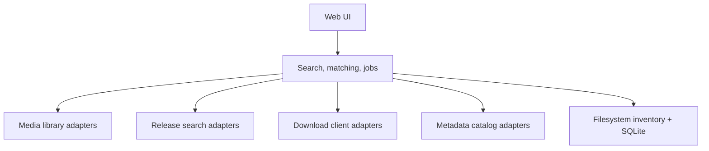

# Media Acquisition Manager

**Status: Phase A in progress — not usable yet.** Version 0.1.0 is being built, and Phase B
(releases 0.2.0 and 0.2.1, the version the app now reports) has started. Today the app is an
API and a web shell that report their own health, with accounts, integration settings and the
library: the installation owner created on first run, the users the owner manages, sign-in, and a
Profile page where everyone changes their own password; the owner connects Jellyfin, a Torznab
source such as Prowlarr and qBittorrent, tests each connection, and imports the Jellyfin library —
its movies, series and episodes — which every signed-in user can browse, with what each file really
holds once the app has inspected it inside the media folders the owner allows; the owner also scans
those folders for the files no library reported, which the app then inspects too — saying how much
room the files take, each file counted once however many names lead to it, and hashing the files
that could be copies of each other —, and maps download destinations to qBittorrent's categories,
and a release source's tracker sections to destinations. Every signed-in user searches the library
and the release sources together on the Search page, for movies and TV, sends a release found there
to qBittorrent, and sees its download on the Jobs page until it finishes. Once the owner connects
TMDb, every signed-in user also gets recommendations of the films, series, cartoons and documentaries
the library doesn't have yet, each with why it is there and what the release sources carry of it,
and downloads one through the Search page like any other; see [ROADMAP.md](ROADMAP.md).

Media Acquisition Manager is a self-hosted application for people who prefer to choose media
releases themselves. It brings your existing library and available releases into one search view,
sends a selected release to a configured download client, and helps identify duplicates. When you
explicitly request a replacement, it waits until the new file has been downloaded and verified
before touching the selected old copy.

The initial workflow targets Jellyfin, Toloka through a Torznab-compatible indexer gateway, and
qBittorrent. These are intended to be the first integrations, not permanent limits on the
application.

> **Security:** until the owner account exists, whoever opens the app first becomes the owner, and
> the app speaks plain HTTP. Create the owner first, then open the port only on a network you trust
> or behind a reverse proxy that adds HTTPS. The Docker Compose file publishes the port on
> `127.0.0.1` for that reason. See [Security](#security).

## Stack

| Layer | Choice |
| --- | --- |
| API | ASP.NET Core on .NET 10, controllers, JWT bearer access tokens |
| Data | EF Core + SQLite in WAL mode; migrations applied on startup |
| Tests | xunit.v3, Moq, `WebApplicationFactory` over real HTTP with a throwaway SQLite database |
| Web app | React 19, React Router 7, TanStack Query 5, zustand, axios, Radix Dialog, lucide-react, react-i18next |
| Build | Vite + React Compiler, strict TypeScript, ESLint, Vitest + Testing Library |
| Styling | CSS tokens and semantic classes, no CSS framework |
| Ship | One Docker image (API + web app) for amd64 and arm64; Jenkins tests every commit and publishes releases to Docker Hub |

## Features

### Available now

- **Accounts and sign-in.** The first visit creates the installation owner; everyone else signs in
  with the user name and password the owner gave them. A session lasts 30 days from its last use,
  and signing out, disabling a user, or resetting or changing a password takes effect at once. See
  [Security](#security).
- **User management for the owner.** The Users page (**Users** in the owner's user menu) searches
  and pages through the users on the server, adds a user, disables or enables one, resets a
  password, and deletes one after a confirmation. The owner's own account can't be disabled or
  deleted.
- **Your profile.** Every signed-in user opens the Profile page from their user menu (**Profile**,
  or their name at the top of the menu): their user name, role, when the account was created and
  last signed in, and when this session ends unless it is used again. **Change password** asks for
  the current password and the new one twice, ends the user's other sessions and keeps this one
  ([ADR 0016](docs/adr/0016-a-users-own-password-change-keeps-the-session-it-was-made-from-and-ends-the-others.md)).
  The **Recommendations** card switches each of the user's four recommendation lists on or off and
  sets how many release-source searches the app may run for them a day, with how many it ran in the
  last 24 hours; each user changes only their own. The theme can be picked there too, and **Sign
  out** is at the bottom.
- **Light, Dark or System.** The **Theme** row of the user menu, and Profile, switch the web app to
  a light or a dark theme, or follow the operating system's setting as it changes. The choice is
  kept in each browser and applied before the first paint, and every open tab of the app takes it.
- **Integration settings for the owner.** The Integrations page (**Integrations** in the owner's
  user menu) searches by name, filters by kind (media library, release source, download client,
  metadata catalog) and pages on the server; adds Jellyfin, a Torznab feed, qBittorrent or TMDb,
  edits one, switches it off and removes it after a confirmation. **Test connection** checks an
  unsaved integration from its dialog, and a row's **Test** checks a saved one, each answering with
  a sentence that says what the service did. Services that report file paths take path mappings onto the app's own mounts
  ([ADR 0003](docs/adr/0003-service-paths-reach-the-app-through-an-explicit-prefix-mapping.md)).
  Credentials are stored encrypted and never shown again. Jellyfin feeds the library, and a
  switched-off one can't be synced; a Torznab feed is searched for releases, and a switched-off one
  is left alone; qBittorrent's categories are what download destinations name, and a switched-off
  one isn't asked for them or sent a release; TMDb, with the owner's own API Read Access Token, is
  the metadata catalog the recommendations come from, and a switched-off one isn't asked. The
  Jellyfin connection test refuses a Jellyfin older than 10.9, the oldest the app reads libraries
  from, and the qBittorrent one a qBittorrent older than 4.4.1.
- **The library.** The Library page (**Library** in the header, for every signed-in user) lists the
  movies and series of the owner's Jellyfin libraries as works: movie items that share an IMDb or
  TMDb id are one work with several versions, never merged by title and year. Each movie shows its titles,
  year and identifiers, a warning for a missing IMDb or TMDb id, and its versions — as rows that sum
  up each file and open to it, or side by side in a table for 2 to 6 versions, one choice per
  browser and rows on a phone — with their files, where Jellyfin sees them and where the app finds
  them through the path mappings; what Jellyfin didn't report shows as unknown. A series is one card
  however many series items Jellyfin makes of it, with the show's IMDb, TMDb TV and TVDB ids and its
  seasons — read from its episodes' own numbers: regular seasons, then specials, then the episodes
  with no season — each opening to its episodes, loaded a page at a time, each with its versions and
  files; an episode of no series is a card of its own with its season and number, and an episode
  Jellyfin lists without a file is left out
  ([ADR 0019](docs/adr/0019-a-series-is-a-work-its-episodes-point-at-its-seasons-come-from-their-numbers-and-an-episode-without-a-file-is-left-out.md)).
  The server searches by title, original title, IMDb, TMDb or TVDB id, year or path, reaching into a
  series' episodes, filters by Jellyfin library, by kind (movies or series) or by a missing id of
  the work's kind, and pages, with titles in Ukrainian alphabetical order. The owner imports a
  library with **Sync now**: a background sync reads all of it — its movies, series and episodes —,
  in Jellyfin 10.9 or later, before it replaces anything, so a failed one changes nothing, and
  nothing in the library or in Jellyfin is moved, renamed or changed
  ([ADR 0008](docs/adr/0008-a-library-sync-replaces-its-sources-snapshot-only-after-reading-all-of-it.md)).
  Removing a Jellyfin integration removes the library it imported from the app, never the files.
- **Verified file facts.** Each file shows what it really holds, read by `ffprobe` from the file
  itself: duration, resolution, video codec and profile, dynamic range (SDR, HDR10, HLG, Dolby
  Vision), overall bit rate, and every audio track (language, codec, channels) and subtitle
  (language, codec, forced, SDH); what the file doesn't say shows as unknown, never guessed. The app
  reads only inside the media folders the owner allows on the **Media folders** page — none by
  default — resolving every link and refusing one that leads out of them. An inspection runs in the
  background after every successful sync or scan of the media folders, at each start and on
  **Inspect files**, two files at a time; a file is read again only when its identity, size or
  modification time changes, and two names of one file are read once
  ([ADR 0009](docs/adr/0009-the-app-reads-a-file-only-inside-the-allowed-roots-and-keeps-each-reading-by-the-files-identity.md)).
  The Library page shows how many files of each source were inspected, couldn't be read or wait,
  and why a file couldn't be read (the reason to the owner only).
- **The files no library reported.** **Scan folders**, on the **Media folders** row under the
  Library page's sources, walks every allowed media folder — hidden folders included, a link
  followed only when it ends inside them, a loop walked once, no file opened — for video files by
  their extension, Blu-ray and DVD clips included. A file Jellyfin lists, a movie's or an
  episode's, is recognised by its path through the current path mappings, never by its name; each
  file no library lists is remembered by one name of its own, with no work, and the file inspection
  then reads it like the library's files. The row shows how far the scan has got, how many files it
  found, how many are in no library and how far the inspection of those has got, and how many
  folders or links it didn't go into, the reason to the owner only. A folder the app can't list now
  — a disk that is away — keeps what was found there before. Only the owner starts a scan, and the
  app never starts one by itself
  ([ADR 0021](docs/adr/0021-the-scan-of-the-media-folders-follows-links-only-inside-the-allowed-roots-and-keeps-one-name-of-each-file-no-library-reported.md)).
- **The room the files take, and the files that could be copies.** The Library page says how much
  room on disk the files of each Jellyfin source, the files in no library and all the files take,
  each file counted once, by its device and inode, however many names — hardlinks — lead to it, with
  the size the app read itself rather than the library's word; the names it hasn't measured yet are
  counted apart. Every file inspection ends by reading in full, one at a time, only the files whose
  size a file of another identity shares and whose media facts don't tell the two apart, for their
  SHA-256, kept under the file's identity, size and modification time, so a file is read whole again
  only when it changes, and a file that changed while it was read keeps nothing. The inspection's
  row shows how far it got, and why a file couldn't be hashed to the owner only. A file a torrent
  seeds counts and is hashed like any other, and no download client is asked ([ADR
  0022](docs/adr/0022-a-file-is-hashed-only-when-a-file-of-another-identity-shares-its-size-and-could-be-its-copy-as-the-last-step-of-the-inspection-one-at-a-time.md),
  [ADR
  0018](docs/adr/0018-a-file-is-a-duplicate-whatever-a-torrent-client-does-with-it-and-its-space-counts-once-per-identity.md)).
  The hashes aren't shown yet: grouping the copies on a Duplicates page is still to come.
- **Search: your library and the release sources side by side.** Every signed-in user types a title
  in the search field at the top of every page (`/` jumps to it) and presses Enter; the Search page
  looks for it in the library and in every enabled release source at once. A year in brackets at
  the end of the line is the year, "Interstellar (2014)", while a bare number stays in the title
  ([ADR 0015](docs/adr/0015-only-a-bracketed-trailing-year-in-the-header-search-becomes-the-year.md)),
  and the page narrows the search by a year, an IMDb id and a TMDb id in fields of their own
  (owner's choice), and by a season; a film's TMDb id also comes in its address (`?tmdbId=`), as a
  recommendation's **Releases** opens it. **In your library** shows each matching movie or series
  as the Library page does, versions and verified file facts included, with how it matched — by
  IMDb or TMDb id, by title and year, or by title alone as a possible match to check — and a
  warning when ids conflict; every match is listed, strongest first, and nothing is picked or merged. Below the
  matches come up to 20 works that don't match but one of whose titles or file paths holds every
  word searched for, each whole, marked as no match, with how many more there are and a link to the
  Library page searched for the same text
  ([ADR 0012](docs/adr/0012-a-search-or-a-release-matches-a-library-work-by-identifier-then-title-and-year-then-title-alone-and-every-match-is-listed.md));
  an episode that matches lists its series. **Available releases** lists every movie and TV release
  found — each source is asked for both, TV in its TV categories by the title without the year —,
  even for a work already in the library, with its source, size, seeders and peers, publish date and
  what its title claims — resolution, medium, codec, dynamic range, audio and subtitle languages,
  and for TV the seasons and episodes — marked as claims, and the library copies it matches among
  those listed, the works by words included, by the title and year read from its title and by the
  ids its listing gives, never by words: a TV release matches series only, saying how many episodes
  of what it claims the library holds, and a movie release movies only
  ([ADR 0020](docs/adr/0020-a-release-is-tv-by-its-category-matches-only-series-and-its-tracker-section-picks-the-destination-offered-first.md));
  a film Toloka files in TV/Anime or TV/Documentary is a movie release unless its title or
  description names seasons or episodes, and the movie search asks those categories too. Each
  release shows its source's own title under its own when the listing gives one — Toloka's topic
  title, Ukrainian first. Each source answers for itself, so one that fails says why beside the
  others' releases. The
  server filters by source, kind (movies or TV), audio language, quality and size, sorts by seeders,
  size, date or quality, and pages; the search is stored for a day, so a filter, a page or a reload
  never asks the sources again
  ([ADR 0011](docs/adr/0011-a-search-is-stored-once-and-every-filter-sort-and-page-reads-what-it-stored.md)).
  Each release has **Details**, its listing beside the matching copies' verified facts, **Open
  source** and **Download**, which sends it to a download client (below). The API also keeps
  MAM-10's single-answer search (`POST /api/releases/search`). Toloka through Prowlarr is searched
  by title (and year, for movies) and lists no ids, so its releases match by title and year. Download
  links stay on the server
  ([ADR 0004](docs/adr/0004-toloka-is-searched-through-prowlarr-and-download-links-stay-on-the-server.md)).
- **Download destinations for the owner.** The Destinations page (**Destinations** in the owner's
  user menu) names where downloads go — `Movies`, `Movies 4K` — each one a category qBittorrent
  already has, which qBittorrent confirms before the destination is saved; the app never sends a
  folder of its own, so the category decides where a download lands. Each destination shows where
  its category saves, as qBittorrent sees it and as the app does through the path mappings, and
  whether that is inside a Jellyfin library folder; when it isn't, or when the app can't tell, it
  says why. One destination is the default, the first one added unless the owner picks another, and
  removing it leaves none until the owner picks one. Searched and paged on the server; qBittorrent
  4.4.1 or later
  ([ADR 0010](docs/adr/0010-a-destination-is-a-download-clients-own-category-never-a-folder.md)).
  Removing a qBittorrent under Integrations removes its destinations too, and its confirmation says
  so; the downloads sent to them keep their names. A destination's dialog also lists each release
  source's tracker sections, read from the source when it opens — Toloka's «Мультсеріали»,
  «Телесеріали», … — for the owner to tick the ones whose releases go there; the Download dialog then
  opens on the destination a release's section is mapped to, the source's own section before a
  standard category, and else on the default (ADR 0020).
- **Send downloads to the right destination.** **Download** on a release opens a dialog for every
  signed-in user (MAM-13's decision 1): a download client that can take the release, one of its
  destinations — the one the release's tracker section is mapped to, else the default, picked
  first — and a summary of what goes where, existing copies kept. A TV release is sent as a movie
  is. The server fetches the release itself and hands qBittorrent the destination's category with
  automatic torrent management — never a folder of the app's, so the category's folder is where it
  lands — once it has confirmed that qBittorrent still has the category and doesn't have the torrent
  already. One click sends at most one download: the job is written with the request id the browser
  made before anything is sent, a retry or a second click answers that job, a submission is never
  sent twice, and qBittorrent's id or the torrent's info hash confirms it, with several candidates
  left for linking by hand rather than guessed. A release already sent to that client is refused,
  unless its job failed or was cancelled. Its download is then followed on the Jobs page (below)
  ([ADR 0013](docs/adr/0013-a-download-is-written-down-before-anything-is-sent-and-one-request-sends-it-at-most-once.md)).
- **Follow each download until it finishes.** The Jobs page (**Jobs** in the header, last, for every
  signed-in user) lists the caller's own jobs — the owner's too: a job stays its sender's — newest
  first, filtered by status and paged on the server: each with its status, a bar of its progress,
  where it went and when, and, when it isn't moving on, why. A job's page adds its facts and its
  files, each with its size and progress, and which ones qBittorrent skips. The app reads qBittorrent
  every 2 seconds in the background, whether or not anyone has the page open, and keeps nothing in
  memory, so a restart goes on where it stopped: `Submitted`, `Downloading`, `Paused`, and
  `Downloaded` once qBittorrent has finished it with a progress of 1, which ends the following. A
  client error, a torrent qBittorrent no longer lists and a client that can't be asked keep the job's
  status with the reason and keep it followed, so it goes on once the cause clears; a send a stop
  interrupted is settled once it is 5 minutes old, and can't be cancelled before then, while it may
  still be being sent. **Cancel job** stops the following and nothing more: nothing is sent to
  qBittorrent, so the torrent and its files stay as they are, and the release may be sent again. The pages refresh every 2 seconds while they show a followed job
  ([ADR 0014](docs/adr/0014-a-download-is-followed-by-reading-its-client-and-cancelling-it-only-stops-the-following.md)).
- **Recommendations of what the library doesn't have yet.** Once the owner connects TMDb, the
  Recommendations page (**Recommendations** in the header, for every signed-in user) lists films,
  series, cartoons and documentaries the library lacks, in four tabs — Movies, Series, Cartoons and
  Documentaries, by the catalog's genres — each card with its poster, Ukrainian and original title,
  year, genres and rating, and every reason it is there as a chip: a collection's missing parts ("2
  of 3"), more by a director or creator two or more of the library's works are by, what the catalog
  recommends beside the library's works ("Because you have …"), a held series' aired seasons with no
  episode ("Missing seasons 4–5"), what a release source just published ("New on Toloka"), and for a
  tab the library holds little of, the best-rated works a source carries. The order is a fixed score
  of those reasons and of the rating, weighted by its votes, unless the reader sorts the tab by
  rating, votes, newest or oldest, title or how many releases were found; a work recommended for
  taste alone needs a solid rating from enough votes; works
  not out yet, the library's own (by id, or by title and year, kinds apart) and those the scan's file
  names claim are left out
  ([ADR 0023](docs/adr/0023-a-recommendation-only-proposes-explains-every-reason-and-never-sends.md)).
  A background run computes the lists after every sync, when TMDb is connected and on the owner's
  **Recompute now**, from the catalog's answers kept in tables of their own, read again after 30
  days and never written to the library
  ([ADR 0025](docs/adr/0025-the-catalog-is-kept-apart-from-the-library.md)); while it runs, the page
  shows its stage, how far through it is ("240 of 815") with a progress bar, and how long ago it
  started — a first run is a few minutes of calls to TMDb. Each card says what the
  release sources carry of it — "4 releases · up to 2160p · Ukr", "Not found (checked 3 days ago)",
  "Not checked yet" —, asked by the app within each user's daily limit (60 by default), at most 4
  searches every 15 minutes, shared by every user, and Toloka's newest releases are read every 3
  hours ([ADR 0024](docs/adr/0024-release-sources-are-asked-for-recommendations-within-a-per-user-budget.md)).
  The server filters by reason, genre, decade, films or series and **Available only**, sorts by the
  **Sort** select, kept in the address beside the tab, and pages.
  **Releases** opens the Search page for the work, and **Download** there sends it as any release:
  nothing is sent by itself. **Not interested** hides a work for that user alone, with **Undo**; a
  card says **Downloading** while anyone's download of it is followed, and leaves the list once that
  download has finished, waits to be linked or was cancelled. Each user's Profile switches the tabs
  and sets the limit.
- **Service status.** The web app shows its version and whether the service is ready; when it is
  not, it names the check that failed. While the server can't be reached, a strip under the header
  says so and asks `GET /api/health` every 5 seconds until it answers; every failed load says what
  failed and why, with **Try again** when asking again can help, and the data already on screen
  stays.
- **Health endpoints** for uptime monitors: liveness and readiness. See
  [Health endpoints](#health-endpoints).
- **Zero-config start.** On first run the API creates its SQLite database, applies the migrations
  and generates its own secrets. See [Configuration](#configuration).
- **One Docker container.** `docker compose up -d` runs the published image with nothing to
  configure; the container reports healthy only when the database is ready. See
  [Quick start](#quick-start-docker-compose) and [Deployment](#deployment).

### Tested with

The integrations were tried against the reference installation, whose recorded answers are the
adapters' test samples, through the app run from this repository. MAM-15 checked Phase A's
acceptance bar there on 2026-10-03; the earlier tickets' live checks are listed too.

| Service | Version tried | Used as |
| --- | --- | --- |
| Jellyfin | 12.1.0 | Media library |
| Prowlarr, serving the Toloka.to indexer over Torznab | 2.6.5, read on 2026-09-29 (a Torznab feed doesn't say its version) | Release source |
| qBittorrent | 5.2.4 | Download client |
| TMDb | API v3, read on 2026-10-05 | Metadata catalog |

- **Jellyfin:** the connection test, and syncs of all its movies, collections included (876 items
  on 2026-10-03). The header search "Sherlock Holmes (2009)" found the movie inside
  `/media/movies/Guy Ritchie. Collection` where it is, matched by title and year. A sync after
  every other check listed each of the 866 files of the 2026-10-01 sync at the same path with the
  same size: nothing was moved, changed or removed.
- **Prowlarr and Toloka:** the connection test, and searches by title and year — "Interstellar"
  2014 answered 16 movie releases on 2026-10-01, "Sherlock Holmes" 2009 answered 12 on 2026-10-03,
  six of them matched to the copy in the library. With the feed pointed for one search at an
  indexer Prowlarr doesn't have, the Search page said under **Available releases** "Prowlarr ·
  Answered in a way this app can't read. Nothing answers Torznab at this address (404 Not Found)…"
  and still showed the library's match. On 2026-10-02 a release was fetched through Prowlarr for a
  download, and a fetch Prowlarr failed ("Download failed") ended its job `Failed` with that
  sentence, having sent nothing.
- **qBittorrent:** the connection test, its four categories and their folders, and the destination
  Movies landing in the Jellyfin library "Фільми" at `/media/movies` (2026-10-01). On 2026-10-02 a
  release went into the category Movies with automatic torrent management and no save path, and was
  confirmed by the info hash the app worked out. On 2026-10-03 that request, sent again with its
  request id, answered with the same job, and the same release from a new search was refused as
  already sent: still two jobs, and nothing added to qBittorrent. The background passes that follow
  a job ran against it too, for a torrent qBittorrent no longer lists.
- **Series and TV releases (MAM-32, 2026-10-05):** a sync read 1,359 items — Jellyfin's 10 series,
  its 471 episodes less the 31 virtual ones, and the movies — into 1,292 works and 7 series (The Grand
  Tour's four series items, one per season folder, are one show by their shared ids), 1,382 versions
  and 1,378 files, 504 of them episodes'. The four episodes Jellyfin lists with no series (files at
  the root of a library folder) are cards of their own. The header search "Yellowstone" listed the
  show with its five seasons and 9 TV releases from Toloka: the packs of seasons 1-3, 4, 5 and 1-5
  matched by title and year with 29, 10, 14 and 53 of its episodes held, the BBC "Yellowstone (S1)
  (2009)" only as a possible match, and Season 5 narrowed them to the 3 packs holding it. With
  Toloka's sections ticked under Settings → Destinations, the Download dialog offered TV Shows for
  the show, Documentary for the BBC and nature films, and Cartoons for the four "Mickey Mouse
  Clubhouse" packs.
- **The scan of the media folders (MAM-18, 2026-10-05):** an image of this change ran on the
  installation's host beside production, on a copy of its data and with `/media` mounted read-only.
  Its start applied `AddFolderScan` to the copied database — the rebuild of `PhysicalFiles` logged
  warning 20410 and kept every row. **Scan folders** found 1,395 media files in `/media` and no
  folder or link it couldn't walk: the 1,378 files Jellyfin lists, movies' and episodes' alike, each
  matched to its file row by path, and 17 no library reports. The other 1,394 lie in the library
  folders, the number MAM-17 counted; the one outside them is a software disc image at the root of
  `/media`. The inspection the scan queued read exactly those 17 with ffprobe on the real disk —
  16 read, the disc image unreadable with ffprobe's own verdict — and took the 1,378 others from the
  cache; a second scan and its inspection read nothing.
- **TMDb and Toloka's newest releases (MAM-33, 2026-10-05):** the app's container on the
  installation's host reaches `api.themoviedb.org` and `image.tmdb.org` directly, with no proxy. With
  Vasyl's API Read Access Token, the library's 640 TMDb movie ids were read in about 3 minutes (943
  calls; TMDb sent no rate-limit header): 279 of the movies sit in 118 collections, 42 of them
  incomplete with 63 released parts missing, and 138 directors have two or more films in the library
  (Guy Ritchie 15, Ridley Scott 12, Steven Spielberg 11). By a script's estimate the library lacks
  4,891 released films, 2,274 of them over a rating floor with a collection, a director or two
  recommending films behind them; How the Universe Works misses seasons 3 to 11, MobLand season 2 and
  The Grand Tour seasons 5 and 6. Of the movies with no TMDb id, 10 have an IMDb id, of which TMDb
  found 8, and a title-and-year search found exactly one film for 23 of 25 Tom & Jerry shorts, while
  the Planet Earth episodes found nothing. Prowlarr answers Toloka's `t=search` with no text with its
  latest 90 releases, newest first, each with Toloka's own title in its description, and `offset`
  pages through nothing; 12 of the latest 90 in TV/Anime and TV/Documentary named no season — films
  such as "Akira (1988)" and series named by their episodes alone such as "Death Note (E1-31 of 37)".
  A movie search sent with those two categories found the documentary "Schumacher '94" filed in
  TV/Documentary. TMDb was then connected under **Integrations** with Vasyl's token, and the
  computation adding it queued finished in 3 min 15 s: 815 seeds — 640 by their TMDb id, 169 found by
  title and year or by IMDb id, and 6 shows — and 3,634 candidates, 2,852 in Movies, 545 in Cartoons,
  135 in Documentaries and 102 in Series, 109 of them top-rated fallbacks waiting for a release source
  to carry them. It recommends How the Universe Works for seasons 3 to 11, The Grand Tour for seasons 5
  and 6 and MobLand for season 2, and Planet Earth too, as the library holds its episodes as movie
  items with no id (MAM-34 links them).

Not tried live yet:

- Jackett, other gateways and indexers, and a feed that searches by IMDb or TMDb id, lists them or
  gives magnet links.
- qBittorrent before 5.2 — the answers of 4.4.1 to 5.1 are written from qBittorrent's source — and
  a qBittorrent on a Windows host.
- A Jellyfin older than 12.1 (the app takes 10.9 and later), and one that merges several versions
  into one item, which the reference installation never does.
- A download followed through `Downloading` to `Downloaded`, a paused one, a job's files, and a job
  that needs linking.
- A TV release sent to qBittorrent (MAM-32): the destination its tracker section picks was checked
  live, but no TV release was sent.
- Links in the media folders and a media disk that is away during a scan (MAM-18): the scan of the
  reference installation met no link leading out and its disk was mounted, so a link followed or
  refused, a loop and the names kept for a disk that is away rest on the tests.
- Hardlinks and byte-identical copies (MAM-19): the reference installation has no file with a second
  name and no two video files of one size (MAM-17), so the space counted once per file and the
  hashing of the files that could be copies rest on the tests; MAM-22 does the live check.
- The app's checks of Toloka for the recommended works within the users' limits, its reading of
  Toloka's newest releases for "New on Toloka", and a download sent from a recommendation (MAM-33):
  the catalog, a computation of the recommendations, Toloka's newest releases read by hand and the
  films in TV/Anime and TV/Documentary were checked live, the rest rests on the tests.

### What it will do

- **Link a download by hand.** Tie a job the app couldn't tell apart from the client's other
  downloads (**Needs linking**) to the right one, so it is followed like any other.
- **Detect duplicates without conflating different editions.** Distinguish hardlinks,
  byte-identical files, different versions of the same title, and uncertain matches.
- **Replace a selected copy safely.** Offer `Keep both` by default. If replacement is chosen, verify
  the specific new file, its identity, and its visibility to the media server before moving the
  specific old copy into quarantine where possible.
- **Respect existing libraries and seeding.** Work with nested collection/trilogy folders and
  multifile torrents without requiring a library-wide rename or interrupting active torrents.

The application should remain usable when a search provider fails, an item has incomplete metadata,
or a replacement needs manual review. It must never silently delete a file because a download
reached 100%.

### Replacement rules

These rules apply to any future implementation:

- An existing file is never selected for removal solely by a fuzzy title match.
- The user must choose the specific old copy to replace. Keeping both is the default.
- Client completion, file existence, media inspection, identity matching, and media-server
  visibility are separate checks.
- A multifile release requires mapping the new *file*, not just its download job, to the old file.
- Recheck the old file's path and filesystem identity immediately before touching it.
- Never modify files needed by an active torrent or assume that deleting a hardlink recovers its
  apparent size.
- Ambiguity, failed checks, or uncertain container path mappings stop the replacement and request
  review.
- Record every state transition and make recovery after a process restart safe.

## Quick start (Docker Compose)

You need Docker with Compose 2.24 or newer. Put [docker-compose.yml](docker-compose.yml), and
[deploy.sh](deploy.sh) for later updates, in an empty directory and start the app there:

```bash
docker compose up -d
```

Open <http://localhost:8118>. With no configuration at all, the app creates its database and
generates its secrets on the first start, on the `mam-data` volume, and the first page asks you to
create the owner account, who then adds the other users. To change the image tag, the port or who
can reach the app, copy [.env.example](.env.example) to `.env` next to the compose file and set only
what you need; see [Deployment](#deployment).

To build the image from a checkout of this repository instead of pulling it:

```bash
docker compose -f docker-compose.build.yml up -d --build
```

## Planned architecture



The core works with media works, versions, physical files, releases, and persisted jobs, and every
title, identifier, version, file and release it stores names the source that reported it
([ADR 0006](docs/adr/0006-every-title-identifier-and-file-the-core-stores-names-its-source.md)).
Adapter contracts keep it independent of any one media server, indexer, download client or
catalog. The first four adapters exist: Jellyfin's reads the library, the Torznab adapter searches
releases, reads a source's newest releases and fetches a release's download, qBittorrent's lists its
categories with the folders they save to, adds a release, finds its torrents by info hash or by
category, and reads their state and their files, and TMDb's reads the film and TV catalog the
recommendations come from — a work's details, collections, people, searches, finds, discovery,
genres and posters — and looks up which catalog work a title or an id may be.
The core's contracts for libraries, release search, download clients, file inventory and metadata
live in Core and name no product
([ADR 0005](docs/adr/0005-the-core-knows-a-service-only-through-a-registered-adapter-type.md)).

| Integration type | First candidate | Planned extension examples |
| --- | --- | --- |
| Media library | Jellyfin | Plex, Emby |
| Release search | Torznab via Prowlarr (Jackett should work the same way) | Other Torznab/Newznab providers, direct adapters |
| Download client | qBittorrent | Transmission, SABnzbd, others |
| File inspection | The local mounts inside the allowed roots, and `ffprobe` | Additional inventory backends if needed |
| Metadata | TMDb | Other film and TV catalogs if needed |

Toloka is searched through Prowlarr: it signs in to the tracker with your account, reads its search
pages, and serves the results as a standard Torznab feed, so the app needs no code specific to
Toloka. A search through Prowlarr worked against the real installation (MAM-6); Prowlarr's download
links carry its API key, so the app fetches them itself, from the feed's own address only, and never
shows them
([ADR 0004](docs/adr/0004-toloka-is-searched-through-prowlarr-and-download-links-stay-on-the-server.md)).
A direct Toloka adapter is an option if the gateway proves unsuitable.

## Security

- **Create the owner before anyone else can reach the app.** Until the owner exists, every page
  leads to the setup page, and whoever submits it first becomes the owner; after that setup answers
  409 for good. Every API endpoint but health, setup, sign-in, refresh and sign-out needs a
  signed-in user, and every page of the web app but setup and sign-in leads to sign-in without one.
  The Docker Compose file publishes the port on `127.0.0.1` unless `APP_BIND_ADDRESS` says
  otherwise. Personal access tokens for scripts arrive with MAM-5.
- **Plain HTTP only.** The app serves no TLS, so passwords and tokens cross the network as they are.
  Open it only on a network you trust, or put a reverse proxy that terminates HTTPS in front of it.
- **Passwords.** User names are 3–32 ASCII letters, digits, `.`, `-` and `_`, in any letter case;
  passwords are 8–128 characters with no composition rules, and there is no email reset and no
  second factor. Passwords are stored as PBKDF2-HMAC-SHA256 with 600 000 iterations and a 16-byte
  random salt, never in a form that can be read back.
- **Short-lived access tokens and a refresh cookie.** Sign-in returns a 15-minute access token
  (HS256, signed with `Jwt:Secret`) that the web app keeps in memory only, and a refresh token in
  the `mam_refresh` cookie: `HttpOnly`, `SameSite=Strict`, `Path=/api/auth`, and `Secure` when the
  request came over HTTPS (a browser won't store a `Secure` cookie from a plain-HTTP address). A
  session ends 30 days after its last use. Every refresh rotates the cookie, and the database keeps
  only its SHA-256 hash; a replaced cookie presented again more than 30 seconds later revokes the
  session, since that is what a copied cookie looks like.
- **Every request checks its session.** A valid token is not enough: its session must still be live
  and its user enabled, so signing out, disabling or deleting a user and resetting or changing a
  password take effect on the next request, not when the token expires. Disable and delete end every
  session of the user; a reset, and a user's change of their own password, end all but the one it
  was made from
  ([ADR 0016](docs/adr/0016-a-users-own-password-change-keeps-the-session-it-was-made-from-and-ends-the-others.md)).
  Rotating `Jwt:Secret` signs nobody out — to lock someone out, disable them or reset their password
  ([ADR 0002](docs/adr/0002-every-authenticated-request-checks-its-session.md)).
- **One answer to every failed sign-in.** An unknown user, a wrong password, a disabled account and
  a blank field all get the same 401 `{ "error": "The user name or password is incorrect." }` after
  the same single password hash, so neither the answer nor its timing tells which user names exist.
- **Rate limit.** Sign-in and setup allow 10 attempts a minute per client address; more get 429
  `{ "error": "Too many attempts. Wait a minute and try again." }` with `Retry-After: 60`. A user
  changing their own password gets 10 attempts a minute per user, from whatever address and counted
  apart from sign-in, then the same 429: a stolen access token can't spread its guesses for the
  current password over many addresses, and a mistyped one doesn't use up the sign-ins of everyone
  behind the same router. Refresh isn't limited: its cookie holds 256 random bits.
- **Owner-only settings.** Every action of a controller under `Controllers/Settings` that changes
  something is owner-only because of where the controller lives, not because someone remembered an
  attribute; `SettingsWritesAreOwnerOnlyConventionHttpTests` pins it. The Users, Integrations and
  Destinations endpoints are owner-only for reading as well. Anyone else gets 403
  `{ "error": "Only the installation owner can do this." }`, logged as a warning.
- **The library is everyone's to read; syncing it is the owner's.** Every signed-in user reads the
  Library's works, libraries, sources and sync runs, which carry no address or key. Starting a sync
  is owner-only, as it sends the stored Jellyfin key to the server and replaces what everyone reads.
  It lives outside `Controllers/Settings`, so it declares the gate itself, and
  `LibraryWritesAreOwnerOnlyHttpTests` sends every library endpoint that isn't a GET as a non-owner
  and expects 403. A failed sync's reason can name the service's address, a path problem quotes the
  owner's path mappings, and who started a sync is the owner's sign-in name, so only the owner gets
  them; everyone else gets `null`.
- **Release search is everyone's, and each search its creator's; why a source failed is the
  owner's.** Every signed-in user may search (owner's choice), which sends the stored Torznab key to
  the owner's gateway and, through it, searches the tracker with the owner's account. A search the
  Search page stores is its creator's alone: asked for by anyone else, the owner included, it answers
  the same bare 404 as one that doesn't exist or is more than a day old, so nobody reads through the
  app what someone else searched for, and deleting a user removes their searches
  ([ADR 0011](docs/adr/0011-a-search-is-stored-once-and-every-filter-sort-and-page-reads-what-it-stored.md)).
  The search endpoints are every signed-in user's, so their controller lives outside
  `Controllers/Settings` and `Controllers/Library`. A source's failure can name its address, so only
  the owner reads the sentence, also when a stored search is read again; everyone gets its status. A
  search's library side keeps the Library's rules: why a file couldn't be read and why a file has no
  app path go to the owner only. A release reaches the browser without its download link: the link
  is sealed to the release's row, without the gateway's key, which the fetch puts back. Page links
  lose the forum session (`sid`), and a link or id that could carry a credential isn't shown or
  stored as it is
  ([ADR 0004](docs/adr/0004-toloka-is-searched-through-prowlarr-and-download-links-stay-on-the-server.md)).
- **Sending a release is everyone's, and each download job its sender's.** Every signed-in user may
  send a release of their own searches to a download client (MAM-13's decision 1), which makes the
  server fetch it from the owner's gateway and add it to the owner's qBittorrent. So the endpoints
  live in `Controllers/Downloads`, outside `Controllers/Settings` and `Controllers/Library`, whose
  writes are owner-only by convention. The Download dialog's choices carry names only — no address,
  folder or path mapping — and a release of anyone else's search, or of one more than a day old,
  answers as unavailable. A job is its sender's: another user's answers the same bare 404 as one
  that doesn't exist. Why a send failed, in the source's or the client's own words, is the owner's —
  those words can name the service's address — so anyone else reads the app's sentence naming the
  service, as on the Search page; the app's own sentences, such as a torrent the client already has,
  are everyone's. A release already sent to a client is refused whoever sent it, as the client is
  the household's, and a torrent the client already has is never taken over
  ([ADR 0013](docs/adr/0013-a-download-is-written-down-before-anything-is-sent-and-one-request-sends-it-at-most-once.md)).
  The jobs list, a job's files and Cancel keep the rule (MAM-14's decision 1): each answers the
  caller's own jobs, the installation owner's included, and another user's job is the same bare 404.
  Why a followed job isn't moving on follows the error's rule: qBittorrent's own sentence, which can
  name its address, is the owner's, and anyone else reads the app's sentence naming the client.
- **Following a download reads qBittorrent and never writes to it.** Every 2 seconds the app signs
  in, or uses the session it keeps, and sends qBittorrent GETs only — its version, the followed
  torrents by hash, a destination's torrents by category (every torrent, kept to the category in the
  app, for a category whose name holds a `+`, which qBittorrent can't read in a query), a torrent's
  files. Cancelling a job writes
  the app's own row and audit row and sends qBittorrent nothing: the download client contract has no
  member that removes, deletes, stops or pauses anything, and a convention test keeps it so. After
  qBittorrent refused the credentials the passes don't sign in again until the owner changes them or
  a connection test with them works, so they never add to qBittorrent's ban of the app's address. The
  log names a job by its id and its statuses only, never a title, a path, an address or a sentence
  ([ADR 0014](docs/adr/0014-a-download-is-followed-by-reading-its-client-and-cancelling-it-only-stops-the-following.md)).
- **Recommendations are everyone's to read, and each user's choices their own.** Every signed-in user
  reads the recommendations and the latest computation, which carry no address or token; their
  controllers live outside `Controllers/Settings` and `Controllers/Library`, and **Recompute now**,
  which spends the owner's TMDb token, declares itself owner-only. Why a computation failed can name
  the catalog's address, and who asked for one is a user's sign-in name — the owner's for **Recompute
  now**, the saver's when a Profile save switches on a tab nobody else has on —, so only the owner
  reads them. "Not interested" and the Profile's lists and daily limit are each user's own: a user reads
  and changes only theirs, under `/api/profile` rather than `/api/auth`, where the refresh cookie
  goes. The app asks the release sources about recommended works by itself only within each user's
  daily limit, at most 4 searches every 15 minutes, so the owner's tracker account is never crawled
  ([ADR 0024](docs/adr/0024-release-sources-are-asked-for-recommendations-within-a-per-user-budget.md)).
  The posters are fetched by the server from TMDb's image host alone (`https://image.tmdb.org`, a
  constant, never an address an answer gives), without any credential, kept only when TMDb answers a
  JPEG or a PNG, cached in `<data>/posters/` and served by the app only to a signed-in user and only
  for a file name that is a catalog work's poster, so the endpoint is no proxy to the image host; why
  a fetch failed goes to the owner only, as it can quote the catalog's address. The web app shows the
  posters as `data:` URLs, so the browser never contacts TMDb and the Content Security Policy is
  unchanged ([ADR 0025](docs/adr/0025-the-catalog-is-kept-apart-from-the-library.md)).
- **The app reads files only inside the allowed roots.** It opens a library file only when the
  path, and every link on the way to it, lies inside a folder the owner allowed on the **Media
  folders** page (owner-only, reading included); none is allowed by default, and the whole file
  system, a relative path or a `..` can't be. A link that leads out of the folders, into the app's
  own `/data` say, is refused like any other path outside them, and so is a link swapped in after
  the check: the file is opened without following one, and `ffprobe` reads that open file only, as
  `file:<path>` with `-protocol_whitelist file` and a `-format_whitelist` of video containers, so a
  crafted file can't make it open a URL or the files a list inside it names, through an argument
  list (no shell), for at most 2 minutes and 8 MiB of answer. Asking for
  an inspection is owner-only; why a file couldn't be read, which quotes paths and what ffprobe said,
  goes to the owner only
  ([ADR 0009](docs/adr/0009-the-app-reads-a-file-only-inside-the-allowed-roots-and-keeps-each-reading-by-the-files-identity.md)).
  The scan of the media folders walks only those folders, by the same rules: it follows a link only
  when it ends inside them, never lists through one leading out, doesn't walk again a folder that
  leads back to one above it, opens each folder on Linux name by name without following a link and
  lists the folder it opened, and opens no file and writes nothing. It stops at 100,000
  folders or 200,000 entries, so links can't keep it walking for hours. Asking for a scan is
  owner-only, and the sentence of a place it didn't scan, which quotes a path, goes to the owner only
  ([ADR 0021](docs/adr/0021-the-scan-of-the-media-folders-follows-links-only-inside-the-allowed-roots-and-keeps-one-name-of-each-file-no-library-reported.md)).
  The hash of a file that could be a copy reads its bytes by the same rules — inside those folders,
  every link resolved, from the file the checks opened, on Linux that very descriptor, never the path
  again — and asks the open file for its facts again afterwards, so a file swapped or changed
  meanwhile is never hashed; it writes nothing but the app's own database. The sentence of a file it
  couldn't hash, which quotes a path, goes to the owner only
  ([ADR 0022](docs/adr/0022-a-file-is-hashed-only-when-a-file-of-another-identity-shares-its-size-and-could-be-its-copy-as-the-last-step-of-the-inspection-one-at-a-time.md)).
- **Audit trail.** Setup, every change to a user (create, disable, enable, password reset, delete),
  every user's change of their own password (`UserPasswordChanged`), every change to an integration
  (add, edit, remove), every save of the media folders, every change
  to a destination (add, edit, remove), every download sent (`DownloadRequested`, written with its
  job before anything is fetched or sent) and every job cancelled (`DownloadCancelled`) write an
  audit row in the same transaction as the change:
  what happened, when, who did it and to whom or what, with both names copied so the row outlives
  them. A save that changes nothing and a connection test write none, and neither does a retry of a
  download already sent, a cancel of a job that already ended, a library sync, a file inspection —
  its hashing included — or a scan of the media folders, whose run rows record who started them;
  nor does a pass that follows the downloads, which no one started. A computation of the
  recommendations writes none either, its run row recording who asked for it, and neither does a
  user's "Not interested", its undo or a save of their Profile's recommendation settings, which are
  that user's own preferences, nor a check of the release sources for a recommended work. There is no
  screen for it yet.
- **Integration credentials.** The Jellyfin and Torznab API keys, TMDb's API Read Access Token and
  the qBittorrent password are stored encrypted with AES-256-GCM under `Encryption:Key`, each sealed
  to its integration and
  field, so a value copied to another row or column doesn't open. The API never returns one, nor
  what it is sealed as: an integration says only `hasPassword` and `hasApiKey`, and a field left
  empty on an edit keeps what is stored. A stored secret that can't be read (the key changed, or the
  value was copied) fails only that integration's test, with 409 and a sentence asking to enter it
  again; it is never cleared on its own. A secret a service repeats in its answer is masked before
  the sentence reaches the page or a failed sync's stored reason, and none is logged: the
  integration HTTP clients log no request URLs, because a Torznab key rides in the query. TMDb's
  token travels only in an `Authorization: Bearer` header, never in a URL. Requests that carry
  credentials never follow a redirect (the test reports where it pointed, without its query), share
  no cookies and are never retried, but for a TMDb GET that TMDb answered 429, sent again at most
  three times after the wait TMDb asked for. The qBittorrent adapter keeps the session it signed
  in for in memory, one per integration and only while its address and credentials stay the same,
  masked like the password and never logged; when qBittorrent has forgotten it, the adapter signs in
  once more and sends that one read again, and never a write. The one write, a submission's
  `torrents/add`, follows a read that renews such a session and is never sent again, a 403 to it
  included. No call repeats a failed sign-in, and a sign-in qBittorrent refused — the credentials,
  or the app's address banned — is remembered in memory the same way, so no later call sends it while
  the address and credentials stay the same, since each refused one counts towards qBittorrent's ban
  of the address: the page says so until the owner corrects them or a connection test with them
  works. It never reads qBittorrent's preferences, which carry the Web UI's API key and the proxy and
  mail passwords. An address can't hold a user name, a password or a query. There is no guard against
  private addresses: the services live on the owner's network, and only the owner can enter one. The
  one address a service supplies, a release's download link, is fetched when the release is sent,
  only from the Torznab feed's own scheme, host and port, and only once: a redirect to a magnet is
  the release, any other redirect is refused. The fetched link and a magnet's trackers stay on the
  server: the app neither fetches nor checks the trackers — qBittorrent does — and the magnet and
  every address in it are masked in whatever qBittorrent answers, so nothing of them reaches the
  browser or a job's error. A feed's error text has every address cut to its host and every
  `passkey=`-like value masked before it is shown, since it can quote a tracker's URL with a passkey
  the app doesn't hold
  ([ADR 0007](docs/adr/0007-an-integration-credential-is-sealed-to-its-row-and-never-leaves-through-the-api.md)).
- **Behind a reverse proxy.** The app takes the client's address from the connection and ignores
  `X-Forwarded-For`, which any client can write. Behind a reverse proxy that address is the proxy's,
  and a connection Docker's own proxy relays (one from the host itself to a port published on
  `127.0.0.1`, or any connection on Docker Desktop) comes from Docker's gateway. All those clients
  then share one sign-in limit: ten failed attempts a minute from anyone keep everyone from signing
  in for as long as they keep at it. The app also sees plain HTTP behind a TLS-terminating proxy, so
  the refresh cookie is not marked `Secure` there; `HttpOnly` and `SameSite=Strict` still apply.
- **The container runs unprivileged.** The app runs as user `mam` (uid 10001), its own files belong
  to root and are read-only to it, and the only persistent place it can write is `/data` (besides
  the usual scratch space in `/tmp`). The media mounts in the compose file's examples are read-only.
- **Security headers on every response:** `X-Content-Type-Options: nosniff`,
  `X-Frame-Options: DENY`, `Referrer-Policy: no-referrer`, and a Content Security Policy that
  forbids inline scripts and allows images only from the app itself and `data:` URLs, the
  recommendations' posters included. The only inline script, which applies dark mode before the
  first paint (`frontend/index.html`), is allowed by its SHA-256 hash, pinned in
  `SecurityHeadersMiddleware.ThemeScriptHash`. Change one byte of that script and
  `SecurityHeadersHttpTests` fails until the hash is updated.
- **Secrets never live in the repository.** Committed `appsettings*.json` files hold `null` for
  every secret; real values come from environment variables, .NET User Secrets or first-run
  generation. See [Configuration](#configuration).
- **Errors never leak internals.** An unhandled exception answers 500 with a trace id to quote,
  never the exception text.

## Deployment

The image is `vahac/media-acquisition-manager` on Docker Hub, for `linux/amd64` and `linux/arm64`:

| Tag | What it is |
| --- | --- |
| `latest` | The newest release. |
| `X.Y.Z`, e.g. `0.1.0` | A release. Rebuilding it (a fix, newer base images) publishes it again under the same tag. |
| `X.Y`, e.g. `0.1` | The newest release of that minor version. |

Only releases are published; a commit to `main` is tested but never pushed.

How the image is built and released is in [PUBLISHING.md](PUBLISHING.md).

**Compose settings.** Set them in `.env` next to `docker-compose.yml`; [.env.example](.env.example)
explains each one. Every other variable in `.env` is passed to the app (see
[Configuration](#configuration)).

| Variable | Default | What it does |
| --- | --- | --- |
| `APP_TAG` | `latest` | The image tag to run. Pin a release to update only when you choose to. |
| `APP_BIND_ADDRESS` | `127.0.0.1` | The host address the port is published on. `0.0.0.0` opens the app to your network, over plain HTTP: create the owner account first, and keep to a network you trust or a reverse proxy that adds HTTPS. |
| `APP_PORT` | `8118` | The host port. The app listens on 8118 inside the container too. |

**Updating.** Keep [deploy.sh](deploy.sh) next to `docker-compose.yml` and run it from that
directory:

```bash
bash deploy.sh
```

It pulls the image `APP_TAG` names, recreates the container and waits until it reports healthy; if
it doesn't, it prints the recent health probes and the container log. The app migrates its database
on startup, so there is no separate migration step.

**Health.** The image's health check probes `GET /api/health/ready` every 30 seconds (every 2
seconds during the first 150 seconds after a start), so `docker ps` shows `healthy` only when the app
answers and its database is open and fully migrated. When it isn't,
`docker inspect media-acquisition-manager` shows the failing check's reason under `State.Health`.

**Data and backups.** Everything the installation keeps is in `/data` inside the container, on the
`mam-data` volume: `mam.db` and the generated secrets in `.secrets/`, and the recommendations'
posters in `posters/`, a cache never pruned that needs no backup, as a missing poster is fetched
again while TMDb is connected. Back up
`mam.db` and `.secrets/` together, with the container stopped:

```bash
docker compose stop app
docker run --rm --volumes-from media-acquisition-manager -v "$PWD:/backup" alpine tar czf /backup/mam-data.tgz -C /data .
docker compose start app
```

To keep the data in a host directory instead of the volume, replace `mam-data:/data` with that
directory, and create it for the container's user and for that user alone first, as the image does
with `/data` (the database files inside are otherwise readable by every user on the host):

```bash
sudo install -d -o 10001 -g 10001 -m 700 <directory>
```

**Media folders.** Mount them read-only (`:ro`) — the app writes nothing to the library; a release
you send is written by qBittorrent, through its own mount, into its category's folder — at the path
Jellyfin sees them at, so a library path means the same file to the app. A download client
often sees the same folders under another path (qBittorrent under `/downloads`, say); don't mount
them a second time for it: map its paths onto yours under **Integrations** → the client →
**Path mappings** (`/downloads` → `/media`), as
[ADR 0003](docs/adr/0003-service-paths-reach-the-app-through-an-explicit-prefix-mapping.md)
explains. The compose file has a commented example. If you can't mount them where Jellyfin sees
them, give the Jellyfin integration path mappings the same way; the Library page shows any file
they leave without a path in the app. The Destinations page reads both integrations' mappings to
tell whether each qBittorrent category saves inside a Jellyfin library, and says so when they leave
a category's folder without a path in the app. The container's user (uid 10001) needs read access:
files readable by everyone (the usual 644 and 755) need nothing more; otherwise add the group that owns
them to the service with `group_add`. Mounting is not enough for the app to read a file: the owner
also adds the folder, as the app sees it (`/media` in the compose file's example), under the user
menu → **Media folders**. Until then the app reads no file, and **Inspect files** and **Scan
folders** on the Library page say so. A mount the app doesn't see shows on the Library page as files
it found nothing at, and to a scan as a media folder it couldn't list or found empty.

## Local development

To work on the app, run it from source; to just run it, see
[Quick start](#quick-start-docker-compose).

**Prerequisites:** the [.NET 10 SDK](https://dotnet.microsoft.com/download/dotnet/10.0) and
[Node.js 24](https://nodejs.org/) with npm. The `dotnet-ef` tool is needed only to add migrations
(see [Database migrations](#database-migrations)).

Run the API and the Vite dev server in two terminals, from the repository root:

```bash
dotnet run --project src/MediaAcquisitionManager.Api
```

```bash
cd frontend
npm ci
npm run dev
```

Open <http://localhost:5173>. Vite serves the web app with hot reload and proxies `/api` to the API
on <http://localhost:5080>. On first start the API creates `src/MediaAcquisitionManager.Api/Data/`
with the SQLite database `mam.db` and the generated secrets in `.secrets/`; both are git-ignored.

### Serving the built web app from the API

This is how the Docker image serves it: one process, one port. Build the frontend, then point
the API's web root at `frontend/dist`. Pass an absolute path, because a relative one resolves
against the API project directory rather than your shell's. From the repository root (bash or
PowerShell):

```bash
cd frontend
npm ci
npm run build
cd ..
dotnet run --project src/MediaAcquisitionManager.Api -- --webroot "$PWD/frontend/dist"
```

Open <http://localhost:5080>.

## Configuration

The API reads `appsettings.json`, .NET User Secrets (in the Development environment), environment
variables with the `MAM_` prefix, and command-line arguments. In a variable name a double
underscore separates sections: `MAM_Storage__DataDirectory` sets `Storage:DataDirectory`.
[.env.example](.env.example) lists every variable with its trade-offs.

| Variable | Default | What it does |
| --- | --- | --- |
| `MAM_Storage__DataDirectory` | `Data` (`/data` in the Docker image) | Directory for the SQLite database `mam.db` and the `.secrets/` directory. A relative path resolves against the API's content root. The Docker Compose file pins it to `/data`, the volume. |
| `MAM_Encryption__Key` | generated on first run | Base64 of 32 random bytes. Encrypts the stored integration credentials (AES-256-GCM). A value that isn't base64 of exactly 32 bytes makes saving a credential, or testing with a stored one, fail with a trace id, and the log names this variable; changing it makes every stored credential unreadable until it is entered again. |
| `MAM_Jwt__Secret` | generated on first run | Base64 of 64 random bytes (at least 32). Signs the 15-minute access tokens. Rotating it signs nobody out: the tokens already issued stop working, and open tabs quietly get new ones through their refresh cookie, which this key doesn't sign. |

The standard ASP.NET Core variables apply as usual (`ASPNETCORE_URLS`, `ASPNETCORE_ENVIRONMENT`).
The folders the app may read files in are not configuration: the owner sets them on the **Media
folders** page, and they live in the database
([ADR 0009](docs/adr/0009-the-app-reads-a-file-only-inside-the-allowed-roots-and-keeps-each-reading-by-the-files-identity.md)).
The image brings `ffprobe`; run from source, the app finds it on the `PATH` (install FFmpeg).

**First-run secrets.** When `Encryption:Key` or `Jwt:Secret` is blank, the API reads it from
`<data>/.secrets/encryption-key` or `<data>/.secrets/jwt-secret`, or generates it there on the first
start (directory 0700 and files 0600 on Linux and macOS). A value you set explicitly always wins,
and then no file is written. An existing file is never overwritten: a start that has to generate
one does it under a lock (the empty file `.secrets/.creating.lock`, which stays), so two instances
started at once against one data directory agree on one value. An empty secret file stops the
startup with a message that says what to do and what a new value would cost: a new encryption key
would orphan everything encrypted with the old one, while a new JWT secret only makes the access
tokens already issued stop working (nobody is signed out). Back up `.secrets/` together with
`mam.db`, which holds the accounts, sessions and integrations: the integrations' stored credentials
open only with the encryption key they were sealed with.

**User Secrets (development).** A fresh checkout needs none: first-run generation covers it. To pin
a value in development without committing it, the Api project has a `UserSecretsId`:

```bash
dotnet user-secrets set "Jwt:Secret" "<base64 value>" --project src/MediaAcquisitionManager.Api
```

## API surface

| Request | Answer |
| --- | --- |
| `GET /api/health` | Liveness: 200 while the process is up. Runs no checks. The web app asks it every 5 seconds while it can't reach the server. |
| `GET /api/health/ready` | Readiness: 200 when the service is ready, 503 when a check fails. |
| `GET /api/setup` | 200 `{ "isRequired": true }` until the owner exists, `false` after. Anonymous. |
| `POST /api/setup` with `{ userName, password }` | Creates the owner and signs them in: 200 as for sign-in. 400 with the broken rule's sentence; 409 once an owner exists; 429 over the rate limit. Anonymous. |
| `POST /api/auth/sign-in` with `{ userName, password }` | 200 `{ accessToken, accessTokenExpiresUtc, user: { id, userName, isOwner } }` and the `mam_refresh` cookie. Any failure: 401 `{ "error": "The user name or password is incorrect." }`; 429 over the rate limit. Anonymous. |
| `POST /api/auth/refresh` with the cookie | 200 as for sign-in, with the cookie rotated. 401 `{ "error": "Your session has ended. Sign in again." }` and the cookie deleted; 409 when a refresh with the same cookie won a moment ago (retry). Anonymous. |
| `POST /api/auth/sign-out` with the cookie | 204; ends the cookie's session and deletes the cookie. Needs no access token. |
| `GET /api/auth/me` | 200 `{ id, userName, isOwner, createdUtc, lastSignInUtc, sessionExpiresUtc }`: `lastSignInUtc` is the user's latest sign-in on any device, `null` before the first, and `sessionExpiresUtc` the end of the session the access token belongs to, which each refresh moves to 30 days later. |
| `POST /api/auth/password` with `{ currentPassword, newPassword }` | Every signed-in user, for their own account. 204; every other session of the user ends at once and the caller's stays ([ADR 0016](docs/adr/0016-a-users-own-password-change-keeps-the-session-it-was-made-from-and-ends-the-others.md)), with an audit row. 400 `{ error }`, changing nothing: "Enter your current password." for a blank one, the broken rule's sentence for the new one, "The current password is incorrect." for a wrong one (never 401, and also when an owner's reset, disable or delete lands while it is being checked). 429 over the rate limit, counted per user. |
| `GET /api/settings/users?search=&page=1&pageSize=25` | Owner only. 200 `{ items, totalCount, page, pageSize }`, each item `{ id, userName, isOwner, isDisabled, createdUtc, lastSignInUtc }`, ordered by user name; `search` matches part of the name in any letter case. 400 for a page below 1 or a page size outside 1–100. |
| `GET /api/settings/users/{id}` | Owner only. 200 with the user; 404. |
| `POST /api/settings/users` with `{ userName, password }` | Owner only. 201 with the user and its `Location`; 400 with the broken rule's sentence; 409 when the name exists in any letter case. |
| `POST /api/settings/users/{id}/disable` | Owner only. 200 with the user, whose sessions all end. 409 for the owner; 404. |
| `POST /api/settings/users/{id}/enable` | Owner only. 200 with the user; the sessions the disable ended stay ended. 404. |
| `POST /api/settings/users/{id}/password` with `{ password }` | Owner only. 204; every session of the user ends except the caller's own. 400 with the rule's sentence; 404. |
| `DELETE /api/settings/users/{id}` | Owner only. 204; the user's sessions go with it. 409 for the owner; 404. |
| `GET /api/settings/integrations?search=&kind=&page=1&pageSize=25` | Owner only. 200 `{ items, totalCount, page, pageSize }`, each item `{ id, name, adapterType, adapterDisplayName, kind, isEnabled, baseUrl, userName, hasPassword, hasApiKey, pathMappings: [{ servicePrefix, appPrefix }], createdUtc }`, ordered by name; `adapterDisplayName` is `null` when this version no longer connects to the type. `search` matches part of the name in any letter case; `kind` is `MediaLibrary`, `ReleaseSearch`, `DownloadClient` or `Metadata`. 400 for a page below 1, a page size outside 1–100 or an unknown kind ("“x” is not a kind of integration. Use MediaLibrary, ReleaseSearch, DownloadClient or Metadata."). |
| `GET /api/settings/integrations/adapter-types` | Owner only. 200 `{ items }`, each `{ typeId, displayName, kind, userName, password, apiKey, reportsFilePaths }`, a credential being `NotUsed`, `Optional` or `Required`; the types are `jellyfin`, `torznab`, `qbittorrent` and `tmdb` (kind `Metadata`: an API key required, which is TMDb's API Read Access Token, no user name or password, and `reportsFilePaths` `false`). |
| `GET /api/settings/integrations/{id}` | Owner only. 200 with the integration; 404. |
| `POST /api/settings/integrations` with `{ adapterType, name, baseUrl, userName, password, apiKey, isEnabled, pathMappings }`, a secret as `{ mode: "Set", value }` | Owner only. 201 with the integration and its `Location`; `isEnabled` left out means on. 400 with the broken rule's sentence; 409 when the name exists in any letter case. Never answers a secret, only `hasPassword` and `hasApiKey`. A TMDb integration added switched on queues a computation of the recommendations, or joins the one waiting (ADR 0023); a full queue or a failure there leaves the answer as it is. |
| `PUT /api/settings/integrations/{id}` with the same fields but `adapterType`; a secret `{ mode: "Set", value }`, `{ mode: "Clear" }` or left out to keep; `isEnabled` and `pathMappings` left out to keep | Owner only. 204; `pathMappings: []` removes them all. 400 with the rule's sentence; 404; 409 when the name is taken or this version can't connect to the integration's type. Switching a TMDb integration back on queues a computation of the recommendations. |
| `GET /api/settings/allowed-roots` | Owner only. 200 `{ paths }`: the media folders the app may read files in, as the owner entered them, in canonical form; `[]` until the owner adds one. |
| `PUT /api/settings/allowed-roots` with `{ paths }` | Owner only. 204; replaces the whole list, `[]` or `null` allowing nothing, and writes an audit row. 400 with the broken rule's sentence (more than 20, not a full path, a `.` or `..` folder, the whole file system, a path of the other operating system's style, a folder twice or one inside another). Starts no inspection. |
| `DELETE /api/settings/integrations/{id}` | Owner only. 204, with its path and destination mappings and, for a release source, the tracker sections mapped to destinations; a media library's imported library goes with it (its titles, identifiers, episode positions, versions, files and libraries, and the works left empty), and a release source's newest releases read for the recommendations go with it, while its sync runs, the download jobs sent to it and what any other kind of integration reported — a metadata catalog's cached works included — keep its name. 404. |
| `POST /api/settings/integrations/{id}/test` | Owner only. Tests the saved integration, switched off or not, and saves nothing: 200 `{ status, message }` for every outcome of the test (`Succeeded`, `Unreachable`, `TimedOut`, `AuthenticationFailed`, `Refused`, `ServiceError`, `UnexpectedResponse`, and `UnsupportedVersion` for a Jellyfin older than 10.9 or a qBittorrent older than 4.4.1); 404; 409 when this version can't connect to its type or a stored secret can't be read. |
| `POST /api/settings/integrations/test` with `{ integrationId, adapterType, baseUrl, userName, password, apiKey }` | Owner only. Tests an unsaved integration and saves nothing: 200 as above; 400 with the broken rule's sentence; 404 with a sentence when `integrationId` names an integration that is gone; 409 as above. With `integrationId`, the stored type is used and a secret left out is the stored one. |
| `GET /api/settings/destinations?search=&page=1&pageSize=25` | Owner only. 200 `{ items, totalCount, page, pageSize }`, each item `{ id, name, isDefault, downloadClientId, downloadClientName, clientDestinationKey, check, createdUtc }`, ordered by name, then by the client's name; `search` matches part of the name in any letter case. `check` is `{ status, servicePath, appPath, libraryNames, problem }`, worked out when the list is read by asking each download client on the page once: `status` is `InLibrary`, `OutsideLibraries`, `PathUnknown`, `LibrariesUnknown`, `CategoryMissing`, `ClientDisabled` or `ClientUnavailable`; `servicePath` is the folder the client says the category saves to and `appPath` the same folder through its path mappings, each `null` when unknown; `libraryNames` the media libraries one of whose folders holds it; `problem` the sentence why, for every status but `InLibrary`. 200 whatever the clients answered. 400 for a page below 1 or a page size outside 1–100. |
| `GET /api/settings/destinations/{id}` | Owner only. 200 with the destination, checked; 404. |
| `POST /api/settings/destinations` with `{ name, downloadClientId, clientDestinationKey, isDefault, sections }` | Owner only. Asks the client whether it has the category spelled exactly so, then 201 with the destination, its check and its `Location`. `sections` (`[{ releaseSourceId, categoryIds, name, isSourceSpecific }]`, left out or `[]` for none) maps tracker sections of release sources to it in the same save (ADR 0020): each category of a source goes to one destination at most, and one mapped to another destination moves here; the source is never asked. A section that breaks a rule is 400 ("Pick the release source of each section.", "A section needs its name.", "A section's name can't contain line breaks or other control characters.", "A section needs at least one category of its release source.", "“x” is not a category id of a release source."), and one whose source isn't a release source is 404 "A release source you picked sections of no longer exists. Reload the page and pick them again.". The first destination, or one sent with `isDefault: true`, becomes the default and takes it from the one that had it. 400 with the broken rule's sentence (a name of 1–64 characters, a client, a category name of up to 256 characters, no control characters); 404 with a sentence when `downloadClientId` is not a download client; 409 when the client already has a destination of that name in any letter case, is switched off, is of a type this version can't send downloads to, has a stored secret the app can't read, or has no such category; 502 with the client's sentence when it couldn't answer. Writes an audit row. |
| `PUT /api/settings/destinations/{id}` with the same fields; `isDefault` and `sections` left out to keep | Owner only. 204. Asks the client only when the client or the category changes; `sections` replaces the destination's tracker sections, `[]` removing them all; `isDefault: false` on the default leaves none; a save that changes nothing writes no audit row. 404; otherwise as `POST`. |
| `DELETE /api/settings/destinations/{id}` | Owner only. 204 and an audit row; nothing changes in the client, a removed default leaves none, and the download jobs sent to it keep its name and category. 404. |
| `GET /api/settings/destinations/client-destinations/{downloadClientId}` | Owner only. What the download client offers right now: 200 `{ items, error }`, each item `{ key, displayName, check }` in the client's order, `check` as above. When the client couldn't be asked — switched off, a type this version can't send downloads to, a stored secret it can't read, or its call failed — `items` is empty and `error` says why. 404 when the id is not a download client. |
| `GET /api/settings/destinations/sections` | Owner only. The tracker sections of every release source, for the destination dialog (ADR 0020): 200 `{ sources }` whatever the sources answered, each release-search integration by name `{ id, name, sections, error }`, each section `{ name, categoryIds, isSourceSpecific, destinationId, destinationName }`. An enabled source is asked for its categories each time, all of them at once; the categories of one cleaned name (Prowlarr's leading `\|-` dropped), rank and destination are one section, in the source's order, and a mapped category the source no longer lists comes last under its stored name. A switched-off source, one of a type this version can't search and one whose key can't be read are not asked, and `error` says why, as it does with the masked sentence of one whose call failed; each still lists the sections mapped to a destination. Not paged: an update replaces a destination's sections, so the dialog needs every mapped one. |
| `GET /api/library/works?search=&locationId=&identifiers=&kind=&page=1&pageSize=25` | 200 `{ items, totalCount, page, pageSize }`, each work `{ id, kind, title, originalTitle, year, identifiers: [{ scheme, value, sourceName }], missingIdentifiers, versions: [{ id, sourceName, sourceItemId, editionLabel, observedUtc, files: [{ id, servicePath, appPath, pathStatus, pathProblem, sizeBytes, locationName, inspection }] }], episode, seasons }`, ordered by title in Ukrainian alphabetical order (Latin titles after Cyrillic ones); a value no library reported is `null`. A work is a `Movie`, a `Series` — listed once, when at least one of its stored episodes passes the search and filters, with no versions and its `seasons` `[{ number, episodeCount }]`: regular seasons, then the specials (`0`), then the episodes without one (`null`), counting the episodes the list keeps — or an `Episode` of no series, with its `episode` `{ seriesId, seasonNumber, episodeNumber }`; an episode of a series is listed only through its series (ADR 0019). `missingIdentifiers` names the schemes of the work's kind it lacks: `Imdb` and `Tmdb` for a movie, `Imdb`, `TmdbTv` and `Tvdb` for a series, `Imdb` and `Tvdb` for an episode. `inspection` is `null` until the app has looked at the file, then `{ status, problem, inspectedUtc, media }`: `status` is `Inspected`, `MediaUnreadable`, `NoAppPath`, `OutsideAllowedRoots`, `NotFound`, `NotARegularFile`, `Unreadable`, `IdentityUnknown` or `InspectorUnavailable`, `problem` the sentence why the file wasn't read (owner only), and `media` only when it was `{ durationMilliseconds, bitRate, tracks: [{ kind, codec, profile, width, height, dynamicRange, channels, channelLayout, language, isDefault, isForced, isHearingImpaired }] }`, `kind` being `Video`, `Audio` or `Subtitle` and `dynamicRange` `Sdr`, `Hdr10`, `Hlg` or `DolbyVision`; whatever the file didn't give is `null`. `search` matches part of a title or original title in any letter case, part of an IMDb, TMDb or TVDB id, a year, or part of a file path; `locationId` is a library from `locations`; `identifiers=Missing` keeps the works lacking an id of their kind; `kind` is `Movie` or `Series` in any letter case, `Series` taking the episodes of no series too. A search or `identifiers=Missing` that a series itself answers keeps all its episodes, otherwise only those that pass, and `locationId` goes by the episodes' files. `appPath` is worked out through the integration's current path mappings; `pathProblem` only for the owner, `null` for everyone else. 400 for a page below 1, a page size outside 1–100, a `locationId` that isn't an id, another `identifiers` value, or "“x” is not a kind filter. Use Movie or Series." |
| `GET /api/library/works/{id}/episodes?season=&search=&locationId=&identifiers=&page=1&pageSize=25` | A series' episodes, a season at a time (ADR 0019): 200 as for the works, each item an episode with its `episode`, versions and files, in the order of the series' seasons, then by episode number (a missing one last), then by title. `season` is a number up to 9999, `0` for the specials, `None` for the episodes without one, or blank for every season; `search`, `locationId` and `identifiers` as for the works, so a search the series itself answers lists every episode, and else the episodes that match. A bare 404 for an id that isn't a series', checked before anything else; 400 as for the works, or "“x” is not a season. Use a season number, or None for the episodes without one." |
| `GET /api/library/locations` | 200 `{ items }`, each `{ id, name, sourceName }`: the Jellyfin libraries that hold a file, by name. |
| `GET /api/library/sources` | 200 `{ items, inspection, scan }`, each media library integration `{ integrationId, name, adapterDisplayName, isEnabled, canReadLibrary, latestRun, lastSucceededRun, filesWithoutAppPathCount, pathProblem, inspection: { inspectedCount, problemCount, notInspectedCount, problem }, space }`, by name, `inspection` `{ hasAllowedRoots, activeRun, lastFinishedRun, hasQueuedRun, space }` for the whole library, each run as `GET /api/library/inspections/{runId}` gives it, and `scan` `{ activeRun, lastFinishedRun, hasQueuedRun, files, space }` for the media folders (ADR 0021), each run as `GET /api/library/scans/{runId}` gives it; an active run is the running one, else the queued one. `files` counts the names the scans stored that no file a library reported maps to now, as each library's `inspection` counts its files, so a sync that starts reporting a path, or a fixed path mapping, takes a name off at once; a scanned name never counts in a library's row. `space` `{ sizeBytes, fileCount, nameCount, unmeasuredCount }` is the room the files take on disk (ADR 0018, ADR 0022), counted when read over the integration's file names, over every stored file name for `inspection`, and over the names `files` counts for `scan`: each file once by its device and inode, with the size the app's last look read, never the size a library reported; `nameCount` is the names that lead to those files, and `unmeasuredCount` the names with no identity or size read, left out of `sizeBytes`. `pathProblem`, `problem` and each run's `requestedByUserName`, `problem`, `hashing.problem` and `error` only for the owner, `null` for everyone else; `space` is everyone's. |
| `POST /api/library/sources/{integrationId}/syncs` | Owner only. 202 with the queued run and its `Location`; the sync runs in the background. 404 for an unknown integration or one that isn't a media library; 409 when it is switched off, its type can't read a library, or a sync of it is under way; 503 when too many syncs are waiting. |
| `POST /api/library/inspections` | Owner only. 202 with the queued file inspection and its `Location`, or with the one already waiting, which the request joins; the inspection runs in the background. 409 `{ "error": "No media folders are allowed yet. Add the folders the app may read under Media folders in the user menu, then inspect again." }`; 503 when too many inspections are waiting. |
| `GET /api/library/inspections/{runId}` | 200 `{ id, trigger, status, requestedByUserName, createdUtc, startedUtc, finishedUtc, filesTotal, filesChecked, filesProbed, hashing, error }`, `trigger` being `Requested`, `LibrarySynced`, `AppStarted` or `FolderScanned` (queued by a scan once it stored its names). `hashing` `{ candidates, checked, read, problemCount, problem }` is the run's last step (ADR 0022): how many files need a hash — files whose size a file of another identity shares and whose media facts don't tell them apart, each once however many names lead to it; `null` until the step has listed them —, how many it has dealt with, how many it read in full in this run (the rest came from the cache or couldn't be hashed), how many it couldn't hash, and the first one's sentence. `requestedByUserName`, `hashing.problem` and `error` only for the owner. 404. |
| `POST /api/library/scans` | Owner only. 202 with the queued scan of the media folders and its `Location`, or with the one already waiting, which the request joins; one asked for while a scan runs is queued behind it. The scan walks every allowed folder in the background, follows a link only when it ends inside them, opens no file, stores one name with no version for each media file no library reported, then queues a file inspection (ADR 0021). 409 `{ "error": "No media folders are allowed yet. Add the folders the app may read under Media folders in the user menu, then scan again." }`; 503 `{ "error": "Too many folder scans are waiting. Try again in a minute." }`, the run kept as failed with it. |
| `GET /api/library/scans/{runId}` | 200 `{ id, status, requestedByUserName, createdUtc, startedUtc, finishedUtc, filesFound, filesUnreported, problemCount, problem, error }`, `status` being `Queued`, `Running`, `Succeeded` or `Failed`: `filesFound` is how many media files the walk has reached so far, each once however many links lead to it, `filesUnreported` how many of them no library reported (`null` until the scan stored them), `problemCount` how many folders, links and names it didn't go into or through, and `problem` the first one's sentence; `requestedByUserName`, `problem` and `error` only for the owner, `null` for everyone else. A bare 404 for an unknown run. |
| `GET /api/library/syncs/{runId}` | 200 `{ id, integrationId, integrationName, status, requestedByUserName, createdUtc, startedUtc, finishedUtc, itemsRead, itemsTotal, worksCount, seriesCount, versionsCount, filesCount, error }`, `status` being `Queued`, `Running`, `Succeeded` or `Failed`; the items are the library's movies, series and episodes, the works its movies and episodes, and `seriesCount` `null` for a run that didn't succeed or ran before 0.2.0; `requestedByUserName` and `error` only for the owner, `null` for everyone else. 404. |
| `POST /api/releases/search` with `{ text, year, imdbId, tmdbId, season }` | Every signed-in user. Searches every enabled release source at once, each for movies and then for TV (ADR 0020), and stores each release found. 200 `{ sources }` whatever the sources answered, by name, each `{ integrationId, name, status, notSearchedReason, error, releases }`: `status` is the call's outcome (`Succeeded`, `Unreachable`, `TimedOut`, `AuthenticationFailed`, `Refused`, `ServiceError`, `UnexpectedResponse`, …) or `null` when the app didn't ask the source, `notSearchedReason` (`SecretUnreadable`, `TypeUnavailable`, `NoUsableSearch`) says why, `error` the sentence for the owner only; each release `{ id, title, description, kind, sizeBytes, seeders, peers, publishedUtc, sourcePageUrl, categories: [{ id, name }], payloadKind, claimed: { resolution, medium, videoCodec, dynamicRanges, audioLanguages, subtitleLanguages } }` in the source's order, the movie releases then the TV ones, at most 100 of each per source, `description` the listing's own description when it says more than the title (Toloka's topic title, Ukrainian first; `null` otherwise), `kind` `Movie` or `Tv` (TV when the source lists it in a TV category — in TV/Anime or TV/Documentary alone only when its title or description names seasons or episodes —, or in none to a TV query), `payloadKind` `Magnet` or `null`, the release's download link never included. With a `season` (0 to 9999, 0 for the specials), only the TV search runs. 400 with the broken rule's sentence: no title, one longer than 200 characters, a year that isn't one, an id that isn't an IMDb (`tt0816692`) or a TMDb (`157336`) id, a season that isn't one; every field is a string. |
| `POST /api/searches` with `{ text, year, imdbId, tmdbId, season }` | Every signed-in user. Asks the library — the snapshot the last sync imported — and every enabled release source at once, the sources the way `POST /api/releases/search` does, and stores the search, how each source answered and every release found, for a day. 201 with the search and its `Location` whatever the sources answered: `{ id, text, year, imdbId, tmdbId, season, createdUtc, library, libraryUnlistedCount, sources, facets }`, the search as asked and trimmed. `library` is every matching work, strongest first, then at most 20 works that match in no way but one of whose titles or file paths holds every word of the title, each whole (ADR 0012), each `{ work, evidence, matchedIdentifiers: [{ scheme, value, sourceName }], matchedTitle: { text, kind, year, sourceName }, conflictingSchemes }`: `work` exactly as `GET /api/library/works` gives it, a movie, a series or an episode of no series — an episode of a series that the search finds lists its series once, with the episode's `matchedTitle` and `matchedIdentifiers` (ADR 0012) —, its owner-only fields `null` for everyone else; `evidence` `Identifier`, `TitleAndYear`, `TitleOnly` or `Words`, which is no match; `matchedIdentifiers` every source's row of a matched id; `matchedTitle` the title that matched, or for `Words` the title holding the words, `null` when none did or only a file path holds them; `conflictingSchemes` (`Imdb`, `Tmdb`, `Tvdb`, `TmdbTv`) the schemes the search and the work, or the work's own sources, disagree on. `libraryUnlistedCount` is how many more works hold every word of the title than `library` lists, `0` when none were left out. `sources` by name, each `{ id, integrationId, name, status, notSearchedReason, error, releaseCount }` as for the release search, `id` being what the releases' `source` filter takes and `integrationId` `null` once the integration is removed. `facets` `{ audioLanguages, hasUnknownAudioLanguage, resolutions, hasUnknownResolution, kinds }`: what the search's releases claim, and their kinds, `Movie` before `Tv`, for the filters. 400 with the broken rule's sentence, nothing stored and no source asked: "Enter the title to search for.", "The search text can be at most 200 characters long.", "The search text can't contain line breaks or other control characters.", "“twenty” is not a year.", "“816692” is not an IMDb id, which looks like tt0816692.", "“tt157336” is not a TMDb id, which is a number such as 157336.", "“first” is not a season. Use a season number, such as 1, or 0 for the specials." (a value is repeated trimmed, cut at 32 characters with "…"). |
| `GET /api/searches/{id}` | Every signed-in user, for their own searches. 200 as for `POST`: the sources as stored, never asked again, and the library matched again as it is now. A bare 404 for a search that doesn't exist, is someone else's (asked for by the owner too) or is more than a day old, whether or not it has been removed yet. |
| `GET /api/searches/{id}/releases?source=&kind=&language=&quality=&minSizeBytes=&maxSizeBytes=&sort=seeders&page=1&pageSize=25` | Every signed-in user, for their own searches. The releases the search stored, filtered, sorted and paged on the server without asking a source: 200 `{ items, totalCount, page, pageSize }`, each release `{ id, sourceId, sourceName, title, description, kind, sizeBytes, seeders, peers, publishedUtc, sourcePageUrl, payloadKind, claimed, claimedWork: { titles, year, lastYear, episodes }, identifiers: [{ scheme, value }], libraryMatches: [{ workId, evidence, conflictingSchemes, heldEpisodeCount }] }`: `description` and `kind` as for the release search, `description` `null` on a release stored before 0.2.1; `claimed` as for the release search, `claimedWork` the titles and the year its title is read as (no title when nothing says where it ends: no year, and for TV no season marker either), a TV title's span ending in `lastYear` and its seasons in `episodes` `{ firstSeason, lastSeason, firstEpisode, lastEpisode }`, `identifiers` the ids its listing gives, `libraryMatches` every work of the search's `library` it matches, those listed by words included, strongest first, by `Identifier`, `TitleAndYear` or `TitleOnly` and never by `Words` — a series for a TV release, a movie for a movie release (ADR 0020) —, with `heldEpisodeCount` on a TV match: how many of the series' episodes are in the seasons or episodes claimed, `null` when none are claimed; never its download link. `source` is one of the search's `sources[].id` (another search's lists nothing); `kind` `Movie` or `Tv` in any letter case; `language` a three-letter code in any letter case, or `unknown` for no audio language claimed; `quality` a resolution such as `1080`, or `unknown`; `minSizeBytes` and `maxSizeBytes` bounds in bytes, both inclusive, which leave out a release of unknown size; `sort` `seeders` (the default), `largest`, `smallest`, `newest` or `quality` (resolution, then seeders), in any letter case, a value the listing doesn't give always last and ties in the search's own order. A bare 404 as for `GET`, checked before any rule; 400 with the broken rule's sentence: "Page must be 1 or more.", "Page size must be between 1 and 100.", "“abc” is not a release source.", "“Show” is not a kind filter. Use Movie or Tv.", "“uk” is not a language code. Use a three-letter code such as ukr, or unknown.", "“HD” is not a resolution. Use one such as 1080, or unknown.", "“4GB” is not a size in bytes.", "The smallest size can't be larger than the largest.", "“best” is not a sort order. Use seeders, largest, smallest, newest or quality." |
| `GET /api/downloads/options?releaseId=` | Every signed-in user, for a release of their own searches. The Download dialog's choices, read from the database without asking any client: 200 `{ clients, suggestedDestinationId }`, by name, each `{ id, name, typeName, destinations: [{ id, name, clientDestinationKey, isDefault }] }` with its destinations by name — every switched-on download client of a type this version can send to that can take the release's payload (one whose kind the listing didn't state needs a client that takes a .torrent file or a magnet link) and has a destination; `typeName` is what it is ("qBittorrent"). `suggestedDestinationId` is the destination the dialog picks first (ADR 0020): among those offered, the one the release's stored categories are mapped to, its source's own section before a standard category; `null` when two different destinations tie at that rank; else the default when it is offered, else `null`. No address, folder or path mapping. 400 `{ "error": "Pick the release to send." }` without a well-formed `releaseId`; 404 `{ "error": "This release isn't available any more: a search keeps what it found for a day. Search again." }` for a release that isn't one of the caller's searches' from the last day. |
| `POST /api/downloads` with `{ requestId, releaseId, downloadClientId, destinationId }` | Every signed-in user, for a release of their own searches. Sends it at most once per request id (ADR 0013): the request id is looked up first, and the caller's same id for the same release, client and destination answers 200 with the job it made, nothing fetched, sent or audited again; otherwise the job is written with an audit row before anything is fetched or sent, and the answer is 201 with the job and its `Location` whatever came of the sending — `Submitted`, `NeedsLinking`, or `Failed` with its sentence. 400 with the broken rule's sentence: "The download has no request id, which keeps a retry from sending it twice. Reload the page and try again.", "Pick the release to send.", "Pick the download client to send it to.", "Pick the destination to send it to.", "“Movies” is a destination of another download client. Pick one of “qBittorrent”’s.", "“qBittorrent” can't take NZB files, which this release is."; 404 with "This release isn't available any more: a search keeps what it found for a day. Search again.", "The download client you picked no longer exists. Reload the page and pick one again." (also for an integration that isn't a download client) or "The destination you picked no longer exists. Reload the page and pick one again."; 409 with "This request id was already used to send a different download. Reload the page and try again.", "“qBittorrent” is switched off. The owner can switch it on under Integrations.", "This version of the app can't send downloads to “…”.", "The source that listed this release has been removed, so the release can't be fetched. Search again.", "“Toloka” is switched off, so its releases can't be fetched. The owner can switch it on under Integrations.", "This version of the app can't fetch releases from “…”." or, when a job that didn't fail already sent the release to that client, "This release was already sent to “qBittorrent”, so it isn't sent twice.". A refused request writes and sends nothing. |
| `GET /api/downloads?status=&page=1&pageSize=25` | Every signed-in user, for their own jobs, the installation owner's included. 200 `{ items, totalCount, page, pageSize }`, each item a job as `GET /api/downloads/{id}` answers it, newest first (by when it was sent, then by id); no client is asked. `status` is a job status by name in any letter case; blank lists every status. 400 for a page below 1, a page size outside 1–100, or "“x” is not a download status. Use Created, Submitted, Downloading, Paused, Downloaded, Failed, NeedsLinking or Cancelled." |
| `GET /api/downloads/{id}` | Every signed-in user, for their own jobs. 200 `{ id, releaseId, releaseTitle, sourceName, downloadClientName, destinationName, clientDestinationKey, status, progress, clientJobId, error, blockReason, createdUtc, statusChangedUtc }`, as `POST` answers it: `status` is `Created` (being sent, or how that went isn't known), `Submitted`, `Downloading`, `Paused`, `Downloaded`, `Failed`, `NeedsLinking` or `Cancelled`; `progress` from 0 to 1 as the client last reported it, `null` until it has; `clientJobId` the client's id of the download, `null` until the client lists it; `error` why it failed, every secret masked; `blockReason` why a followed job isn't moving on (the client reports an error, no longer lists it, or can't be asked), `null` when nothing blocks it, a client's own sentence for the owner only; the client's and the destination's names and the category as they were when it was sent. A bare 404 for another user's job or one that doesn't exist. |
| `GET /api/downloads/{id}/files?page=1&pageSize=25` | Every signed-in user, for their own jobs. 200 `{ items, totalCount, page, pageSize }`: the job's files as its client last listed them, in the client's order, each `{ position, path, sizeBytes, progress, isWanted }` — `path` relative to the job's folder exactly as the client names it, `isWanted` `false` for a file the client skips — and no items until the client has listed them. A bare 404 for another user's job or one that doesn't exist, checked before the paging; 400 for a page below 1 or a page size outside 1–100. |
| `POST /api/downloads/{id}/cancel` | Every signed-in user, for their own jobs. Stops following the job and sends the client nothing, so the torrent and its files stay there (ADR 0014): 200 with the job, now `Cancelled` with no `blockReason`, and an audit row. Only a job still followed or one that needs linking: 409 "This download is already finished, so there's nothing to stop following.", "This download has already failed, so there's nothing to stop following." or "This download is already cancelled, so there's nothing to stop following.", changing nothing; a `Created` job younger than 5 minutes, whose send may still be under way, is 409 "This download is still being sent, so it can't be cancelled yet. Try again in a few minutes.", changing nothing. A bare 404 for another user's job or one that doesn't exist. |
| `GET /api/recommendations?tab=&reason=&available=&genreId=&decade=&kind=&sort=Score&page=1&pageSize=25` | Every signed-in user, for their own lists (ADR 0023). One tab of the recommendations, filtered, sorted and paged on the server, without asking the catalog or a source: 200 `{ items, totalCount, page, pageSize, facets, catalogConnected, lastRun }`, the items ordered by `sort`, each `{ id, kind, catalogId, title, originalTitle, year, genres, rating, voteCount, posterUrl, reasons, availability, downloading, searchText, searchTmdbId }` — `id` the catalog work's, `kind` `Movie` or `Series`, `catalogId` TMDb's id, `title` in Ukrainian where TMDb has it, `genres` the names in alphabetical order, `rating` `null` when nobody rated it, `posterUrl` `/api/recommendations/posters/<file>` or `null`; `reasons` strongest first, each `{ kind, name, held, total, titles, seasons, dateUtc }`, `kind` being `MissingSeasons`, `Collection`, `Director`, `Creator`, `Recommended`, `NewAtSource` or `TopRated`, `name` the collection, person or source, `held` and `total` a collection's released parts held and released, a person's catalog works in the library, or how many of the library's catalog works recommend it, all of them (a work the library holds several times counts once), `titles` at most 5 of those works' titles, `seasons` the missing season numbers; `availability` `{ checkedUtc, found, releaseCount, bestResolution, hasUkrainianAudio, maxSeeders }` or `null` before the first check (ADR 0024); `downloading` while a followed download job's release is the work; `searchText` the title the sources are searched by and the year in brackets, and `searchTmdbId` a film's TMDb id as text (`null` for a show), what **Releases** opens the Search page with. `tab` is `Movies`, `Series`, `Cartoons` or `Documentaries` and the rest optional, in any letter case: `reason` a reason kind; `available=true` keeps the works a release source carries (`false` keeps all); `genreId` a catalog genre id; `decade` a decade's first year (`1990`); `kind` `Movie` or `Series`; `sort` `Score` by default — the score, then votes, title (ordinal) and catalog id —, `Rating` (the weighted rating `(votes × rating + 50 × 5.0) / (votes + 50)`, so a 10.0 of three votes doesn't top it), `Votes`, `Newest` or `Oldest` (by release date, a work of no known date last), `Title` (in Ukrainian alphabetical order, as the library's works) or `Releases` (the availability check's release count, the works found first, then those not found, then those never checked), ties falling back to the score's order; `pageSize` 1 to 100, 25 by default. `facets` `{ reasons: [{ kind, count }], genres: [{ id, name, count }], decades: [{ decade, count }], kinds: [{ kind, count }] }` count the caller's whole list of the tab before the request's filters, whatever the sort — the reasons in a card's order, the genres by name in Ukrainian alphabetical order, the decades and kinds in order —; `catalogConnected` says whether a metadata catalog is; `lastRun` as `GET /api/recommendations/runs/latest` answers it, or `null`. The caller's "Not interested" works are left out, and so is a fallback work until a check found it at a source. Every user's download jobs count, matched to a work by its kind and by an id the release gives or the title and year its title or description claims, and for a held series by a missing season or none named: a followed job (`Created`, `Submitted`, `Downloading`, `Paused`) makes a work `downloading`, one that ended without failing (`Downloaded`, `NeedsLinking`, `Cancelled`) leaves it out, winning over a followed one, and a failed one changes nothing. 400 with the first broken rule's sentence, the value repeated trimmed and cut at 32 characters with "…": "Choose a tab: Movies, Series, Cartoons or Documentaries.", "“x” is not a recommendation tab. Use Movies, Series, Cartoons or Documentaries.", "“x” is not a recommendation reason. Use Collection, Director, Creator, Recommended, MissingSeasons, TopRated or NewAtSource.", "“x” is not an availability filter. Use true or false.", "“x” is not a genre id, which is a number such as 18.", "“x” is not a decade. Use its first year, such as 1990.", "“x” is not a kind of work. Use Movie or Series.", "“x” is not a sort. Use Score, Rating, Votes, Newest, Oldest, Title or Releases.", "Page must be 1 or more.", "Page size must be between 1 and 100.", and "This tab is switched off in your profile." for a tab the caller has off. A page past the last is empty. |
| `PUT /api/recommendations/dismissals/{kind}/{catalogId}` | Every signed-in user, for themselves. "Not interested": the work — `Movie` or `Series`, in any letter case, and TMDb's id — is left out of the caller's lists from now on, and of no one else's (Vasyl's decision 3); a work no list holds yet is kept marked for when one does. 204, also when it already was. 400 with "“x” is not a kind of work. Use Movie or Series." or "“x” is not a catalog id, which is a number such as 603.", changing nothing. Writes no audit row. |
| `DELETE /api/recommendations/dismissals/{kind}/{catalogId}` | Every signed-in user, for themselves. **Undo** of "Not interested": 204, also when there was nothing to undo; another user's mark of the same work stays. 400 as for `PUT`. |
| `GET /api/recommendations/posters/{fileName}` | Every signed-in user. A catalog work's poster: 200 with the bytes, `image/jpeg` or `image/png` by the extension, and `Cache-Control: private, max-age=2592000, immutable`. The first request fetches it from TMDb's image host at `https://image.tmdb.org/t/p/w342` without any credential and keeps it in `<data>/posters/`, which is never pruned; later ones read it from there, a catalog connected or not (ADR 0025). A bare 404 for a name that is no poster file name, one no catalog work has, one the image host doesn't have, or one not kept while no metadata catalog is connected. 502 when the catalog couldn't send it — its sentence, masked of the token, for the owner, and "The metadata catalog couldn't send this poster." for everyone else —, nothing kept. The web app fetches it with the access token and shows it as a `data:` URL. |
| `GET /api/recommendations/runs/latest` | Every signed-in user. 200 with the latest computation of the recommendations — the running one, else the newest by when it was queued — `{ id, status, trigger, requestedByUserName, createdUtc, startedUtc, finishedUtc, seedCount, candidateCount, stage, stageDone, stageTotal, error }`: `status` `Queued`, `Running`, `Succeeded` or `Failed`; `trigger` `LibrarySynced`, `Requested`, `TabEnabled`, `CatalogConnected` or `FeedRead`; `stage`, while it runs, `ReadingLibrary`, `FindingLibraryWorks`, `ReadingWorks`, `ReadingCollections`, `ReadingPeople`, `Discovering` or `Saving`, and `null` when it isn't running, with `stageDone` of `stageTotal` the stage's items done (`240` of `815`), both `null` for a stage without counts — written at each change of stage and at most every 2 seconds within one; `seedCount` the library works the run started from and `candidateCount` the works it recommends, for every user together, both `null` unless it succeeded; `requestedByUserName` and `error` only for the owner, `null` for everyone else. 204 with no body before the first. |
| `POST /api/recommendations/runs` | Owner only (**Recompute now**). 202 with the queued computation, or with the one already waiting, which the request joins; one asked for while a run runs is queued behind it, and the run reads the library, the catalog and every enabled user's tabs as they are when it starts. 409 `{ "error": "Connect a metadata catalog under Integrations first." }` without a switched-on metadata catalog of a type this version serves; 503 `{ "error": "Too many recommendation runs are waiting. Try again in a minute." }`, the run kept as failed with it. |
| `GET /api/profile/recommendations` | Every signed-in user, for themselves. 200 `{ movies, series, cartoons, documentaries, dailySearchLimit, searchesLast24Hours }`: which of their four lists are on, how many release-source searches the app may run for their lists in 24 hours, and how many it ran for them in the last 24 hours. A user who never saved gets every list on and 60 (ADR 0024). |
| `PUT /api/profile/recommendations` with `{ movies, series, cartoons, documentaries, dailySearchLimit }` | Every signed-in user, for themselves. 200 with the settings as saved; writes no audit row. Switching on a tab no other enabled user has on — a user who never saved has them all on — queues a computation of the recommendations (`TabEnabled`, in the saver's name) or joins the one waiting; a full queue never fails the save. Every field is required: 400 with "Say whether the Movies tab is on." (and so for Series, Cartoons and Documentaries), "The daily search limit is a whole number from 0 to 500.", or for a body that isn't the settings "Send the settings as JSON: movies, series, cartoons and documentaries true or false, and dailySearchLimit a whole number from 0 to 500.", saving nothing. |
| Any other `/api/...` path, any method | 404 with `{ "error": "No API endpoint matches <METHOD> <path>." }`, signed in or not |
| Everything else | The web app's `index.html`, so client-side routes survive a reload |

Apart from the health endpoints, which answer with their own report (see
[Health endpoints](#health-endpoints)), every failure that carries a message answers
`{ "error": "<readable sentence>" }`. An unknown API path answers 404 JSON instead of the web app's
page, so a mistyped API call can't look like a success. A 404 for an id in the path that doesn't
exist has no body at all.

Health, setup, sign-in, refresh and sign-out need no access token; every other endpoint needs
`Authorization: Bearer <access token>`, and answers 401 `{ "error": "Sign in to continue." }`
without one or when the token's session has ended. An owner-only request from anyone else answers
403 `{ "error": "Only the installation owner can do this." }`. The refresh cookie is sent only to
`/api/auth`. Instants are UTC with a trailing `Z`.

### Health endpoints

Both endpoints are anonymous and answer `application/json`. Liveness always has an empty check
list:

```json
{ "status": "Healthy", "checks": [] }
```

Readiness checks the database: it must open and have every migration applied. `status` is
`Healthy`, `Degraded` or `Unhealthy`, and a failing check says why in a readable sentence:

```json
{
  "status": "Unhealthy",
  "checks": [
    { "name": "database", "status": "Unhealthy", "description": "The database has 1 pending migration." }
  ]
}
```

## Translations

The web app is in English, and every text it shows comes from
`frontend/src/locales/en/<feature>.json` through react-i18next — never from a component
([ADR 0001](docs/adr/0001-every-ui-string-comes-from-a-locale-resource.md)). New text gets a key in
the feature's file and is rendered with `t()`; `npm run lint` refuses literal text in markup, and
`npm run build` fails on a key that doesn't exist. Show dates, numbers and file sizes with the
helpers in `frontend/src/lib/format.ts`, which follow the UI locale.

To add a language, copy `frontend/src/locales/en/` to a folder named after its language code,
translate the values (keep the keys and the `{{placeholders}}`), and add it to `resources` in
`frontend/src/lib/i18n.ts`. Browsers that prefer that language then get it; anything not yet
translated falls back to English. Messages from the API stay in English.

## Tests

The whole .NET suite:

```bash
bash run-tests.sh
```

It builds the solution in Release and runs the test projects as parallel `dotnet test` shards; each
shard writes TRX and JUnit reports to its project's `TestResults/` directory. `CONFIG=Debug`,
`SHARDS=<n>` and `NO_BUILD=1` override the defaults. A plain run works too:

```bash
dotnet test MediaAcquisitionManager.slnx
```

API tests go over real HTTP through `WebApplicationFactory`, each test class against its own
throwaway SQLite database, so they never touch your `Data/` directory. Tests tagged
`Category=RequiresDocker` are excluded by default; there are none yet.

Real, sanitized answers of Jellyfin, qBittorrent, Prowlarr's Torznab feed and ffprobe are kept in
`tests/MediaAcquisitionManager.TestInfrastructure/VendorSamples/`, with a README saying where each
came from and how it was sanitized. The adapters' tests run against them: the connection tests,
and Jellyfin's library reads with variants made from the real movies (`JellyfinSamples`: merged
versions, stacked parts, a library of any size for paging). The API tests sync libraries from
`FakeJellyfinServer`, which answers from the same samples. The tests swap each integration's HTTP
handler for one that answers with a sample, so no test reaches a real service.
`VendorSamplesTests` fails the build if a sample carries a credential.

The release search is tested against the real Toloka answers through Prowlarr: the adapter reads the
caps and both search samples (`TorznabSamples` moves their download links to the test's own feed)
and Prowlarr's recorded answer to a wrong API key, and hand-written answers for what they don't show
— magnets, other gateways' shapes, credentials in every place a feed puts them, the other error codes
and statuses. The API tests search through `FakeTorznabServer`, one or several feeds at once, and
`ReleaseSearchSecretsHttpTests` plants the gateway's key, its link token, the forum session and
tracker passkeys and checks that none reaches an answer, the log or a release row. The live search
against the reference installation is checked through the app itself: the Toloka integration added
under Integrations, then a search through the API (16 movie releases for "Interstellar" 2014 on
2026-10-01).

The stored search is tested over HTTP against a real sync of `FakeJellyfinServer`'s library (works
are seeded directly only where no sync can give the case, such as two sources' conflicting ids) and
one or several `FakeTorznabServer` feeds, one class per area in
`tests/MediaAcquisitionManager.Api.Tests/Search/`: `SearchesCreateHttpTests` (the answer, every 400
sentence and the rows stored), `SearchesConcurrencyHttpTests` (the library and every source asked
at once: `DbCommandHook`, a command interceptor of the test harness, holds the library's first read
until a feed is asked, so a search that asked one after the other would wait in vain),
`SearchesFailingSourcesHttpTests` (each way a source fails, beside the others' releases),
`SearchesLibraryMatchingHttpTests` and `SearchReleasesMatchingHttpTests` (evidence, order,
conflicts, and the works listed by words with their cap and count, ADR 0012),
`SearchReleasesListHttpTests` (every filter, every sort with its ties and missing values, paging and
every 400 sentence), `SearchesAccessHttpTests` (another user's search, the day's lifetime and the
prune) and `SearchesSecretsHttpTests` (no planted key, link token, session or passkey in the three
answers, the stored rows or the log). The rules are tested on their own in the core —
`TitleMatchKeyTests`, `ReleaseWorkClaimsTests`, `WorkMatchingTests` and
`SearchReleaseListRulesTests` — and in Infrastructure the ids a listing gives
(`TorznabAdapterSearchIdentifiersTests`) and the new tables' keys (`SearchPersistenceTests`). The
Search page was checked in a browser at desktop and phone width against fake services, and later
against the reference installation (see [Tested with](#tested-with)).

The download destinations are tested against the real qBittorrent 5.2.3 answers: the adapter lists
the categories of `categories.json` with their folders, and qBittorrent's recorded answer to a
session it has forgotten (`expired-session-response.txt`, a 403) drives the sign-in that renews it;
hand-written answers cover what the samples don't show — other versions' folder rules, empty and
relative save paths, a Windows host and its network shares, names the app can't keep, old versions,
broken answers and refused sign-ins. The folder rules themselves (`QBittorrentCategoryPaths`) and the
kept sessions and refusals (`QBittorrentSessions`) are tested on their own.
The API tests ask `FakeQBittorrentServer`, which answers the sign-in with a session cookie, the
version, the categories and the default save path from the same samples, and the recorded 403 to a
session it doesn't know, with knobs for an old version, a missing category, refused credentials,
an unreachable client and sessions that expire. The library folders the checks need come from a
real sync of `virtual-folders.json` through `FakeJellyfinServer`, so the samples' four categories
land in their four libraries end to end. `DestinationsClientDestinationsHttpTests` checks that every
request the destinations send is the sign-in or a GET and none names a save path. The connection
and the category listing were also checked live through the app on 2026-10-01, against the
reference installation's qBittorrent v5.2.4.

Sending a release is tested over HTTP against `FakeTorznabServer`'s download links and
`FakeQBittorrentServer`, which also answers `torrents/add` — `Ok.` before 5.2 and its JSON from 5.2,
by the `Version` it plays — and `torrents/info` by hash, records every add with its multipart
fields, holds torrents added beforehand (a torrent qBittorrent already has) and can leave an added
torrent unlisted for a number of lookups. One class per area in
`tests/MediaAcquisitionManager.Api.Tests/Downloads/`: `DownloadsSendHttpTests` (the job, its row and
its audit row, and the wire: the feed's download fetched once, then exactly one add with the
release, the category byte for byte and `autoTMM=true`, and no save path in any request),
`DownloadsIdempotencyHttpTests` (one request id sent twice, or twice at once, makes one job, one
audit row and one add; the id used for another download; a release already sent),
`DownloadsValidationHttpTests` (every refusal with its sentence, with nothing written, fetched or
sent), `DownloadOptionsHttpTests`, `DownloadsGetHttpTests`, `DownloadsSendFailuresHttpTests` (each
way a send fails, with exactly what reached qBittorrent: an add answered 500 but listed afterwards
was taken, two jobs listed for one hash need linking) and `DownloadsSecretsHttpTests` (no planted
key, link token, password, session or tracker passkey in any answer, log line, job error or audit
row) and `DownloadsErrorVisibilityHttpTests` (a member reads the app's sentence naming the source or
the client, the owner the service's own words, and everyone the app's own sentences). The adapter's submission is tested on its own against every answer
(`QBittorrentAdapterSubmitTests`), the core's hashes, matching and rules in
`TorrentInfoHashReaderTests`, `ClientJobCorrelationTests` and `DownloadRulesTests`, the unique
request id per user in `DownloadJobPersistenceTests`, and the Download dialog — a double click sends
once, a retry keeps its request id, a failed job's next try gets a new one — in
`DownloadDialog.test.tsx`.

Following the downloads is tested over HTTP by driving the background passes one at a time
(`PollDownloadJobsAsync`) against `FakeQBittorrentServer`, which now also answers
`torrents/files?hash=` and `torrents/info?category=`, gives its torrents files, and can change a
torrent's state and progress, remove it, or rename it as qBittorrent renames a hybrid after its
magnet; any request but the sign-in, the add and a GET is still refused and recorded. Jobs a
"previous run" left are planted directly, and the clock is moved for the 5 minutes of an
interrupted send and the minute of the listing's grace. `DownloadJobTrackingHttpTests` (each of
qBittorrent's states mapped, the status time changed only with the status, the end of the following
at `Downloaded`, the files read only when the job moved, a client error and its recovery, nothing
written for a job nothing happened to, lookups of 50 ids, the log, a pass that throws or is stopped),
`DownloadJobRecoveryHttpTests` (the jobs a restart finds, a job's id found later, every outcome of an
interrupted send, the renamed hybrid found through its destination), `DownloadJobMissingHttpTests`
(a torrent removed and back, the listing's grace, every way a client can't be asked, which never
makes a job missing, refused credentials never sent again, and who reads whose sentence),
`DownloadsListHttpTests`, `DownloadJobFilesHttpTests` and `DownloadsCancelHttpTests` (the audit row,
no request at all to qBittorrent and no later lookup, every ended status's 409, another user's job a
bare 404 for the owner too, a pass racing a cancel, and the release sent again). The core's rules
are tested on their own in `DownloadJobFollowingTests`, `ClientJobCorrelationTests` and
`DownloadJobListRulesTests`; `DownloadClientNeverRemovesTests` fails the build if the download client
contract gains a member named for removing, deleting, stopping or pausing, and checks that it
scanned every member. The adapter's reads are tested against the recorded files of a three-movie
pack and the recorded torrent list, and hand-written answers for the rest
(`QBittorrentAdapterFilesTests`, `QBittorrentAdapterDestinationJobsTests`), the new rows and indexes
in `DownloadJobPersistenceTests`, and the Jobs pages — rows, filter, pager, cancel, every empty and
failed state, and polling only while a followed job is shown — in `JobsPage.test.tsx`,
`JobsPage.polling.test.tsx`, `JobDetailsPage.test.tsx` and `JobProgress.test.tsx`.

The file inspection is tested in two halves. The local file inventory runs against real folders in
a temporary directory — allowed roots, links that stay inside or lead out, hardlinks, unreadable
files — and a stub `ffprobe` script; its parser reads the two real ffprobe samples and variants made
from them (HDR10, HLG, Dolby Vision). Links, hardlinks and file modes are Linux's and Windows'
business, so a few of those tests run on one platform only and say why on the other. The API tests
replace the inventory with `FakeFileInventory`, the way they replace the vendors' networks, and
drive real inspection runs over HTTP: the cache and its invalidation, every outcome of a file, two
reads at a time and the triggers.

The scan of the media folders (MAM-18) is tested the same two ways. `LocalFileInventoryListingTests`
walks real folders in a temporary directory — media files by extension in any letter case, nested
and hidden folders, folder and file links that stay inside or lead out, loops, a dangling link, a
missing, empty or linked root, a path past 4096 characters and the walk's limits — and
`LocalFileInventoryListingLinuxTests` what only Linux can show: a folder swapped for a link after
the check, names that aren't UTF-8, a folder the app may not list and a named pipe never opened;
`MediaFileNamesTests` pins the extensions. Over HTTP, `FakeFileInventory` lists the files a test
plants, with linked names and listing problems: `FolderScanStartHttpTests` (202, 401, 403, 409,
503, joining a waiting scan and the race for it), `FolderScanRunHttpTests` (what is reported and
what is stored, kept or forgotten, a movie's and an episode's files, links, problems, the limit and
a failure mid-walk), `FolderScanWorkerHttpTests` (the reconciler, a dead or stopped scan, and a
shutdown or a failure while it stores, which leaves the names as they were),
`FolderScanInspectionHttpTests` (the inspection a scan queues and the size
and time it records), `FolderScanIsolationHttpTests` (a scanned name never in the works list, a
search, the locations, a library's counts or a match) and `LibrarySourcesScanHttpTests` (the
Media folders row's data, counted when read). `FolderScanPersistenceTests` and
`AddFolderScanMigrationTests` pin the new table and the rebuild of `PhysicalFiles` with every value
kept, and `LibrarySyncPanel.scan.test.tsx` and `LibraryPage.scan.test.tsx` the Media folders row and
its polling.

The space counted once per file and the hashing (MAM-19) are tested the same two ways.
`LocalFileInventoryHashTests` hashes real files in a temporary directory — known bytes read in
chunks of 4 bytes and of 1 MiB, an empty file, two hardlinked names and two copies, folder links
inside the root and leading out of it, a file outside every root, a missing file and a folder, a file
that grows, is rewritten at its length, or grows and shrinks back to its facts while it is read,
cancellation before and during the read, and on Windows bytes another program locks — and
`LocalFileInventoryHashLinuxTests` what only Linux can show: a named pipe never opened, and the file
it opened read to its end after its path was swapped for a link leading out or a new file was moved
over its name. Over HTTP, `FakeFileInventory` answers hashes too: `FileInspectionHashHttpTests`
(what a run's last step hashes and records, one file at a time, its progress, its problems and who
reads them, a file that changed while or before it was hashed, the log line),
`FileHashCandidatesHttpTests` (which files are hashed: a unique size, two hardlink names, two films
of one size, each compared fact and the facts left out, a file ffprobe couldn't read, a platform
without identity, a seeded file with no client asked, a scanned file), `FileHashCacheHttpTests` (the
cache, each part of its key, and which hashes a run forgets or keeps), `FileHashWorkerHttpTests` (a
shutdown or a failure while hashing) and `LibrarySpaceHttpTests` (the space in each row and in total,
the same for the owner and everyone else). `FileHashPersistenceTests` pins the new table, its key and
the run's new columns, and `LibrarySyncPanel.hashing.test.tsx` and `LibrarySyncPanel.space.test.tsx`
the page's lines.

Series, episodes and TV releases (MAM-32) are tested against the real answers too. The Jellyfin
adapter reads the real series and episode samples (`JellyfinAdapterTvTests`: the 65-source item, the
halves of an episode, the virtual special), and `FakeJellyfinServer` answers the series and episode
lists by `includeItemTypes`, empty unless a test fills them, so the movie tests keep their counts.
Over HTTP, `LibrarySnapshotTvHttpTests` syncs them row by row (one series of several items, a movie
and a series of one TMDb number kept apart, a list that changes while it is read), and
`LibraryWorksTvHttpTests`, `LibraryWorksTvSearchHttpTests` and `LibraryEpisodesHttpTests` the
Library page's series, seasons, episodes, kind filter and the search and filters that reach into a
series. `FakeTorznabServer` answers `t=tvsearch` from its own feed, empty by default, and
`TorznabSamples` loads the three real Toloka TV answers; `ReleaseSearchTvHttpTests` and
`SearchesTvHttpTests` pin the TV queries on the wire, the season and what each release stores,
`ReleaseWorkClaimsTvTests` reads every title of the three answers, and
`SearchReleasesTvMatchingHttpTests` and `SearchesTvLibraryHttpTests` the matching by kind, the
episodes held and the series in **In your library**. The tracker sections are tested in
`DestinationsSectionsHttpTests` (the real Toloka caps grouped into sections, each source's failure
beside the others), `DestinationsSectionsSaveHttpTests` (every rule, a section moved between
destinations, the races of a save) and `DownloadOptionsSuggestionHttpTests`, and their rules in the
core in `DestinationSectionRulesTests`, `DestinationSectionGroupingTests` and
`DestinationSuggestionTests`. In the web app, `SeriesSeasons.test.tsx`,
`LibraryWorkCard.series.test.tsx`, `LibraryPage.series.test.tsx`, `SearchPage.tv.test.tsx` and
`DestinationDialog.sections.test.tsx` cover the new pieces.

The recommendations (MAM-33) are tested against TMDb's real answers too. `TmdbSamples` loads the
recorded TMDb answers — a film's details with its collection, credits and recommendations, a show's
with its seasons, a collection, a person's combined credits, searches, a find by IMDb id, two
discoveries, the genre lists and the answer to a wrong token — which `TmdbAdapterTests`,
`TmdbAdapterWorksTests`, `TmdbAdapterListsTests`, `TmdbAdapterLookupTests` and
`TmdbAdapterPostersTests` read, while `TmdbAdapterRateLimitTests` and `TmdbRequestPacerTests` drive the
pacing and the 429s; `VendorSamplesTests` fails the build on a recorded bearer token.
`TorznabAdapterSearchLatestTests` reads Toloka's recorded newest releases and their descriptions, and
`SearchReleasesFilmsInTvCategoriesHttpTests` the documentary film filed in TV/Documentary through the
ordinary search. Over HTTP the runs ask `FakeTmdbServer`, which answers from works a test adds
(`FakeTmdbWork`, `FakeTmdbSeason`) and records every request, beside a synced or seeded library:
`RecommendationRunStartHttpTests` (202, 401, 403, 409, 503, joining a waiting run, the latest run and
who reads what), `RecommendationRunWorkerHttpTests` (the worker, the reconciler, a dead or stopped
run, the catalog switched off or refusing the token), `RecommendationRunProgressHttpTests` (a running
run's stage and counts, written at each stage and at most every 2 seconds, and who reads them), `RecommendationTriggerHttpTests` (a sync, a
catalog added or switched back on), `RecommendationSignalsHttpTests`,
`RecommendationMissingSeasonsHttpTests`, `RecommendationTabsHttpTests`,
`RecommendationRatingFloorHttpTests`, `RecommendationExclusionsHttpTests` and
`RecommendationCatalogCacheHttpTests` (the catalog's rows, their provenance and their age, the
lookups, and a library never written). The availability check is driven a pass at a time against
`FakeTorznabServer`: `RecommendationAvailabilityHttpTests` (what a search asks, which releases count
and what is stored, a source that doesn't answer), `RecommendationAvailabilityScheduleHttpTests`
(the rechecks, the shared result, "Not interested" and switched-off tabs, the order) and
`RecommendationAvailabilityBudgetHttpTests` (the limit, its split between tabs, the 24 hours, four
searches a pass and the users in turn); the newest releases in `RecommendationFeedHttpTests` (the one
query per source, the entries kept, updated and forgotten) and `RecommendationFeedResolutionHttpTests`
(the lookups by the description's and the title's titles, a later seasons' pack, at most 100 a pass,
a failing catalog, the run queued). The list is tested in `RecommendationListHttpTests` (the JSON the
page reads, the order, the paging, every 400 sentence, a tab switched off, nothing written or asked),
`RecommendationListFiltersHttpTests` (each filter, the facets before the filters and without the
caller's dismissed works, the fallback until found), `RecommendationListSortHttpTests` (each sort,
the ties, the 400) and `RecommendationListDownloadsHttpTests` (a
followed, an ended and a failed job, matched by id or title and year, by kind, and by a missing
season), "Not interested" in `RecommendationDismissalsHttpTests`, the posters in
`RecommendationPostersHttpTests` (fetched once without the token and kept, served from disk, every
404 and the 502 for the owner and for everyone else), and the Profile settings in
`RecommendationSettingsHttpTests` and `RecommendationSettingsTriggerHttpTests` (the defaults, every
400 sentence, no audit row, and the run a tab switched on queues). The core's rules are tested on
their own in `RecommendationScoringTests`, `RecommendationRatingFloorTests`,
`RecommendationTabsTests`, `RecommendationSettingsRulesTests`, `RecommendationSearchBudgetTests`,
`RecommendationQueryTitleTests`, `RecommendationPosterNamesTests` and `SeedTitleCleaningTests`. In the
web app, `RecommendationsPage.test.tsx`, `RecommendationsPage.cards.test.tsx`,
`RecommendationsPage.filters.test.tsx`, `RecommendationsPage.sort.test.tsx`, `RecommendationsPage.run.test.tsx`,
`RecommendationPoster.test.tsx`, `RecommendationReasons.test.tsx`,
`RecommendationSettingsCard.test.tsx`, `recommendations.test.ts`, `recommendations-api.test.ts` and
`profile-api.test.ts` cover the new pieces.

The frontend checks, in `frontend/` (`npm run build` also type-checks with `tsc -b`):

```bash
npm run lint
npm run build
npm run test
```

## Project structure

```text
MediaAcquisitionManager.slnx
run-tests.sh                                   sharded .NET test runner
Dockerfile                                     the image: API + built web app + ffprobe
docker-compose.yml                             runs the published image
docker-compose.build.yml                       builds the image from the checkout (:local)
deploy.sh                                      pulls, recreates and waits for healthy
Jenkinsfile                                    CI: tests every commit to main, pushes nothing
Jenkinsfile.publish                            a release, started by hand: tests, pushes to Docker Hub
src/
  MediaAcquisitionManager.Api/                 ASP.NET Core host: Program.cs, controllers, sign-in
                                               and sessions, user management, integration
                                               settings, the library and its background sync,
                                               the media folders, the file inspection with its
                                               hashing, the room the files take, the scan of
                                               the media folders, the
                                               release search, the stored searches and their
                                               library matches, the download destinations, the
                                               downloads sent to a client and their following,
                                               the recommendations with their runs, the metadata
                                               catalog's cache and each user's profile settings,
                                               audit trail, health checks, security headers,
                                               EF Core migrations
  MediaAcquisitionManager.Core/                entities of the accounts, the media model and
                                               integrations, adapter contracts, options, rules,
                                               path mapping, the allowed roots' rules, which
                                               file names are media files, the
                                               library's grouping and title order, the release
                                               search's planning and title claims, the matching
                                               of a search and its releases to the library's
                                               works, the release list's filters and sorts, the
                                               destinations' rules and path check, and the
                                               downloads' rules, a torrent's info hashes, the
                                               matching of a client's jobs and what their
                                               states mean for a followed download, and the
                                               recommendations' tabs, score, rating floor,
                                               settings rules and the cleaning of a title for a
                                               catalog lookup; no package references
  MediaAcquisitionManager.Infrastructure/      DbContext, SQLite pragmas, first-run secrets,
                                               password hashing, credential encryption, the
                                               Jellyfin, Torznab, qBittorrent and TMDb
                                               adapters, the local file inventory with its
                                               walk of the media folders and its hash, and
                                               ffprobe
tests/
  MediaAcquisitionManager.TestInfrastructure/  test harness: API factory, test databases, clock,
                                               seeders, vendor samples, a fake Jellyfin, a fake
                                               Torznab feed, a fake qBittorrent, a fake TMDb, a
                                               fake file inventory
  MediaAcquisitionManager.Api.Tests/           endpoint tests over real HTTP
  MediaAcquisitionManager.Core.Tests/
  MediaAcquisitionManager.Infrastructure.Tests/
frontend/                                      React web app (Vite, TypeScript, React Compiler)
  src/locales/                                 UI text, one folder per language, one file per feature
  src/release-notes/                           user-facing What's new, one file per version
docs/
  Media_Acquisition_Manager_Spec.md            development specification
  adr/                                         architecture decision records
```

Dependencies point one way: Api → Infrastructure → Core.

## Database migrations

Migrations live in the Api project and are applied automatically when the API starts. To add one
(install the tool once with `dotnet tool install --global dotnet-ef`):

```bash
dotnet ef migrations add <Name> --project src/MediaAcquisitionManager.Api --startup-project src/MediaAcquisitionManager.Api
```

`dotnet ef` creates the database context through a design-time factory and never creates the data
directory or writes `.secrets/`: when the tools do run the app's startup (a `--context` that names
no known context), the startup skips both.

## Planned features

Work is planned in four phases. [ROADMAP.md](ROADMAP.md) has the scope, tests and acceptance bar
of each, and the tickets of Phase A (MAM-1 to MAM-16) and Phase B (MAM-17 to MAM-22, MAM-32 and
MAM-33).

1. **Phase A: a vertical slice with no removal (release 0.1.0).** Build configuration, a local UI,
   Jellyfin inventory with ffprobe facts of its files, one Torznab search adapter, qBittorrent
   destinations, submission and status tracking, and persisted jobs. Search and download must work
   while leaving existing files untouched.
2. **Phase B: inventory and duplicate detection (releases 0.2.0 and 0.2.1).** Import series,
   seasons and episodes from Jellyfin beside the movies and search, match and send their releases
   (built), scan the allowed folders for files no library reported (built), count hardlinks once and
   hash only the files that could be copies (built), and recommend the films, series, cartoons and
   documentaries the library doesn't have yet, from TMDb, with what the release sources carry of
   them (built, 0.2.1). Label exact, same-work, and possible matches separately, for movies and
   episodes alike.
3. **Phase C: safe replacement.** Implement the persisted replacement state machine, explicit file
   selection, checks, audit log, and quarantine where a safe atomic move is possible.
4. **Phase D: prove extensibility.** Add one more search or download adapter with different
   capabilities without rewriting the core replacement workflow. Add other media servers when
   needed.

## Project documentation

- [Development specification](docs/Media_Acquisition_Manager_Spec.md) — requirements, the data
  model, acceptance criteria for each phase, and the open questions (§7), answered against the
  real installation by MAM-6 in Phase A and MAM-17 in Phase B.
- [Roadmap](ROADMAP.md) and [Changelog](CHANGELOG.md).
- [Publishing](PUBLISHING.md) — the Jenkins pipeline, the image tags and how to cut a release.
- [Release notes](frontend/src/release-notes/) — the user-facing What's new, one file per
  version.
- Architecture decision records live in `docs/adr/`; new ones start from the
  [template](docs/adr/0000-template.md).
- [Environment variables](.env.example) with their trade-offs.

Integration references:

- [Jellyfin movie organization and multiple versions](https://jellyfin.org/docs/general/server/media/movies/)
- [Jellyfin API](https://api.jellyfin.org/)
- [Prowlarr](https://wiki.servarr.com/prowlarr) — the indexer manager that serves Toloka as Torznab
- [Jackett API and Torznab](https://github.com/Jackett/Jackett/wiki/Jackett-API)
- [qBittorrent WebUI API](https://github.com/qbittorrent/qBittorrent/wiki/WebUI-API-%28qBittorrent-4.1%29)
- [TMDb API](https://developer.themoviedb.org/docs) — the film and TV catalog the recommendations
  come from
- [ffprobe reference](https://ffmpeg.org/ffprobe.html)

Check each integration against the installed version when implementing it.
