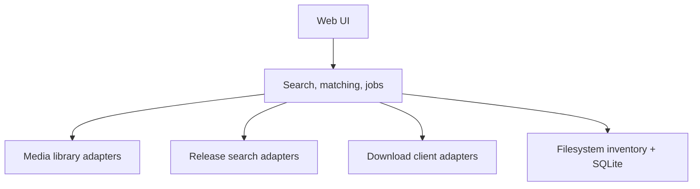

# Media Acquisition Manager

**Status: planning. No working release or installation package exists yet.**

Media Acquisition Manager is a proposed self-hosted application for people who prefer to choose media releases themselves. It brings your existing library and available releases into one search view, sends a selected release to a configured download client, and helps identify duplicates. When you explicitly request a replacement, it waits until the new file has been downloaded and verified before touching the selected old copy.

The initial workflow targets Jellyfin, Toloka through a Torznab-compatible indexer gateway, and qBittorrent. These are intended to be the first integrations, not permanent limits on the application.

## What it should do

- **Search your library and release sources together.** Keep showing available releases even when the title is already in your library.
- **Show meaningful comparisons.** Display verified properties of files you own alongside the *claimed* properties of releases, including resolution, video and audio formats, languages, size, and HDR when known. The user decides whether a release is an upgrade.
- **Send downloads to the right destination.** Select a compatible client and a logical destination such as `Movies` or `Movies 4K`; an adapter maps that destination to a qBittorrent category or another client's equivalent.
- **Detect duplicates without conflating different editions.** Distinguish hardlinks, byte-identical files, different versions of the same title, and uncertain matches.
- **Replace a selected copy safely.** Offer `Keep both` by default. If replacement is chosen, verify the specific new file, its identity, and its visibility to the media server before moving the specific old copy into quarantine where possible.
- **Respect existing libraries and seeding.** Work with nested collection/trilogy folders and multifile torrents without requiring a library-wide rename or interrupting active torrents.

The application should remain usable when a search provider fails, an item has incomplete metadata, or a replacement needs manual review. It must never silently delete a file because a download reached 100%.

## Planned architecture

The core works with media works, versions, physical files, releases, and persisted jobs. Adapter contracts keep it independent of any one media server, indexer, or download client.

| Integration type | First candidate | Planned extension examples |
| --- | --- | --- |
| Media library | Jellyfin | Plex, Emby |
| Release search | Torznab via Jackett or a compatible gateway | Other Torznab/Newznab providers, direct adapters |
| Download client | qBittorrent | Transmission, SABnzbd, others |
| File inspection | Configured media roots and `ffprobe` | Additional inventory backends if needed |

Toloka appears in Jackett's supported-tracker list, but login and search must be verified against a real installation during the first implementation phase. A direct Toloka adapter is an option if a gateway proves unsuitable.

## Development roadmap

1. **Phase A: a vertical slice with no removal.** Build configuration, a local UI, Jellyfin inventory, one Torznab search adapter, qBittorrent submission and status tracking, and persisted jobs. Search and download must work while leaving existing files untouched.
2. **Phase B: inventory and duplicate detection.** Scan only authorized paths, account for hardlinks, inspect media, and hash candidate files when useful. Label exact, same-work, and possible matches separately.
3. **Phase C: safe replacement.** Implement the persisted replacement state machine, explicit file selection, checks, audit log, and quarantine where a safe atomic move is possible.
4. **Phase D: prove extensibility.** Add one more search or download adapter with different capabilities without rewriting the core replacement workflow. Add other media servers when needed.

### Replacement rules

These rules apply to any future implementation:

- An existing file is never selected for removal solely by a fuzzy title match.
- The user must choose the specific old copy to replace. Keeping both is the default.
- Client completion, file existence, media inspection, identity matching, and media-server visibility are separate checks.
- A multifile release requires mapping the new *file*, not just its download job, to the old file.
- Recheck the old file's path and filesystem identity immediately before touching it.
- Never modify files needed by an active torrent or assume that deleting a hardlink recovers its apparent size.
- Ambiguity, failed checks, or uncertain container path mappings stop the replacement and request review.
- Record every state transition and make recovery after a process restart safe.

## Getting started with development

There is no runnable application yet. Start with the full specifications:

- [Development specification](Media_Acquisition_Manager_Spec.md)

Place the specification beside this README in the project root, or update the link if you move it into `docs/`. It includes a starting prompt for a new Codex session, acceptance criteria for each phase, and open questions about filesystem mounts, qBittorrent categories, seeding, authentication, and quarantine. Resolve the questions needed for Phase A before configuring live integrations.

The suggested initial deployment is Docker Compose with SQLite for service state. These are design choices to validate during implementation, not installation instructions. Do not infer Docker image names, credentials, API endpoints, or filesystem paths from this README; inspect the actual services and their versions.

## Project documentation

- [Jellyfin movie organization and multiple versions](https://jellyfin.org/docs/general/server/media/movies/)
- [Jellyfin API](https://api.jellyfin.org/)
- [Jackett API and Torznab](https://github.com/Jackett/Jackett/wiki/Jackett-API)
- [qBittorrent WebUI API](https://github.com/qbittorrent/qBittorrent/wiki/WebUI-API-%28qBittorrent-4.1%29)
- [ffprobe reference](https://ffmpeg.org/ffprobe.html)

Check each integration against the installed version when implementing it.
