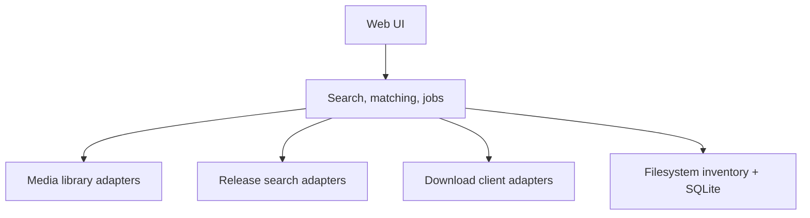

# Media Acquisition Manager

**Status: Phase A in progress — not usable yet.** Version 0.1.0 is being built. Today the app is an
API and a web shell that report their own health, with accounts and integration settings: the
installation owner created on first run, the users the owner manages, and sign-in; the owner
connects Jellyfin, a Torznab source such as Prowlarr and qBittorrent, and tests each connection.
Search, downloads and library import are still to come; see [ROADMAP.md](ROADMAP.md).

Media Acquisition Manager is a self-hosted application for people who prefer to choose media
releases themselves. It brings your existing library and available releases into one search view,
sends a selected release to a configured download client, and helps identify duplicates. When you
explicitly request a replacement, it waits until the new file has been downloaded and verified
before touching the selected old copy.

The initial workflow targets Jellyfin, Toloka through a Torznab-compatible indexer gateway, and
qBittorrent. These are intended to be the first integrations, not permanent limits on the
application.

> **Security:** until the owner account exists, whoever opens the app first becomes the owner, and
> the app speaks plain HTTP. Create the owner first, then open the port only on a network you trust
> or behind a reverse proxy that adds HTTPS. The Docker Compose file publishes the port on
> `127.0.0.1` for that reason. See [Security](#security).

## Stack

| Layer | Choice |
| --- | --- |
| API | ASP.NET Core on .NET 10, controllers, JWT bearer access tokens |
| Data | EF Core + SQLite in WAL mode; migrations applied on startup |
| Tests | xunit.v3, Moq, `WebApplicationFactory` over real HTTP with a throwaway SQLite database |
| Web app | React 19, React Router 7, TanStack Query 5, zustand, axios, Radix Dialog, lucide-react, react-i18next |
| Build | Vite + React Compiler, strict TypeScript, ESLint, Vitest + Testing Library |
| Styling | CSS tokens and semantic classes, no CSS framework |
| Ship | One Docker image (API + web app) for amd64 and arm64; Jenkins tests every commit and publishes releases to Docker Hub |

## Features

### Available now

- **Accounts and sign-in.** The first visit creates the installation owner; everyone else signs in
  with the user name and password the owner gave them. A session lasts 30 days from its last use,
  and signing out, disabling a user or resetting a password takes effect at once. See
  [Security](#security).
- **User management for the owner.** The Users page (**Users** in the owner's user menu) searches
  and pages through the users on the server, adds a user, disables or enables one, resets a
  password, and deletes one after a confirmation. The owner's own account can't be disabled or
  deleted.
- **Integration settings for the owner.** The Integrations page (**Integrations** in the owner's
  user menu) searches by name, filters by kind (media library, release source, download client)
  and pages on the server; adds Jellyfin, a Torznab feed or qBittorrent, edits one, switches it off
  and removes it after a confirmation. **Test connection** checks an unsaved integration from its
  dialog, and a row's **Test** checks a saved one, each answering with a sentence that says what the
  service did. Services that report file paths take path mappings onto the app's own mounts
  ([ADR 0003](docs/adr/0003-service-paths-reach-the-app-through-an-explicit-prefix-mapping.md)).
  Credentials are stored encrypted and never shown again. Nothing uses the integrations yet: library
  import, search and downloads build on them.
- **Service status.** The web app shows its version and whether the service is ready; when it is
  not, it names the check that failed.
- **Health endpoints** for uptime monitors: liveness and readiness. See
  [Health endpoints](#health-endpoints).
- **Zero-config start.** On first run the API creates its SQLite database, applies the migrations
  and generates its own secrets. See [Configuration](#configuration).
- **One Docker container.** `docker compose up -d` runs the published image with nothing to
  configure; the container reports healthy only when the database is ready. See
  [Quick start](#quick-start-docker-compose) and [Deployment](#deployment).

### What it will do

- **Search your library and release sources together.** Keep showing available releases even when
  the title is already in your library.
- **Show meaningful comparisons.** Display verified properties of files you own alongside the
  *claimed* properties of releases, including resolution, video and audio formats, languages, size,
  and HDR when known. The user decides whether a release is an upgrade.
- **Send downloads to the right destination.** Select a compatible client and a logical destination
  such as `Movies` or `Movies 4K`; an adapter maps that destination to a qBittorrent category or
  another client's equivalent.
- **Detect duplicates without conflating different editions.** Distinguish hardlinks,
  byte-identical files, different versions of the same title, and uncertain matches.
- **Replace a selected copy safely.** Offer `Keep both` by default. If replacement is chosen, verify
  the specific new file, its identity, and its visibility to the media server before moving the
  specific old copy into quarantine where possible.
- **Respect existing libraries and seeding.** Work with nested collection/trilogy folders and
  multifile torrents without requiring a library-wide rename or interrupting active torrents.

The application should remain usable when a search provider fails, an item has incomplete metadata,
or a replacement needs manual review. It must never silently delete a file because a download
reached 100%.

### Replacement rules

These rules apply to any future implementation:

- An existing file is never selected for removal solely by a fuzzy title match.
- The user must choose the specific old copy to replace. Keeping both is the default.
- Client completion, file existence, media inspection, identity matching, and media-server
  visibility are separate checks.
- A multifile release requires mapping the new *file*, not just its download job, to the old file.
- Recheck the old file's path and filesystem identity immediately before touching it.
- Never modify files needed by an active torrent or assume that deleting a hardlink recovers its
  apparent size.
- Ambiguity, failed checks, or uncertain container path mappings stop the replacement and request
  review.
- Record every state transition and make recovery after a process restart safe.

## Quick start (Docker Compose)

You need Docker with Compose 2.24 or newer. Put [docker-compose.yml](docker-compose.yml), and
[deploy.sh](deploy.sh) for later updates, in an empty directory and start the app there:

```bash
docker compose up -d
```

Open <http://localhost:8118>. With no configuration at all, the app creates its database and
generates its secrets on the first start, on the `mam-data` volume, and the first page asks you to
create the owner account, who then adds the other users. To change the image tag, the port or who
can reach the app, copy [.env.example](.env.example) to `.env` next to the compose file and set only
what you need; see [Deployment](#deployment).

To build the image from a checkout of this repository instead of pulling it:

```bash
docker compose -f docker-compose.build.yml up -d --build
```

## Planned architecture



The core works with media works, versions, physical files, releases, and persisted jobs, and every
title, identifier, version, file and release it stores names the source that reported it
([ADR 0006](docs/adr/0006-every-title-identifier-and-file-the-core-stores-names-its-source.md)).
Adapter contracts keep it independent of any one media server, indexer, or download client. The
first three adapters exist and, so far, only test a connection; the core's contracts for libraries,
release search, download clients, file inventory and metadata live in Core and name no product
([ADR 0005](docs/adr/0005-the-core-knows-a-service-only-through-a-registered-adapter-type.md)).

| Integration type | First candidate | Planned extension examples |
| --- | --- | --- |
| Media library | Jellyfin | Plex, Emby |
| Release search | Torznab via Prowlarr (Jackett should work the same way) | Other Torznab/Newznab providers, direct adapters |
| Download client | qBittorrent | Transmission, SABnzbd, others |
| File inspection | Configured media roots and `ffprobe` | Additional inventory backends if needed |

Toloka is searched through Prowlarr: it signs in to the tracker with your account, reads its search
pages, and serves the results as a standard Torznab feed, so the app needs no code specific to
Toloka. A search through Prowlarr worked against the real installation (MAM-6); Prowlarr's download
links carry its API key, so the app will fetch them itself and never show them
([ADR 0004](docs/adr/0004-toloka-is-searched-through-prowlarr-and-download-links-stay-on-the-server.md)).
A direct Toloka adapter is an option if the gateway proves unsuitable.

## Security

- **Create the owner before anyone else can reach the app.** Until the owner exists, every page
  leads to the setup page, and whoever submits it first becomes the owner; after that setup answers
  409 for good. Every API endpoint but health, setup, sign-in, refresh and sign-out needs a
  signed-in user, and every page of the web app but setup and sign-in leads to sign-in without one.
  The Docker Compose file publishes the port on `127.0.0.1` unless `APP_BIND_ADDRESS` says
  otherwise. Personal access tokens for scripts arrive with MAM-5.
- **Plain HTTP only.** The app serves no TLS, so passwords and tokens cross the network as they are.
  Open it only on a network you trust, or put a reverse proxy that terminates HTTPS in front of it.
- **Passwords.** User names are 3–32 ASCII letters, digits, `.`, `-` and `_`, in any letter case;
  passwords are 8–128 characters with no composition rules, and there is no email reset and no
  second factor. Passwords are stored as PBKDF2-HMAC-SHA256 with 600 000 iterations and a 16-byte
  random salt, never in a form that can be read back.
- **Short-lived access tokens and a refresh cookie.** Sign-in returns a 15-minute access token
  (HS256, signed with `Jwt:Secret`) that the web app keeps in memory only, and a refresh token in
  the `mam_refresh` cookie: `HttpOnly`, `SameSite=Strict`, `Path=/api/auth`, and `Secure` when the
  request came over HTTPS (a browser won't store a `Secure` cookie from a plain-HTTP address). A
  session ends 30 days after its last use. Every refresh rotates the cookie, and the database keeps
  only its SHA-256 hash; a replaced cookie presented again more than 30 seconds later revokes the
  session, since that is what a copied cookie looks like.
- **Every request checks its session.** A valid token is not enough: its session must still be live
  and its user enabled, so signing out, disabling or deleting a user and resetting a password take
  effect on the next request, not when the token expires. Disable and delete end every session of
  the user; a reset ends all but the one it was made from. Rotating `Jwt:Secret` signs nobody out —
  to lock someone out, disable them or reset their password
  ([ADR 0002](docs/adr/0002-every-authenticated-request-checks-its-session.md)).
- **One answer to every failed sign-in.** An unknown user, a wrong password, a disabled account and
  a blank field all get the same 401 `{ "error": "The user name or password is incorrect." }` after
  the same single password hash, so neither the answer nor its timing tells which user names exist.
- **Rate limit.** Sign-in and setup allow 10 attempts a minute per client address; more get 429
  `{ "error": "Too many attempts. Wait a minute and try again." }` with `Retry-After: 60`. Refresh
  isn't limited: its cookie holds 256 random bits.
- **Owner-only settings.** Every action of a controller under `Controllers/Settings` that changes
  something is owner-only because of where the controller lives, not because someone remembered an
  attribute; `SettingsWritesAreOwnerOnlyConventionHttpTests` pins it. The Users and Integrations
  endpoints are owner-only for reading as well. Anyone else gets 403
  `{ "error": "Only the installation owner can do this." }`, logged as a warning.
- **Audit trail.** Setup, every change to a user (create, disable, enable, password reset, delete)
  and every change to an integration (add, edit, remove) write an audit row in the same transaction
  as the change: what happened, when, who did it and to whom or what, with both names copied so the
  row outlives them. A save that changes nothing and a connection test write none. There is no
  screen for it yet.
- **Integration credentials.** The Jellyfin and Torznab API keys and the qBittorrent password are
  stored encrypted with AES-256-GCM under `Encryption:Key`, each sealed to its integration and
  field, so a value copied to another row or column doesn't open. The API never returns one, nor
  what it is sealed as: an integration says only `hasPassword` and `hasApiKey`, and a field left
  empty on an edit keeps what is stored. A stored secret that can't be read (the key changed, or the
  value was copied) fails only that integration's test, with 409 and a sentence asking to enter it
  again; it is never cleared on its own. A secret a service repeats in its answer is masked before
  the sentence reaches the page, and none is logged: the integration HTTP clients log no request
  URLs, because a Torznab key rides in the query. Requests that carry credentials never follow a
  redirect (the test reports where it pointed, without its query), share no cookies and are never
  retried. An address can't hold a user name, a password or a query. There is no guard against
  private addresses: the services live on the owner's network, and only the owner can enter one
  ([ADR 0007](docs/adr/0007-an-integration-credential-is-sealed-to-its-row-and-never-leaves-through-the-api.md)).
- **Behind a reverse proxy.** The app takes the client's address from the connection and ignores
  `X-Forwarded-For`, which any client can write. Behind a reverse proxy that address is the proxy's,
  and a connection Docker's own proxy relays (one from the host itself to a port published on
  `127.0.0.1`, or any connection on Docker Desktop) comes from Docker's gateway. All those clients
  then share one sign-in limit: ten failed attempts a minute from anyone keep everyone from signing
  in for as long as they keep at it. The app also sees plain HTTP behind a TLS-terminating proxy, so
  the refresh cookie is not marked `Secure` there; `HttpOnly` and `SameSite=Strict` still apply.
- **The container runs unprivileged.** The app runs as user `mam` (uid 10001), its own files belong
  to root and are read-only to it, and the only persistent place it can write is `/data` (besides
  the usual scratch space in `/tmp`). The media mounts in the compose file's examples are read-only.
- **Security headers on every response:** `X-Content-Type-Options: nosniff`,
  `X-Frame-Options: DENY`, `Referrer-Policy: no-referrer`, and a Content Security Policy that
  forbids inline scripts. The only inline script, which applies dark mode before the first paint
  (`frontend/index.html`), is allowed by its SHA-256 hash, pinned in
  `SecurityHeadersMiddleware.ThemeScriptHash`. Change one byte of that script and
  `SecurityHeadersHttpTests` fails until the hash is updated.
- **Secrets never live in the repository.** Committed `appsettings*.json` files hold `null` for
  every secret; real values come from environment variables, .NET User Secrets or first-run
  generation. See [Configuration](#configuration).
- **Errors never leak internals.** An unhandled exception answers 500 with a trace id to quote,
  never the exception text.

## Deployment

The image is `vahac/media-acquisition-manager` on Docker Hub, for `linux/amd64` and `linux/arm64`:

| Tag | What it is |
| --- | --- |
| `latest` | The newest release. |
| `X.Y.Z`, e.g. `0.1.0` | A release. Rebuilding it (a fix, newer base images) publishes it again under the same tag. |
| `X.Y`, e.g. `0.1` | The newest release of that minor version. |

Only releases are published; a commit to `main` is tested but never pushed.

How the image is built and released is in [PUBLISHING.md](PUBLISHING.md).

**Compose settings.** Set them in `.env` next to `docker-compose.yml`; [.env.example](.env.example)
explains each one. Every other variable in `.env` is passed to the app (see
[Configuration](#configuration)).

| Variable | Default | What it does |
| --- | --- | --- |
| `APP_TAG` | `latest` | The image tag to run. Pin a release to update only when you choose to. |
| `APP_BIND_ADDRESS` | `127.0.0.1` | The host address the port is published on. `0.0.0.0` opens the app to your network, over plain HTTP: create the owner account first, and keep to a network you trust or a reverse proxy that adds HTTPS. |
| `APP_PORT` | `8118` | The host port. The app listens on 8118 inside the container too. |

**Updating.** Keep [deploy.sh](deploy.sh) next to `docker-compose.yml` and run it from that
directory:

```bash
bash deploy.sh
```

It pulls the image `APP_TAG` names, recreates the container and waits until it reports healthy; if
it doesn't, it prints the recent health probes and the container log. The app migrates its database
on startup, so there is no separate migration step.

**Health.** The image's health check probes `GET /api/health/ready` every 30 seconds (every 2
seconds during the first 150 seconds after a start), so `docker ps` shows `healthy` only when the app
answers and its database is open and fully migrated. When it isn't,
`docker inspect media-acquisition-manager` shows the failing check's reason under `State.Health`.

**Data and backups.** Everything the installation keeps is in `/data` inside the container, on the
`mam-data` volume: `mam.db` and the generated secrets in `.secrets/`. Back them up together, with the
container stopped:

```bash
docker compose stop app
docker run --rm --volumes-from media-acquisition-manager -v "$PWD:/backup" alpine tar czf /backup/mam-data.tgz -C /data .
docker compose start app
```

To keep the data in a host directory instead of the volume, replace `mam-data:/data` with that
directory, and create it for the container's user and for that user alone first, as the image does
with `/data` (the database files inside are otherwise readable by every user on the host):

```bash
sudo install -d -o 10001 -g 10001 -m 700 <directory>
```

**Media folders.** Mount them read-only (`:ro`) — nothing in Phase A writes to the library — at the
path Jellyfin sees them at, so a library path means the same file to the app. A download client
often sees the same folders under another path (qBittorrent under `/downloads`, say); don't mount
them a second time for it: map its paths onto yours under **Integrations** → the client →
**Path mappings** (`/downloads` → `/media`), as
[ADR 0003](docs/adr/0003-service-paths-reach-the-app-through-an-explicit-prefix-mapping.md)
explains. The compose file has a commented example. The container's user (uid 10001) needs read
access: files readable by everyone (the usual 644 and 755) need nothing more; otherwise add the
group that owns them to the service with `group_add`.

## Local development

To work on the app, run it from source; to just run it, see
[Quick start](#quick-start-docker-compose).

**Prerequisites:** the [.NET 10 SDK](https://dotnet.microsoft.com/download/dotnet/10.0) and
[Node.js 24](https://nodejs.org/) with npm. The `dotnet-ef` tool is needed only to add migrations
(see [Database migrations](#database-migrations)).

Run the API and the Vite dev server in two terminals, from the repository root:

```bash
dotnet run --project src/MediaAcquisitionManager.Api
```

```bash
cd frontend
npm ci
npm run dev
```

Open <http://localhost:5173>. Vite serves the web app with hot reload and proxies `/api` to the API
on <http://localhost:5080>. On first start the API creates `src/MediaAcquisitionManager.Api/Data/`
with the SQLite database `mam.db` and the generated secrets in `.secrets/`; both are git-ignored.

### Serving the built web app from the API

This is how the Docker image serves it: one process, one port. Build the frontend, then point
the API's web root at `frontend/dist`. Pass an absolute path, because a relative one resolves
against the API project directory rather than your shell's. From the repository root (bash or
PowerShell):

```bash
cd frontend
npm ci
npm run build
cd ..
dotnet run --project src/MediaAcquisitionManager.Api -- --webroot "$PWD/frontend/dist"
```

Open <http://localhost:5080>.

## Configuration

The API reads `appsettings.json`, .NET User Secrets (in the Development environment), environment
variables with the `MAM_` prefix, and command-line arguments. In a variable name a double
underscore separates sections: `MAM_Storage__DataDirectory` sets `Storage:DataDirectory`.
[.env.example](.env.example) lists every variable with its trade-offs.

| Variable | Default | What it does |
| --- | --- | --- |
| `MAM_Storage__DataDirectory` | `Data` (`/data` in the Docker image) | Directory for the SQLite database `mam.db` and the `.secrets/` directory. A relative path resolves against the API's content root. The Docker Compose file pins it to `/data`, the volume. |
| `MAM_Encryption__Key` | generated on first run | Base64 of 32 random bytes. Encrypts the stored integration credentials (AES-256-GCM). A value that isn't base64 of exactly 32 bytes makes saving a credential, or testing with a stored one, fail with a trace id, and the log names this variable; changing it makes every stored credential unreadable until it is entered again. |
| `MAM_Jwt__Secret` | generated on first run | Base64 of 64 random bytes (at least 32). Signs the 15-minute access tokens. Rotating it signs nobody out: the tokens already issued stop working, and open tabs quietly get new ones through their refresh cookie, which this key doesn't sign. |

The standard ASP.NET Core variables apply as usual (`ASPNETCORE_URLS`, `ASPNETCORE_ENVIRONMENT`).

**First-run secrets.** When `Encryption:Key` or `Jwt:Secret` is blank, the API reads it from
`<data>/.secrets/encryption-key` or `<data>/.secrets/jwt-secret`, or generates it there on the first
start (directory 0700 and files 0600 on Linux and macOS). A value you set explicitly always wins,
and then no file is written. An existing file is never overwritten, and an empty one stops the
startup with a message that says what to do and what a new value would cost: a new encryption key
would orphan everything encrypted with the old one, while a new JWT secret only makes the access
tokens already issued stop working (nobody is signed out). Back up `.secrets/` together with
`mam.db`, which holds the accounts, sessions and integrations: the integrations' stored credentials
open only with the encryption key they were sealed with.

**User Secrets (development).** A fresh checkout needs none: first-run generation covers it. To pin
a value in development without committing it, the Api project has a `UserSecretsId`:

```bash
dotnet user-secrets set "Jwt:Secret" "<base64 value>" --project src/MediaAcquisitionManager.Api
```

## API surface

| Request | Answer |
| --- | --- |
| `GET /api/health` | Liveness: 200 while the process is up. Runs no checks. |
| `GET /api/health/ready` | Readiness: 200 when the service is ready, 503 when a check fails. |
| `GET /api/setup` | 200 `{ "isRequired": true }` until the owner exists, `false` after. Anonymous. |
| `POST /api/setup` with `{ userName, password }` | Creates the owner and signs them in: 200 as for sign-in. 400 with the broken rule's sentence; 409 once an owner exists; 429 over the rate limit. Anonymous. |
| `POST /api/auth/sign-in` with `{ userName, password }` | 200 `{ accessToken, accessTokenExpiresUtc, user: { id, userName, isOwner } }` and the `mam_refresh` cookie. Any failure: 401 `{ "error": "The user name or password is incorrect." }`; 429 over the rate limit. Anonymous. |
| `POST /api/auth/refresh` with the cookie | 200 as for sign-in, with the cookie rotated. 401 `{ "error": "Your session has ended. Sign in again." }` and the cookie deleted; 409 when a refresh with the same cookie won a moment ago (retry). Anonymous. |
| `POST /api/auth/sign-out` with the cookie | 204; ends the cookie's session and deletes the cookie. Needs no access token. |
| `GET /api/auth/me` | 200 `{ id, userName, isOwner }` |
| `GET /api/settings/users?search=&page=1&pageSize=25` | Owner only. 200 `{ items, totalCount, page, pageSize }`, each item `{ id, userName, isOwner, isDisabled, createdUtc, lastSignInUtc }`, ordered by user name; `search` matches part of the name in any letter case. 400 for a page below 1 or a page size outside 1–100. |
| `GET /api/settings/users/{id}` | Owner only. 200 with the user; 404. |
| `POST /api/settings/users` with `{ userName, password }` | Owner only. 201 with the user and its `Location`; 400 with the broken rule's sentence; 409 when the name exists in any letter case. |
| `POST /api/settings/users/{id}/disable` | Owner only. 200 with the user, whose sessions all end. 409 for the owner; 404. |
| `POST /api/settings/users/{id}/enable` | Owner only. 200 with the user; the sessions the disable ended stay ended. 404. |
| `POST /api/settings/users/{id}/password` with `{ password }` | Owner only. 204; every session of the user ends except the caller's own. 400 with the rule's sentence; 404. |
| `DELETE /api/settings/users/{id}` | Owner only. 204; the user's sessions go with it. 409 for the owner; 404. |
| `GET /api/settings/integrations?search=&kind=&page=1&pageSize=25` | Owner only. 200 `{ items, totalCount, page, pageSize }`, each item `{ id, name, adapterType, adapterDisplayName, kind, isEnabled, baseUrl, userName, hasPassword, hasApiKey, pathMappings: [{ servicePrefix, appPrefix }], createdUtc }`, ordered by name; `adapterDisplayName` is `null` when this version no longer connects to the type. `search` matches part of the name in any letter case; `kind` is `MediaLibrary`, `ReleaseSearch` or `DownloadClient`. 400 for a page below 1, a page size outside 1–100 or an unknown kind. |
| `GET /api/settings/integrations/adapter-types` | Owner only. 200 `{ items }`, each `{ typeId, displayName, kind, userName, password, apiKey, reportsFilePaths }`, a credential being `NotUsed`, `Optional` or `Required`; the types are `jellyfin`, `torznab` and `qbittorrent`. |
| `GET /api/settings/integrations/{id}` | Owner only. 200 with the integration; 404. |
| `POST /api/settings/integrations` with `{ adapterType, name, baseUrl, userName, password, apiKey, isEnabled, pathMappings }`, a secret as `{ mode: "Set", value }` | Owner only. 201 with the integration and its `Location`; `isEnabled` left out means on. 400 with the broken rule's sentence; 409 when the name exists in any letter case. Never answers a secret, only `hasPassword` and `hasApiKey`. |
| `PUT /api/settings/integrations/{id}` with the same fields but `adapterType`; a secret `{ mode: "Set", value }`, `{ mode: "Clear" }` or left out to keep; `isEnabled` and `pathMappings` left out to keep | Owner only. 204; `pathMappings: []` removes them all. 400 with the rule's sentence; 404; 409 when the name is taken or this version can't connect to the integration's type. |
| `DELETE /api/settings/integrations/{id}` | Owner only. 204, with its path and destination mappings; download jobs and facts it reported keep its name. 404. |
| `POST /api/settings/integrations/{id}/test` | Owner only. Tests the saved integration, switched off or not, and saves nothing: 200 `{ status, message }` for every outcome of the test (`Succeeded`, `Unreachable`, `TimedOut`, `AuthenticationFailed`, `Refused`, `ServiceError`, `UnexpectedResponse`); 404; 409 when this version can't connect to its type or a stored secret can't be read. |
| `POST /api/settings/integrations/test` with `{ integrationId, adapterType, baseUrl, userName, password, apiKey }` | Owner only. Tests an unsaved integration and saves nothing: 200 as above; 400 with the broken rule's sentence; 404 with a sentence when `integrationId` names an integration that is gone; 409 as above. With `integrationId`, the stored type is used and a secret left out is the stored one. |
| Any other `/api/...` path, any method | 404 with `{ "error": "No API endpoint matches <METHOD> <path>." }`, signed in or not |
| Everything else | The web app's `index.html`, so client-side routes survive a reload |

Apart from the health endpoints, which answer with their own report (see
[Health endpoints](#health-endpoints)), every failure that carries a message answers
`{ "error": "<readable sentence>" }`. An unknown API path answers 404 JSON instead of the web app's
page, so a mistyped API call can't look like a success. A 404 for an id in the path that doesn't
exist has no body at all.

Health, setup, sign-in, refresh and sign-out need no access token; every other endpoint needs
`Authorization: Bearer <access token>`, and answers 401 `{ "error": "Sign in to continue." }`
without one or when the token's session has ended. An owner-only request from anyone else answers
403 `{ "error": "Only the installation owner can do this." }`. The refresh cookie is sent only to
`/api/auth`. Instants are UTC with a trailing `Z`.

### Health endpoints

Both endpoints are anonymous and answer `application/json`. Liveness always has an empty check
list:

```json
{ "status": "Healthy", "checks": [] }
```

Readiness checks the database: it must open and have every migration applied. `status` is
`Healthy`, `Degraded` or `Unhealthy`, and a failing check says why in a readable sentence:

```json
{
  "status": "Unhealthy",
  "checks": [
    { "name": "database", "status": "Unhealthy", "description": "The database has 1 pending migration." }
  ]
}
```

## Translations

The web app is in English, and every text it shows comes from
`frontend/src/locales/en/<feature>.json` through react-i18next — never from a component
([ADR 0001](docs/adr/0001-every-ui-string-comes-from-a-locale-resource.md)). New text gets a key in
the feature's file and is rendered with `t()`; `npm run lint` refuses literal text in markup, and
`npm run build` fails on a key that doesn't exist. Show dates, numbers and file sizes with the
helpers in `frontend/src/lib/format.ts`, which follow the UI locale.

To add a language, copy `frontend/src/locales/en/` to a folder named after its language code,
translate the values (keep the keys and the `{{placeholders}}`), and add it to `resources` in
`frontend/src/lib/i18n.ts`. Browsers that prefer that language then get it; anything not yet
translated falls back to English. Messages from the API stay in English.

## Tests

The whole .NET suite:

```bash
bash run-tests.sh
```

It builds the solution in Release and runs the test projects as parallel `dotnet test` shards; each
shard writes TRX and JUnit reports to its project's `TestResults/` directory. `CONFIG=Debug`,
`SHARDS=<n>` and `NO_BUILD=1` override the defaults. A plain run works too:

```bash
dotnet test MediaAcquisitionManager.slnx
```

API tests go over real HTTP through `WebApplicationFactory`, each test class against its own
throwaway SQLite database, so they never touch your `Data/` directory. Tests tagged
`Category=RequiresDocker` are excluded by default; there are none yet.

Real, sanitized answers of Jellyfin, qBittorrent, Prowlarr's Torznab feed and ffprobe are kept in
`tests/MediaAcquisitionManager.TestInfrastructure/VendorSamples/`, with a README saying where each
came from and how it was sanitized. The adapters' connection tests run against them: the tests swap
each integration's HTTP handler for one that answers with a sample, so no test reaches a real
service. `VendorSamplesTests` fails the build if a sample carries a credential.

The frontend checks, in `frontend/` (`npm run build` also type-checks with `tsc -b`):

```bash
npm run lint
npm run build
npm run test
```

## Project structure

```text
MediaAcquisitionManager.slnx
run-tests.sh                                   sharded .NET test runner
Dockerfile                                     the image: API + built web app + ffprobe
docker-compose.yml                             runs the published image
docker-compose.build.yml                       builds the image from the checkout (:local)
deploy.sh                                      pulls, recreates and waits for healthy
Jenkinsfile                                    CI: tests every commit to main, pushes nothing
Jenkinsfile.publish                            a release, started by hand: tests, pushes to Docker Hub
src/
  MediaAcquisitionManager.Api/                 ASP.NET Core host: Program.cs, controllers, sign-in
                                               and sessions, user management, integration
                                               settings, audit trail, health checks, security
                                               headers, EF Core migrations
  MediaAcquisitionManager.Core/                entities of the accounts, the media model and
                                               integrations, adapter contracts, options, rules and
                                               path mapping; no package references
  MediaAcquisitionManager.Infrastructure/      DbContext, SQLite pragmas, first-run secrets,
                                               password hashing, credential encryption, the
                                               Jellyfin, Torznab and qBittorrent adapters
tests/
  MediaAcquisitionManager.TestInfrastructure/  test harness: API factory, test databases, clock,
                                               seeders, vendor samples
  MediaAcquisitionManager.Api.Tests/           endpoint tests over real HTTP
  MediaAcquisitionManager.Core.Tests/
  MediaAcquisitionManager.Infrastructure.Tests/
frontend/                                      React web app (Vite, TypeScript, React Compiler)
  src/locales/                                 UI text, one folder per language, one file per feature
  src/release-notes/                           user-facing What's new, one file per version
docs/
  Media_Acquisition_Manager_Spec.md            development specification
  adr/                                         architecture decision records
```

Dependencies point one way: Api → Infrastructure → Core.

## Database migrations

Migrations live in the Api project and are applied automatically when the API starts. To add one
(install the tool once with `dotnet tool install --global dotnet-ef`):

```bash
dotnet ef migrations add <Name> --project src/MediaAcquisitionManager.Api --startup-project src/MediaAcquisitionManager.Api
```

`dotnet ef` creates the database context through a design-time factory and never creates the data
directory or writes `.secrets/`: when the tools do run the app's startup (a `--context` that names
no known context), the startup skips both.

## Planned features

Work is planned in four phases. [ROADMAP.md](ROADMAP.md) has the scope, tests and acceptance bar
of each, and the tickets of Phase A (MAM-1 to MAM-15).

1. **Phase A: a vertical slice with no removal (release 0.1.0).** Build configuration, a local UI,
   Jellyfin inventory, one Torznab search adapter, qBittorrent submission and status tracking, and
   persisted jobs. Search and download must work while leaving existing files untouched.
2. **Phase B: inventory and duplicate detection.** Scan only authorized paths, account for
   hardlinks, inspect media, and hash candidate files when useful. Label exact, same-work, and
   possible matches separately.
3. **Phase C: safe replacement.** Implement the persisted replacement state machine, explicit file
   selection, checks, audit log, and quarantine where a safe atomic move is possible.
4. **Phase D: prove extensibility.** Add one more search or download adapter with different
   capabilities without rewriting the core replacement workflow. Add other media servers when
   needed.

## Project documentation

- [Development specification](docs/Media_Acquisition_Manager_Spec.md) — requirements, the data
  model, acceptance criteria for each phase, and the open questions (§7) that Phase A answers
  against the real installation before configuring live integrations.
- [Roadmap](ROADMAP.md) and [Changelog](CHANGELOG.md).
- [Publishing](PUBLISHING.md) — the Jenkins pipeline, the image tags and how to cut a release.
- [Release notes](frontend/src/release-notes/0.1.0.md) — the user-facing What's new, one file per
  version.
- Architecture decision records live in `docs/adr/`; new ones start from the
  [template](docs/adr/0000-template.md).
- [Environment variables](.env.example) with their trade-offs.

Integration references:

- [Jellyfin movie organization and multiple versions](https://jellyfin.org/docs/general/server/media/movies/)
- [Jellyfin API](https://api.jellyfin.org/)
- [Prowlarr](https://wiki.servarr.com/prowlarr) — the indexer manager that serves Toloka as Torznab
- [Jackett API and Torznab](https://github.com/Jackett/Jackett/wiki/Jackett-API)
- [qBittorrent WebUI API](https://github.com/qbittorrent/qBittorrent/wiki/WebUI-API-%28qBittorrent-4.1%29)
- [ffprobe reference](https://ffmpeg.org/ffprobe.html)

Check each integration against the installed version when implementing it.
