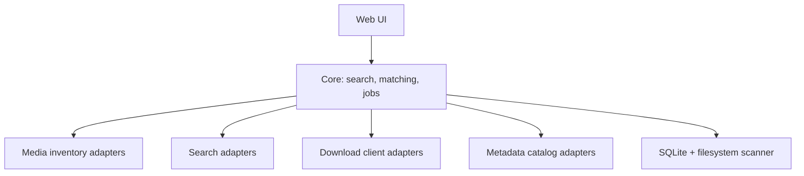

# Media Acquisition Manager — development starting document

**Version:** 0.1, 27 September 2026  
**Status:** draft technical specification; implementation has not started.  
**UI language:** to be decided during development; this document is in English.

## 1. Purpose and context

A standalone self-hosted service for a user who **chooses releases manually**. It shows existing library items alongside releases available from connected sources, lets the user send a selected release to a download client with the right destination, detects duplicates, and, when explicitly requested, carefully replaces an old file after verifying the new one.

Vasyl's initial setup involves Jellyfin, Toloka search, qBittorrent categories, custom collection/trilogy folders, and torrents that must continue seeding. **Architectural requirement:** these three products are merely the first adapters. The core must have no hard dependency on their APIs and must not assume that one torrent contains one movie. The service must work without reorganizing folders such as `Collection/Trilogy`.

### User value

1. Search for a movie and see existing copies and releases from all enabled sources on the same page, even when the movie is already in the library.
2. Compare verified properties of an existing copy with the release's **claimed** properties; the service does not decide what is “better” for the user.
3. Select a release, client, and destination in one workflow; schedule replacement of a **specific** old file or keep both.
4. Find byte-identical files, other versions of the same movie, and possible matches. Never silently delete anything.

**Note (2026-10-05, MAM-33):** the app now also proposes works the library doesn't have yet —
films, series, cartoons and documentaries picked from what it has, through an external catalog
(TMDb), each with every reason it is proposed and what the release sources carry of it (§3.5). It
proposes only: the user still chooses every release on the search page and sends it through the
Download dialog, and nothing is ever sent, queued or downloaded because of a recommendation
([ADR 0023](adr/0023-a-recommendation-only-proposes-explains-every-reason-and-never-sends.md)).

**Note (2026-10-05, MAM-34):** the owner can now tell the library which catalog film or show a work
is, picking from ranked suggestions, a pasted link or a catalog search. The app writes a film's
link into the media server as the item's registry ids alone — its TMDb id, and its IMDb id where the
server holds none — and nothing else: no identify, no refresh, no title, image, lock or people, and
files and folders are never touched, so the library still needs no reorganizing. A series' link stays
in the app (Vasyl, 2026-10-06): Jellyfin rewrites every season and episode of a series whenever it
saves the series
([ADR 0026](adr/0026-a-tmdb-id-set-by-hand-is-the-owners-word-kept-per-library-item-and-written-into-the-library-as-ids-only.md)).

**Note (2026-10-06, MAM-34):** written alone, the ids changed nothing visible in the media server,
which fetches an existing item's metadata only when it refreshes it. So the app now also asks the
media server to look up the item's missing metadata after writing its ids — Jellyfin's own "Search
for missing metadata", which fills what the item lacks and replaces nothing —, and writes an
episode's own IMDb id into a film item the server lists for it (Vasyl, 2026-10-06; ADR 0026's
section added that day). This replaces the note above's "no refresh" and its "a series' link stays
in the app": the same day Vasyl decided, finally, that a series is written like a film. The server's
save of a series gives all its seasons and episodes the series' age ratings, which that lookup
doesn't change back — recorded on The Penguins of Madagascar, whose 3 seasons and 149 episodes all
carried TV-Y7 afterwards —, and he accepted that: age ratings don't matter to him. The links set
before are brought up to date only on the owner's click.

**Note (2026-10-06, MAM-34, decided again):** assigning a catalog id to an item is now the media
server's own Identify — a search by that id, then Apply — so the server replaces the item's title,
overview and images in its library's language; this replaces the two notes above wherever they say
"ids alone", "no identify, no refresh", "looks up missing metadata" or put back. Removing a link
forgets it in the app only, and the server keeps what the Identify gave the item. Files and folders
are never touched, and a library that saves beside the media is refused. (Vasyl, 2026-10-06; [ADR
0026](adr/0026-a-tmdb-id-set-by-hand-is-the-owners-word-kept-per-library-item-and-written-into-the-library-as-ids-only.md)'s
section added that day.)

**Note (2026-10-07, MAM-35):** the Library page's cards, and the Search page's `In your library`
cards, now show each work's own picture: the image the media server holds for the item the card
stands for, read by each sync as a version tag and fetched by the app from the server, kept on the
app's disk and served by the app, so the browser never contacts the media server. It is never the
catalog's poster (§3.5); for an item identified through the catalog it is the image the server
itself took from the catalog then, which is the library's data. Nothing is written to the media
server for it. (Vasyl's decisions of 2026-10-06; [ADR
0027](adr/0027-a-library-works-poster-is-the-librarys-own-image-read-by-the-syncs-tag-and-served-by-the-app.md).)

## 2. First-version scope and default decisions

| Question | Working decision | Status |
| --- | --- | --- |
| Primary media type | Movies; the model should allow TV shows later | MVP proposal |
| Initial integrations | Jellyfin, Torznab through Jackett or a compatible gateway, qBittorrent | Proposal; verify Toloka with a live connection |
| Toloka | Connect it as a Torznab indexer through Jackett if that works; build a direct adapter only if there is a demonstrated need | Login and search functionality are unverified |
| Other servers/clients | Contracts for Plex/Emby, Transmission/SABnzbd, and others; implement after the first vertical slice | Extension |
| Search | Manual search that queries the existing library and enabled sources concurrently | Requirement |
| Destination | `DownloadDestination` in the core; map it to an existing qBittorrent category/path | Requirement |
| Removal | Only for an explicitly selected old file after verification of the new file; quarantine/reversal where possible | Requirement |
| File layout | Existing names and nested folders remain usable; no mandatory renaming | Requirement |
| Deployment | Docker Compose, SQLite for service state, local UI | Initial proposal |

**Note (2026-10-04, MAM-17 and MAM-32):** the primary media type is no longer movies alone. The
owner chose movies and TV in full (§7, question 3;
[ADR 0017](adr/0017-an-episode-is-a-work-known-by-registry-ids-and-the-library-alone-says-what-an-item-is.md)),
and release 0.2.0 imports Jellyfin's series and episodes beside its movies
([ADR 0019](adr/0019-a-series-is-a-work-its-episodes-point-at-its-seasons-come-from-their-numbers-and-an-episode-without-a-file-is-left-out.md)),
searches the release sources for TV releases, matches them to the library's series and sends them
to a download client
([ADR 0020](adr/0020-a-release-is-tv-by-its-category-matches-only-series-and-its-tracker-section-picks-the-destination-offered-first.md)).

**Note (2026-10-14, MAM-30):** Phase D implements the extension rows for one client and one gateway,
by Vasyl's decisions of 2026-10-13: Transmission 4.0 or newer, through its legacy RPC, can stand in for
qBittorrent, and Jackett for Prowlarr, through the same Torznab adapter — one client and one gateway
at a time, never two side by side. For a client without categories the `Destination` row maps a logical
destination to a folder of the client instead: a Jellyfin library folder it can reach, or its own
default folder
([ADR 0039](adr/0039-a-download-client-without-categories-gets-the-library-folders-it-can-reach-and-its-own-default-folder-as-destinations.md)).

**Approach:** implement one complete end-to-end workflow with one adapter of each type and stable contracts, then add more adapters. This gives the interfaces broad applicability without implementing every supported product at once.

**Search-source alternatives:** direct Torznab/Newznab; Prowlarr API; Jackett; a site-specific adapter. Using Jackett in the first slice is a practical hypothesis because its documentation lists Toloka and Torznab support. The core must not depend on Jackett.

## 3. Functional requirements

### 3.1 Search and matching

- Search by title, year, IMDb/TMDb ID, or identifier URL if a parser for that URL has been implemented.
- Local results: title, year, identifiers and their sources, location, size, video and audio tracks, subtitles, duration, resolution, codecs, bitrate, and HDR **only when those fields are actually available**. Show “unknown” rather than guessing.
- Source results: release title, indexer, size, format/quality/languages, seeder count when available, source-page link, and a way to retrieve a `.torrent`, magnet, or NZB. Quality inferred from a title is marked as claimed, not verified by inspecting the file.
- Show every matching release even when the movie is already present; allow filtering by source, language, size, and quality. A failure in one source does not hide results from other sources.
- Matching priority: reliable identifier first; then original/localized title plus year; then a candidate requiring manual review. A title or year match alone never authorizes replacement.
- Preserve the provenance of every identifier and title. Conflicting IDs or different editions/versions prevent automatic matching for removal.
- *Added 2026-10-05 (MAM-34):* an id the owner links by hand counts as a reliable identifier of the library work, keeps its own provenance (who set it and when) beside the media server's, and conflicts with a different id the server reports rather than replacing it. A TMDb or IMDb link or id can be pasted in the owner's link dialog; the search field doesn't read links yet.
- *Added 2026-10-08 (MAM-23):* a title and year match may be scheduled for replacement once the owner confirms the work in the Download dialog — Toloka lists no ids, so none of its releases could otherwise ever replace a copy —, but it still authorizes nothing on its own: the old copy moves only after the media server has given the downloaded file the old copy's own work by its ids (§3.4, check 3). A title alone, or conflicting ids, never ([ADR 0032](adr/0032-a-replacement-targets-films-episodes-or-seasons-on-the-owners-word-and-goes-ahead-only-when-the-library-gives-the-new-file-the-old-copys-work.md)).

### 3.2 “Download” action

1. The user chooses a **specific** release.
2. The UI shows clients compatible with its payload type and available destinations; the initial destination is configurable and can be changed before submission.
3. If the movie already exists, the UI offers `Keep existing` (default) or `Schedule replacement` with a choice of one or more **listed** files. Save that choice as explicit consent for this job.
4. Before submission, show a summary: source, release title, client, destination, selected old paths, and replacement conditions.
5. Create a job, send the release to the client once, and save a stable client-side job identifier after confirmation. Repeated clicks and retries must not create duplicate downloads.
6. If the client or source does not immediately return a reliable ID, correlate cautiously using the info hash/NZB ID and the client's job list; require manual linking if ambiguous.

**Destinations:** logical choices such as `Movies` and `Movies 4K` map to a specific client's configuration. For qBittorrent, check that the selected category exists and has the expected path. The UI must not override the category with a conflicting `savePath`. If the destination path cannot be determined, disable automatic replacement.

**Note (2026-10-08, MAM-38):** the category's folder is where qBittorrent writes, and qBittorrent takes over any file already at a new torrent's path — it checks that file and downloads the pieces that don't match into it, in place, so another release under the same name is written over. Before the one submission the app now works out every place each of a `.torrent`'s files may land below the destination's folder, under each of qBittorrent's content layouts, and refuses the send — a failed job with the app's sentence naming the file, nothing handed to the client — when one of those places holds a file of another size, a file of the same size whose sampled pieces don't hash as the torrent says, something that isn't a file, or a file a torrent the client already has in that category will write; files already there with the same bytes don't stop it, so a series update that re-adds its old episodes is sent (Vasyl's decisions). A magnet, a file list the app can't read, a destination folder the app can't look into (no path in the app, or outside the Media folders), a place behind a link leading out of the Media folders, a file name the app can't look up and a client that can't tell its torrents or their files are sent unchecked, unless another place refuses the send, the job saying why, and the Download dialog warns before submission when the destination's folder can't be checked. The check only reads, and the app still never sends a `savePath` or a content layout of its own. ([ADR 0034](adr/0034-a-download-is-refused-before-it-is-sent-when-its-client-would-write-over-a-different-file-already-at-its-path.md).)

**Note (2026-10-09, MAM-24):** step 3's choice is built as `Keep both` ("Keep existing", the default) and `Replace after verification` ("Schedule replacement"), the installation owner's alone and only while the owner has switched replacement on: the owner ticks one or more of the copies the dialog lists — a matched film's every file of every version, or the held episodes a TV release claims — and, for a work matched by title and year, the work's confirmation ("This release is Alien (1979)"). The choice is saved as explicit consent for the job: the replacement is written only from the owner's own ticks, in the download job's one save before anything is fetched or sent, with who scheduled it and when, each ticked file with its identity read from the disk then, and a `ReplacementScheduled` audit row; a title-and-year confirmation is kept per work, in the words the owner ticked, with a `ReplacementWorkConfirmed` row. Step 4's summary says under `Existing copies` either "Kept: nothing is replaced or removed, and a release that would write over a different file isn't sent." or the ticked copies by work with their paths, then the conditions: the old copy would move aside only after the new one is downloaded, checked and shown in the media server as the same work, a copy held by a torrent waits until the owner removes that torrent, and this version only schedules the replacement. A destination whose path can't be determined, isn't confirmed inside a library or lies outside the Media folders takes no replacement, as the **Destinations** paragraph above asks, and a replacement is sent only when the check before submission looked at every place its files would land and found no file there, the same bytes included; otherwise the job fails with nothing sent, and the owner picks `Keep both` himself, as the app never downgrades it silently (Vasyl's decisions of 2026-10-09; [ADR 0032](adr/0032-a-replacement-targets-films-episodes-or-seasons-on-the-owners-word-and-goes-ahead-only-when-the-library-gives-the-new-file-the-old-copys-work.md), [ADR 0034](adr/0034-a-download-is-refused-before-it-is-sent-when-its-client-would-write-over-a-different-file-already-at-its-path.md)).

**Note (2026-10-14, MAM-30):** **Destinations** for a client without categories — Transmission. Its destinations are the Jellyfin library folders mapped back into its paths through its integration's path mappings, and its own default folder, each confirmed by the client's free-space answer every time it is looked at; a folder it can't see is listed and can't be picked, and a library the mappings can't lead back to is listed with how to fix it. The selected folder is the one the client confirmed, never one typed, and the send names that folder with the destination's name as the torrent's label, so no setting of the client's can conflict with it. "If the destination path cannot be determined, disable automatic replacement" holds unchanged: the default folder outside every library, or any folder whose path the app can't place, takes no replacement. Step 5's "send the release to the client once" holds with one exception the client makes safe: a request Transmission answered with a 409 before reading it is sent once more with the new session id. Step 6's identifier is Transmission's `hashString`, given at once. ([ADR 0039](adr/0039-a-download-client-without-categories-gets-the-library-folders-it-can-reach-and-its-own-default-folder-as-destinations.md), [ADR 0013](adr/0013-a-download-is-written-down-before-anything-is-sent-and-one-request-sends-it-at-most-once.md).)

### 3.3 Duplicate detection

| Class | Evidence | UI behavior |
| --- | --- | --- |
| Same file / hardlink | Same device and inode in one filesystem namespace | Show links to the same data; **do not** count the occupied space twice |
| Byte-identical duplicate | Full cryptographic hash of both files | Show an exact match; estimate recoverable space with hardlinks/snapshots in mind |
| Another copy of the same work | Reliably matching TMDb/IMDb ID, different files | Show multiple versions; do not automatically call one redundant |
| Possible match | Title + year + duration/other clues when IDs are unavailable | Require manual confirmation; never use it for automatic removal |

Compute hashes lazily: shortlist candidates by size and metadata, then run a full hash only where useful. Key the hash cache by file identity, size, and modification time; invalidate it if any changes. Show `theatrical`, `director's cut`, `extended`, SDR/HDR, and similar labels as potential distinctions; do not treat different cuts as junk. The MVP report must not offer bulk automatic deletion.

**Note (2026-10-07, MAM-20):** the four classes are worked out on every read from what the app already holds and stored nowhere, and are independent of each other. *Same file*: names of one device and inode; removing one frees nothing. *Byte-identical*: files of two identities or more with one SHA-256 kept under each file's current identity, size and modification time; the recoverable space is every copy's size but the largest's, given only when every copy's file system is known not to share blocks between files (read from the mount table by device: ext4 and the like yes; btrfs, ZFS, XFS, network shares, overlays and anything unknown no) and every name of each copy is known, otherwise withheld with the reason (Vasyl's decision 3). *Another copy of the same work*: film and episode works of any library or integration sharing a registry id — an IMDb id whatever the kind, a TMDb or TVDB id within the work's kind (a show's TMDb id never matches a film's), an episode's series' id with its season and episode, an id or an episode-to-show link the owner set — holding two different copies; one library item with several files proves nothing, and none is called redundant. Conflicting ids stay in this class, flagged for manual review with the disagreement shown (Vasyl's decision 1), and labels such as `theatrical` or `director's cut`, read from file and version names by a word list in English and Ukrainian, and the measured dynamic range (SDR, HDR10, HLG, Dolby Vision) are shown as distinctions needing review (Vasyl's decision 2); a label decides no match. *Possible match*: works, or files no library reported, sharing a title with its own year where no id, kind or episode place says they differ — no distance, no year ± 1 —, with whether the measured durations agree; a file no library reported can only be this, by its file or folder name. No class reads a download client. The groups are read through `GET /api/library/duplicates`, paged and filtered by class on the server, and shown on the Duplicates page (MAM-21, §5). ([ADR 0028](adr/0028-duplicates-are-worked-out-on-every-read-in-four-classes-by-one-file-one-hash-one-registry-key-or-one-title-and-year-and-a-group-only-shows.md).)

**Note (2026-10-08, MAM-37):** different editions are not duplicates (Vasyl's decision): copies of one work whose file or version names say different cuts or editions — `theatrical`, `extended`, `director's cut`, special edition, unrated, widescreen, open matte, remastered and the like, a copy with no such label beside a labelled one included — are no copies of each other, so *Another copy of the same work* no longer lists them with their editions as distinctions needing review, as the MAM-20 note above had it; a possible match still shows differing editions as a distinction, and one file's names or byte-identical files stay what their bytes say, whatever the names. In that class, too, two episodes of one show at different season or episode numbers are never one work, whatever ids they share; an episode's `a` and `b` files (a letter glued to its `S03E09`) are no copies of each other, though the Library still shows them as one episode with two versions, as the media server does; a film's copies whose file names claim years, alone in brackets, more than one year apart are no copies (films only: in an episode's name such a year is its show's or its season's); and copies whose measured running times differ widely — the shortest under three quarters of the longest — are flagged for review ("Running times differ"). Conflicting ids of films, and one episode under two shows' ids, still stay one group flagged for review. Nothing in the library, a file or a download client changes, only what the Duplicates page lists: on a copy of the reference installation's database it went from 46 groups to 4. ([ADR 0028](adr/0028-duplicates-are-worked-out-on-every-read-in-four-classes-by-one-file-one-hash-one-registry-key-or-one-title-and-year-and-a-group-only-shows.md).)

### 3.4 Safe replacement

`Scheduled → Submitted → Downloading → Downloaded → Inspecting → Verified → Quarantined/Removed → Completed`

Additional states: `NeedsReview`, `Paused`, `Failed`, `Cancelled`. Persist transitions in SQLite so jobs survive restarts. Each step must be idempotent. Polling the client is sufficient for the MVP; webhooks, where available, can be added later.

Before removing any old file, verify **all** of the following:

1. The client job has completed without errors and the required file(s) are marked complete. For a multifile torrent, “torrent 100%” does not establish which file replaces the old one.
2. The specific new file is inside an allowed directory, is a regular completed media file of nonzero size, and `ffprobe` can open it and reports expected video/duration. This checks readability and stream composition, not every frame.
3. The new file is matched to **the same work and intended edition** using reliable metadata or manual confirmation. A Jellyfin ID can itself be wrong; conflicts or ambiguity lead to `NeedsReview`.
4. The media server can access the new file, and a scan reveals the **new path/version**, rather than merely the old movie card. If Jellyfin groups versions into one item, compare its media sources/paths instead of requiring a new item ID.
5. Immediately before touching the old file, recheck its canonical path, filesystem identity, size/modification time, and current match. Do not remove it if it changed, has the same path as the new file, lies outside an allowed root, or is not the file the user selected.
6. If the old file belongs to an active torrent, is still seeding, or shares its data through a hardlink, **do not modify the torrent or its seeding data**. Keep “remove a media-library copy” separate from “delete a client's files.” When uncertain, use `NeedsReview`.

For the MVP, **move the selected media-library copy into quarantine** instead of irreversibly deleting it, but only if the quarantine directory is on the same filesystem and the move is atomic. Otherwise, offer manual confirmation of deletion after the checks. Implement automatic quarantine cleanup separately, after defining retention and disk-space policies. Moving a hardlinked media copy leaves seeding data in place, but **does not** reclaim its file size until the last hardlink is gone; verify the actual mount paths.

Do not indiscriminately call Jellyfin's `DELETE /Items/{id}`: one item may represent multiple versions, and API permissions and semantics depend on the version. Removal must target a specific file inside authorized storage and be recorded in an audit trail. Never remove the old file because a timer expired or the download reached 100%.

**Note (2026-10-08, MAM-23):** Vasyl's decisions for Phase C. *Quarantine:* the picked old copy and its own companion files (subtitles, an `.nfo` of the same name) move into `.mam-quarantine` at the top of the allowed folder that holds them, one atomic rename per name that never replaces and never copies, on one mount; never a folder, another video or a disc's clip. A quarantined copy stays until the owner restores it or deletes it for good after a second confirmation; no timer, no automatic cleanup. Where the move can't be atomic nothing is deleted: the job stops at `NeedsReview` — this replaces "otherwise, offer manual confirmation of deletion after the checks" above, so the chain's `Removed` step no longer occurs ([ADR 0030](adr/0030-a-replaced-copy-is-renamed-into-a-quarantine-on-the-same-mount-and-stays-there-until-the-owner-restores-it-or-deletes-it-for-good.md)). *Check 6:* on the reference installation a seeding copy is the torrent's own data under its one name, so no move of it leaves the seed intact; an old copy any torrent lists, in any state, stops the job before the move until the owner removes the torrent in the client without its files, and the app never writes to a download client ([ADR 0031](adr/0031-a-replacement-never-touches-a-torrent-and-an-old-copy-a-torrent-lists-waits-until-the-owner-removes-the-torrent.md)). *Checks 1 and 3 for several files:* a replacement may target films, one or more episodes and whole seasons; each picked old copy is paired, after the media server has read and identified the new files, with exactly one new file of its work, every unclear pair waits for the owner, and only the media server's ids — never the owner's word after the download — let a copy move; a `.torrent` whose files would land on an existing file, and a magnet, are never sent as a replacement ([ADR 0032](adr/0032-a-replacement-targets-films-episodes-or-seasons-on-the-owners-word-and-goes-ahead-only-when-the-library-gives-the-new-file-the-old-copys-work.md)). After every move and restore the app asks the media server to look at the paths, and writes nothing else into it.

**Note (2026-10-10, MAM-25):** checks 1 to 4 as built, with Vasyl's decisions of the day ([ADR 0035](adr/0035-a-replacements-new-file-is-checked-by-its-clients-word-the-media-inspector-and-the-librarys-ids-before-anything-moves-and-what-is-unsettled-after-an-hour-stops-for-review.md)). Once the download is `Downloaded`, a background loop of its own, every 15 s and whatever the replacement switch and ticks say, moves the replacement to `Inspecting` and checks each new file — a file the client downloads with a video file's extension — before anything is touched. *Check 1:* the client is asked again, never the stored rows: the job seeding or complete at a progress of 1 with its content in its save folder, and each new file complete by the client's own word, each file of a pack on its own. *Check 2:* the file is placed in the app through the client's path mappings and in the one library folder that holds it, then read by the media inspector inside the allowed folders: a regular file, nonzero in size, with a video stream and a running time, of the size the client downloaded, and neither an old copy's identity nor its path; "the expected duration" is MAM-37's measure, a paired new file stopping only when it runs under three quarters of its old copy's measured running time (a longer cut passes; an old copy never measured is compared with nothing). Then the client's whole listing must show no other torrent writing the file, by path or by device and inode; a torrent the app can't place in its folders leaves that unclear, and waits like a client out of reach. *Check 4:* once every file passed, the app asks the media server to look at the new paths, in its own terms (Jellyfin: `POST /Library/Media/Updated`, at most 500 paths to a request), asked again on the next pass, within the hour, while it doesn't take the request, and then reads, on every pass, the item it made of each, by the id the path computes, so a new version grouped under the old copy's item is found by its own path; the file must be listed and read (the item carries a running time, an episode its number). *Check 3:* the item's own registry ids decide — a film's TMDb or IMDb id of the old work, the owner's TMDb link counted, with no other value of a scheme the work has; an episode's series by its ids at the same season and number, the old episode's own item, as the media server gives it now, still in that series at that number; ids only of schemes the old work has none of prove nothing and wait like a missing id —, each ticked copy is paired with exactly one new file of its work, and the edition a new file's name claims must be one the release claimed. A new file no ticked copy pairs with is simply added: a season pack's extra episode, and — once every ticked copy is paired — a collection pack's other film, another work by the media server's ids (Vasyl's decision of 2026-10-10). A file the media server hasn't listed, read or identified yet, and a client or media server that can't be reached, wait one hour — from the check's start for the client and the files, from the moment the media server took the request to look for the media server —, then stop the job for review with what is still missing; an unavailable media server never leads to a pass. A wrong id while a ticked copy has found no new file — the film may be its new file, identified wrongly —, an episode in another series, a conflicting id, or an unclear pair, stops at once. The chain's `Inspecting` and `Verified` are built; `Failed` is used for a bad file only (not media, not a regular file, empty, no video stream or running time) and every other stop is `NeedsReview`, with the reason and the evidence stored. `Verified` moves nothing in this version: checks 5 and 6 and the move are MAM-26's.

**Note (2026-10-10, MAM-26):** checks 5 and 6 and the quarantine as built, with Vasyl's decisions of the day ([ADR 0030](adr/0030-a-replaced-copy-is-renamed-into-a-quarantine-on-the-same-mount-and-stays-there-until-the-owner-restores-it-or-deletes-it-for-good.md), [ADR 0031](adr/0031-a-replacement-never-touches-a-torrent-and-an-old-copy-a-torrent-lists-waits-until-the-owner-removes-the-torrent.md), [ADR 0033](adr/0033-replacement-is-off-until-the-owner-switches-it-on-and-ticks-the-folders-it-may-touch-and-the-app-may-only-rename-there.md)). A background loop of its own, a pass right after the start and every 15 s, takes up each `Verified` replacement while replacement is switched on (switched off, it stays `Verified`, untouched). *Check 5*, right before the move, for each ticked copy: still inside an allowed root and in a ticked folder, no clip of a disc folder, the same path, device, inode, size and modification time as when the user selected it, read within its own allowed root, a file itself and not a link, neither a new file's path nor its identity, and its paired new file still the one verified. *Check 6:* every download client whose path mappings reach the allowed roots is read for every torrent with its files, for the video and each companion that would move; a video any torrent lists, in any state, stops the job at `NeedsReview` naming the torrent ("…: remove that torrent there without its files, then press Retry."), a client not read or a torrent not placed stops it as uncertain, a companion a torrent lists stays where it is, named on the job, and a hardlink's second name may move, freeing no room. Then the video and its own companions are renamed, one `renameat2(RENAME_NOREPLACE)` per name on one mount, never a copy, into `<allowed root>/.mam-quarantine/<job>/<path inside the root>`, the gates read again before each and an audit row committed before and after each; a video that can't move, or any name whose rename moved another file put at it after the last look (then `Lost`), stops the job at `NeedsReview`, what moved staying in the quarantine, and a Retry's run takes up the companions it left waiting. The chain as built is `Verified → Quarantining → Quarantined`, then the owner's `Restoring → Restored` (every name put back, both copies in the library) or `Deleting → Completed` (every name deleted from the quarantine after a second confirmation), any of them ending at `NeedsReview` when a step can't be done; no timer deletes anything. `Removed` never occurs: where the move can't be atomic nothing is deleted (the MAM-23 note above). A move, restore or deletion a restart cut is found again by device and inode at the old path and in the quarantine and stops at `NeedsReview`, renaming nothing by itself — a restore or deletion cut after its last name ends `Restored` or `Completed`, and a look that fails decides nothing until a later pass. A `NeedsReview` the move stopped (checks 5 and 6, a refused rename, a cut) can be retried by the owner, back to `Verified`; a stop of checks 1 to 4 can't yet (MAM-27).

**Note (2026-10-11, MAM-27):** the owner's settling of a review as built, with Vasyl's decisions of 2026-10-08 and of the day ([ADR 0032](adr/0032-a-replacement-targets-films-episodes-or-seasons-on-the-owners-word-and-goes-ahead-only-when-the-library-gives-the-new-file-the-old-copys-work.md), [ADR 0035](adr/0035-a-replacements-new-file-is-checked-by-its-clients-word-the-media-inspector-and-the-librarys-ids-before-anything-moves-and-what-is-unsettled-after-an-hour-stops-for-review.md)). A `NeedsReview` checks 1 to 4 stopped can now be retried by the owner, back to `Downloaded`: the last check's evidence is forgotten at once, and the next pass checks the new files again from the client's word, reads them again and asks the media server to look again, both hours anew, so the server's ids decide again; a `NeedsReview` the move stopped is retried back to `Verified` as before, and one whose download the app can't follow has no Retry. One ticked old copy can be dropped from a replacement that stopped for review — it stays where it is, is never read, paired, checked or moved by that job again, may be ticked by another download, and can't be taken back in —, and nothing more happens until the owner retries; the last copy can't be dropped. A stop no fix in the media server or the client can change — the old episode numbered otherwise, no new episode at its number, a half or a file of several episodes on either side, another edition, a new file under three quarters of the old copy's running time — is settled only by dropping that copy or keeping both, and Retry is withheld while such a copy is in the job. The owner's Keep both cancels the replacement alone from any state before an old copy moves — `Scheduled` to `Verified`, and a review none of whose names has left its folder —, ending it `Cancelled` with its download left as it is and nothing sent to the client. No state is added, and nothing of this writes to the media.

**Note (2026-10-12, MAM-28):** check 6 when a download client's path mappings change after a replacement went through it, with Vasyl's decisions of the day ([ADR 0031](adr/0031-a-replacement-never-touches-a-torrent-and-an-old-copy-a-torrent-lists-waits-until-the-owner-removes-the-torrent.md), found while preparing MAM-28's live check). Right before a move, every download client the app has sent a replacement to — a replacement's download went to it and took it, and its integration still exists — is read whatever its path mappings say, where the MAM-26 note above reads only the clients whose path mappings reach the allowed roots: a mapping deleted, or pointed outside the allowed roots, since then puts the client's torrent files outside them, where the app never looks, and a seeding old copy would have moved. A torrent of such a client that lists a file its mappings put outside the allowed roots with the file name of a name the move would rename (in any letter case), no size, or that name's size unless the name's file has other names can't be ruled out and stops the job at `NeedsReview`: "“qBittorrent”'s path mappings put 1 of its torrents outside the Media folders, so the app can't tell whether that torrent holds the old copy: check those mappings under Integrations, then press Retry." A torrent that lists nothing like a name stops nothing, so a broken mapping stops a move only when it matters, and neither does one that lists only the size of a copy with other names: its hardlink twin outside the allowed roots is the torrent's own name, which the move leaves seeding; every other client keeps the MAM-26 rule, the Download dialog's read is unchanged, and no mapping is refused at save, as a seedbox needs one that leads elsewhere. This is what §6's "invalid mount mapping" asks of check 6. Still not caught: a client the app never sent a replacement to, a mapping pointed at a wrong folder that is still inside the allowed roots, where the file's size and identity decide, and a symbolic link under another file name to a copy with other names, which is taken for its hardlink twin.

### 3.5 Recommendations

*Added 2026-10-05 (MAM-33, release 0.2.1).*

- Suggest films, series, cartoons and documentaries the library doesn't have yet, from an external catalog connected as a metadata integration with the owner's own key (TMDb). Four lists by the catalog's genres: a documentary goes to Documentaries, else an animation (anime included) to Cartoons, else a film to Movies and a show to Series.
- Every suggestion shows each reason it is there: the missing parts of a collection the library holds part of; other works of a director or show creator with two or more works in the library; the catalog's recommendations, weighted by how many library works recommend the work; the aired seasons of a held series with no episode in the library (specials ignored, partly held seasons not flagged); what a release source has just published; and, for a list with few library works, the catalog's best-rated works that a release source carries. The order is a deterministic score of those reasons and of the rating weighed by its vote count, and the user may sort a list by rating, votes, date, title or the releases found instead. A rating floor that weighs the vote count applies to reasons of taste only; works not released yet are never suggested.
- Leave out works the library holds — by a reliable identifier, then by title and year, never by title alone (§3.1) —, works a file found by the folder scan names, works with a download job (any user's) that ended without failing — Downloaded, NeedsLinking or Cancelled —, and works the user marked "Not interested", which is kept per user. A work with a followed job (Created, Submitted, Downloading, Paused) stays listed and is marked Downloading; a failed job changes nothing.
- Check the release sources for each suggested work within each user's daily search budget (default 60, 0 for none), split between the user's enabled lists. The result is kept per work, apart from searches, shared by every user, and checked again after a day when found and after a week when not. Read each source's newest releases every few hours, one request per source.
- Never download automatically: a suggestion opens the search page for its work, and the user sends a release through the Download dialog (§3.2).
- Keep the catalog's data apart from the library: never written into the library's works, titles or identifiers, never shown on the Library page, refreshed after about 30 days. A work without a catalog id is looked up by its IMDb id or title and year, as a possible match used for recommendations only. Posters are served by the app; the browser never contacts the catalog.
- Each user switches the four lists on or off and sets the daily limit in their profile; every list is on until they change it.
- *Added 2026-10-05 (MAM-34):* a work the owner linked to a catalog film or show by hand is known by that link, seeds suggestions by it and is held by it, and is never looked up as a possible match. The catalog's data shows on the Library page only in the owner's link dialog.
- *Added 2026-10-07 (MAM-35):* the Library page's cards show a picture, and it is the library's own — the media server's image of the item, which for an item identified through the catalog is the image the server itself took from the catalog —, never the catalog's poster cache; the app never fetches a card's picture from the catalog. So "never shown on the Library page" above still holds for the catalog's data ([ADR 0027](adr/0027-a-library-works-poster-is-the-librarys-own-image-read-by-the-syncs-tag-and-served-by-the-app.md)).

See [ADR 0023](adr/0023-a-recommendation-only-proposes-explains-every-reason-and-never-sends.md), [ADR 0024](adr/0024-release-sources-are-asked-for-recommendations-within-a-per-user-budget.md) and [ADR 0025](adr/0025-the-catalog-is-kept-apart-from-the-library.md).

## 4. Architecture and data model

Application-level contracts (interfaces/ports) with explicit capabilities:

| Contract | Responsibility | First implementation |
| --- | --- | --- |
| `IMediaLibraryProvider` | List works, IDs, versions, and physical paths; read an item's poster image, resized by the library (MAM-35); request a scan; optional version capabilities; optionally identify an item as a catalog film or show and nothing else, on the kinds of item it names (`IMediaLibraryItemIdentifier`, MAM-34; Jellyfin: films and series) | Jellyfin |
| `IReleaseSearchProvider` | Search and normalize results; retrieve a payload separately for client submission | Torznab (Jackett) |
| `IDownloadClient` | Supported payload types, destination validation, submission, status, file list/status, job correlation | qBittorrent |
| `IFileInventory` | Scan only allowed roots; file identity, size/hash, ffprobe. Read-only: the quarantine's renames and deletions go through a write contract of their own beside it (MAM-23, [ADR 0030](adr/0030-a-replaced-copy-is-renamed-into-a-quarantine-on-the-same-mount-and-stays-there-until-the-owner-restores-it-or-deletes-it-for-good.md), [ADR 0033](adr/0033-replacement-is-off-until-the-owner-switches-it-on-and-ticks-the-folders-it-may-touch-and-the-app-may-only-rename-there.md)) | Local/container mount |
| `IMetadataResolver` | Authoritative IDs/titles and matching without silent guesses | TMDb (MAM-33), for recommendations only; a search matches against the library snapshot instead |
| `IMetadataCatalog` | Details, collections, people, genres, search, discovery and posters of works the library may not have; an episode of a show with its own IMDb id | TMDb (MAM-33); also the suggestions, searches, pasted ids and episodes of the owner's links (MAM-34) |

**Entity boundaries:** `MediaWork` (a movie or episode as a work), `MediaVersion` (edition/quality), `PhysicalFile` (file or filesystem link), `Release` (source listing), `DownloadJob` (client operation), `ReplacementJob` (intent concerning specific old files), `DestinationMapping`, `AuditEvent`. Do not assume `MediaWork == Jellyfin ItemId`, `Release == one file`, or `PhysicalFile == one physical copy of the bytes`.

Minimum `ReplacementJob` fields: internal ID, source/release reference or snapshot, payload type, client/destination IDs, client job ID/info hash, expected media work/edition, selected old files and their identities at selection time, explicit replacement-consent flag, new-file verification evidence, current state, error, timestamps, and audit trail. Never put tracker cookies or keys in plaintext logs or a URL exposed to the browser.

**Path mapping:** Jellyfin, qBittorrent, and the service container may see the same data at different paths. Explicit mount mappings are needed for correlation; ambiguous mappings block replacement. Prefer identical in-container mount paths across services. Scan only explicitly authorized roots; do not follow arbitrary symlinks outside them or trust paths returned by an indexer.

**Security:** authenticate the UI, keep client API access on a private network, supply secrets through environment variables/secret mounts, protect state-changing actions against CSRF, and grant minimal filesystem permissions. Read-only search needs read access, whereas managed replacement requires separately configured write access limited to authorized roots. Submitting a magnet or URL must not let an indexer trigger arbitrary backend HTTP requests to internal addresses; allowlist providers and validate destinations after redirects.

**Note (2026-10-08, MAM-23):** the write access of replacement is four gates, all off by default: the media folders mounted read-write, the app running as their owner (1000 and 100 on the reference installation, measured by a read-only script; no folder's owner or mode changes) — set since 0.3.0's MAM-39 through the image's `PUID` and `PGID`, the container handing only the app's own data directory over to them before it drops every privilege and starts the app ([ADR 0036](adr/0036-the-image-starts-as-root-only-to-hand-its-data-directory-to-puid-and-pgid-then-drops-to-them-with-no-capabilities-before-the-app-starts.md)) —, the owner's master switch in the app, and the owner's tick on each library folder replacement may touch. Only the installation owner schedules, restores and deletes for good. The app's only writes to the media folders are the quarantine's folders, the renames into and out of it and the deletions in it ([ADR 0033](adr/0033-replacement-is-off-until-the-owner-switches-it-on-and-ticks-the-folders-it-may-touch-and-the-app-may-only-rename-there.md)).

**Note (2026-10-09, MAM-24):** the `ReplacementJob` as built is the `ReplacementJobs` row with its child rows, and each minimum field lives here. Internal ID: its `Id`. Source/release reference: its download job's `ReleaseId` (`DownloadJobId`, one replacement per download), whose release row is kept while a job points at it. Payload type: the download job's `PayloadKind`, recorded right after the fetch for every send, as a gateway's link names it only then. Client/destination IDs, client job ID and info hash: the download job's `DownloadClientConnectionId`, `DestinationMappingId`, `ClientJobId`, `InfoHashV1` and `InfoHashV2`, never copied twice. Expected media work/edition: `ReplacementJobWorks`, each matched work's id, kind, title, year, match evidence and confirmation words, with `ReplacementJobWorkIdentifiers`, its registry ids then (the owner's TMDb links counted, a series' its show's own), and `ReleaseEditions`, the edition words the release's title claims. Selected old files and their identities at selection time: `ReplacementJobFiles`, each file's, version's, work's and matched work's ids, an episode's season and number as its own library item places it, the library's and the app's path, and the device, inode, size, modification time to the tick and link count read from the disk when the owner scheduled, with the version's edition label — a snapshot keyed to no row a library sync rebuilds. Explicit replacement-consent flag: the row itself, written only from the owner's ticks, with `RequestedByUserId`, `RequestedByUserName`, `CreatedUtc` and its `ReplacementScheduled` audit row, and per title-and-year work `ConfirmedByOwner` with a `ReplacementWorkConfirmed` row. New-file verification evidence: none yet (MAM-25). Current state: `State` — `Scheduled`, `Submitted`, `Downloading`, `Paused`, `Downloaded`, `NeedsReview`, `Failed` or `Cancelled`, stored by name so later tickets add theirs —, mirroring the download until it is done and waiting there. Error: `Reason`, why it stopped. Timestamps: `CreatedUtc` and `StateChangedUtc`. Audit trail: `ReplacementScheduled`, `ReplacementWorkConfirmed` and `ReplacementCancelled`. The master switch and the per-folder ticks are `ReplacementSettings` and `ReplacementFolders`, the latter keyed by the folder's path in the app ([ADR 0033](adr/0033-replacement-is-off-until-the-owner-switches-it-on-and-ticks-the-folders-it-may-touch-and-the-app-may-only-rename-there.md)). `IDownloadClient` gains one read, `ListJobsWithFilesAsync` — every job of a client with its files, the one member that reads a whole client, used only behind the replacement gates for the Download dialog's marks of copies a torrent holds ([ADR 0031](adr/0031-a-replacement-never-touches-a-torrent-and-an-old-copy-a-torrent-lists-waits-until-the-owner-removes-the-torrent.md)) —, and still no member that removes, stops or moves anything.

**Note (2026-10-10, MAM-25):** the new-file verification evidence as built, kept with the `ReplacementJob` ([ADR 0035](adr/0035-a-replacements-new-file-is-checked-by-its-clients-word-the-media-inspector-and-the-librarys-ids-before-anything-moves-and-what-is-unsettled-after-an-hour-stops-for-review.md)). `ReplacementJobNewFiles`, a row per new file in the client's order: its name, size and progress as the client reported them; its path in the app, the library integration holding it and its path in the library's terms; its device, inode, size, modification time, running time, video codec and frame size as the media inspector read them; the library's item, its kind (`Movie`, `Episode` or `Other`), whether it was read, its series item, season, episode and end number, and when it was last read; the matched work it was identified as and why it stopped the job, if it did. `ReplacementJobNewFileIdentifiers`: the item's and its series' registry ids. On each `ReplacementJobFiles` row: the new file it paired with (`PairedNewFileId`), its end number by the library, its measured running time and why it stopped the job. On the job: `InspectionStartedUtc` and `LibraryAskedUtc`, which the two one-hour waits are reckoned from. None is keyed to a row a library sync rebuilds; the files' rows are replaced each time the files are checked. Current state: `State` gains `Inspecting` and `Verified`; `Downloaded` lasts until the next pass takes the job up. Audit trail: `ReplacementCheckStarted`, `ReplacementVerified`, `ReplacementNeedsReview` and `ReplacementFailed`, with no actor — the app's own check — and the replacement job as target. `IMediaLibraryProvider`'s "request a scan" is built as an optional capability of its own, `IMediaLibraryFileLookup`, never a member of the provider: `RequestScanAsync` asks the library to look at given paths and nothing else (Jellyfin: one `POST /Library/Media/Updated`), and `ReadFilesAsync` reads what it holds at each path — the file's own item, a hidden version included, its kind, whether it was read, its ids, an episode's place with its end number, and its series' ids —, reads only. `IDownloadClient` gains nothing: the check uses its job lookup, its files read and its whole listing.

**Note (2026-10-10, MAM-26):** the write contract as built ([ADR 0030](adr/0030-a-replaced-copy-is-renamed-into-a-quarantine-on-the-same-mount-and-stays-there-until-the-owner-restores-it-or-deletes-it-for-good.md), [ADR 0033](adr/0033-replacement-is-off-until-the-owner-switches-it-on-and-ticks-the-folders-it-may-touch-and-the-app-may-only-rename-there.md)): `IFileQuarantine`, beside `IFileInventory`, which stays read-only by construction, lists a folder's files, moves a name into a root's quarantine, restores it and deletes it from there, and says per folder whether a rename can work (the same mount as the quarantine by `STATX_MNT_ID`, read-write, writable by the app's user); every member that changes a file names the quarantine, none copies, writes over, links or changes an owner, and anywhere but Linux every write is refused. The folder scan never walks into a `.mam-quarantine`. The `ReplacementJob` gains `QuarantineCheckedUtc` (a stop or a claim of the move, which Retry needs), `QuarantinedUtc` and `LibraryNoticeDueUtc` (a media-server notice owed), and `ReplacementJobNames`, one row per name the move planned — the ticked copy it belongs to, video or companion, its original path, its quarantine path, the allowed root, its device, inode, size, modification time and link count read right before the move, its state (`Planned`, `Moving`, `Quarantined`, `Stayed`, `Restoring`, `Restored`, `Deleting`, `Deleted`, `Lost`) and why, and when it moved, came back or was deleted. The audit trail gains sixteen actions — the move's, Retry's, Restore's and Delete for good's, a job row for each start and end and a name row before and after each rename or deletion, the mover's with no actor and the owner's with him. `IDownloadClient` is unchanged; its names may now also not move, relocate, rename or set a location. The media library's request to look carries what happened to each path (`Created` or `Deleted`), and after a move and a restore the media server is told the old copy's original paths, never a quarantine path.

**Note (2026-10-11, MAM-27):** the review's data as built ([ADR 0032](adr/0032-a-replacement-targets-films-episodes-or-seasons-on-the-owners-word-and-goes-ahead-only-when-the-library-gives-the-new-file-the-old-copys-work.md), [ADR 0033](adr/0033-replacement-is-off-until-the-owner-switches-it-on-and-ticks-the-folders-it-may-touch-and-the-app-may-only-rename-there.md)). Each `ReplacementJobFiles` row gains `DroppedUtc` (when the owner dropped that old copy from the job, which then never reads, pairs or moves it again) and `OnlyDropSettles` (its problem is one no fix in the media server or the client can change, so only a drop or keeping both settles it), by migration `AddReplacementCopyDrops`, no table rebuilt. Current state: no state is added; the owner's Keep both ends a replacement `Cancelled` with a reason of its own, and his Retry of a stopped check takes it back to `Downloaded`. Audit trail: `ReplacementCheckRetried`, `ReplacementCancelledAlone` and `ReplacementCopyDropped`, the owner's with him, the last aimed at the copy itself (a new target kind, `ReplacementJobFile`). The details the owner reads add each copy's status and each new file's progress, worked out by the server from these rows, so no page pairs anything itself.

**Note (2026-10-14, MAM-30):** the second implementations, as built. `IDownloadClient`'s second is Transmission 4.0 or newer; `IReleaseSearchProvider`'s Torznab adapter serves Jackett as it serves Prowlarr, with no new adapter. The download client's capabilities say what a client is — its kind of destination (a category or a folder), how it lays out a torrent's files, the suffix of an unfinished file on the disk, whether it takes a BitTorrent v2-only torrent and whether its job ids can change —, so the core and the UI depend on no qBittorrent-specific field; its destination listing takes the folders the app proposes, and a submission carries a label. No member removes, stops or moves anything, as before. The `DownloadJob` keeps the kind of destination its client had (`DestinationKind`). **Path mapping** now runs both ways: a library folder in the app is mapped back into a client's paths (`PathMapper.MapBack`) by the same rule — every covering pair applied, a path no pair or two disagreeing pairs lead back to has no service path, never a guess ([ADR 0003](adr/0003-service-paths-reach-the-app-through-an-explicit-prefix-mapping.md)).

## 5. User interface

**Search:** query field plus `In your library` and `Available releases` sections. Library results show separate physical versions, not just a work title. Each release offers `Details`, `Open source`, and `Download`. Mark unknown quality properties as unknown. Comparison shows verified facts about the existing file beside the release's claimed properties.

**Download dialog:** release → client → logical destination → `Keep both` or a list of specific old copies to replace → final submission confirmation. If the match is not reliable, scheduling removal is disabled; downloading without replacement remains possible.

**Download dialog (MAM-23):** `Replace after verification` is the installation owner's, and only while replacement is switched on and the old copy lies in a ticked folder. It lists the matched film's copies, or the held episodes a TV release claims — its episode or range within a season, or every held episode of each whole season —, for the owner to tick; a title and year match also needs the owner's confirmation of the work ("This release is Alien (1979)"), which is enough to schedule but not to move anything (§3.1); a copy a torrent holds is marked with what the owner will have to do in the client first. Members see `Keep both` with the reason.

**Note (2026-10-09, MAM-24):** the Download dialog as built. After the destination comes `Existing copies`, a choice of `Keep both`, the default, changed only by a click, and `Replace after verification`; a member's is disabled with "Only the installation owner can replace a copy.". For the owner, once a destination is picked and in both modes, the dialog lists the matched works with their copies — each copy's file name and folder, version, edition words, resolution, dynamic range and size —, nothing pre-ticked, with the reason a release, a work or a copy can't be replaced; a season has "Tick every copy that can be replaced"; a title-and-year match asks for its confirmation ("This release is Alien (1979)"), without which `Send` waits; a copy whose other name keeps its room taken is marked from the first read; once `Replace` is picked it also marks a copy a torrent holds, with what the owner will have to do in the client first, and each download client it couldn't check; `Send` says why it waits while anything is missing; the summary lists the ticked copies by work. A refused schedule reads the copies again, and a send refused before submission keeps the form with the app's sentence. The Media folders page gains a `Replacing copies` card in its one form, saved by its one Save: the switch `Replace copies after verification`, off by default, and `Library folders replacement may touch`, each library folder by its path in the app with its libraries and a tick, none by default — an unticked folder outside the Media folders can't be ticked, and a stored tick that is no longer a library folder is listed ticked until the owner unticks it. The Jobs page shows one line under a job that carries a replacement — scheduled, waiting for verification, or stopped with why, and what won't move while replacement is off or a folder unticked —; the queue's verification progress, cancelling a pending removal, retrying and resolving stay MAM-27's ([ADR 0032](adr/0032-a-replacement-targets-films-episodes-or-seasons-on-the-owners-word-and-goes-ahead-only-when-the-library-gives-the-new-file-the-old-copys-work.md), [ADR 0033](adr/0033-replacement-is-off-until-the-owner-switches-it-on-and-ticks-the-folders-it-may-touch-and-the-app-may-only-rename-there.md)).

**Library:** search existing works, versions, and paths; indicate missing IDs. Allow manual linking once that workflow is implemented.

**Library (MAM-34):** the owner's `TMDb…` action on a work opens a dialog with the ids the media server reports for each of its items, up to five ranked catalog suggestions with their evidence (title, year, runtime against the measured duration, the library's genre, a linked neighbour) and the one confident suggestion marked, a field for a pasted TMDb or IMDb link or id, and a catalog search; above Save it says what the server will replace, and Save links the picked film or show and queues the server's Identify for each item — its title, overview and images become the catalog's, in the language of the item's library, in the background —, while Remove link forgets the link in the app only. A film item linked to a show is an episode of it, with optional season and episode numbers; named both, the server identifies it through The Open Movie Database by the episode's own IMDb id, else the link is kept in the app and says why. Each linked item shows whether the server identified it: "Waiting to identify" and "Identifying…" while it runs, then "Identified in Jellyfin", "Not identified yet" with Retry and the reason, "Jellyfin lost it" with Identify again, or "Kept in the app". A series' link is identified like a film's, in the background, and the server also refreshes its seasons and episodes. The TMDb links page repairs the links set before on the owner's click (Update Jellyfin: a count, one confirmation, progress) and lists, under Not identified, every link the server or the app refused or failed to identify, with its reason. A library that saves artwork or metadata next to the media is refused before any search, and files and folders are never touched. A film id the server gives an item after the owner linked it as an episode of a show is shown as a conflict, neither winning. A TMDb links page, opened from the missing-ID filter, reviews the works without an id one at a time by the keyboard, links every confident suggestion at once and lists the conflicting and unattached links. Linked ids show on the cards as "set by" the owner; members see them, without the owner's name, and can't link.

**Search (MAM-34):** a linked id matches like the server's own and is shown as "set by" the owner; a linked id beside a different server id of its scheme is flagged as a conflict.

**Library (MAM-35):** each work's card, on the Library page and among the Search page's `In your library` results, shows the work's own picture from the media server beside its title, in a box of a poster's shape at the size of a recommendation's: the picture of the item whose title the card shows, else of the next item that has one. A series' card shows the series' picture, the episodes of an opened season show none, and an episode of no series shows its own; no season has one. A picture that isn't a poster's shape, such as a frame of the video, is shown whole, not cropped, and a placeholder of the work's kind stands in while it loads, when the server has none and when it can't be fetched. The pictures appear after each library's next sync.

**Duplicates:** filters for `byte-identical`, `same work / other versions`, and `possible`; show the evidence behind each grouping. Display a numeric “potentially recoverable space” estimate only when the storage relationship is known well enough to calculate it.

**Duplicates (MAM-21):** a Duplicates page for every signed-in user, reached from the header and from the Library page, with a tab for each class — `All`, `Same file`, `Byte-identical`, `Same work`, `Possible` — and `Dismissed` last, filtered and paged on the server. Each group is headed by its first work — an episode by its series, with its season, episode and own title — and shows its class, what flags it for review, the evidence its class gives (the one file's device, inode and link count; the shared hash; the shared ids; the shared title and year and whether the durations agree), the space its files take, and the recoverable space only where it is calculated, else why not. Its files are listed as the Library lists versions, as rows or a comparison table, each named by the end of its path that tells it from the group's other files — its file name, else the nearest folder that differs —, with its folder, identity, hash, editions and the works that hold it. Only the installation owner confirms or dismisses a possible match, or undoes either (Vasyl's decisions of 2026-10-07); members see the decision and when, not who, with the buttons disabled and the reason. A decision is kept by the group's key, with an audit row: a confirmed match stays listed as confirmed, still a possible match, and never authorises removal; a dismissed one leaves every tab for `Dismissed`, a short row with `Undo` taking its place on the page, and can be undone there too; a possible match's key is made of its works and the files no library reports, so a group another work, or such a file, joins or leaves is asked about again, while another file or version of a work already in it changes nothing. Only possible matches are decided. The page removes, moves and renames nothing and has no bulk action. ([ADR 0029](adr/0029-a-possible-match-is-confirmed-or-dismissed-by-the-owner-alone-kept-by-its-groups-key-and-never-authorises-removal.md).)

**Duplicates (MAM-40):** the page now settles copies (Vasyl's decisions of 2026-10-12). Its tabs and badges have plain names — `All`, `One file, two names` (same file), `Exact copies` (byte-identical), `Same film, different files` (same work; an episode's group "Same episode, different files"), `Maybe the same film` (possible), `Kept as they are` (what was `Dismissed`) and, for the installation owner alone, `Removed copies` —, and each group says in one line what it is and what can be done; the API keeps the class names. On a group of exact copies or of one work's copies the owner may **Remove this copy** on any of its files: after a confirmation naming the file, its size and the files that stay, the file and its own companions are renamed into the quarantine of the allowed folder that holds it, as a replaced copy is (§3.4), behind the same switch and per-folder ticks, checked again against the disk and every download client right before, one removal at a time; it waits under `Removed copies` until the owner restores it or deletes it for good after a second confirmation. A file that can't be removed now shows the button disabled with why — switched off, an unticked folder, never inspected, the only copy the app could read, held by a replacement or a removal, and the like; a copy a torrent seeds is refused when pressed, naming the torrent. The owner may also **Keep both** (`Keep all` past two files) on such a group, the same stored decision as a dismissal, so it moves to `Kept as they are` with `Undo` until a new file joins it. A name in the quarantine counts in no group. The app never suggests which copy to remove, and nothing acts on several groups or files at once; a possible match is still never removed and one file's names never decided. So the MAM-21 note's "The page removes, moves and renames nothing" no longer holds: Remove this copy renames one file the owner picked, with its companions, into the quarantine, and Restore and Delete for good under `Removed copies` rename it back or delete it there. ([ADR 0037](adr/0037-a-copy-is-removed-from-the-duplicates-page-into-the-quarantine-on-the-owners-word-through-replacements-gates-and-checks.md); [ADR 0029](adr/0029-a-possible-match-is-confirmed-or-dismissed-by-the-owner-alone-kept-by-its-groups-key-and-never-authorises-removal.md) and [ADR 0028](adr/0028-duplicates-are-worked-out-on-every-read-in-four-classes-by-one-file-one-hash-one-registry-key-or-one-title-and-year-and-a-group-only-shows.md) amended.)

**Jobs:** queue with current state, verification progress, and reason for any block; cancellation of pending removal, retrying verification, and manual resolution of ambiguity. Cancelling a job does not automatically delete its torrent from the client.

**Note (2026-10-10, MAM-25):** the Jobs page's one line under a job that carries a replacement now follows the check of its new files: "Replacement checks the new file: 1 copy, kept until it is verified." while it is `Downloaded` or `Inspecting`; "New file verified: 1 copy will be replaced by it in a later version; nothing is moved yet." with a green tick; "Replacement needs review: <reason>" for any review, the check's and a download that needs linking; "Replacement stopped: <reason>" for `Failed` and `Cancelled`. While it is scheduled, checked or verified, `Scheduled` to `Verified`, it also says what won't move while replacement is switched off or a folder is unticked; a stopped replacement — in review, failed or cancelled — goes no further until the owner acts, so it says none of that, though one in review still holds its copies. The Jobs page and a job's page ask again every 2 s while the check runs. The queue's evidence, retrying verification, settling a pair and cancelling a pending removal stay MAM-27's.

**Note (2026-10-10, MAM-26):** the Jobs page's line now goes on past `Verified` — "New file verified: 1 old copy moves into the quarantine next.", "Moving the old copy into the quarantine…", "Old copy moved into the quarantine: 1 copy, kept until you restore it or delete it for good." (with the files that stayed in their folder), "Putting the old copy back…", "Deleting the old copy for good…", "Replacement undone: the old copy is back where it was." and "Replaced: the old copy was deleted for good." —, with the owner's Retry beside a line the move stopped. A job's page shows the owner its old copies — every name the move planned, where it was, where it is now, its size and the room in the quarantine — with Retry, Restore (a plain confirmation) and Delete for good (a second confirmation listing every path and the room it frees), the last two disabled while replacement is switched off; a member sees none of it. The Media folders page says, for each ticked folder, whether a rename into the quarantine can work there, lists each quarantine's room, and refuses a Save that would leave a quarantine holding names outside every allowed root. While a copy still to move lies outside a ticked folder, the line says the whole replacement stops for review unless it is ticked again. The Download dialog's conditions say the old copy moves into the quarantine and stays there until the owner restores it or deletes it for good. Retrying verification, settling a pair, dropping a copy and the queue's evidence stay MAM-27's.

**Note (2026-10-11, MAM-27):** the Jobs page and each job's page as built, read against the sentence above ([ADR 0032](adr/0032-a-replacement-targets-films-episodes-or-seasons-on-the-owners-word-and-goes-ahead-only-when-the-library-gives-the-new-file-the-old-copys-work.md), [ADR 0035](adr/0035-a-replacements-new-file-is-checked-by-its-clients-word-the-media-inspector-and-the-librarys-ids-before-anything-moves-and-what-is-unsettled-after-an-hour-stops-for-review.md), [ADR 0014](adr/0014-a-download-is-followed-by-reading-its-client-and-cancelling-it-only-stops-the-following.md)). *Current state:* the line under a job says where its replacement stands, and while the check waits for the media server until what time ("Replacement waits for Jellyfin to identify the new file until 14:05: 1 copy, kept until it is verified."). *Verification progress:* the job's page lists the ticked old copies, each with the new file it pairs with and where it stands, and the new files, each with how far the check got on the disk and in the media server, the ids its work is expected to carry and those it was given; the owner's Jobs row opens the same copies under the job (`Copies`). *Reason for any block:* the reason the replacement stopped, each copy's own problem ("Still held by the torrent … then press Retry.", no id from the media server yet, an unclear pair) and a box of what the owner can do by what stopped it, with replacement switched off said too. *Cancellation of pending removal:* the owner's `Keep both`, at any point before an old copy moves: both copies stay, the download goes on, nothing is sent to the client. *Retrying verification:* the owner's `Retry` after a stop of the check, once he fixed the cause, and after a stop of the move as before. *Manual resolution of ambiguity* is built as settling through the library — the owner corrects the new item in the media server (for a film, the app's TMDb link, which the server's Identify applies) and retries, the server's ids deciding — or by dropping the old copy, which stays where it is, or by keeping both; no click confirms a work, an edition or a pair by hand after the download (Vasyl's decision of 2026-10-08; ADR 0032 records the rejected option "The owner confirms the work by hand at review"), and nothing moves until every ticked copy is paired or dropped. Only the owner sees or does any of it, each action with an audit row; a member's Jobs page is unchanged.

**Note (2026-10-12, MAM-41):** the Jobs page sorted by what waits for the user (Vasyl's decisions of 2026-10-12, [ADR 0014](adr/0014-a-download-is-followed-by-reading-its-client-and-cancelling-it-only-stops-the-following.md)). *Queue:* tabs in place of the status filter — `Needs you` (the job needs linking, or its replacement stopped for review, waits in the quarantine, or is verified while replacement is switched off), `In progress` (the download still followed, or the replacement still checked or moved), `Finished` and `All` —, sorted and counted by the server, the tab kept in the address. *Current state and reason for any block:* each row says in a few words where its download and, for the owner, its replacement stand ("Check stopped", "9 old copies in the quarantine"), and a chevron before the title opens under the row the whole sentences — the block reason, the replacement's line with what to do —, the replacement's old copies with their new files and `Drop`, which the row's `Copies` button opened before, the source, the client's id and a link to the job's page. *Actions:* verbs only — `Retry`, `Keep both`, `Restore`, `Delete for good` and `Cancel job` —, Restore and Delete for good joining the row from the job's page with the same confirmations. A member sees the same tabs for their own jobs, with no replacement column.

**Recommendations (MAM-33):** tabs for the user's enabled lists (Movies, Series, Cartoons, Documentaries); filters by reason, genre, decade, films or series, and available only. Each card shows the poster, the localized and original title, year, genres and rating, every reason as a chip, the release sources' status ("4 releases · up to 2160p · Ukr", "Not found (checked 3 days ago)" or "Not checked yet") and "Downloading" while a download of it runs. Actions: `Releases` opens the search page with the title and year, and a film's catalog (TMDb) id (a show's search takes none), then the Download dialog; `Not interested`, with undo. The owner can recompute the lists. The catalog's attribution is shown.

**Profile:** besides the user's own password and session, a Recommendations section with the four list switches and the daily search limit; every user changes their own.

## 6. Implementation phases and acceptance criteria

### Phase A — vertical slice without deletion

- Docker Compose, configuration, and health checks; local UI and SQLite migrations.
- Jellyfin inventory with pagination, IDs, files/versions, and state snapshots; ffprobe for local files.
- One Torznab provider with per-indexer configuration; test Toloka through Jackett using a real query.
- One qBittorrent adapter: connection test, category listing, magnet/.torrent submission, job/file monitoring; separate destination mapping.
- Search displays an existing copy beside releases; one click submits one job; existing files remain untouched in this phase.

**Acceptance:** a movie in a `Collection` folder can be found without moving it; Toloka/another indexer appears when its integration actually works; if Toloka fails, the UI displays an explicit source-specific error; retrying the same command does not create duplicate jobs; the category determines the expected destination without an overriding path.

### Phase B — scanner and duplicates

- Scan only configured roots; account for hardlinks, verify metadata, and hash lazily.
- Separate exact byte duplicates, other versions of the same work, and possible matches.

**Acceptance:** two hardlink names do not inflate occupied space; movies with similar names or years are not merged incorrectly; different cuts are not deleted; conflicting IDs require manual review.

### Phase C — safe replacement

- Persisted state machine, audit trail, restart recovery, checks in §3.4, quarantine where feasible.
- The user selects a specific old file and clearly sees `Keep both` or `Replace after verification`.

**Acceptance:** process restart, failed download, unknown new path, multifile torrent, failed ffprobe, wrong ID, unavailable Jellyfin, changed old file, active seeding, and invalid mount mapping **never cause silent deletion**. A successful unambiguous replacement leaves an audit trail and a way to restore the quarantined copy.

### Phase D — practical extensibility

- Add **one** second search or client adapter with different capabilities (for example, Newznab/SABnzbd or Transmission) without changing the core state machine; add Plex/Emby later if needed.
- Verify that logical destinations, error handling, and UI do not depend on qBittorrent-specific fields.

**Note (2026-10-14, MAM-30):** built for release 0.4.0 (Vasyl's decisions of 2026-10-13, MAM-29): the second adapter is Transmission 4.0 or newer, in place of qBittorrent, and Jackett serves Toloka in place of Prowlarr through the same Torznab adapter, which needed no new adapter; the core state machine — the following of a download and every replacement transition — is unchanged. The destinations, the errors and the UI decide by the client's declared capabilities, never by its type; one behavioural contract suite (`DownloadClientContractTests`) passes for qBittorrent and Transmission, and the Torznab tests pass on Jackett's answers as on Prowlarr's. The acceptance on a clean installation with Jellyfin, Jackett and Transmission only — a search, a send and a film replaced through the quarantine — is MAM-31's.

## 7. Open questions before coding

These are not assumptions about the current setup. Resolve the answers at the start of the next session:

1. What are the OS/filesystem and exact read/write mount paths for the service, Jellyfin, and client? Which directories are managed by active torrents? Can quarantine moves be atomic within one filesystem?
2. What qBittorrent categories and save paths already exist? Is automatic torrent management enabled? Are incomplete downloads stored separately?
   *For Transmission, answered 2026-10-14 (MAM-30): no answer of Transmission's says where an
   unfinished download sits, so its temporary folder must be off; while it is on, the app refuses
   every call to it with how to turn it off ([ADR 0039](adr/0039-a-download-client-without-categories-gets-the-library-folders-it-can-reach-and-its-own-default-folder-as-destinations.md)).*
3. Does the MVP need TV shows, seasons, anime, or documentaries, or are movies sufficient?
   *Answered 2026-10-04 (MAM-17): movies and TV in full, in every library — cartoon series and
   documentaries included; an episode is a work of its own (ADR 0017). Built in release 0.2.0
   (MAM-32): series, seasons and episodes in the library, and TV releases searched, matched and sent
   (ADR 0019, ADR 0020).*
   *For replacement, answered 2026-10-08 (MAM-23): films, one or more episodes and whole seasons,
   each old copy paired with one new file of its work after the media server has read them (ADR 0032).*
4. What quarantine mode and retention period should be used? Is additional manual approval required before final deletion?
   *Answered 2026-10-08 (MAM-23): an atomic rename into `.mam-quarantine` on the old copy's own
   mount, never a copy; kept until the owner deletes it for good, which asks a second time; no
   automatic cleanup; no deletion where the move can't be atomic (ADR 0030).*
5. Which indexing route actually works with the Toloka account? Is an additional Jackett or Prowlarr container acceptable?
6. Are the old files to be replaced original seeding files, hardlinks, or independent copies?
   *Answered 2026-10-04 (MAM-17): 822 of the 1394 library video files are a seeding torrent's own
   data, 571 belong to no torrent, and no file has a second name (ADR 0018). For replacement,
   answered 2026-10-08 (MAM-23): a copy any torrent lists waits until the owner removes the torrent
   without its files; the app never writes to a download client (ADR 0031).*
7. How will the service be exposed: only through LAN/VPN or through a reverse proxy? How will users authenticate?

## 8. Starting prompt for the next Codex session

> I am building a self-hosted Media Acquisition Manager. Read the attached `Media_Acquisition_Manager_Spec.md` in full and treat it as the initial technical specification. First inspect my existing repository if I provide one, and resolve the §7 questions necessary for Phase A. Make concise architectural decisions and implement Phase A as a vertical slice in my repository, or create a project if there is no repository. Do not enable any file deletion until Phase C has been implemented and verified. Distinguish integrations actually tested against live systems from unverified hypotheses. Preserve manual release selection and keep the core independent of Jellyfin, Toloka, and qBittorrent.

## 9. Implementation documentation

- [Jellyfin: Movies, including multiple versions](https://jellyfin.org/docs/general/server/media/movies/)
- [Jellyfin: Metadata provider identifiers](https://jellyfin.org/docs/general/server/metadata/identifiers/)
- [Jellyfin: OpenAPI](https://api.jellyfin.org/)
- [Jackett: API / Torznab](https://github.com/Jackett/Jackett/wiki/Jackett-API) and [supported trackers](https://github.com/Jackett/Jackett)
- [qBittorrent: WebUI API](https://github.com/qbittorrent/qBittorrent/wiki/WebUI-API-%28qBittorrent-4.1%29) — check the installed client's version before using specific endpoints.
- [FFmpeg: ffprobe](https://ffmpeg.org/ffprobe.html)

**Accuracy note:** this document records requirements agreed in the conversation and a proposed design. Toloka appearing in Jackett's supported-tracker list does not establish that login and search work in this specific installation. Phase A must verify that in practice.
