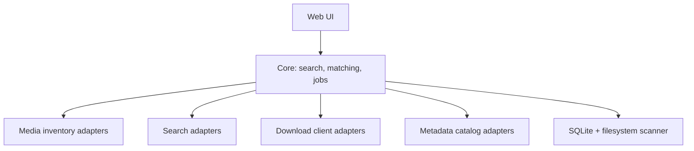

# Media Acquisition Manager — development starting document

**Version:** 0.1, 27 September 2026  
**Status:** draft technical specification; implementation has not started.  
**UI language:** to be decided during development; this document is in English.

## 1. Purpose and context

A standalone self-hosted service for a user who **chooses releases manually**. It shows existing library items alongside releases available from connected sources, lets the user send a selected release to a download client with the right destination, detects duplicates, and, when explicitly requested, carefully replaces an old file after verifying the new one.

Vasyl's initial setup involves Jellyfin, Toloka search, qBittorrent categories, custom collection/trilogy folders, and torrents that must continue seeding. **Architectural requirement:** these three products are merely the first adapters. The core must have no hard dependency on their APIs and must not assume that one torrent contains one movie. The service must work without reorganizing folders such as `Collection/Trilogy`.

### User value

1. Search for a movie and see existing copies and releases from all enabled sources on the same page, even when the movie is already in the library.
2. Compare verified properties of an existing copy with the release's **claimed** properties; the service does not decide what is “better” for the user.
3. Select a release, client, and destination in one workflow; schedule replacement of a **specific** old file or keep both.
4. Find byte-identical files, other versions of the same movie, and possible matches. Never silently delete anything.

**Note (2026-10-05, MAM-33):** the app now also proposes works the library doesn't have yet —
films, series, cartoons and documentaries picked from what it has, through an external catalog
(TMDb), each with every reason it is proposed and what the release sources carry of it (§3.5). It
proposes only: the user still chooses every release on the search page and sends it through the
Download dialog, and nothing is ever sent, queued or downloaded because of a recommendation
([ADR 0023](adr/0023-a-recommendation-only-proposes-explains-every-reason-and-never-sends.md)).

**Note (2026-10-05, MAM-34):** the owner can now tell the library which catalog film or show a work
is, picking from ranked suggestions, a pasted link or a catalog search. The app writes a film's
link into the media server as the item's registry ids alone — its TMDb id, and its IMDb id where the
server holds none — and nothing else: no identify, no refresh, no title, image, lock or people, and
files and folders are never touched, so the library still needs no reorganizing. A series' link stays
in the app (Vasyl, 2026-10-06): Jellyfin rewrites every season and episode of a series whenever it
saves the series
([ADR 0026](adr/0026-a-tmdb-id-set-by-hand-is-the-owners-word-kept-per-library-item-and-written-into-the-library-as-ids-only.md)).

**Note (2026-10-06, MAM-34):** written alone, the ids changed nothing visible in the media server,
which fetches an existing item's metadata only when it refreshes it. So the app now also asks the
media server to look up the item's missing metadata after writing its ids — Jellyfin's own "Search
for missing metadata", which fills what the item lacks and replaces nothing —, and writes an
episode's own IMDb id into a film item the server lists for it (Vasyl, 2026-10-06; ADR 0026's
section added that day). This replaces the note above's "no refresh" and its "a series' link stays
in the app": the same day Vasyl decided, finally, that a series is written like a film. The server's
save of a series gives all its seasons and episodes the series' age ratings, which that lookup
doesn't change back — recorded on The Penguins of Madagascar, whose 3 seasons and 149 episodes all
carried TV-Y7 afterwards —, and he accepted that: age ratings don't matter to him. The links set
before are brought up to date only on the owner's click.

**Note (2026-10-06, MAM-34, decided again):** assigning a catalog id to an item is now the media
server's own Identify — a search by that id, then Apply — so the server replaces the item's title,
overview and images in its library's language; this replaces the two notes above wherever they say
"ids alone", "no identify, no refresh", "looks up missing metadata" or put back. Removing a link
forgets it in the app only, and the server keeps what the Identify gave the item. Files and folders
are never touched, and a library that saves beside the media is refused. (Vasyl, 2026-10-06; [ADR
0026](adr/0026-a-tmdb-id-set-by-hand-is-the-owners-word-kept-per-library-item-and-written-into-the-library-as-ids-only.md)'s
section added that day.)

**Note (2026-10-07, MAM-35):** the Library page's cards, and the Search page's `In your library`
cards, now show each work's own picture: the image the media server holds for the item the card
stands for, read by each sync as a version tag and fetched by the app from the server, kept on the
app's disk and served by the app, so the browser never contacts the media server. It is never the
catalog's poster (§3.5); for an item identified through the catalog it is the image the server
itself took from the catalog then, which is the library's data. Nothing is written to the media
server for it. (Vasyl's decisions of 2026-10-06; [ADR
0027](adr/0027-a-library-works-poster-is-the-librarys-own-image-read-by-the-syncs-tag-and-served-by-the-app.md).)

## 2. First-version scope and default decisions

| Question | Working decision | Status |
| --- | --- | --- |
| Primary media type | Movies; the model should allow TV shows later | MVP proposal |
| Initial integrations | Jellyfin, Torznab through Jackett or a compatible gateway, qBittorrent | Proposal; verify Toloka with a live connection |
| Toloka | Connect it as a Torznab indexer through Jackett if that works; build a direct adapter only if there is a demonstrated need | Login and search functionality are unverified |
| Other servers/clients | Contracts for Plex/Emby, Transmission/SABnzbd, and others; implement after the first vertical slice | Extension |
| Search | Manual search that queries the existing library and enabled sources concurrently | Requirement |
| Destination | `DownloadDestination` in the core; map it to an existing qBittorrent category/path | Requirement |
| Removal | Only for an explicitly selected old file after verification of the new file; quarantine/reversal where possible | Requirement |
| File layout | Existing names and nested folders remain usable; no mandatory renaming | Requirement |
| Deployment | Docker Compose, SQLite for service state, local UI | Initial proposal |

**Note (2026-10-04, MAM-17 and MAM-32):** the primary media type is no longer movies alone. The
owner chose movies and TV in full (§7, question 3;
[ADR 0017](adr/0017-an-episode-is-a-work-known-by-registry-ids-and-the-library-alone-says-what-an-item-is.md)),
and release 0.2.0 imports Jellyfin's series and episodes beside its movies
([ADR 0019](adr/0019-a-series-is-a-work-its-episodes-point-at-its-seasons-come-from-their-numbers-and-an-episode-without-a-file-is-left-out.md)),
searches the release sources for TV releases, matches them to the library's series and sends them
to a download client
([ADR 0020](adr/0020-a-release-is-tv-by-its-category-matches-only-series-and-its-tracker-section-picks-the-destination-offered-first.md)).

**Approach:** implement one complete end-to-end workflow with one adapter of each type and stable contracts, then add more adapters. This gives the interfaces broad applicability without implementing every supported product at once.

**Search-source alternatives:** direct Torznab/Newznab; Prowlarr API; Jackett; a site-specific adapter. Using Jackett in the first slice is a practical hypothesis because its documentation lists Toloka and Torznab support. The core must not depend on Jackett.

## 3. Functional requirements

### 3.1 Search and matching

- Search by title, year, IMDb/TMDb ID, or identifier URL if a parser for that URL has been implemented.
- Local results: title, year, identifiers and their sources, location, size, video and audio tracks, subtitles, duration, resolution, codecs, bitrate, and HDR **only when those fields are actually available**. Show “unknown” rather than guessing.
- Source results: release title, indexer, size, format/quality/languages, seeder count when available, source-page link, and a way to retrieve a `.torrent`, magnet, or NZB. Quality inferred from a title is marked as claimed, not verified by inspecting the file.
- Show every matching release even when the movie is already present; allow filtering by source, language, size, and quality. A failure in one source does not hide results from other sources.
- Matching priority: reliable identifier first; then original/localized title plus year; then a candidate requiring manual review. A title or year match alone never authorizes replacement.
- Preserve the provenance of every identifier and title. Conflicting IDs or different editions/versions prevent automatic matching for removal.
- *Added 2026-10-05 (MAM-34):* an id the owner links by hand counts as a reliable identifier of the library work, keeps its own provenance (who set it and when) beside the media server's, and conflicts with a different id the server reports rather than replacing it. A TMDb or IMDb link or id can be pasted in the owner's link dialog; the search field doesn't read links yet.

### 3.2 “Download” action

1. The user chooses a **specific** release.
2. The UI shows clients compatible with its payload type and available destinations; the initial destination is configurable and can be changed before submission.
3. If the movie already exists, the UI offers `Keep existing` (default) or `Schedule replacement` with a choice of one or more **listed** files. Save that choice as explicit consent for this job.
4. Before submission, show a summary: source, release title, client, destination, selected old paths, and replacement conditions.
5. Create a job, send the release to the client once, and save a stable client-side job identifier after confirmation. Repeated clicks and retries must not create duplicate downloads.
6. If the client or source does not immediately return a reliable ID, correlate cautiously using the info hash/NZB ID and the client's job list; require manual linking if ambiguous.

**Destinations:** logical choices such as `Movies` and `Movies 4K` map to a specific client's configuration. For qBittorrent, check that the selected category exists and has the expected path. The UI must not override the category with a conflicting `savePath`. If the destination path cannot be determined, disable automatic replacement.

### 3.3 Duplicate detection

| Class | Evidence | UI behavior |
| --- | --- | --- |
| Same file / hardlink | Same device and inode in one filesystem namespace | Show links to the same data; **do not** count the occupied space twice |
| Byte-identical duplicate | Full cryptographic hash of both files | Show an exact match; estimate recoverable space with hardlinks/snapshots in mind |
| Another copy of the same work | Reliably matching TMDb/IMDb ID, different files | Show multiple versions; do not automatically call one redundant |
| Possible match | Title + year + duration/other clues when IDs are unavailable | Require manual confirmation; never use it for automatic removal |

Compute hashes lazily: shortlist candidates by size and metadata, then run a full hash only where useful. Key the hash cache by file identity, size, and modification time; invalidate it if any changes. Show `theatrical`, `director's cut`, `extended`, SDR/HDR, and similar labels as potential distinctions; do not treat different cuts as junk. The MVP report must not offer bulk automatic deletion.

**Note (2026-10-07, MAM-20):** the four classes are worked out on every read from what the app already holds and stored nowhere, and are independent of each other. *Same file*: names of one device and inode; removing one frees nothing. *Byte-identical*: files of two identities or more with one SHA-256 kept under each file's current identity, size and modification time; the recoverable space is every copy's size but the largest's, given only when every copy's file system is known not to share blocks between files (read from the mount table by device: ext4 and the like yes; btrfs, ZFS, XFS, network shares, overlays and anything unknown no) and every name of each copy is known, otherwise withheld with the reason (Vasyl's decision 3). *Another copy of the same work*: film and episode works of any library or integration sharing a registry id — an IMDb id whatever the kind, a TMDb or TVDB id within the work's kind (a show's TMDb id never matches a film's), an episode's series' id with its season and episode, an id or an episode-to-show link the owner set — holding two different copies; one library item with several files proves nothing, and none is called redundant. Conflicting ids stay in this class, flagged for manual review with the disagreement shown (Vasyl's decision 1), and labels such as `theatrical` or `director's cut`, read from file and version names by a word list in English and Ukrainian, and the measured dynamic range (SDR, HDR10, HLG, Dolby Vision) are shown as distinctions needing review (Vasyl's decision 2); a label decides no match. *Possible match*: works, or files no library reported, sharing a title with its own year where no id, kind or episode place says they differ — no distance, no year ± 1 —, with whether the measured durations agree; a file no library reported can only be this, by its file or folder name. No class reads a download client. The groups are read through `GET /api/library/duplicates`, paged and filtered by class on the server, and shown on the Duplicates page (MAM-21, §5). ([ADR 0028](adr/0028-duplicates-are-worked-out-on-every-read-in-four-classes-by-one-file-one-hash-one-registry-key-or-one-title-and-year-and-a-group-only-shows.md).)

### 3.4 Safe replacement

`Scheduled → Submitted → Downloading → Downloaded → Inspecting → Verified → Quarantined/Removed → Completed`

Additional states: `NeedsReview`, `Paused`, `Failed`, `Cancelled`. Persist transitions in SQLite so jobs survive restarts. Each step must be idempotent. Polling the client is sufficient for the MVP; webhooks, where available, can be added later.

Before removing any old file, verify **all** of the following:

1. The client job has completed without errors and the required file(s) are marked complete. For a multifile torrent, “torrent 100%” does not establish which file replaces the old one.
2. The specific new file is inside an allowed directory, is a regular completed media file of nonzero size, and `ffprobe` can open it and reports expected video/duration. This checks readability and stream composition, not every frame.
3. The new file is matched to **the same work and intended edition** using reliable metadata or manual confirmation. A Jellyfin ID can itself be wrong; conflicts or ambiguity lead to `NeedsReview`.
4. The media server can access the new file, and a scan reveals the **new path/version**, rather than merely the old movie card. If Jellyfin groups versions into one item, compare its media sources/paths instead of requiring a new item ID.
5. Immediately before touching the old file, recheck its canonical path, filesystem identity, size/modification time, and current match. Do not remove it if it changed, has the same path as the new file, lies outside an allowed root, or is not the file the user selected.
6. If the old file belongs to an active torrent, is still seeding, or shares its data through a hardlink, **do not modify the torrent or its seeding data**. Keep “remove a media-library copy” separate from “delete a client's files.” When uncertain, use `NeedsReview`.

For the MVP, **move the selected media-library copy into quarantine** instead of irreversibly deleting it, but only if the quarantine directory is on the same filesystem and the move is atomic. Otherwise, offer manual confirmation of deletion after the checks. Implement automatic quarantine cleanup separately, after defining retention and disk-space policies. Moving a hardlinked media copy leaves seeding data in place, but **does not** reclaim its file size until the last hardlink is gone; verify the actual mount paths.

Do not indiscriminately call Jellyfin's `DELETE /Items/{id}`: one item may represent multiple versions, and API permissions and semantics depend on the version. Removal must target a specific file inside authorized storage and be recorded in an audit trail. Never remove the old file because a timer expired or the download reached 100%.

### 3.5 Recommendations

*Added 2026-10-05 (MAM-33, release 0.2.1).*

- Suggest films, series, cartoons and documentaries the library doesn't have yet, from an external catalog connected as a metadata integration with the owner's own key (TMDb). Four lists by the catalog's genres: a documentary goes to Documentaries, else an animation (anime included) to Cartoons, else a film to Movies and a show to Series.
- Every suggestion shows each reason it is there: the missing parts of a collection the library holds part of; other works of a director or show creator with two or more works in the library; the catalog's recommendations, weighted by how many library works recommend the work; the aired seasons of a held series with no episode in the library (specials ignored, partly held seasons not flagged); what a release source has just published; and, for a list with few library works, the catalog's best-rated works that a release source carries. The order is a deterministic score of those reasons and of the rating weighed by its vote count, and the user may sort a list by rating, votes, date, title or the releases found instead. A rating floor that weighs the vote count applies to reasons of taste only; works not released yet are never suggested.
- Leave out works the library holds — by a reliable identifier, then by title and year, never by title alone (§3.1) —, works a file found by the folder scan names, works with a download job (any user's) that ended without failing — Downloaded, NeedsLinking or Cancelled —, and works the user marked "Not interested", which is kept per user. A work with a followed job (Created, Submitted, Downloading, Paused) stays listed and is marked Downloading; a failed job changes nothing.
- Check the release sources for each suggested work within each user's daily search budget (default 60, 0 for none), split between the user's enabled lists. The result is kept per work, apart from searches, shared by every user, and checked again after a day when found and after a week when not. Read each source's newest releases every few hours, one request per source.
- Never download automatically: a suggestion opens the search page for its work, and the user sends a release through the Download dialog (§3.2).
- Keep the catalog's data apart from the library: never written into the library's works, titles or identifiers, never shown on the Library page, refreshed after about 30 days. A work without a catalog id is looked up by its IMDb id or title and year, as a possible match used for recommendations only. Posters are served by the app; the browser never contacts the catalog.
- Each user switches the four lists on or off and sets the daily limit in their profile; every list is on until they change it.
- *Added 2026-10-05 (MAM-34):* a work the owner linked to a catalog film or show by hand is known by that link, seeds suggestions by it and is held by it, and is never looked up as a possible match. The catalog's data shows on the Library page only in the owner's link dialog.
- *Added 2026-10-07 (MAM-35):* the Library page's cards show a picture, and it is the library's own — the media server's image of the item, which for an item identified through the catalog is the image the server itself took from the catalog —, never the catalog's poster cache; the app never fetches a card's picture from the catalog. So "never shown on the Library page" above still holds for the catalog's data ([ADR 0027](adr/0027-a-library-works-poster-is-the-librarys-own-image-read-by-the-syncs-tag-and-served-by-the-app.md)).

See [ADR 0023](adr/0023-a-recommendation-only-proposes-explains-every-reason-and-never-sends.md), [ADR 0024](adr/0024-release-sources-are-asked-for-recommendations-within-a-per-user-budget.md) and [ADR 0025](adr/0025-the-catalog-is-kept-apart-from-the-library.md).

## 4. Architecture and data model

Application-level contracts (interfaces/ports) with explicit capabilities:

| Contract | Responsibility | First implementation |
| --- | --- | --- |
| `IMediaLibraryProvider` | List works, IDs, versions, and physical paths; read an item's poster image, resized by the library (MAM-35); request a scan; optional version capabilities; optionally identify an item as a catalog film or show and nothing else, on the kinds of item it names (`IMediaLibraryItemIdentifier`, MAM-34; Jellyfin: films and series) | Jellyfin |
| `IReleaseSearchProvider` | Search and normalize results; retrieve a payload separately for client submission | Torznab (Jackett) |
| `IDownloadClient` | Supported payload types, destination validation, submission, status, file list/status, job correlation | qBittorrent |
| `IFileInventory` | Scan only allowed roots; file identity, size/hash, ffprobe, quarantine | Local/container mount |
| `IMetadataResolver` | Authoritative IDs/titles and matching without silent guesses | TMDb (MAM-33), for recommendations only; a search matches against the library snapshot instead |
| `IMetadataCatalog` | Details, collections, people, genres, search, discovery and posters of works the library may not have; an episode of a show with its own IMDb id | TMDb (MAM-33); also the suggestions, searches, pasted ids and episodes of the owner's links (MAM-34) |

**Entity boundaries:** `MediaWork` (a movie or episode as a work), `MediaVersion` (edition/quality), `PhysicalFile` (file or filesystem link), `Release` (source listing), `DownloadJob` (client operation), `ReplacementJob` (intent concerning specific old files), `DestinationMapping`, `AuditEvent`. Do not assume `MediaWork == Jellyfin ItemId`, `Release == one file`, or `PhysicalFile == one physical copy of the bytes`.

Minimum `ReplacementJob` fields: internal ID, source/release reference or snapshot, payload type, client/destination IDs, client job ID/info hash, expected media work/edition, selected old files and their identities at selection time, explicit replacement-consent flag, new-file verification evidence, current state, error, timestamps, and audit trail. Never put tracker cookies or keys in plaintext logs or a URL exposed to the browser.

**Path mapping:** Jellyfin, qBittorrent, and the service container may see the same data at different paths. Explicit mount mappings are needed for correlation; ambiguous mappings block replacement. Prefer identical in-container mount paths across services. Scan only explicitly authorized roots; do not follow arbitrary symlinks outside them or trust paths returned by an indexer.

**Security:** authenticate the UI, keep client API access on a private network, supply secrets through environment variables/secret mounts, protect state-changing actions against CSRF, and grant minimal filesystem permissions. Read-only search needs read access, whereas managed replacement requires separately configured write access limited to authorized roots. Submitting a magnet or URL must not let an indexer trigger arbitrary backend HTTP requests to internal addresses; allowlist providers and validate destinations after redirects.

## 5. User interface

**Search:** query field plus `In your library` and `Available releases` sections. Library results show separate physical versions, not just a work title. Each release offers `Details`, `Open source`, and `Download`. Mark unknown quality properties as unknown. Comparison shows verified facts about the existing file beside the release's claimed properties.

**Download dialog:** release → client → logical destination → `Keep both` or a list of specific old copies to replace → final submission confirmation. If the match is not reliable, scheduling removal is disabled; downloading without replacement remains possible.

**Library:** search existing works, versions, and paths; indicate missing IDs. Allow manual linking once that workflow is implemented.

**Library (MAM-34):** the owner's `TMDb…` action on a work opens a dialog with the ids the media server reports for each of its items, up to five ranked catalog suggestions with their evidence (title, year, runtime against the measured duration, the library's genre, a linked neighbour) and the one confident suggestion marked, a field for a pasted TMDb or IMDb link or id, and a catalog search; above Save it says what the server will replace, and Save links the picked film or show and queues the server's Identify for each item — its title, overview and images become the catalog's, in the language of the item's library, in the background —, while Remove link forgets the link in the app only. A film item linked to a show is an episode of it, with optional season and episode numbers; named both, the server identifies it through The Open Movie Database by the episode's own IMDb id, else the link is kept in the app and says why. Each linked item shows whether the server identified it: "Waiting to identify" and "Identifying…" while it runs, then "Identified in Jellyfin", "Not identified yet" with Retry and the reason, "Jellyfin lost it" with Identify again, or "Kept in the app". A series' link is identified like a film's, in the background, and the server also refreshes its seasons and episodes. The TMDb links page repairs the links set before on the owner's click (Update Jellyfin: a count, one confirmation, progress) and lists, under Not identified, every link the server or the app refused or failed to identify, with its reason. A library that saves artwork or metadata next to the media is refused before any search, and files and folders are never touched. A film id the server gives an item after the owner linked it as an episode of a show is shown as a conflict, neither winning. A TMDb links page, opened from the missing-ID filter, reviews the works without an id one at a time by the keyboard, links every confident suggestion at once and lists the conflicting and unattached links. Linked ids show on the cards as "set by" the owner; members see them, without the owner's name, and can't link.

**Search (MAM-34):** a linked id matches like the server's own and is shown as "set by" the owner; a linked id beside a different server id of its scheme is flagged as a conflict.

**Library (MAM-35):** each work's card, on the Library page and among the Search page's `In your library` results, shows the work's own picture from the media server beside its title, in a box of a poster's shape at the size of a recommendation's: the picture of the item whose title the card shows, else of the next item that has one. A series' card shows the series' picture, the episodes of an opened season show none, and an episode of no series shows its own; no season has one. A picture that isn't a poster's shape, such as a frame of the video, is shown whole, not cropped, and a placeholder of the work's kind stands in while it loads, when the server has none and when it can't be fetched. The pictures appear after each library's next sync.

**Duplicates:** filters for `byte-identical`, `same work / other versions`, and `possible`; show the evidence behind each grouping. Display a numeric “potentially recoverable space” estimate only when the storage relationship is known well enough to calculate it.

**Duplicates (MAM-21):** a Duplicates page for every signed-in user, reached from the header and from the Library page, with a tab for each class — `All`, `Same file`, `Byte-identical`, `Same work`, `Possible` — and `Dismissed` last, filtered and paged on the server. Each group is headed by its first work — an episode by its series, with its season, episode and own title — and shows its class, what flags it for review, the evidence its class gives (the one file's device, inode and link count; the shared hash; the shared ids; the shared title and year and whether the durations agree), the space its files take, and the recoverable space only where it is calculated, else why not. Its files are listed as the Library lists versions, as rows or a comparison table, each named by the end of its path that tells it from the group's other files — its file name, else the nearest folder that differs —, with its folder, identity, hash, editions and the works that hold it. Only the installation owner confirms or dismisses a possible match, or undoes either (Vasyl's decisions of 2026-10-07); members see the decision and when, not who, with the buttons disabled and the reason. A decision is kept by the group's key, with an audit row: a confirmed match stays listed as confirmed, still a possible match, and never authorises removal; a dismissed one leaves every tab for `Dismissed`, a short row with `Undo` taking its place on the page, and can be undone there too; a possible match's key is made of its works and the files no library reports, so a group another work, or such a file, joins or leaves is asked about again, while another file or version of a work already in it changes nothing. Only possible matches are decided. The page removes, moves and renames nothing and has no bulk action. ([ADR 0029](adr/0029-a-possible-match-is-confirmed-or-dismissed-by-the-owner-alone-kept-by-its-groups-key-and-never-authorises-removal.md).)

**Jobs:** queue with current state, verification progress, and reason for any block; cancellation of pending removal, retrying verification, and manual resolution of ambiguity. Cancelling a job does not automatically delete its torrent from the client.

**Recommendations (MAM-33):** tabs for the user's enabled lists (Movies, Series, Cartoons, Documentaries); filters by reason, genre, decade, films or series, and available only. Each card shows the poster, the localized and original title, year, genres and rating, every reason as a chip, the release sources' status ("4 releases · up to 2160p · Ukr", "Not found (checked 3 days ago)" or "Not checked yet") and "Downloading" while a download of it runs. Actions: `Releases` opens the search page with the title and year, and a film's catalog (TMDb) id (a show's search takes none), then the Download dialog; `Not interested`, with undo. The owner can recompute the lists. The catalog's attribution is shown.

**Profile:** besides the user's own password and session, a Recommendations section with the four list switches and the daily search limit; every user changes their own.

## 6. Implementation phases and acceptance criteria

### Phase A — vertical slice without deletion

- Docker Compose, configuration, and health checks; local UI and SQLite migrations.
- Jellyfin inventory with pagination, IDs, files/versions, and state snapshots; ffprobe for local files.
- One Torznab provider with per-indexer configuration; test Toloka through Jackett using a real query.
- One qBittorrent adapter: connection test, category listing, magnet/.torrent submission, job/file monitoring; separate destination mapping.
- Search displays an existing copy beside releases; one click submits one job; existing files remain untouched in this phase.

**Acceptance:** a movie in a `Collection` folder can be found without moving it; Toloka/another indexer appears when its integration actually works; if Toloka fails, the UI displays an explicit source-specific error; retrying the same command does not create duplicate jobs; the category determines the expected destination without an overriding path.

### Phase B — scanner and duplicates

- Scan only configured roots; account for hardlinks, verify metadata, and hash lazily.
- Separate exact byte duplicates, other versions of the same work, and possible matches.

**Acceptance:** two hardlink names do not inflate occupied space; movies with similar names or years are not merged incorrectly; different cuts are not deleted; conflicting IDs require manual review.

### Phase C — safe replacement

- Persisted state machine, audit trail, restart recovery, checks in §3.4, quarantine where feasible.
- The user selects a specific old file and clearly sees `Keep both` or `Replace after verification`.

**Acceptance:** process restart, failed download, unknown new path, multifile torrent, failed ffprobe, wrong ID, unavailable Jellyfin, changed old file, active seeding, and invalid mount mapping **never cause silent deletion**. A successful unambiguous replacement leaves an audit trail and a way to restore the quarantined copy.

### Phase D — practical extensibility

- Add **one** second search or client adapter with different capabilities (for example, Newznab/SABnzbd or Transmission) without changing the core state machine; add Plex/Emby later if needed.
- Verify that logical destinations, error handling, and UI do not depend on qBittorrent-specific fields.

## 7. Open questions before coding

These are not assumptions about the current setup. Resolve the answers at the start of the next session:

1. What are the OS/filesystem and exact read/write mount paths for the service, Jellyfin, and client? Which directories are managed by active torrents? Can quarantine moves be atomic within one filesystem?
2. What qBittorrent categories and save paths already exist? Is automatic torrent management enabled? Are incomplete downloads stored separately?
3. Does the MVP need TV shows, seasons, anime, or documentaries, or are movies sufficient?
   *Answered 2026-10-04 (MAM-17): movies and TV in full, in every library — cartoon series and
   documentaries included; an episode is a work of its own (ADR 0017). Built in release 0.2.0
   (MAM-32): series, seasons and episodes in the library, and TV releases searched, matched and sent
   (ADR 0019, ADR 0020).*
4. What quarantine mode and retention period should be used? Is additional manual approval required before final deletion?
5. Which indexing route actually works with the Toloka account? Is an additional Jackett or Prowlarr container acceptable?
6. Are the old files to be replaced original seeding files, hardlinks, or independent copies?
7. How will the service be exposed: only through LAN/VPN or through a reverse proxy? How will users authenticate?

## 8. Starting prompt for the next Codex session

> I am building a self-hosted Media Acquisition Manager. Read the attached `Media_Acquisition_Manager_Spec.md` in full and treat it as the initial technical specification. First inspect my existing repository if I provide one, and resolve the §7 questions necessary for Phase A. Make concise architectural decisions and implement Phase A as a vertical slice in my repository, or create a project if there is no repository. Do not enable any file deletion until Phase C has been implemented and verified. Distinguish integrations actually tested against live systems from unverified hypotheses. Preserve manual release selection and keep the core independent of Jellyfin, Toloka, and qBittorrent.

## 9. Implementation documentation

- [Jellyfin: Movies, including multiple versions](https://jellyfin.org/docs/general/server/media/movies/)
- [Jellyfin: Metadata provider identifiers](https://jellyfin.org/docs/general/server/metadata/identifiers/)
- [Jellyfin: OpenAPI](https://api.jellyfin.org/)
- [Jackett: API / Torznab](https://github.com/Jackett/Jackett/wiki/Jackett-API) and [supported trackers](https://github.com/Jackett/Jackett)
- [qBittorrent: WebUI API](https://github.com/qbittorrent/qBittorrent/wiki/WebUI-API-%28qBittorrent-4.1%29) — check the installed client's version before using specific endpoints.
- [FFmpeg: ffprobe](https://ffmpeg.org/ffprobe.html)

**Accuracy note:** this document records requirements agreed in the conversation and a proposed design. Toloka appearing in Jackett's supported-tracker list does not establish that login and search work in this specific installation. Phase A must verify that in practice.
